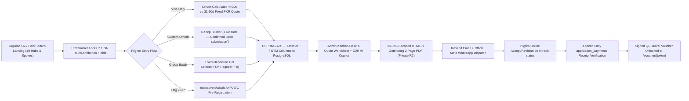
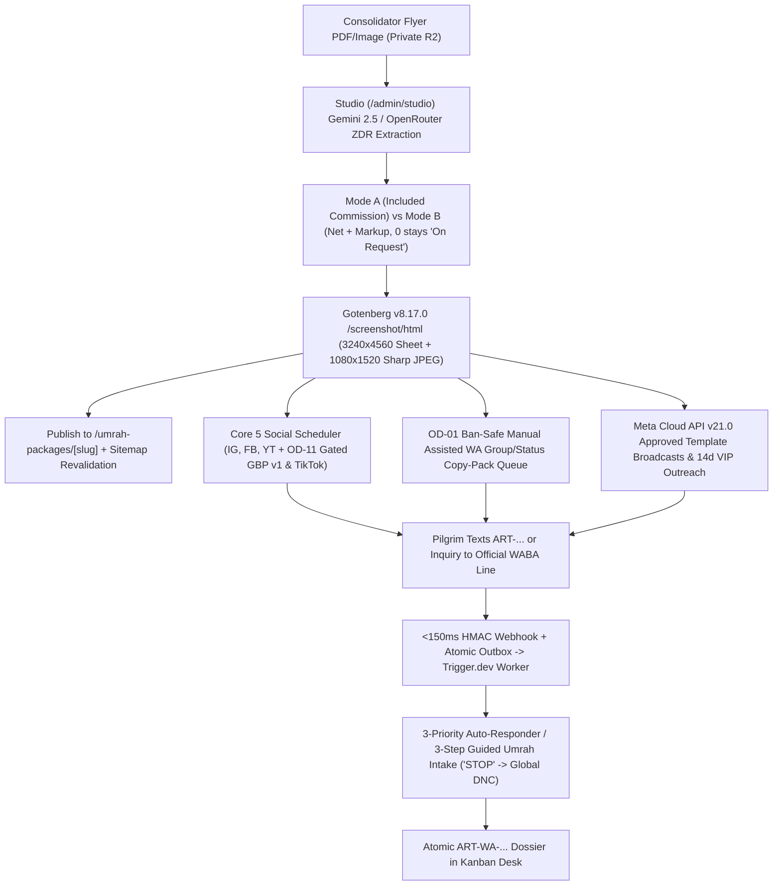

# Al Ramlah Travels (`سفريات الرملة`) — Master Platform Brief & Verified Architecture Handbook

> **Document Type:** Production Architecture Handbook, Engineering Specification & Verified Platform Reference  
> **Classification:** Authoritative Codebase Ground Truth (Synchronized Post-Gate A `Spec 0024` & Gate B `Spec 0025`)  
> **Platform Version:** `1.1.0` (Gate A & Gate B Certified — Next.js `16.4.6` Standalone · Node.js `22+` LTS)  
> **Canonical Headquarters:** Office No. 38, Street 1, Sector C, Askari 10, Airport Road, Lahore Cantt, Pakistan (`+92 327 4029701` · `+92 319 0462638` · `https://alramlahtravels.com`)  
> **Primary Capabilities:** Custom & Group Umrah Commerce, Hajj 2027 Indicative Pre-Registration, Multimodal Consolidator Flyer Studio, Gotenberg `v8.17.0` 4K Poster & Luxury PDF Engine, Official Meta WhatsApp Cloud API `v21.0` CRM + Ban-Safe Manual Assisted WA Queue, Core 5 Social Scheduler, 19-Route Hub-and-Spoke SEO/GEO Architecture, and 7-Column First-Touch Attribution  

---

## 1. Executive Overview & Verified Platform Metrics

**Al Ramlah Travels** (`سفريات الرملة`) is a full-stack pilgrimage commerce, quotation, and omnichannel CRM platform built for a Lahore Cantt Haramain specialist agency serving families across Pakistan and the overseas Pakistani diaspora.

Every metric in this handbook reflects empirically verified codebase ground truth on `audit/production-hardening` (see [`docs/audit/PRODUCTION_READINESS.md`](audit/PRODUCTION_READINESS.md), [`docs/audit/SEO_READINESS.md`](audit/SEO_READINESS.md), and [`docs/audit/FINAL_REPORT.md`](audit/FINAL_REPORT.md)):

| Architectural Dimension | Verified Codebase Count & Specification |
| :--- | :--- |
| **Runtime & Framework** | Node.js `>=22.0.0` LTS · TypeScript `5` · Next.js `16.4.6` (App Router, `output: "standalone"`, `authInterrupts: true`) · React `19.2.8` |
| **PostgreSQL 16 Schema (`db/schema/*`)** | **`48` tables** · **`47` `pgEnum`s** · **`17` SQL `CHECK` constraints** · **`1` append-only trigger** (`trg_audit_logs_immutable`) across `10` schema modules (`4` forward SQL migrations `0000`–`0003`) |
| **Database Driver (`db/index.ts`)** | Dual-driver Drizzle ORM (`^0.45.4`): `neon-http` + ACID transactional `Pool` (`withTransaction(fn)`) via `@neondatabase/serverless` in prod and `pg.Pool` (`^8.16.0`) in local Docker & CI |
| **Public Storefront & SEO/GEO (`Spec 0025`)** | **`19` indexable route patterns** (`97.44%` RSC) + `app/robots.ts` + `app/sitemap.ts` (`revalidate = 3600`) + `public/llms.txt` + `1200×630` `next/og` PNG cards + signed QR `/voucher/[token]` (`403` `forbidden()` when unpaid/unapproved) — **`90.2 / 100` (Grade `A`)** |
| **Admin Portal (`app/admin/`)** | `6` primary operational hubs (`/admin`, `/admin/studio`, `/admin/campaigns`, `/admin/desk`, `/admin/catalog`, `/admin/settings` incl. `?tab=health`) + Dossier & A4 Voucher views + `15` legacy `redirect()`/`308` routes (`40` `page.tsx` files total, `0` client `page.tsx` routes) |
| **API Route Handlers (`app/api/**/route.ts`)** | **`9` handlers**: Better Auth (`/api/auth/[...all]`), Health (`/api/health`), Private R2 Media Proxy (`/api/media/[...key]`), Core 5 OAuth (`3` routes), R2 Presign (`/api/uploads/presign`), Dev Upload (`/api/uploads/local`, `404` in prod), and Meta WhatsApp Webhook (`/api/webhooks/whatsapp`) |
| **Server Actions (`app/actions/*.ts`)** | **`12` `"use server"` modules** exporting **`194` functions**: `66` `requireSuperAdmin()`, `117` `requireAdmin()`, `10` rate-limited public actions, `1` stateless diagnostic helper (`0` unauthenticated admin actions) |
| **Trigger.dev Cloud `v4` (`trigger/`)** | **`8` `schemaTask` durable workers** + **`5` PKT cron schedules** across **`9` bounded concurrency queues** (fail-closed in production when `TRIGGER_SECRET_KEY` is absent) |
| **Automated Verification Suite (`tests/`)** | **`731 / 731` unit, domain property (`13,825` PRNG cases), SEO & real-PG integration tests** (`115` files, `91.37%` security/domain V8 line coverage) + **`26 / 26` Playwright E2E specs (`J1`–`J23`)** with `0` `@axe-core/playwright` WCAG 2.2 AA violations |

---

## 2. Two Core Operational Flywheels

### 2.1 Flywheel A — B2C Pilgrim Discovery, Custom Journey Planning & Fulfilment



### 2.2 Flywheel B — B2B Wholesale Flyer Wrapping, Core 5 Social & WhatsApp CRM



---

## 3. Technology Stack & Production Dependencies

Locked in [`package.json`](../package.json) (`0` critical/high production CVEs verified via `npm audit --omit=dev --audit-level=high`):

| Layer | Packages & Versions | Production Role |
| :--- | :--- | :--- |
| **Core Web** | `next@16.4.6`, `react@19.2.8`, `react-dom@19.2.8`, `typescript@^5` | App Router RSC runtime, async `params`/`searchParams`, `proxy.ts` CSP/HSTS/`X-Robots-Tag`, standalone Docker/Vercel build, and `next/og` `1200×630` OpenGraph cards. |
| **Database & ORM** | `drizzle-orm@^0.45.4`, `@neondatabase/serverless@^1.2.0`, `pg@^8.16.0`, `drizzle-kit@^0.31.11` | Type-safe SQL queries, `SELECT ... FOR UPDATE` row-level seat & outreach locks, forward SQL migrations (`db/migrate.ts`), and encrypted logical backups (`scripts/db-backup.ts`). |
| **Auth & Security** | `better-auth@^1.7.10`, `zod@^4.6.7`, `pino@^9.7.0` | Credential auth (`disableSignUp: true`), live DB `isActive` session wipe, `v2:` HKDF-AES-256-GCM keyring vault (`lib/security/vault.ts`), SSRF guard, context-aware HTML escaping, and PII-redacted structured logs. |
| **UI & Design System** | `@base-ui/react@^1.8.0`, `@shadcn/react@^0.3.1`, `tailwindcss@^4`, `@dnd-kit/*`, `cmdk@^1.1.1`, `recharts@3.8.0`, `lucide-react@^1.48.0` | Single locked Haramain light theme (`@custom-variant dark (&:where(.never-dark *));`), `@base-ui/react` `render` prop composition (`0` `asChild`), WCAG 2.2 AA contrast (`--gold-text` `#7A5C1E` `6.73:1`). |
| **AI, Media, PDF & Email** | `ai@^7.0.159`, `@ai-sdk/google@^4.0.109`, `@openrouter/ai-sdk-provider@^3.1.0`, `@aws-sdk/client-s3@^3.1161.0`, `sharp@^0.35.5`, `resend@^6.1.0`, `@react-email/components@^1.0.8` | Multimodal flyer extraction, PII-scrubbed ZDR Quoting Copilot (`data_collection: "deny"`), public/private R2 storage, Gotenberg `v8.17.0` HTML-to-PDF/PNG rendering, and Resend transactional mail (`OD-02`). |
| **Durable Jobs** | `@trigger.dev/sdk@4.8.3`, `@trigger.dev/react-hooks@4.8.3` | Durable background execution, `AbortTaskRunError` retry classification, `9` bounded queues, `5` PKT cron schedules, and realtime progress telemetry (`useRealtimeRun`). |
| **QA & E2E Tooling** | `vitest@^5.1.0`, `@playwright/test@^1.65.1`, `@axe-core/playwright@^4.14.0` | Hermetic unit/SEO/integration test runner (`.env.audit` + `HermeticNetworkError`), 5 local HTTP contract fakes, and 26 full-stack Chromium + Axe WCAG 2.2 AA specs. |

*(Note per **`OD-01`**: `@whiskeysockets/baileys` was removed from `package.json` in Phase A to eliminate cloud WebSocket split-brain and SIM-ban risk. All automated WhatsApp messaging uses official Meta WhatsApp Cloud API `v21.0`, while WhatsApp Group & Status campaigns use the Ban-Safe Manual Assisted Copy-Pack & `wa.me` Queue.)*

---

## 4. Governing Owner Decisions (`OD-01`–`OD-11`) & 9 Haramain Invariants

### 4.1 Verified Owner Architectural Decisions (`docs/audit/OWNER_DECISIONS.md`)

1. **`OD-01` (WhatsApp Topology)**: Sunset server-side Baileys sockets; run official Meta WhatsApp Cloud API `v21.0` for webhooks, inbox replies, templates, and broadcasts, paired with the Ban-Safe Manual Assisted Copy-Pack Queue for WhatsApp Groups & Statuses.
2. **`OD-02` (Transactional Email)**: Resend (`lib/security/mailer.ts`) delivers escaped HTML Quotation PDFs and Better Auth password-reset emails (`EMAIL_FROM`), backed by `super_admin` staff password reset (`mustChangePassword = true`).
3. **`OD-03` (Offline Payment Ledger)**: Append-only `application_payments` ledger (`ON DELETE RESTRICT`, `amount_pkr > 0`) with private R2 bank-receipt proof uploads (`receipts/`) and deterministic `unpaid | deposit_paid | partially_paid | paid_in_full` status calculation (no online card checkout in v1).
4. **`OD-04` (Online Quote Acceptance & Signed Voucher)**: Pilgrims accept quotes or request revisions online via `/#track-status` (`respondToApplicationQuoteAction`); signed QR `/voucher/[token]` returns HTTP `403` (`forbidden()`) until status is `approved` AND verified payment is `deposit_paid` or `paid_in_full`.
5. **`OD-05` (Status Tracker Anti-Enumeration)**: 48-bit CSPRNG `ART-...` references + constant-time `>=9`-digit E.164 phone verification + dual IP (`5/15m`) and per-reference (`12/15m`) PostgreSQL rate limits + wholesale/admin-note-redacted DTOs.
6. **`OD-06` (Storage Partition, Retention & AI ZDR)**: Public R2 prefixes (`posters/`, `cms/`, `hotels/`) vs private R2 prefixes (`passports/`, `whatsapp-media/`, `quotes/`, `receipts/`, `flyers/`) gated behind authenticated/HMAC `/api/media/[...key]`; nightly PKT cron (`30 3 * * *`) purges expired PII (60d passports, 24m unbooked leads, 90d webhook payloads, with 6y FBR tax carve-out); AI prompts scrub pilgrim PII and send `provider: { data_collection: "deny" }`.
7. **`OD-07` (Hosting & Neon-Safe Crons)**: Vercel Pro / Docker `node:22-alpine` standalone + Neon Launch (7-day PITR) + Trigger.dev Cloud + `$0/mo` Oracle Cloud PAYG Always Free ARM64 Gotenberg `v8.17.0`; `66` sensitive actions locked to `requireSuperAdmin()`; daytime PKT crons allow Neon overnight scale-to-zero.
8. **`OD-08` (Typography & Prayer Pill)**: English primary UI with `100%` of sacred Arabic script wrapped in `<ArabicText lang="ar" dir="rtl">`, Noto Naskh Arabic & Nastaliq Urdu in Gotenberg PDFs, and an offline Umm al-Qura Haramain prayer pill (`CLS = 0`).
9. **`OD-09` (Pricing & Booking Rules)**: Masar `<=30d` brackets multiplied by live `sarToPkrRate` (`09a`); Mode B `0`-priced tiers stay `0` / `"On Request"` (`09b`); mandatory KSA Arrival/Departure dates on `Visa Only` (`09c`); `infantPricePkr > 0` & group `bookedSeats` deducted atomically via `SELECT ... FOR UPDATE` on `approved` (`09d`); `hajj_packages` rendered strictly as Indicative 2027 Pre-Registration with `HAJJ_2027_REGULATORY_DISCLAIMER` (`09e`).
10. **`OD-10` (Canonical Askari 10 NAP, Licenses & IBAN Gate)**: Single SSoT in `lib/company-info.ts` (`Office No. 38, Street 1, Sector C, Askari 10, Airport Road, Lahore Cantt, Pakistan`, `+92 327 4029701` · `+92 319 0462638`); `iban_verified = false` suppresses unverified bank IBANs; DTS/MoRA/IATA/NTN fields render only when populated in `agency_settings`; fabricated reviews and `"15,000+"` claims removed.
11. **`OD-11` (Core 5 Social Compliance)**: Live Instagram, Facebook Pages, and YouTube publishing; Google Business Profile migrated to v1 APIs (`GBP_API_APPROVED`) and TikTok Content Posting v2 (`TIKTOK_DIRECT_POST_APPROVED`) gated behind explicit vendor approval flags; social analytics report honest `status: "unavailable"` when platform metrics are absent (`0` SHA-256 mocks).

### 4.2 The 9 Non-Negotiable Haramain Business Invariants (`lib/domain/*`)

Proven across `13,825` deterministic PRNG property test cases (`96.41%` mean V8 line coverage across `lib/domain/*`):

1. **Server-Calculated Visa Duration Tier**: `short_term` (`1–30` inclusive KSA days) vs `long_term` (`31–90` days) is always computed server-side from mandatory KSA Arrival & Departure dates; no manual tier selector exists.
2. **Volatile Services Transparency Lock**: Only standalone `Visa Only` and fixed `groupPackages` (`price > 0`) display fixed PKR prices publicly; Flights, Hotels, Transport, and Ziyarat always display `"Live Rate — Confirmed upon submission"`, and `100%` of wholesale `*Sar` columns are stripped from public DTOs (`lib/seo/public-queries.ts`).
3. **Makkah No-Airport Rule**: Makkah-first itineraries lock Entry Airport to Jeddah (`JED`) with ground/rail transfer to Makkah; Madinah-first preserves `MED → JED`.
4. **Passenger Bed, Seat & Passport Accounting**: `totalPassportCount = adults + children + infants`; `bedAndSeatCount = adults + children` (`infants < 2 yrs` take `0` hotel beds and `0` vehicle seats while requiring a visa and `infantPricePkr`).
5. **Private Room Auto-Splitter**: `calculatePrivateRoomSplits()` allocates `Quad (4)`, `Triple (3)`, and `Double (2)` rooms strictly within each hotel's `allowedRoomTypes`.
6. **Vehicle Fleet Capacity Bands**: `1–3` Sedan, `4–6` SUV, `7–12` Van/Minibus, `13+` Coach Bus; Haramain High-Speed Train is `shared_only` intercity rail and never selectable for local Ziyarat tours.
7. **Seamless Stay Date Chaining**: `checkOut[i] === checkIn[i+1]` and `ksaDepartureDate === lastStay.checkOutDate` enforced in UTC on both client and server.
8. **Wholesale Margin Isolation & `0`-Tier Preservation**: Mode A (`included_in_flyer`) vs Mode B (`net_plus_markup`) preserves `0` unpriced tiers as `"On Request"` (`disabled` in booking modal, excluded from JSON-LD `AggregateOffer`), and redacts wholesale net cost from `staff` roles.
9. **14-Day PKT Outreach Cooldown & Global DNC Preemption**: Inbound `"STOP"`/`"UNSUBSCRIBE"`/`"RUKO"` sets permanent `do_not_contact` across `whatsapp_conversations` and `outreach_contacts` **before** any inbound-reply cooldown unlock; transactional `SELECT ... FOR UPDATE` prevents concurrent 14-day VIP outreach double-sends.

---

## 5. Complete Public Route, SEO/GEO & Admin Hub Architecture

### 5.1 Public Hub-and-Spoke Routes (`19` Indexable Patterns + Discovery Endpoints)

All indexable public routes enforce `50–60` char `<title>`, `150–160` char `<meta name="description">`, query-free `https://alramlahtravels.com` self-canonicals, `1200×630` PNG OpenGraph cards, `@base-ui/react` `<PublicBreadcrumbs />` (on all 18 subpages), XSS-escaped JSON-LD, and `93.36%`–`97.28%` 4-gram Jaccard uniqueness across sibling spokes:

- **Commercial Hubs & City Gateways**: `/`, `/umrah-packages`, `/umrah-packages/[slug]` (+ per-slug `opengraph-image.tsx`), `/umrah-packages/from-lahore`, `/umrah-packages/from-karachi`, `/umrah-packages/from-islamabad` (`dynamicParams = false`)
- **Pilgrimage Guides & Haramain Directories**: `/hajj-2027`, `/umrah-visa`, `/hotels/makkah`, `/hotels/madinah`, `/ziyarat`, `/ziyarat/makkah`, `/ziyarat/madinah` (`dynamicParams = false`)
- **Entity Trust & Legal Spokes**: `/about`, `/contact`, `/faq` (20 Q&As across 6 AI fan-out dimensions), `/privacy` (discloses `alramlah_attribution_v1` in §3), `/terms`, `/refund-policy`
- **Discovery & Non-Indexed Capability Routes**: `/robots.txt` (`app/robots.ts`), `/sitemap.xml` (`app/sitemap.ts`), `/llms.txt` (`public/llms.txt`), `/voucher/[token]` (`X-Robots-Tag: noindex`, HTTP `403` when locked)

### 5.2 First-Touch Lead Attribution Pipeline (`<UtmTracker />` → PostgreSQL → Admin & CSV)

- `<Suspense><UtmTracker /></Suspense>` in `app/(public)/layout.tsx` captures first-touch `utm_source`, `utm_medium`, `utm_campaign`, `utm_content`, `utm_term`, `landing_page`, and external `http_referrer` into `sessionStorage["alramlah_attribution_v1"]` without breaking static/ISR rendering.
- All 5 public submission flows (`ReviewAndSubmitStep`, `LeadCaptureDialog`, `GroupBookingModal`, `HajjInquirySection`, `ContactSection`) attach sanitized attribution to Server Actions, persisting all 7 columns in `applications` and `contact_messages`, surfacing channel badges (`Paid Search`, `Organic Search`, `AI Search`, `Social`, `Referral`) in Admin Dossiers & Messages, and exporting formula-safe cells (`sanitizeCsvCellInternal`) in Admin CSV downloads.

### 5.3 4-Hub Admin Information Architecture (`app/admin/(dashboard)/`)

1. **Overview (`/admin`)**: Bounded SQL executive KPIs (`LATERAL` latest quote), PKT analytics, group occupancy gauges, and 24h SLA alerts.
2. **Studio (`/admin/studio`)**: Consolidator supplier management, Mode A/B flyer extraction, Gotenberg multi-sheet `3240×4560` posters & `1080×1520` Sharp JPEGs, and 1-click catalog publishing with `revalidatePublicSeoPaths()`.
3. **Campaigns (`/admin/campaigns`)**: Visual PKT Core 5 Social Calendar & Composer (`?tab=social`), `OD-01` Ban-Safe Manual Assisted WA Group/Status Queue (`?tab=whatsapp`), Meta CSV Template Broadcasts, and 14-Day VIP Outreach CRM (`?tab=outreach`).
4. **Desk (`/admin/desk`)**: 6-column `@dnd-kit` Applications Kanban (`?tab=pipeline`), Live 4s Read-Only Meta WhatsApp Cloud Inbox (`?tab=inbox`), Website Contact Inquiries (`?tab=web_messages`), Application Dossier + Quote Worksheet + `application_payments` ledger (`/admin/applications/[id]`), Printable A4 Voucher (`/admin/applications/[id]/voucher`), and global `Cmd+K` lookup.
5. **Catalog (`/admin/catalog`)**: FK-safe CRUD (`23503` soft-archive protection) across Hotels, Visa Rates, Vehicles & Transport Sectors, Ziyarat Places, Airlines & Departure Cities, Hajj 2027 Packages, Suppliers, and Website CMS (`?tab=messages`, Slides, Testimonials, FAQs).
6. **Settings (`/admin/settings`)**: `super_admin`-guarded Core 5 OAuth Connections, Meta WABA Setup, Gotenberg Health Ping, Agency Licenses/IBAN (`iban_verified`), Staff RBAC & Password Reset (`?tab=staff`), and Live Production Readiness Diagnostics (`?tab=health`).

---

## 6. Database Schema Summary (`48` Tables & `47` Enums Across `10` Modules)

1. **`db/schema/auth.ts` (`4` tables, `1` enum)**: `user` (`role`: `super_admin | staff`, `isActive`, `mustChangePassword`), `session`, `account`, `verification`.
2. **`db/schema/audit-logs.ts` (`3` tables)**: `audit_logs` (protected by `trg_audit_logs_immutable`), `rate_limit` (Better Auth), `rate_limit_buckets` (atomic PostgreSQL sliding/fixed window buckets).
3. **`db/schema/settings.ts` (`1` table)**: `agency_settings` (singleton `chk_agency_settings_singleton`, Askari 10 NAP, `sarToPkrRate`, `dtsLicense`, `moraLicense`, `iataCode`, `ntnNumber`, `officialIban`, `ibanVerified`).
4. **`db/schema/catalog.ts` (`8` tables, `9` enums)**: `visa_rates`, `airlines`, `departure_cities`, `hotels`, `vehicles`, `transport_sectors`, `transport_rates`, `ziyarat_places`.
5. **`db/schema/packages.ts` (`3` tables, `2` enums)**: `group_packages` (with unique SEO `slug` & `infantPricePkr`), `group_departures` (`booked_seats <= total_seats` `CHECK`), `hajj_packages` (`OD-09e` Maktab tiers).
6. **`db/schema/applications.ts` (`5` tables, `10` enums)**: `applications` (CSPRNG `reference_number`, `chk_applications_traveller_invariants`, `voucher_token`, `sla_escalated_at`, `payload_redacted_at`, + `7` UTM attribution columns), `application_hotel_stays`, `application_transport_segments`, `application_quotes` (`UNIQUE(application_id, version)`), `application_payments` (`OD-03` append-only receipt ledger + `payment_method` enum).
7. **`db/schema/cms.ts` (`4` tables, `2` enums)**: `hero_slides`, `testimonials`, `faqs`, `contact_messages` (+ `7` UTM attribution columns).
8. **`db/schema/suppliers-and-marketing.ts` (`8` tables, `8` enums)**: `suppliers`, `supplier_flyers`, `supplier_flyer_packages`, `post_assets`, `marketing_channels` (`idx_marketing_channels_external_handle`), `daily_post_distributions`, `outreach_contacts`, `outreach_logs`.
9. **`db/schema/whatsapp-crm.ts` (`9` tables, `8` enums)**: `whatsapp_accounts`, `whatsapp_conversations`, `whatsapp_messages` (`chk_wa_messages_lowercase_type`), `whatsapp_templates`, `whatsapp_broadcasts`, `whatsapp_broadcast_recipients`, `whatsapp_quick_replies`, `whatsapp_auto_reply_rules`, `whatsapp_linked_device_sessions` (legacy schema retained for historical metadata; active queue uses `OD-01` manual copy-packs).
10. **`db/schema/social-scheduler.ts` (`3` tables, `7` enums)**: `social_integrations`, `scheduled_posts`, `scheduled_post_targets`.

---

## 7. Durable Background Workers & PKT Cron Schedules (`trigger/`)

### 7.1 `8` Schema-Validated Durable Tasks (`schemaTask`)
1. `extract-packages.task.ts` — Multimodal Gemini 2.5 / OpenRouter ZDR supplier flyer extraction.
2. `render-gotenberg-asset.task.ts` — Gotenberg `v8.17.0` 3-page Quotation PDF & `3240×4560` / `1080×1520` poster rendering (`gotenbergQueue`, concurrency `2`).
3. `quoting-copilot.task.ts` — Read-only catalog/flyer lookup + deterministic server-calculated quote worksheet & bilingual draft generation.
4. `process-inbound-whatsapp.task.ts` — Decoupled async Meta webhook processor (`<150ms` HTTP ACK, global `"STOP"` DNC check, 3-Priority Auto-Responder, 3-Step Guided Umrah Intake).
5. `mirror-whatsapp-media.task.ts` — SSRF-guarded inbound WhatsApp media streaming to private Cloudflare R2 (`whatsapp-media/`).
6. `send-whatsapp-broadcast.task.ts` — Paced Meta Cloud API template broadcast fan-out (`whatsappBroadcastQueue`, concurrency `1`).
7. `send-whatsapp-group-campaign.task.ts` — `OD-01` Ban-Safe Manual Assisted WA Group/Status Copy-Pack & `wa.me` queue preparation.
8. `publish-social-post.task.ts` — Atomic `publishing`-locked Core 5 social publishing, IG Reel container polling, and idempotent `ART-...` first-comment auto-plug (`socialPublishQueue`, concurrency `5`).

### 7.2 `5` Neon-Safe `Asia/Karachi` PKT Cron Schedules
1. `sweep-due-social-posts` — Dispatches due `scheduled_posts` during active PKT operating windows.
2. `sweep-due-whatsapp-broadcasts` — Dispatches due `whatsapp_broadcasts` and recovers `retry_pending` webhook outbox items.
3. `sla-overdue-quote-monitor` — Stamps `applications.sla_escalated_at` on `pending_quote` leads older than `slaOverdueHours` (`24h` default) without mutating pilgrim `specialRequests`.
4. `proactive-social-token-refresh` — Every 6 hours, renews expiring Meta/Google/TikTok OAuth tokens while preserving Facebook/Instagram Page access tokens.
5. `pii-and-media-retention-purge` (`30 3 * * *` PKT) — Enforces `OD-06` 60-day passport/WA media purge, 24-month unbooked lead purge, and 90-day raw webhook redaction while preserving 6-year FBR financial records.

---

## 8. Operations, Verification & Production Cutover

All developer commands run from `web/` (see [`.env.example`](../.env.example), [`README.md`](../README.md), [`PRODUCTION_READINESS.md`](audit/PRODUCTION_READINESS.md), [`SEO_READINESS.md`](audit/SEO_READINESS.md), and [`docs/audit/runbooks/RB-01..10.md`](audit/runbooks/)):

```bash
npm audit --omit=dev --audit-level=high
npx next typegen && npm run typecheck && npx tsc --noEmit -p tests/e2e/tsconfig.json
npm run lint
npm test
npm run build
npm run test:e2e
```

---

> **Certified Architecture Reference** — Synchronized against `Spec 0024` (Gate A) & `Spec 0025` (Gate B) on `audit/production-hardening`.
