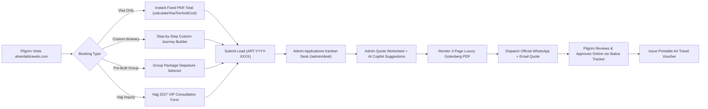
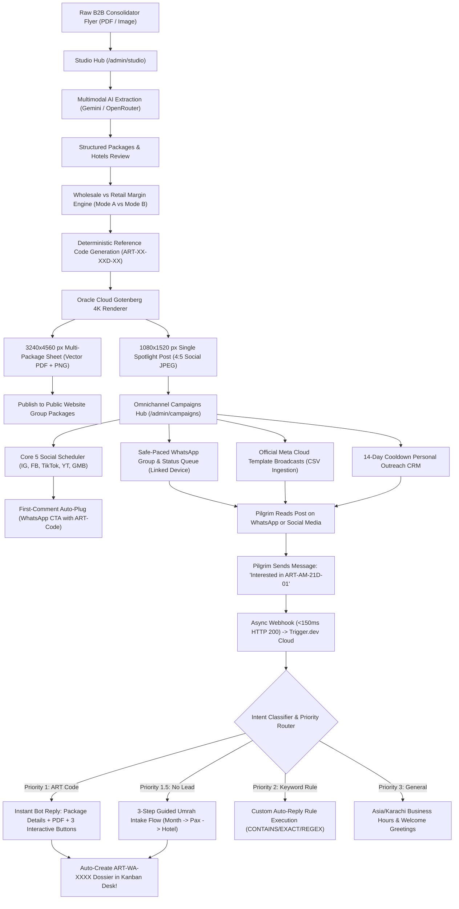
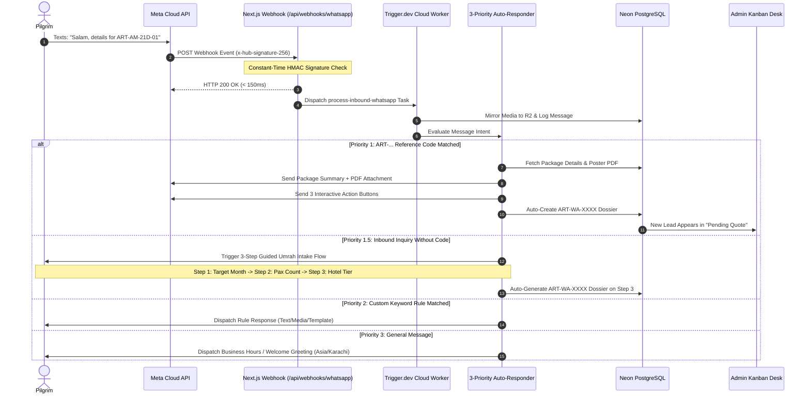
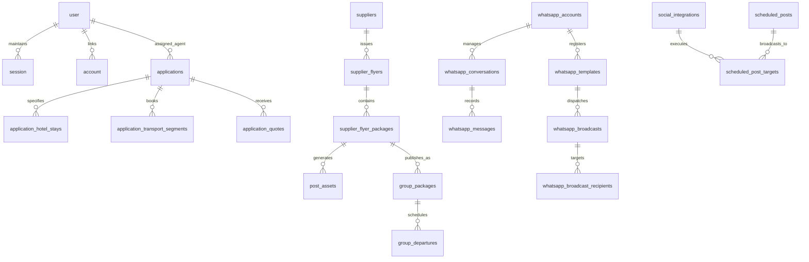

# Al Ramlah Travels (`سفريات الرملة`) — Master Platform Brief & Architecture Handbook

> **Document Type:** Production Architecture Handbook, Engineering Specification & Platform Reference  
> **Classification:** Authoritative Technical Brief (Zero-Omission Reference)  
> **Platform Version:** 1.0.0 (Production Release — Next.js 16.3.4 Standalone)  
> **Agency Base:** Al Ramlah Travels, Askari 10, Lahore Cantt, Punjab, Pakistan  
> **Primary Domains:** Hajj, Umrah & Sacred Ziyarat Pilgrimage Services, B2B Consolidator Wholesale Flyer Wrapping, Omnichannel Social Campaigns, Dual-Engine WhatsApp CRM & Durable Background Task Orchestration  
> **Target Audience:** Core Software Engineers, System Architects, DevOps Specialists, Product Managers, Founders & Strategic Stakeholders  

---

## Table of Contents

1. [Executive Overview & Product Vision](#1-executive-overview--product-vision)
   - [1.1 Platform Essence & Brand Heritage](#11-platform-essence--brand-heritage)
   - [1.2 The Two Autonomous Flywheels](#12-the-two-autonomous-flywheels)
   - [1.3 Business Transformation & Industry Impact](#13-business-transformation--industry-impact)
2. [Technology Stack & Architectural Pillars](#2-technology-stack--architectural-pillars)
   - [2.1 Comprehensive Dependency & Technology Matrix](#21-comprehensive-dependency--technology-matrix)
   - [2.2 Core Architectural Invariants & Decisions](#22-core-architectural-invariants--decisions)
3. [Reference Repositories (`services/`) & Custom Workspace Assets](#3-reference-repositories-services--custom-workspace-assets)
   - [3.1 The 10 Cloned Upstream Reference Repositories](#31-the-10-cloned-upstream-reference-repositories)
   - [3.2 Custom Workspace Skills & Poster Engines (`skills/`)](#32-custom-workspace-skills--poster-engines-skills)
   - [3.3 Infrastructure Automation Scripts (`scripts/`)](#33-infrastructure-automation-scripts-scripts)
   - [3.4 Real-World Consolidator Datasets (`sample_posts/`)](#34-real-world-consolidator-datasets-sample_posts)
   - [3.5 Agent Skills & Architecture Context (`.agents/skills/`)](#35-agent-skills--architecture-context-agentsskills)
4. [External Cloud Services, Infrastructure & Environment Configuration](#4-external-cloud-services-infrastructure--environment-configuration)
   - [4.1 Deep Infrastructure Integration & Service Roles](#41-deep-infrastructure-integration--service-roles)
   - [4.2 Comprehensive Environment Variables Reference](#42-comprehensive-environment-variables-reference)
5. [Brand Identity, Sacred Luxury Design System & Core Business Domain Invariants](#5-brand-identity-sacred-luxury-design-system--core-business-domain-invariants)
   - [5.1 Visual Heritage & The Haramain Luxury Aesthetic](#51-visual-heritage--the-haramain-luxury-aesthetic)
   - [5.2 Color Tokens, Surfaces & Typography Hierarchy](#52-color-tokens-surfaces--typography-hierarchy)
   - [5.3 Base UI (`@base-ui/react`) & Component Composition Rules](#53-base-ui-base-uireact--component-composition-rules)
   - [5.4 The 9 Non-Negotiable Business Domain Invariants](#54-the-9-non-negotiable-business-domain-invariants)
6. [Deep Feature Breakdown (End-to-End Product Capabilities)](#6-deep-feature-breakdown-end-to-end-product-capabilities)
   - [6.1 Public Pilgrim Experience](#61-public-pilgrim-experience)
   - [6.2 Admin Overview & Global `Cmd+K` Post Reverse-Lookup](#62-admin-overview--global-cmdk-post-reverse-lookup)
   - [6.3 Hub 1 — Multimodal 4K Poster & Supplier Studio (`/admin/studio`)](#63-hub-1--multimodal-4k-poster--supplier-studio-adminstudio)
   - [6.4 Hub 2 — Omnichannel Campaigns & Outreach (`/admin/campaigns`)](#64-hub-2--omnichannel-campaigns--outreach-admincampaigns)
   - [6.5 Hub 3 — Dual-Engine WhatsApp CRM Inbox & Applications Kanban Desk (`/admin/desk`)](#65-hub-3--dual-engine-whatsapp-crm-inbox--applications-kanban-desk-admindesk)
   - [6.6 Hub 4 — Dynamic Catalog & Website CMS (`/admin/catalog`) & Settings (`/admin/settings`)](#66-hub-4--dynamic-catalog--website-cms-admincatalog--settings-adminsettings)
7. [Complete Page-by-Page, Route & API Reference](#7-complete-page-by-page-route--api-reference)
   - [7.1 Public Customer-Facing Pages & Layouts](#71-public-customer-facing-pages--layouts)
   - [7.2 Admin Portal Hubs, Dynamic Routes & Management Pages](#72-admin-portal-hubs-dynamic-routes--management-pages)
   - [7.3 Legacy Redirect Routing Architecture](#73-legacy-redirect-routing-architecture)
   - [7.4 Next.js 16 API Route Handlers](#74-nextjs-16-api-route-handlers)
8. [Complete Database Schema Reference (All 43 Tables & 46 PostgreSQL Enums)](#8-complete-database-schema-reference-all-43-tables--46-postgresql-enums)
   - [8.1 Core Entity-Relationship Diagram](#81-core-entity-relationship-diagram)
   - [8.2 Complete PostgreSQL Enums Catalog (46 Enums)](#82-complete-postgresql-enums-catalog-46-enums)
   - [8.3 Complete PostgreSQL Tables Catalog (43 Tables)](#83-complete-postgresql-tables-catalog-43-tables)
9. [Exhaustive Next.js File & Folder Structure Breakdown](#9-exhaustive-nextjs-file--folder-structure-breakdown)
   - [9.1 High-Level Repository Architecture](#91-high-level-repository-architecture)
   - [9.2 Server Actions Deep Dive (`app/actions/`)](#92-server-actions-deep-dive-appactions)
   - [9.3 Domain & Shared Libraries Deep Dive (`lib/`)](#93-domain--shared-libraries-deep-dive-lib)
   - [9.4 Trigger.dev Cloud Durable Worker Pipeline (`trigger/`)](#94-triggerdev-cloud-durable-worker-pipeline-trigger)
   - [9.5 UI & Primitives Component Hierarchy (`components/`)](#95-ui--primitives-component-hierarchy-components)
   - [9.6 Comprehensive Verification Suite (`tests/`)](#96-comprehensive-verification-suite-tests)
   - [9.7 Architectural Specs (`docs/specs/`) & Scope Ledger (`docs/scope/`)](#97-architectural-specs-docsspecs--scope-ledger-docsscope)
10. [Developer Operations, Scripts & End-to-End Verification Commands](#10-developer-operations-scripts--end-to-end-verification-commands)
    - [10.1 Local Environment Setup & Prerequisites](#101-local-environment-setup--prerequisites)
    - [10.2 Database Migrations, Seeding & Push](#102-database-migrations-seeding--push)
    - [10.3 Background Worker Development & Deployment](#103-background-worker-development--deployment)
    - [10.4 Oracle Cloud Gotenberg Deployment & Maintenance](#104-oracle-cloud-gotenberg-deployment--maintenance)
    - [10.5 Quality Assurance, Typechecking, Linting & Production Build](#105-quality-assurance-typechecking-linting--production-build)

---

## 1. Executive Overview & Product Vision

### 1.1 Platform Essence & Brand Heritage

**Al Ramlah Travels** (`سفريات الرملة`) is an enterprise-grade, vertical travel commerce platform custom-engineered for a premier luxury pilgrimage agency operating out of **Askari 10, Lahore Cantt, Punjab, Pakistan**.

The platform is designed to resolve the deep inefficiencies, opacity, and fragmentation that plague the South Asian pilgrimage industry. Historically, pilgrimage agencies in Pakistan rely on disjointed, manual operations:
1. **Unformatted B2B Supplier Flyers**: Wholesale consolidators distribute cluttered, low-resolution WhatsApp flyers filled with volatile group package rates. Agency staff manually retype, calculate profit margins, and reformat packages onto social channels with error-prone turnarounds.
2. **Volatile Service Pricing**: Unlike conventional holiday packages, Umrah and Hajj pricing fluctuates daily based on hotel room rates in Makkah and Madinah, airline inventory, and ground transportation surcharges. Transparent quoting requires live, itemized calculations rather than static e-commerce checkouts.
3. **Fragmented Customer Communications**: Inquiries scatter across personal WhatsApp numbers, unmanaged Meta business accounts, and phone calls. Inbound messages fall through the cracks, leads cool down past 24-hour SLAs, and quote PDFs look unprofessional.

Al Ramlah Travels unifies these operations into a single cohesive platform combining:
- A high-conversion **B2C Public Booking & Custom Journey Builder** tailored to Islamic travel sequences.
- A **B2B Multimodal Supplier Flyer Wrapping & Poster Generation Studio** powered by Gemini 2.5/3 Vision and headless Gotenberg Chromium.
- An **Omnichannel Social Media Scheduler** (Instagram, Facebook, TikTok, YouTube, Google Business Profile) with AI captioning and automated first-comment WhatsApp call-to-actions.
- A **Dual-Engine WhatsApp CRM** combining the official Meta Cloud API v21.0 and a native Linked-Device Web engine (`@whiskeysockets/baileys`) with continuous 4-second live inbox polling, automated inbound lead classification, and a 3-step Umrah intake bot.
- A **Durable AI Quoting Copilot & Applications Kanban Desk** orchestrated via Trigger.dev Cloud v4, generating 3-page luxury vector PDFs and printable travel vouchers in seconds.

---

### 1.2 The Two Autonomous Flywheels

The entire architecture is structured around two mutually reinforcing operational flywheels that drive customer acquisition, quotation turnaround, and booking fulfillment.

#### Flywheel A: B2C Custom & Group Pilgrim Journey (Inbound Demand & Fulfilment)



1. **Inbound Entry**: A pilgrim lands on the luxury public experience (`/`) and initiates an inquiry via the **Custom Journey Builder**, selects a **Pre-Built Group Package**, or submits a **Hajj 2027 Consultation**.
2. **Deterministic Pricing Guard**:
   - If the pilgrim requests **Visa Only**, the system calculates and displays the exact fixed PKR total immediately using server-side visa tier logic (`calculateVisaTierAndCost`).
   - If volatile services (Flights, Hotels, Transport, Ziyarat) are enabled, the platform enforces the **Pricing Transparency Rule**: it renders the itemized Live Summary Card displaying *"Live Rate — Confirmed upon submission"* and assigns a deterministic tracking reference (e.g., `ART-2026-B5C7`).
3. **Desk Ingestion**: The inquiry appears instantly inside the Admin Kanban Desk (`/admin/desk`) under `pending_quote`.
4. **Interactive Worksheet & AI Copilot**: The travel consultant opens the dossier (`/admin/applications/[id]`). The **Durable AI Quoting Copilot** automatically matches catalog rates and flyer prices, generating SAR and PKR itemized breakdown hints.
5. **Luxury PDF & Dispatch**: With one click, the system triggers the Oracle Cloud Gotenberg engine to generate a branded 3-page vector Quotation PDF and dispatches it directly to the pilgrim's WhatsApp and email.
6. **Self-Service Tracking & Voucher**: The pilgrim tracks the quotation status in real time via `/` using their reference code and phone number, approves the package, and upon payment receives their official printable A4 travel voucher.

---

#### Flywheel B: B2B Supplier Wrapping & Omnichannel Acquisition (Outbound Marketing & Lead Generation)



1. **Wholesale Flyer Ingestion**: Agency directors receive dense, unbranded supplier flyers from consolidators (e.g., Ammaar Travels, UpSky, Zahoor) in Lahore, Karachi, or Jeddah.
2. **Multimodal AI Extraction**: The image or PDF is uploaded to `/admin/studio`. Vercel AI SDK and Google Gemini Vision parse the document, extracting hotel names, distances, flight sectors, dates, nights, and 4-tier room prices (`SHARING`, `QUAD`, `TRIPLE`, `DOUBLE`).
3. **Wholesale vs Retail Margin Engine**: The consultant selects the commercial model:
   - **Mode A (`included_in_flyer`)**: The flyer's published rates are retail; the consolidator grants a wholesale commission discount (e.g., PKR 10,000/seat). Net supplier cost is computed as retail minus commission.
   - **Mode B (`net_plus_markup`)**: The flyer's published rates are net cost; Al Ramlah Travels adds a custom markup (e.g., PKR 15,000/seat). Display rates reflect the marked-up price.
4. **Deterministic Reference Codes**: Every package card is assigned a unique, immutable reference code (e.g., `ART-AM-21D-01` representing Al Ramlah Travels + Ammaar Travels + 21 Days + Package 01).
5. **High-Fidelity Rendering**: The Oracle Cloud Gotenberg Chromium service renders:
   - An Ultra-HD **4K Multi-Package Master Sheet** (`3240×4560 px` at `deviceScaleFactor: 3`) and vector PDF.
   - Mobile-optimized **Single-Package Spotlight Cards** (`1080×1520 px` 4:5 aspect ratio).
6. **Multi-Channel Distribution**:
   - Assets are scheduled across the **Core 5 Social Networks** via `/admin/campaigns`, complete with automated first-comments containing WhatsApp inquiry links with pre-filled post codes.
   - Assets are queued for dispatch across real agency WhatsApp groups and statuses via the native Linked-Device engine using randomized anti-ban pacing.
   - High-value client lists receive personalized Meta Cloud template broadcasts.
7. **Instant Inbound Conversion**: When a prospective pilgrim texts `ART-AM-21D-01` on WhatsApp, the platform's 3-priority auto-responder instantly mirrors the media, parses the intent, delivers the exact package PDF with interactive buttons, and automatically registers an `ART-WA-XXXX` dossier on the Applications Kanban Desk.

---

### 1.3 Business Transformation & Industry Impact

| Operational Dimension | Legacy Pakistani Agency Model | Al Ramlah Travels Modern Platform |
| :--- | :--- | :--- |
| **Wholesale Flyer Processing** | 2–4 hours manually retyping flyer tables into Canva or Photoshop templates. | **< 30 seconds** using Gemini Vision extraction and Gotenberg 4K HTML/CSS automated rendering. |
| **Pricing Calculation** | High risk of quoting below net cost due to confusing consolidator commission schemes. | **Deterministic Margin Engine** mathematically isolating net supplier cost from customer display rates across 4 room tiers. |
| **Quote Turnaround Time** | 4 to 24 hours via unformatted WhatsApp text messages. | **< 60 seconds** with AI Copilot pre-calculating hotel/flight/visa margins and delivering a 3-page luxury PDF. |
| **Social Media Publishing** | Scattered manual uploads; missed peak PKT engagement windows; no conversion tracking. | **Centralized Core 5 Scheduler** targeting peak PKT windows (`11 AM`, `4 PM`, `9 PM`) with traceable `ART-...` first-comment hooks. |
| **WhatsApp Inquiries** | Messages buried in personal phones; unmonitored staff conversations; zero SLA tracking. | **Dual-Engine Shared Desk Inbox** with multi-number line switching, 4s live polling, 24h SLA alerts, and automatic Kanban lead capture. |
| **Cost of Infrastructure** | Thousands of dollars spent on fragmented SaaS subscriptions (HubSpot, Hootsuite, Wafeq). | **Self-hosted & Serverless Core**: `\$0/month` Gotenberg on Oracle Cloud ARM64, Neon Serverless PostgreSQL, Cloudflare R2, and Vercel. |

---

## 2. Technology Stack & Architectural Pillars

### 2.1 Comprehensive Dependency & Technology Matrix

The application's runtime dependencies and developer toolchains are locked to modern, production-tested releases as specified in [package.json](file:///c:/dev/al-ramlah-travels/web/package.json):

| Package / Technology | Exact Version | Architectural Classification | Role & Implementation Responsibility |
| :--- | :--- | :--- | :--- |
| **Next.js** | `16.3.4` | Application Framework | Full-stack App Router runtime, React Server Components (RSC), standalone production compilation, and root reverse-proxy orchestration (`proxy.ts`). |
| **React** | `19.2.8` | UI Library | React 19 core library utilizing modern server rendering, actions, optimistic hooks, and hydration optimizations. |
| **React DOM** | `19.2.8` | DOM Renderer | Server and browser DOM reconciliation for React 19. |
| **TypeScript** | `^5` | Programming Language | Strict type system across database schemas, API contracts, domain calculations, and frontend forms. |
| **Tailwind CSS** | `^4` | Styling Engine | Tailwind CSS v4 featuring the new `@theme inline` CSS engine, high-performance CSS variable binding, and zero legacy PostCSS overhead. |
| **`@base-ui/react`** | `^1.8.0` | Headless UI Primitives | Modern unstyled accessible primitives from the Base UI project; foundation for shadcn `base-nova`. |
| **`shadcn` / `@shadcn/react`** | `^4.21.0` / `^0.3.1` | Component Library | Pre-configured `base-nova` component preset built on `@base-ui/react`, leveraging `render` prop composition instead of Radix `asChild`. |
| **Drizzle ORM** | `^0.45.4` | TypeScript ORM | Zero-overhead, type-safe SQL query builder and schema manager for PostgreSQL. |
| **Drizzle Kit** | `^0.31.11` | Database Tooling | Schema migration generation, database synchronization (`db:push`), and visual database inspection (`db:studio`). |
| **`@neondatabase/serverless`** | `^1.2.0` | Database Driver | High-performance serverless HTTP and WebSocket connection pooler for Neon Serverless PostgreSQL. |
| **Better Auth** | `^1.7.10` | Authentication & RBAC | Complete TypeScript authentication engine using the Drizzle PostgreSQL adapter for session management, cookie encryption, and role enforcement (`super_admin` vs `staff`). |
| **Zod** | `^4.6.7` | Validation Library | Runtime schema validation for every Server Action, Route Handler, API webhook, and form input. |
| **`@dnd-kit/core`** | `^6.3.1` | Drag & Drop Engine | High-performance pointer-based drag-and-drop core powering the Applications Kanban Desk. |
| **`@dnd-kit/sortable`** | `^10.0.0` | DND Sortables | Column-level and card-level sorting algorithms for Kanban stages. |
| **`@dnd-kit/utilities`** | `^3.2.2` | DND Utilities | Transform and styling helpers for smooth hardware-accelerated drag animations. |
| **`cmdk`** | `^1.1.1` | Command Menu | Fast, unstyled command palette powering the global `Cmd+K` Post Reverse-Lookup modal. |
| **Recharts** | `3.8.0` | Data Visualization | Composable SVG charting library rendering executive financial analytics, group occupancy metrics, and social campaign funnels. |
| **Lucide React** | `^1.48.0` | Iconography | Comprehensive SVG icon library customized with luxury gold and emerald strokes. |
| **Vercel AI SDK (`ai`)** | `^7.0.159` | Generative AI Engine | Unified AI interface powering multimodal flyer package extraction and the Durable Quoting Copilot. |
| **`@openrouter/ai-sdk-provider`**| `^3.1.0` | AI Provider Bridge | Multi-model routing gateway connecting Vercel AI SDK to Gemini, Claude, and GPT models with automatic JSON healing. |
| **`@ai-sdk/google`** | `^4.0.109` | Direct AI Provider | First-party Google GenAI provider for low-latency direct Gemini 2.5/3 multimodal inference. |
| **`@trigger.dev/sdk`** | `4.8.3` | Durable Background Tasks | Distributed task execution engine handling long-running background jobs, retries, and cron schedules. |
| **`@trigger.dev/react-hooks`** | `4.8.3` | Realtime Client Hooks | Client-side React hooks (`useRealtimeRun`) enabling live progress telemetry banners in the Admin UI. |
| **`@trigger.dev/build`** | `4.8.3` | Worker Build Tooling | Container packaging and CLI build tools for deploying Trigger.dev Cloud worker images. |
| **AWS SDK v3 S3 Clients** | `^3.1161.0` | Object Storage Client | Modular AWS SDK v3 packages (`@aws-sdk/client-s3`, `@aws-sdk/s3-request-presigner`) for Cloudflare R2 presigned uploads and asset management. |
| **`sharp`** | `^0.35.5` | High-Speed Image Processing | Native libvips image processor converting heavy `3240×4560` 4K posters into progressive `1080×1520` 4:5 JPEGs for social feeds. |
| **`@whiskeysockets/baileys`** | `^7.0.0-rc14` | WhatsApp Web Multi-Device | Native TypeScript implementation of the WhatsApp Web protocol for QR code linking, group sync, and status posting. |
| **`qrcode`** | `^1.5.4` | QR Code Generator | Canvas and string QR generator for in-browser WhatsApp Linked-Device pairing. |
| **`ws`** | `^8.22.0` | WebSocket Client | High-performance WebSocket client underpinning the Baileys Multi-Device Signal connection. |
| **`embla-carousel-react`** | `^8.6.0` | Carousel Engine | Smooth touch-friendly carousel engine driving the public homepage hero banner slider. |
| **`date-fns`** | `^4.4.0` | Date Utilities | Lightweight, immutable date arithmetic for hotel night calculation, visa duration windows, and UTC chaining. |
| **`react-day-picker`** | `^10.0.2` | Date Picker Core | Accessible calendar engine powering the custom dual-month Haramain travel date picker. |
| **Gotenberg Engine** | `v8.17.0` | Chromium Rendering | Dockerized Chromium/LibreOffice microservice hosted on Oracle Cloud Always Free ARM64 for vector PDF generation. |

---

### 2.2 Core Architectural Invariants & Decisions

1. **Tracer Bullet Architecture**: Every vertical capability (Custom Journey Builder, Poster Studio, Social Scheduler, WhatsApp Inbox, Kanban Desk) is built as a complete, self-contained end-to-end slice spanning Drizzle schemas, PostgreSQL enums, Server Actions, domain validators, and accessible UI components.
2. **Next.js 16 Breaking Conventions**:
   - In Next.js 16, dynamic routing parameters (`params`) and search query parameters (`searchParams`) are asynchronous **Promises**. All page components and layouts await them before access: `const { id } = await params`.
   - Reverse-proxy and security headers are orchestrated in [proxy.ts](file:///c:/dev/al-ramlah-travels/web/proxy.ts) rather than legacy middleware configurations.
3. **Base UI (`@base-ui/react`) Composition**:
   - The UI layer strictly adopts `@base-ui/react` primitives styled with the `shadcn` `base-nova` preset.
   - Traditional Radix UI patterns like `asChild` are **strictly forbidden**. Components use Base UI's native `render` prop composition:
     ```tsx
     <Button render={<Link href="/admin/desk" />}>Go to Desk</Button>
     ```
4. **Zero-Hallucination Local Upstream Porting**:
   - External dependencies like `wacrm` and `postiz-app` are **not** deployed as separate, bloated microservices or external Node containers.
   - Instead, official reference clones in `services/` were audited, and their core domain logic (AES-256-GCM token encryption, constant-time HMAC webhook verification, Core 5 social publishing protocols, time-slot scheduling) was natively ported into clean TypeScript inside `web/lib/`.
5. **Fail-Closed Security & Constant-Time Verification**:
   - All inbound webhooks from Meta WhatsApp Cloud API are verified against the raw HTTP request body using `crypto.createHmac("sha256", appSecret)` with `crypto.timingSafeEqual`.
   - Access tokens and OAuth refresh credentials are encrypted at rest using AES-256-GCM with a unique 12-byte initialization vector (IV) and a 16-byte authentication tag per record.
6. **Decoupled Asynchronous Webhook Processing**:
   - Meta requires webhook endpoints to acknowledge receipts within 3 seconds. To guarantee zero dropouts during traffic spikes, [route.ts](file:///c:/dev/al-ramlah-travels/web/app/api/webhooks/whatsapp/route.ts) performs signature verification, logs the event to PostgreSQL, and dispatches the payload to Trigger.dev Cloud in **< 150 ms**, returning `HTTP 200 OK` before heavy media mirroring or AI execution begins.

---

> [!NOTE]
> The platform operates on a single, locked luxury aesthetic inspired by the sanctuary of the Two Holy Mosques. Dark mode is explicitly disabled across all customer-facing and administrative interfaces.


---

## 3. Reference Repositories (`services/`) & Custom Workspace Assets

### 3.1 The 10 Cloned Upstream Reference Repositories

Rather than deploying a brittle labyrinth of external microservices, Docker containers, and third-party SaaS tools that introduce latency, licensing overhead, and cold-start failures, Al Ramlah Travels maintains full local reference clones of 10 industry-leading open-source repositories in [services/](file:///c:/dev/al-ramlah-travels/services/). 

These reference repositories serve as the immutable architectural ground truth. Every integration pattern, cryptographic algorithm, and provider adapter was audited against these repositories and natively ported into clean, idiomatic TypeScript within the Next.js 16 monorepo.

```
c:\dev\al-ramlah-travels\services\
├── better-auth/               # Authentication & RBAC architecture reference
├── drizzle-orm/               # Relational SQL & PostgreSQL driver reference
├── google-js-genai/           # Official Google GenAI TypeScript SDK reference
├── gotenberg/                 # Headless Chromium/LibreOffice PDF engine source
├── openrouter-ai-sdk-provider/# Vercel AI SDK provider adapter reference
├── postiz-app/                # Social scheduling & provider publishing specifications
├── react-email/               # Transactional email component patterns
├── trigger.dev/               # Durable background task execution engine
├── vercel-ai/                 # AI SDK core interfaces & structured generation
└── wacrm/                     # Meta WhatsApp Cloud API CRM & shared inbox reference
```

---

#### 1. `wacrm/` (`ArnasDon/wacrm`)
- **Upstream Repository**: [https://github.com/ArnasDon/wacrm.git](https://github.com/ArnasDon/wacrm.git)
- **License**: MIT
- **Why Cloned Locally**: To eliminate dependency on external unmanaged WhatsApp SaaS dashboards by extracting the exact Meta WhatsApp Cloud API v21.0 integration patterns, cryptographic algorithms, and shared inbox architectures.
- **Ported Algorithms & Architectural Logic**:
  - **AES-256-GCM Token Vault**: Implementation of authenticated encryption with unique 12-byte IVs and 16-byte authentication tags, preserving backward compatibility with legacy 2-part AES-256-CBC ciphertexts.
  - **Constant-Time Webhook Verification**: `crypto.timingSafeEqual` signature checks against comma-separated multi-app secrets (`x-hub-signature-256`).
  - **Shared Team Inbox Architecture**: Multi-agent assignment, thread pinning, archiving, internal team notes, and `/shortcut` quick-reply variable substitution.
  - **Meta Template Engine**: Interactive button builders, dynamic `{{1}}` positional parameters, named parameter mappings, and CSV recipient list parsing.
  - **Read Receipt Dispatch**: Automated blue-tick confirmation (`messaging_product: "whatsapp"`, `status: "read"`).
- **Primary Implementing Files in `web/`**:
  - [encryption.ts](file:///c:/dev/al-ramlah-travels/web/lib/whatsapp/encryption.ts): Cryptographic AES-256-GCM encryption and decryption.
  - [webhook-signature.ts](file:///c:/dev/al-ramlah-travels/web/lib/whatsapp/webhook-signature.ts): Timing-safe HMAC webhook signature validator.
  - [meta-api.ts](file:///c:/dev/al-ramlah-travels/web/lib/whatsapp/meta-api.ts): Meta Graph API v21.0 client (messages, media, templates).
  - [template-send-builder.ts](file:///c:/dev/al-ramlah-travels/web/lib/whatsapp/template-send-builder.ts): Template component assembler.
  - [whatsapp-crm.ts](file:///c:/dev/al-ramlah-travels/web/db/schema/whatsapp-crm.ts): Relational CRM schema (accounts, conversations, messages, templates, broadcasts).
  - [whatsapp-crm.ts](file:///c:/dev/al-ramlah-travels/web/app/actions/whatsapp-crm.ts): Server actions for shared inbox and broadcast dispatch.
  - [desk-hub-client.tsx](file:///c:/dev/al-ramlah-travels/web/components/admin/hubs/desk-hub-client.tsx): Real-time shared inbox with 4s polling.

---

#### 2. `postiz-app/` (`gitroomhq/postiz-app`)
- **Upstream Repository**: [https://github.com/gitroomhq/postiz-app.git](https://github.com/gitroomhq/postiz-app.git)
- **License**: AGPL-3.0 (Used exclusively as an architectural reference; zero AGPL code copied)
- **Why Cloned Locally**: To understand the exact API requirements, container polling rules, and upload specifications across the Core 5 social networks (Instagram, Facebook Pages, TikTok, YouTube, Google Business Profile) without running Postiz's heavy multi-service stack.
- **Ported Algorithms & Architectural Logic**:
  - **Multi-Account OAuth Candidate Selector**: Ingestion of Facebook Page lists and Instagram Business accounts linked to personal user tokens, allowing consultants to choose specific publishing targets.
  - **Proactive Token Refresh Engine**: Automated 60-day token renewal for Meta long-lived tokens and Google/YouTube refresh tokens.
  - **Facebook 3-Phase Reels & Stories Upload**: Chunked session creation, binary payload transfer, and status polling.
  - **Instagram Media Container Polling**: Recursive verification of container upload status (`pollInstagramContainerFinished`) before executing final publishing commands.
  - **TikTok Content Posting API v2**: Web vs loopback redirect URI discrimination, PKCE code challenge generation, title slicing (150 chars), and `SELF_ONLY` privacy fallback.
  - **First-Comment WhatsApp Plug**: Automatic injection of pre-filled WhatsApp lead generation links into post comments immediately upon successful publication.
- **Primary Implementing Files in `web/`**:
  - [instagram.ts](file:///c:/dev/al-ramlah-travels/web/lib/social/providers/instagram.ts): Instagram Graph API publisher and container polling.
  - [facebook.ts](file:///c:/dev/al-ramlah-travels/web/lib/social/providers/facebook.ts): Facebook Page feed and video publisher.
  - [tiktok.ts](file:///c:/dev/al-ramlah-travels/web/lib/social/providers/tiktok.ts): TikTok Content Posting v2 adapter with PKCE support.
  - [youtube.ts](file:///c:/dev/al-ramlah-travels/web/lib/social/providers/youtube.ts): YouTube Data API v3 video uploader.
  - [gmb.ts](file:///c:/dev/al-ramlah-travels/web/lib/social/providers/gmb.ts): Google Business Profile local update adapter.
  - [time-slots.ts](file:///c:/dev/al-ramlah-travels/web/lib/social/time-slots.ts): Peak PKT publishing queue engine (`11 AM`, `4 PM`, `9 PM`).
  - [social-scheduler.ts](file:///c:/dev/al-ramlah-travels/web/db/schema/social-scheduler.ts): Schema for integrations, posts, and per-channel targets.

---

#### 3. `trigger.dev/` (`triggerdotdev/trigger.dev`)
- **Upstream Repository**: [https://github.com/triggerdotdev/trigger.dev.git](https://github.com/triggerdotdev/trigger.dev.git)
- **License**: Apache-2.0
- **Why Cloned Locally**: To reference the official SDK v4 (`@trigger.dev/sdk`) implementation patterns, task schemas, error classification strategies, and concurrency queue primitives.
- **Ported Algorithms & Architectural Logic**:
  - **Schema-Validated Tasks (`schemaTask`)**: Type-safe payload validation using Zod schemas for durable execution.
  - **Dedicated Concurrency Queues**: Strict isolation preventing resource exhaustion (Gotenberg Chromium capped at 2, WhatsApp Broadcasts serialized to 1, Social uploads capped at 5).
  - **Global Idempotency Scoping**: Utilizing `idempotencyKeys.create(key, { scope: "global" })` to ensure broadcasts and campaigns never duplicate during retries.
  - **Error Discrimination & Unrecoverable Aborts**: Inspecting error types to abort immediately on permanent OAuth revocations (`AbortTaskRunError`) while allowing retries on network blips.
  - **Realtime Telemetry Banners**: Minting public scoped tokens via `auth.createPublicToken` and rendering live progress via `useRealtimeRun`.
- **Primary Implementing Files in `web/`**:
  - [trigger.config.ts](file:///c:/dev/al-ramlah-travels/web/trigger.config.ts): Worker build configuration, task directories, and retry profiles.
  - [queues.ts](file:///c:/dev/al-ramlah-travels/web/trigger/queues.ts): Concurrency queue definitions.
  - [errors.ts](file:///c:/dev/al-ramlah-travels/web/trigger/errors.ts): Transient vs permanent error classification logic.
  - [dispatch.ts](file:///c:/dev/al-ramlah-travels/web/trigger/dispatch.ts): Dual-mode dispatcher (Trigger.dev Cloud vs inline local development fallback).
  - [metadata.ts](file:///c:/dev/al-ramlah-travels/web/trigger/metadata.ts): Real-time progress and counter tracking helpers.
  - [trigger-realtime.ts](file:///c:/dev/al-ramlah-travels/web/app/actions/trigger-realtime.ts): Server actions for scoped public token minting.

---

#### 4. `gotenberg/` (`gotenberg/gotenberg`)
- **Upstream Repository**: [https://github.com/gotenberg/gotenberg.git](https://github.com/gotenberg/gotenberg.git)
- **License**: MIT
- **Why Cloned Locally**: To inspect the exact multipart form payload specifications, Chromium viewport emulation flags, and deviceScaleFactor parameters required for rendering pixel-perfect vector PDFs and Ultra-HD 4K screenshots.
- **Ported Algorithms & Architectural Logic**:
  - **Multipart Form Payload Assembly**: Streaming HTML string buffers, embedded SVG assets, and custom print options directly to `/forms/chromium/convert/html` and `/forms/chromium/screenshot/html`.
  - **Device Scale Factor Emulation**: Passing `deviceScaleFactor: 3` to capture Ultra-HD 4K (`3240×4560 px`) posters from standard HTML/CSS templates.
  - **PDF Print Media Optimization**: Setting `printBackground: true`, zero margins, and explicit `paperWidth: 8.27` / `paperHeight: 11.69` for standard A4 compliance.
  - **Caddy Reverse Proxy Integration**: Enforcing custom header authentication (`X-Gotenberg-Api-Key`) over TLS on Oracle Cloud Always Free ARM64.
- **Primary Implementing Files in `web/`**:
  - [gotenberg.ts](file:///c:/dev/al-ramlah-travels/web/lib/posters/gotenberg.ts): Client library assembling multipart Gotenberg requests.
  - [chromium-cdp.ts](file:///c:/dev/al-ramlah-travels/web/lib/posters/chromium-cdp.ts): Zero-dependency local Chrome DevTools Protocol fallback.
  - [setup-oracle-arm.sh](file:///c:/dev/al-ramlah-travels/scripts/oracle-gotenberg/setup-oracle-arm.sh): Production host provisioning and iptables hardening script.
  - [Caddyfile](file:///c:/dev/al-ramlah-travels/scripts/oracle-gotenberg/Caddyfile): Caddy 2 reverse-proxy configuration with API key verification.

---

#### 5. `vercel-ai/` (`vercel/ai`)
- **Upstream Repository**: [https://github.com/vercel/ai.git](https://github.com/vercel/ai.git)
- **License**: Apache-2.0
- **Why Cloned Locally**: To reference the core interfaces of Vercel AI SDK v7 (`ai`), structured object generation (`generateObject`), and streaming tool execution.
- **Ported Algorithms & Architectural Logic**:
  - **Structured Multimodal Ingestion**: Passing base64 images and PDF buffers alongside strict Zod extraction schemas.
  - **Domain Tool Invocation**: Declaring typed, read-only tools for the AI Quoting Copilot (`lookupFlyerPackages`, `lookupGroupDepartures`, `lookupCatalogRates`).
  - **Human-in-the-Loop Safety**: Enforcing `requiresHumanApproval: true` on all AI-generated quote drafts before any message or PDF leaves the system.
- **Primary Implementing Files in `web/`**:
  - [extract-packages.ts](file:///c:/dev/al-ramlah-travels/web/lib/ai/extract-packages.ts): Structured flyer package extraction.
  - [quoting-copilot.ts](file:///c:/dev/al-ramlah-travels/web/lib/ai/quoting-copilot.ts): Quoting Copilot domain tools and draft generators.
  - [extract-packages.task.ts](file:///c:/dev/al-ramlah-travels/web/trigger/extract-packages.task.ts): Durable background extraction task.

---

#### 6. `openrouter-ai-sdk-provider/` (`OpenRouterTeam/ai-sdk-provider`)
- **Upstream Repository**: [https://github.com/OpenRouterTeam/ai-sdk-provider.git](https://github.com/OpenRouterTeam/ai-sdk-provider.git)
- **License**: MIT
- **Why Cloned Locally**: To understand OpenRouter API parameter passing, error codes, and JSON response healing for resilient multi-model routing.
- **Ported Algorithms & Architectural Logic**:
  - Primary routing to Google Gemini 2.5/3 Pro with fallback to Claude 3.5 Sonnet.
  - Automatic healing of truncated or malformed JSON responses during complex PDF table extraction.
- **Primary Implementing Files in `web/`**:
  - [extract-packages.ts](file:///c:/dev/al-ramlah-travels/web/lib/ai/extract-packages.ts): OpenRouter provider initialization and model selection.
  - [quoting-copilot.ts](file:///c:/dev/al-ramlah-travels/web/lib/ai/quoting-copilot.ts): OpenRouter-backed bilingual conversational generation.

---

#### 7. `google-js-genai/` (`googleapis/js-genai`)
- **Upstream Repository**: [https://github.com/googleapis/js-genai.git](https://github.com/googleapis/js-genai.git)
- **License**: Apache-2.0
- **Why Cloned Locally**: To verify direct Google GenAI API conventions, mime-type requirements for high-resolution image uploads, and system prompt tuning for Gemini 2.5/3 Flash and Pro models.
- **Ported Algorithms & Architectural Logic**:
  - Native image part assembly (`inlineData` with base64 buffer) for fast, direct Gemini inference without third-party proxy hops.
- **Primary Implementing Files in `web/`**:
  - [extract-packages.ts](file:///c:/dev/al-ramlah-travels/web/lib/ai/extract-packages.ts): Direct `@ai-sdk/google` Gemini integration.

---

#### 8. `drizzle-orm/` (`drizzle-team/drizzle-orm`)
- **Upstream Repository**: [https://github.com/drizzle-team/drizzle-orm.git](https://github.com/drizzle-team/drizzle-orm.git)
- **License**: Apache-2.0
- **Why Cloned Locally**: To verify advanced Drizzle PostgreSQL constructs: `pgEnum`, `pgTable`, `jsonb`, relational queries (`with`), complex indexing, and atomic transactions.
- **Ported Algorithms & Architectural Logic**:
  - Fully normalized relational schema spanning 43 tables and 46 enums.
  - Zero-overhead serverless query compilation with `@neondatabase/serverless`.
- **Primary Implementing Files in `web/`**:
  - [index.ts](file:///c:/dev/al-ramlah-travels/web/db/index.ts): Database client initialization and connection pooling.
  - [schema/](file:///c:/dev/al-ramlah-travels/web/db/schema/): 9 domain schema definition files.

---

#### 9. `better-auth/` (`better-auth/better-auth`)
- **Upstream Repository**: [https://github.com/better-auth/better-auth.git](https://github.com/better-auth/better-auth.git)
- **License**: MIT
- **Why Cloned Locally**: To review Better Auth's Drizzle adapter integration, cookie session encryption, password hashing, and role-based access control (RBAC).
- **Ported Algorithms & Architectural Logic**:
  - Role-based authorization (`super_admin` vs `staff`).
  - Next.js App Router route handler bridging (`/api/auth/[...all]`).
  - Server-side session verification guards for Server Actions.
- **Primary Implementing Files in `web/`**:
  - [auth.ts](file:///c:/dev/al-ramlah-travels/web/lib/auth.ts): Better Auth server configuration.
  - [auth-client.ts](file:///c:/dev/al-ramlah-travels/web/lib/auth-client.ts): Client authentication hooks.
  - [auth-guard.ts](file:///c:/dev/al-ramlah-travels/web/lib/auth-guard.ts): Server action session and role validators.
  - [auth.ts](file:///c:/dev/al-ramlah-travels/web/db/schema/auth.ts): User, session, account, and verification table schemas.

---

#### 10. `react-email/` (`resend/react-email`)
- **Upstream Repository**: [https://github.com/resend/react-email.git](https://github.com/resend/react-email.git)
- **License**: MIT
- **Why Cloned Locally**: To reference responsive email layout patterns and inline CSS rendering techniques for customer quotation delivery and voucher attachments.
- **Ported Algorithms & Architectural Logic**:
  - Clean HTML layout patterns ensuring high deliverability across Outlook, Gmail, and Apple Mail clients.
- **Primary Implementing Files in `web/`**:
  - [quotes.ts](file:///c:/dev/al-ramlah-travels/web/app/actions/quotes.ts): Transactional quotation email assembly and dispatch.

---

### 3.2 Custom Workspace Skills & Poster Engines (`skills/`)

The repository root includes three custom-engineered poster and document generator skills in [skills/](file:///c:/dev/al-ramlah-travels/skills/):

```
c:\dev\al-ramlah-travels\skills\
├── umrah-package-posters/         # Multi-package Ultra-HD 4K poster generator
├── umrah-single-package-poster/   # Single-package spotlight poster generator
└── umrah-quotation-pdf/           # 3-page luxury quotation PDF generator
```

1. **`skills/umrah-package-posters`**:
   - **Purpose**: Generates pixel-perfect, Ultra-HD (`3240×4560 px` at `deviceScaleFactor: 3`) multi-package sheets and infinite-resolution vector PDFs.
   - **Capability**: Transcribes dense package matrices (1 to 10 packages) into standardized luxury cards featuring official brand emblems, airline badges, flight schedules, hotel nights, distances, and 4-tier pricing bars (`SHARING`, `QUAD`, `TRIPLE`, `DOUBLE`). Includes automatic density switching (`is_dense: False` for 1–6 cards, `is_dense: True` for 7–10 cards).
2. **`skills/umrah-single-package-poster`**:
   - **Purpose**: Generates high-impact, single-package **Spotlight Posters** ("Attention Grabbers") in 4:5 social media aspect ratio (`1080×1520 px`).
   - **Capability**: Highlights a single hero package with prominent duration badges (`15 DAYS`, `21 DAYS`), route pills (`LHE - JED | JED - LHE`), traceable reference codes (`ART-AM-21D-01`), hotel cards with walking distance pills, gifted Ziyarat inclusions, and oversized price callouts.
3. **`skills/umrah-quotation-pdf`**:
   - **Purpose**: Generates the official 3-page luxury card-based Al Ramlah Travels Umrah Quotation PDF.
   - **Structure**:
     - **Page 1**: Executive Cover, Agency Licensing, Pilgrim Demographics, and Flight Itinerary.
     - **Page 2**: Sacred Accommodation (Makkah & Madinah Hotels with room allocation, distance, and meal plan) + Ground Transportation Legs.
     - **Page 3**: Inclusions, Sacred Ziyarat Itinerary, Financial Summary (SAR/PKR breakdown, bank accounts), and Terms of Service.

---

### 3.3 Infrastructure Automation Scripts (`scripts/`)

The [scripts/](file:///c:/dev/al-ramlah-travels/scripts/) directory provides zero-cost cloud deployment scripts and operational tooling:

- **`scripts/oracle-gotenberg/`**:
  - [setup-oracle-arm.sh](file:///c:/dev/al-ramlah-travels/scripts/oracle-gotenberg/setup-oracle-arm.sh): Automated provisioning bash script for Ubuntu 24.04 on Oracle Cloud Always Free (`VM.Standard.A1.Flex` ARM64 / Ampere A1). Configures Docker, iptables rules, UFW, system limits, and health checks.
  - [docker-compose.yml](file:///c:/dev/al-ramlah-travels/scripts/oracle-gotenberg/docker-compose.yml): Production container stack running Gotenberg 8 alongside Caddy 2 on an isolated internal Docker bridge network (`gotenberg-net`). Port 3000 is never exposed publicly.
  - [Caddyfile](file:///c:/dev/al-ramlah-travels/scripts/oracle-gotenberg/Caddyfile): Automated Let's Encrypt TLS reverse proxy with HTTP/3 (QUIC), open `GET /health` endpoints, and strict `X-Gotenberg-Api-Key` header authentication on conversion routes.
- **`scripts/save-secrets.ps1`**:
  - Secure PowerShell script for saving sensitive Cloudflare R2 credentials and Google OAuth secrets directly to `web/.env` using masked password prompts, preventing credentials from appearing in terminal histories.

---

### 3.4 Real-World Consolidator Datasets (`sample_posts/`)

The [sample_posts/](file:///c:/dev/al-ramlah-travels/sample_posts/) directory contains raw supplier flyers and their corresponding Al Ramlah Travels wrapped output assets from major consolidators:

- **`ammaar/umrah/`**:
  - `packages-posts-from-them/`: Raw wholesale package sheets distributed by Ammaar Travels.
  - `packages-posts-alramlah-travels/`: The resulting branded Al Ramlah Travels 4K multi-package sheets and single spotlights.
- **`upsky-travels/umrah/`**:
  - Raw flyers and wrapped outputs from UpSky Travels.
- **`zahoor-travels/umrah/`**:
  - Sample customized quotes and pricing matrices from Zahoor Travels.

---

### 3.5 Agent Skills & Architecture Context (`.agents/skills/`)

The workspace contains dedicated engineering skill packages in [.agents/skills/](file:///c:/dev/al-ramlah-travels/.agents/skills/):
- **`trigger-getting-started`**: Trigger.dev v4 project initialization, CLI auth, and dev worker setup.
- **`trigger-authoring-tasks`**: Standard task authoring, retries, queues, and concurrency caps.
- **`trigger-realtime-and-frontend`**: Frontend hooks (`useRealtimeRun`) and public token generation.
- **`trigger-cost-savings`**: Worker sizing, wait optimization, and task cost management.
- **`trigger-authoring-chat-agent`**: Durable AI chat agent implementation patterns.
- **`trigger-chat-agent-advanced`**: Advanced sub-agent orchestration and session management.

---

## 4. External Cloud Services, Infrastructure & Environment Configuration

### 4.1 Deep Infrastructure Integration & Service Roles

Al Ramlah Travels leverages a resilient, cost-optimized modern cloud infrastructure designed to run at near **\$0/month** fixed overhead while maintaining enterprise availability:

```
                                  ┌───────────────────────────────┐
                                  │      Vercel Edge Network      │
                                  │   Next.js 16.3.4 App Router   │
                                  └───────────────┬───────────────┘
                                                  │
                 ┌────────────────────────────────┼────────────────────────────────┐
                 ▼                                ▼                                ▼
  ┌─────────────────────────────┐  ┌─────────────────────────────┐  ┌─────────────────────────────┐
  │   Neon Serverless Postgres   │  │   Cloudflare R2 Storage     │  │   Trigger.dev Cloud v4      │
  │  - Primary HTTP Endpoint    │  │  - Raw Supplier Flyers      │  │  - Durable Background Tasks │
  │  - Pooled WebSocket URL     │  │  - 4K Posters & PDFs        │  │  - 3 Concurrency Queues     │
  │  - Drizzle ORM Schema       │  │  - Social Feed 4:5 JPEGs    │  │  - 4 PKT Cron Schedules     │
  └─────────────────────────────┘  └─────────────────────────────┘  └──────────────┬──────────────┘
                                                                                   │
                 ┌─────────────────────────────────────────────────────────────────┘
                 │
                 ├──► Oracle Cloud Always Free ARM64 (Gotenberg v8 + Caddy 2 TLS)
                 ├──► Meta WhatsApp Cloud API v21.0 & Baileys Multi-Device Engine
                 ├──► Multimodal AI Gateway (Direct Google Gemini + OpenRouter)
                 └──► Core 5 Social Networks (Instagram, FB, TikTok, YT, GMB)
```

1. **Neon Serverless PostgreSQL**:
   - **Role**: Primary relational database hosting all 43 tables and 46 enums.
   - **Integration**: Accessed via `@neondatabase/serverless` with Drizzle ORM. Utilizes `DATABASE_URL` (direct) for Drizzle migrations and `DATABASE_URL_POOLED` (PgBouncer connection pooler) for high-concurrency runtime queries.
2. **Cloudflare R2 Object Storage**:
   - **Role**: S3-compatible, zero-egress object storage for raw supplier flyers, generated 4K posters, luxury quotation PDFs, and social media media assets.
   - **Integration**: Integrated via AWS SDK v3 (`@aws-sdk/client-s3`). Client uploads use presigned URLs (`@aws-sdk/s3-request-presigner`).
   - **Local Fallback**: When R2 credentials are unset in local development, uploads fall back transparently to [local/route.ts](file:///c:/dev/al-ramlah-travels/web/app/api/uploads/local/route.ts), saving files to `public/uploads/r2-local/`.
3. **Oracle Cloud Always Free ARM64 Gotenberg Microservice**:
   - **Role**: Headless Chromium document renderer running Gotenberg 8 on a dedicated Ampere A1 compute instance (`VM.Standard.A1.Flex`, 4 OCPU, 24 GB RAM, \$0/month forever).
   - **Integration**: Protected by Caddy 2 automated TLS and API key authentication (`X-Gotenberg-Api-Key`).
   - **Local Fallback**: If Gotenberg is unreachable, [chromium-cdp.ts](file:///c:/dev/al-ramlah-travels/web/lib/posters/chromium-cdp.ts) spawns a local headless Chrome process via Chrome DevTools Protocol.
4. **Trigger.dev Cloud v4**:
   - **Role**: Distributed durable task orchestration executing flyer extraction, media processing, PDF generation, broadcast fan-out, and social publishing.
   - **Queues**:
     - `gotenbergQueue` (concurrency limit: 2)
     - `whatsappBroadcastQueue` (concurrency limit: 1)
     - `socialPublishQueue` (concurrency limit: 5)
   - **Local Fallback**: When `TRIGGER_SECRET_KEY` is omitted, tasks execute synchronously inline via `inlineRunner` in [dispatch.ts](file:///c:/dev/al-ramlah-travels/web/trigger/dispatch.ts).
5. **Official Meta WhatsApp Cloud API v21.0**:
   - **Role**: High-deliverability messaging for marketing broadcasts, quote PDF delivery, and official transactional notifications.
   - **Integration**: Direct REST calls with bearer token authentication and constant-time HMAC webhook verification. Supports **Embedded Signup Coexistence**, allowing agency founders to maintain their personal WhatsApp numbers on mobile while staff handle pilgrimage leads via the Cloud API.
6. **Native WhatsApp Web Multi-Device Engine (`@whiskeysockets/baileys`)**:
   - **Role**: Native WhatsApp Web connection operating alongside the Cloud API.
   - **Capabilities**: Connects via QR code or 8-digit phone pairing. Syncs real WhatsApp groups and contacts directly into the database. Dispatches automated group and status posts using safe, randomized pacing without incurring Meta template messaging fees.
   - **Session Store**: Session keys, pre-keys, and Signal credentials are encrypted and persisted inside the `whatsapp_linked_device_sessions` PostgreSQL table.
7. **Multimodal AI Gateway (Google Gemini & OpenRouter)**:
   - **Role**: High-accuracy structured extraction of tabular data from flyer PDFs and images, plus bilingual conversational quoting assistance.
   - **Routing**: Prefers direct Google Gemini 2.5/3 Flash via `@ai-sdk/google` for ultra-low latency; routes complex requests through OpenRouter for automatic JSON schema healing and fallback redundancy.
8. **Core 5 Social Platform APIs**:
   - **Role**: Direct native social media scheduling and publishing across Instagram, Facebook Pages, TikTok, YouTube, and Google Business Profile.
   - **Composio Managed Bridge**: Optional zero-config OAuth bridge for instant Instagram and Facebook Pages connection when agency directors prefer not to create custom Meta Developer Apps.
9. **Better Auth Session & RBAC Engine**:
   - **Role**: Secure authentication for administrative users, providing bcrypt password hashing, HTTP-only secure cookie session management, and role-based permissions (`super_admin` vs `staff`).
10. **`sharp` High-Performance Media Normalizer**:
    - **Role**: Server-side image processor transforming heavy `3240×4560 px` 4K multi-card sheets into progressive `1080×1520 px` 4:5 JPEGs optimized for Instagram and Facebook mobile feeds.
11. **Production Deployment Infrastructure**:
    - **Vercel**: Edge-optimized Next.js App Router deployment for the web application.
    - **Docker Standalone**: Multi-stage `Dockerfile` (Node 20 Alpine) compiling a self-contained Next.js server with Nginx proxying for on-premise or custom VPS hosting.

---

### 4.2 Comprehensive Environment Variables Reference

All environment variables are declared and validated using Zod in [env.ts](file:///c:/dev/al-ramlah-travels/web/lib/env.ts):

| Variable Name | Required | Default / Format | Description & Architectural Purpose |
| :--- | :---: | :--- | :--- |
| `DATABASE_URL` | **Yes** | `postgresql://...` | Direct connection string for Neon Serverless PostgreSQL (used for Drizzle schema migrations). |
| `DATABASE_URL_POOLED` | **Yes** | `postgresql://...` | Connection-pooled URL (PgBouncer) for application runtime queries. |
| `BETTER_AUTH_SECRET` | **Yes** | `string` (min 32 chars) | Cryptographic secret key used to sign and encrypt Better Auth session cookies. |
| `BETTER_AUTH_URL` | No | `http://localhost:3000` | Canonical base URL for Better Auth authentication endpoints. |
| `NEXT_PUBLIC_APP_URL` | No | `http://localhost:3000` | Publicly accessible domain of the application (e.g., `https://alramlahtravels.com`). |
| `NODE_ENV` | No | `development` | Runtime environment (`development`, `test`, `production`). |
| `R2_ACCOUNT_ID` | No | Cloudflare Account ID | Cloudflare account identifier for R2 storage API calls. |
| `R2_ACCESS_KEY_ID` | No | S3 Access Key ID | S3-compatible access key credential for Cloudflare R2. |
| `R2_SECRET_ACCESS_KEY` | No | S3 Secret Key | S3-compatible secret key credential for Cloudflare R2. |
| `R2_BUCKET_NAME` | No | `al-ramlah-assets` | Target bucket name in Cloudflare R2. |
| `R2_PUBLIC_URL` | No | `https://assets...` | Custom domain or public r2.dev URL mapped to the storage bucket. |
| `GOOGLE_GENERATIVE_AI_API_KEY`| No | `AIzaSy...` | Primary API key for direct Google GenAI SDK (`@ai-sdk/google`). |
| `GEMINI_API_KEY` | No | `AIzaSy...` | Alias for Google GenAI API key. |
| `OPENROUTER_API_KEY` | No | `sk-or-v1-...` | API key for OpenRouter multi-model AI gateway. |
| `OPENAI_API_KEY` | No | `sk-...` | Optional OpenAI key for secondary fallback models. |
| `TRIGGER_PROJECT_ID` | No | `proj_...` | Trigger.dev Cloud project identifier. |
| `TRIGGER_SECRET_KEY` | No | `tr_prod_...` | Secret API key for Trigger.dev Cloud worker orchestration. |
| `NEXT_PUBLIC_TRIGGER_PUBLIC_API_KEY` | No | `pk_prod_...` | Scoped public API key for client-side realtime task progress streaming. |
| `GOTENBERG_API_URL` | No | `https://pdf...` | HTTPS URL of the Oracle Cloud Gotenberg service. |
| `GOTENBERG_API_KEY` | No | `string` | Shared secret header passed via `X-Gotenberg-Api-Key` to authenticate requests. |
| `ENCRYPTION_KEY` | No | 64-hex / 32 bytes | Master cryptographic key used for AES-256-GCM token and credential encryption. |
| `META_APP_ID` | No | Numerical String | Official Meta Developer Application ID. |
| `META_APP_SECRET` | No | Hex String | Meta Application Secret used for HMAC webhook verification. |
| `WHATSAPP_VERIFY_TOKEN`| No | `string` | Custom token for Meta webhook subscription challenges. |
| `FACEBOOK_CLIENT_ID` | No | Numerical String | OAuth App ID for native Facebook and Instagram publishing. |
| `FACEBOOK_CLIENT_SECRET`| No | Hex String | OAuth App Secret for Facebook Graph API token exchange. |
| `TIKTOK_CLIENT_KEY` | No | String | Client Key from TikTok Developer Portal. |
| `TIKTOK_CLIENT_SECRET` | No | String | Client Secret from TikTok Developer Portal. |
| `TIKTOK_REDIRECT_BASE_URL` | No | URL String | Custom redirect base URL for TikTok OAuth callbacks. |
| `GOOGLE_OAUTH_CLIENT_ID` | No | `...apps.googleusercontent.com` | OAuth Client ID for YouTube and Google Business Profile. |
| `GOOGLE_OAUTH_CLIENT_SECRET` | No | String | OAuth Client Secret for Google Cloud Console project. |
| `COMPOSIO_API_KEY` | No | String | API key for Composio Managed OAuth Bridge. |
| `SKIP_ENV_VALIDATION` | No | `0` or `1` | Build-time bypass flag allowing container compilation without live production secrets. |


---

## 5. Brand Identity, Sacred Luxury Design System & Core Business Domain Invariants

### 5.1 Visual Heritage & The Haramain Luxury Aesthetic

The visual language of Al Ramlah Travels is rooted in **Sacred Luxury**: a dignified aesthetic combining Islamic architectural heritage, the sanctuary serenity of Makkah and Madinah, and the polished typography of bespoke travel publishing.

The primary visual anchor is the brand emblem depicted in `public/logo.jpg`:
- The Holy Kaaba draped in the deep charcoal Kiswah with illuminated gold calligraphy.
- A golden minaret evoking the Prophet’s Mosque in Madinah.
- A golden crescent cradling the sanctuary.
- Flowing, sculpted Arabic calligraphy of `الرملة` in warm metallic gold.

Every color, elevation layer, and typographic token across the platform is harmonized with this emblem as defined in [design.md](file:///c:/dev/al-ramlah-travels/web/design.md).

> [!IMPORTANT]
> The platform strictly enforces a **single, locked luxury theme**. There is no dark mode toggle or theme switching. The application renders exclusively in the Haramain Luxury Palette across all devices and viewports.

---

### 5.2 Color Tokens, Surfaces & Typography Hierarchy

The color system uses Tailwind CSS v4 `@theme inline` and OKLCH color spaces for perceptual uniformity:

| Design Token | Hex Code | OKLCH Value | UI Role & Implementation Scope |
| :--- | :--- | :--- | :--- |
| **Deep Haramain Emerald** (`--primary`) | `#0A3622` | `oklch(0.26 0.08 155)` | Authoritative emerald green evoking the Sacred Dome of Madinah; used for primary CTAs, active navigation states, public hero banners, and admin sidebar background. |
| **Base Primary Emerald** | `#0F4C31` | `oklch(0.32 0.09 155)` | Slightly lighter emerald tone for hover states and button focus rings. |
| **Metallic Haramain Gold** (`--gold`, `--accent`) | `#C5A059` | `oklch(0.72 0.12 85)` | Warm metallic gold harmonized with Kiswah embroidery; used for accent badges, gold dividers, star ratings, and hero price highlights. |
| **Bright Accent Gold** | `#D4AF37` | `oklch(0.76 0.14 85)` | Bright illuminated gold for pill borders, active toggle indicators, and luxury icons. |
| **Warm Ivory Canvas** (`--background`) | `#FAF7F0` | `oklch(0.975 0.012 85)`| Soft, welcoming canvas evoking Arabic parchment and alabaster courtyard marble. Applied to all page backgrounds. |
| **Alabaster Parchment** (`--secondary`, `--muted`)| `#F5EFE6` | `oklch(0.95 0.018 80)` | Muted secondary tone for inactive tabs, input field backgrounds, and table headers. |
| **Crisp Card Surface** (`--card`) | `#FFFFFF` | `oklch(1 0 0)` | Pure alabaster white for elevated cards, dialog modals, slide-over sheets, and review worksheets. |
| **Sand Gold Hairline** (`--border`) | `#E6DEC8` | `oklch(0.90 0.02 85)` | Delicate border providing clean structural definition without harsh contrast. |
| **Deep Slate Charcoal** (`--foreground`) | `#1A1D1A` | `oklch(0.18 0.015 155)`| Authoritative charcoal text ensuring high legibility ($>12:1$ contrast on Warm Ivory). |
| **Warm Slate Taupe** (`--muted-foreground`) | `#686E65` | `oklch(0.52 0.02 140)` | Secondary neutral text for descriptions, subheadings, and metadata. |

#### Semantic Pipeline Status Colors (5-Stage Quoting Lifecycle)

The booking and quotation workflow relies on 5 standardized semantic statuses:

| Status Enum Value | Badge Background | Text Color | Meaning & Workflow Significance |
| :--- | :--- | :--- | :--- |
| **`pending_quote`** | `#FEF3C7` (Amber) | `#92400E` | Request submitted by pilgrim; awaiting admin rate worksheet review. |
| **`quoted`** | `#E0F2FE` (Sky) | `#0369A1` | Official quote delivered to pilgrim via WhatsApp or email. |
| **`approved`** | `#D1FAE5` (Emerald)| `#065F46` | Pilgrim accepted the quote; deposit or full payment confirmed. |
| **`rejected`** | `#FEE2E2` (Rose) | `#991B1B` | Request declined (e.g., airline sold out, invalid passport). |
| **`cancelled`** | `#F1F5F9` (Slate) | `#334155` | Pilgrim withdrew application prior to confirmation. |

> [!WARNING]
> Applications remaining in `pending_quote` for longer than 24 hours trigger a visual **24h SLA Red Pulse** (`#EF4444`, `animate-pulse`) on the Kanban Desk and Admin Dashboard to prevent lead abandonment.

#### Typography Hierarchy

The system loads 4 dedicated Google font families via `next/font/google`:
1. **Editorial Display (`Playfair Display` / `font-display`)**: Elegant serif reserved for major hero headlines, luxury package titles, and editorial callouts (e.g., *"Build your bespoke pilgrimage"*).
2. **UI & Body Sans (`Plus Jakarta Sans` / `font-sans`)**: Geometric, modern sans-serif powering form controls, body paragraphs, navigation menus, and tabular interfaces.
3. **Tabular Monospace (`JetBrains Mono` / `font-mono`)**: Mandatory for all prices (`PKR 1,250,000`), reference IDs (`ART-2026-B5C7`), hotel distances (`350 m`), and countdown timers. Uses `tabular-nums` to eliminate layout shift during live calculations.
4. **Sacred Arabic Calligraphy (`Amiri` / `font-arabic`)**: High-contrast Naskh typeface used for Bismillah, Talbiyah, Quranic verses, and historical landmark names in Makkah and Madinah.

---

### 5.3 Base UI (`@base-ui/react`) & Component Composition Rules

Al Ramlah Travels utilizes the `shadcn` `base-nova` preset built directly on `@base-ui/react` 1.8.0.

#### The `render` Prop Rule (No Radix `asChild`)
In legacy Radix UI libraries, component composition relies on cloning children via `asChild`. Base UI completely replaces this mechanism with the **`render` prop**:

```tsx
// ❌ WRONG (Radix UI legacy pattern - DO NOT USE):
<Button asChild>
  <Link href="/admin/desk">Open Desk</Link>
</Button>

// ✅ CORRECT (Base UI native render prop composition):
<Button render={<Link href="/admin/desk" />}>
  Open Desk
</Button>
```

All 48+ components in [components/ui/](file:///c:/dev/al-ramlah-travels/web/components/ui/) (Buttons, Dialogs, Sheets, Tooltips, Tabs, Popovers, Dropdowns) conform strictly to this pattern.

---

### 5.4 The 9 Non-Negotiable Business Domain Invariants

The platform's business logic is governed by 9 mathematical and operational invariants implemented in [lib/domain/](file:///c:/dev/al-ramlah-travels/web/lib/domain/):

#### 1. Server-Calculated Visa Tier Invariant
- **Rule**: Visa duration tiers (`short_term` $\le 30$ days vs `long_term` $> 30$ days) are **strictly calculated on the server** from KSA Arrival and Departure dates.
- **Enforcement**: [visa-calc.ts](file:///c:/dev/al-ramlah-travels/web/lib/domain/visa-calc.ts) computes the exact day delta (`Date.UTC(departure) - Date.UTC(arrival) + 1`). A manual visa-tier dropdown is **never** exposed to customers, preventing accidental undercharging for extended stays. Also accounts for real-world Saudi Masar fee brackets (10d, 15d, 21d, 30d).

#### 2. Pricing Transparency & Volatility Invariant
- **Rule**: Only **Visa Only** requests display an immediate, fixed PKR total to the pilgrim on the public builder.
- **Enforcement**: When volatile services (**Flights**, **Hotels**, **Transport**, **Ziyarat**) are enabled, the public UI locks the total price and displays:  
  `"Live Rate — Confirmed upon submission"`  
  This prevents disputes over volatile hotel room and airline ticket inventory while automatically pre-filling computed visa rates and live catalog hints in the travel consultant's quote worksheet.

#### 3. Makkah No-Airport Ground Transfer Rule
- **Rule**: Makkah has no commercial airport.
- **Enforcement**: Any itinerary starting in Makkah automatically locks the arrival airport to **Jeddah King Abdulaziz International Airport (`JED`)** and mandates an immediate ground transfer leg (`JED Airport → Makkah Hotel`). Itineraries starting in Madinah route to **Prince Mohammad Bin Abdulaziz Airport (`MED`)**.

#### 4. Passenger Accounting & Seat Allocation Invariant
- **Rule**: 
  $$\text{Total Passport Count} = \text{Adults} + \text{Children} + \text{Infants}$$
  $$\text{Bed and Seat Count} = \text{Adults} + \text{Children}$$
- **Enforcement**: [rooms.ts](file:///c:/dev/al-ramlah-travels/web/lib/domain/rooms.ts) and [vehicle-capacity.ts](file:///c:/dev/al-ramlah-travels/web/lib/domain/vehicle-capacity.ts) enforce that infants under 2 years require an official Saudi visa and infant flight ticket, but occupy **0 hotel beds** and **0 vehicle seats**. Hotel room splitters and vehicle capacity algorithms allocate exclusively for `Adults + Children`.

#### 5. Private Hotel Room Auto-Splitter Invariant
- **Rule**: When pilgrims select private rooms, the system must calculate optimal room combinations (`Quad = 4`, `Triple = 3`, `Double = 2`) that minimize empty beds while satisfying hotel room availability.
- **Enforcement**: [room-splitter.ts](file:///c:/dev/al-ramlah-travels/web/lib/domain/room-splitter.ts) generates mathematically valid splits where wasted beds $\le 2$, filtering combinations by the hotel's allowed room types. For example, a family of 5 is automatically allocated 1 Triple + 1 Double (5 beds, 0 wasted).

#### 6. Vehicle Fleet Capacity & Smart Upgrade Rule
- **Rule**: Vehicle recommendations must dynamically match passenger and luggage capacity.
- **Enforcement**: [vehicle-capacity.ts](file:///c:/dev/al-ramlah-travels/web/lib/domain/vehicle-capacity.ts) evaluates total passengers:
  - 1–3 passengers: Sedan (e.g., Toyota Camry)
  - 4–6 passengers: SUV / Large Van (e.g., GMC Yukon / Toyota HiAce)
  - 7–12 passengers: Minibus (e.g., Toyota Coaster)
  - 13+ passengers: Full Coach Bus
  In private mode, vehicle quantity is automatically calculated ($\lceil \text{passengers} / \text{capacity} \rceil$).

#### 7. Seamless Itinerary Date Chaining Invariant
- **Rule**: In multi-city itineraries, Stay 1 Check-out must equal Stay 2 Check-in.
- **Enforcement**: [date-chaining.ts](file:///c:/dev/al-ramlah-travels/web/lib/domain/date-chaining.ts) chains dates in pure UTC, preventing date gaps or overlapping check-ins during city transitions (e.g., Makkah $\rightarrow$ Madinah).

#### 8. B2B Wholesale vs Retail Commission Invariant
- **Rule**: Supplier flyer packages must support both wholesale commission structures:
  - **Mode A (`included_in_flyer`)**: Retail rates are published; Al Ramlah receives a commission discount:
    $$\text{Final Display Price} = \text{Flyer Price}$$
    $$\text{Net Supplier Cost} = \text{Flyer Price} - \text{Commission}$$
  - **Mode B (`net_plus_markup`)**: Net rates are published; Al Ramlah adds custom markup:
    $$\text{Final Display Price} = \text{Flyer Price} + \text{Markup}$$
    $$\text{Net Supplier Cost} = \text{Flyer Price}$$
- **Enforcement**: [marketing-ops.ts](file:///c:/dev/al-ramlah-travels/web/lib/domain/marketing-ops.ts) calculates prices across all 4 tiers (`SHARING`, `QUAD`, `TRIPLE`, `DOUBLE`), guaranteeing profit margins.

#### 9. 14-Day Personal Outreach Cooldown & Reply Exemption Invariant
- **Rule**: Outbound VIP marketing contacts cannot be contacted more than once every 14 days to prevent spam complaints.
- **Enforcement**: [marketing-ops.ts](file:///c:/dev/al-ramlah-travels/web/lib/domain/marketing-ops.ts) enforces a strict 14-day lock on outreach contacts. **Exemption**: If a contact replies inbound on WhatsApp, their status instantly transitions to `replied_active`, unlocking the conversation immediately for consultant follow-up.

---

## 6. Deep Feature Breakdown (End-to-End Product Capabilities)

### 6.1 Public Pilgrim Experience

The public storefront at `/` delivers a serene, high-conversion pilgrimage discovery and planning experience:

- **Hero Slider**: Built with Embla Carousel, showcasing luxury photography of the Holy Kaaba, the Prophet's Green Dome, and executive VIP transport, paired with Playfair Display typography.
- **Step-by-Step Custom Journey Builder**:
  1. **Mode Presets**: Quick-select presets (`Complete Umrah`, `Visa Only`, `Flights Only`, `Hotels Only`, `Custom Mix`).
  2. **Service Pillar Toggles**: Toggle individual services on/off with instant real-time UI adaptation.
  3. **Dates & Travellers Bar**: Dual-month Haramain calendar picker with Adults, Children, and Infants counters.
  4. **City Sequences**: Intuitive visual routing (Makkah First, Madinah First, Makkah Only, Madinah Only, or Round-Trip Makkah-Madinah-Makkah).
  5. **Flight Preferences**: Cabin selection (Economy vs Business), direct vs connecting preference, and departure city picker.
  6. **Haramain Hotels**: Search luxury properties in Makkah and Madinah with walking distance tags (`50 m from Haram`), star ratings, room types, and dining plans (`Room Only`, `Breakfast`, `Half Board`, `Full Board`).
  7. **Ground Transportation**: Vehicle selection (Private VIP Sedan, GMC SUV, Coaster Minibus) or High-Speed Haramain Bullet Train tickets.
  8. **Sacred Ziyarat**: Curated historical excursions grouped by holy city (Jabal al-Nour, Cave of Hira, Mount Uhud, Masjid Quba).
  9. **Review & Submit**: Detailed breakdown card with instant WhatsApp handoff.
- **Pre-Built Group Packages**: Displays active seasonal departures (e.g., 15-Day Economy, 21-Day VIP 5-Star) with batch countdowns (`Filling Fast`, `4 Seats Remaining`) and instant online seat booking modal.
- **Hajj 2027 VIP Consultation**: High-touch inquiry form capturing applicant eligibility, mahram details, and luxury service requirements.
- **Live Status Tracker**: Pilgrims enter their reference number (`ART-YYYY-XXXX`) and phone number to inspect real-time quotation status, download luxury quote PDFs, approve packages, or access vouchers.
- **Floating WhatsApp Concierge**: Instant direct chat button connecting pilgrims to the agency’s active WhatsApp line.

---

### 6.2 Admin Overview & Global `Cmd+K` Post Reverse-Lookup

The administrative homepage at `/admin` provides high-level executive visibility:
- **Executive KPI Strip**: Real-time counts of Total Inquiries, Active Quotes, Approved Bookings, Revenue, and 24h SLA alerts.
- **Smart Insights Banner**: AI-curated operational alerts highlighting overdue quotes, expiring social tokens, and high-demand group packages.
- **Recharts Financial Visualizations**: Monthly revenue trajectories, conversion rate funnels, and lead source distribution.
- **Group Occupancy Gauges**: Visual capacity bars showing real-time seat fill rates across active group departure batches.
- **Global `Cmd+K` Post Reverse-Lookup**: An instantaneous command palette powered by `cmdk`. When a pilgrim texts a reference code from social media (e.g., `ART-AM-21D-01`), the consultant presses `Cmd+K`, pastes the code, inspects the flyer package details, and converts it into a formal application dossier with one click.

---

### 6.3 Hub 1 — Multimodal 4K Poster & Supplier Studio (`/admin/studio`)

The Studio Hub streamlines wholesale consolidator flyer processing:
- **Dual Ingestion Modes**:
  - **Mode A (Finished 4K Poster Drop-in)**: Directly ingest finished Ultra-HD posters generated by Gemini Ultra or graphic designers, generating social crops and linking to catalog packages.
  - **Mode B (Raw Supplier Flyer Wrapping)**: Upload raw consolidator PDFs or photos (e.g., from Ammaar or UpSky).
- **Multimodal AI Extraction**: Vercel AI SDK and Gemini 2.5/3 Vision analyze the flyer, extracting hotels, nights, distances, flight details, and room rates into editable form cards.
- **Commercial Margin Engine**: Toggle Mode A (`included_in_flyer`) vs Mode B (`net_plus_markup`), entering per-seat commissions or markups.
- **Gotenberg 4K Generation**: Calls the Oracle Cloud Gotenberg engine to generate an Ultra-HD `3240×4560 px` master multi-package sheet and individual `1080×1520 px` single spotlight cards.
- **1-Click Catalog Publishing**: Instantly pushes extracted packages into public website Group Packages with live departure batches.

---

### 6.4 Hub 2 — Omnichannel Campaigns & Outreach (`/admin/campaigns`)

A unified command center for social media and customer outreach:

#### Core 5 Social Scheduler
- **Visual PKT Calendar**: Interactive Week/Month social calendar view highlighting peak Pakistani engagement slots (`11:00 AM`, `4:00 PM`, `9:00 PM` PKT).
- **Studio Media Picker**: Browse generated 4K posters and spotlights from Cloudflare R2 or drag-and-drop new creatives.
- **AI Caption & Hashtag Copilot**: Generates engaging, platform-specific captions with luxury Islamic tone, tailored hashtags, and custom hook angles across Instagram, Facebook, TikTok, YouTube, and Google Business Profile.
- **Interactive Core 5 Device Previewer**: Real-time interactive mobile preview rendered across `FEED`, `REEL`, and `STORY` viewports, featuring the 2-step `SPOTLIGHT_THEN_SHEET` campaign workflow.
- **First-Comment Auto-Plug**: Automatically schedules an instant first comment on published posts containing the `ART-...` reference code and direct WhatsApp booking link.
- **Reactive Engagement Engine**: Monitors post engagement and automatically replies to user comments with WhatsApp booking links when engagement thresholds are crossed.
- **Cross-Channel Analytics**: Aggregates reach, likes, comments, and shares across all connected networks.

#### WhatsApp Groups & Status Queue
- **Native Linked-Device Engine**: Utilizes connected WhatsApp phones to dispatch flyer spotlights directly to real agency WhatsApp groups and statuses.
- **Ban-Safe Pacing Controls**: Select from `safe` (30–60s delay), `ultra_safe` (60–120s delay), or `fast` pacing, with simulated `"composing..."` typing states to prevent carrier bans.

#### Official Meta Template Broadcasts
- **CSV Contact Imgestion**: Upload customer phone lists with variable mapping (`{{name}}`, `{{city}}`).
- **Template Delivery Funnel**: 4-stage delivery funnel tracking `sent`, `delivered`, `read`, and `failed` receipts.
- **1-Click Retry Drawer**: Instantly isolates failed recipients and re-dispatches with exponential backoff.

#### 14-Day VIP Outreach CRM
- Tracks high-value corporate and family pilgrimage leads, enforcing a 14-day contact cooldown to protect brand prestige while automatically unlocking contacts when they send an inbound reply.

---

### 6.5 Hub 3 — Dual-Engine WhatsApp CRM Inbox & Applications Kanban Desk (`/admin/desk`)

Hub 3 combines an omnichannel customer inbox with the core booking fulfillment pipeline.

#### Dual-Engine Architecture
1. **Meta WhatsApp Cloud API v21.0**: Handles official broadcasts, verified business communications, and automated template delivery.
2. **Native Baileys Multi-Device Engine**: Connects staff smartphones via QR/pairing code, allowing direct peer-to-peer chat, group synchronization, and free status updates.

#### Live Shared Team Inbox
- **Adaptive 4s Polling**: Real-time conversation sync with unread badges, multi-line filtering, and visibility-aware pause.
- **Staff Collaboration**: Assign conversations to specific consultants, pin VIP threads, archive closed chats, and write internal team notes hidden from the customer.
- **Quick-Reply Shortcuts**: Type `/` to bring up pre-configured hospitality templates with automatic variable substitution (`/bank`, `/visa-reqs`, `/quote`).

#### Inbound Webhook Pipeline & Auto-Responder
When an inbound message hits the webhook, the system executes a 3-priority classification pipeline:



#### Durable AI Quoting Copilot
The travel consultant opens an application dossier and triggers the AI Quoting Copilot:
- Queries Drizzle catalog rates, hotel contracts, and flyer prices using read-only domain tools.
- Generates an itemized SAR/PKR pricing breakdown guaranteeing the **Arithmetic Integrity Invariant**:
  $$\text{Grand Total PKR} = \max(0, \text{Visa} + \text{Flights} + \text{Hotels} + \text{Transport} + \text{Ziyarat} - \text{Discount})$$
- Generates a bilingual English + Roman Urdu hospitality draft for WhatsApp.
- Requires consultant review and approval before any quote is sent.

#### Applications Kanban Desk & Quote Worksheet
- **Kanban Board**: Drag-and-drop applications across 5 stages (`pending_quote`, `quoted`, `approved`, `rejected`, `cancelled`) powered by `@dnd-kit`.
- **Quote Worksheet Form**: Real-time SAR-to-PKR conversion hints, seat accounting validation, and instant profit margin previews.
- **3-Page Luxury Gotenberg PDF**: Renders the official vector quotation PDF and dispatches it via WhatsApp and email.
- **Printable A4 Travel Voucher**: Formats confirmed bookings into a high-density, printable physical travel voucher featuring agency stamps, passenger rosters, flight manifests, and hotel check-in vouchers.

---

### 6.6 Hub 4 — Dynamic Catalog & Website CMS (`/admin/catalog`) & Settings (`/admin/settings`)

- **Catalog Hub (`/admin/catalog`)**: Full management across 7 operational modules:
  1. *Hotels*: Makkah and Madinah properties, distance from Haram, star ratings, allowed room types, and meal plans.
  2. *Vehicles*: Fleet management (Sedan, SUV, HiAce, Coaster, Bus) with passenger and luggage limits.
  3. *Transport Sectors*: Inter-city routes (Jeddah $\rightarrow$ Makkah, Makkah $\rightarrow$ Madinah) and vehicle rates.
  4. *Ziyarat Places*: Historical landmarks with historical descriptions and city grouping.
  5. *Airlines & Cities*: Airline fleets, logos, and Pakistani departure airports (LHE, KHI, ISB, PEW, MUX, SKT).
  6. *Visa Rates*: Master short-term and long-term visa rates with Masar slabs and SAR conversion.
  7. *Website CMS*: Hero slider slides, pilgrim testimonials, FAQs, and contact inbox messages.
- **Settings Hub (`/admin/settings`)**:
  1. *WABA Setup*: Meta Cloud API credentials, phone number IDs, and webhook secrets.
  2. *Linked Devices*: Multi-number Baileys sessions, QR code pairing cards, and connection health status.
  3. *Social OAuth*: Native API keys and Composio connection manager.
  4. *Gotenberg Engine*: Microservice URL, API key, and live connection test ping.
  5. *Staff & Agency*: Staff user management, role assignment (`super_admin` vs `staff`), and agency contact information.


---

## 7. Complete Page-by-Page, Route & API Reference

### 7.1 Public Customer-Facing Pages & Layouts

The customer-facing application is organized within the `app/(public)` route group:

| Route Path | File Location | Page Classification | Description & Server Queries |
| :--- | :--- | :--- | :--- |
| **`/`** | [page.tsx](file:///c:/dev/al-ramlah-travels/web/app/(public)/page.tsx) | Dynamic Landing & Planner | The flagship public experience. Server fetches active `heroSlides`, published `groupPackages` with active departures, verified `testimonials`, categorized `faqs`, and global `agencySettings`. Hosts the interactive Custom Journey Builder, Group Packages section, Hajj consultation, and Live Request Tracker. |
| **`/privacy`** | [page.tsx](file:///c:/dev/al-ramlah-travels/web/app/(public)/privacy/page.tsx) | Static Policy Document | Official privacy disclosure outlining customer data collection (passports, travel dates), Meta WhatsApp Cloud API data handling, Cloudflare R2 media storage, and data protection rights under Pakistani law. |
| **`/terms`** | [page.tsx](file:///c:/dev/al-ramlah-travels/web/app/(public)/terms/page.tsx) | Static Terms Document | Commercial terms of service covering booking deposits, Saudi Ministry of Hajj & Umrah regulatory compliance, cancellation policies, flight change penalties, and hotel check-in protocols. |

---

### 7.2 Admin Portal Hubs, Dynamic Routes & Management Pages

Administrative routes are protected by Better Auth server-side guards and organized within the `app/admin` route tree:

| Route Path | File Location | Hub Classification | Query Parameters & Key Functionality |
| :--- | :--- | :--- | :--- |
| **`/admin/login`** | [page.tsx](file:///c:/dev/al-ramlah-travels/web/app/admin/(auth)/login/page.tsx) | Auth Gateway | Elegant luxury login form utilizing Better Auth credentials (`email` + `password`). Provides session cookie initialization and role-based redirect. |
| **`/admin`** | [page.tsx](file:///c:/dev/al-ramlah-travels/web/app/admin/(dashboard)/page.tsx) | Executive Overview | Master executive dashboard. Fetches real-time counts, 24h SLA overdue counts, revenue charts, and group departure occupancy. Supports `?lookup=ART-...` query to auto-trigger the post reverse-lookup dialog. |
| **`/admin/studio`** | [page.tsx](file:///c:/dev/al-ramlah-travels/web/app/admin/(dashboard)/studio/page.tsx) | Hub 1: Poster Studio | B2B flyer wrapping and 4K poster generation. Queries all suppliers, raw flyers, and post assets. Hosts drag-and-drop R2 uploader, multimodal AI extraction viewer, margin calculation controls, and Gotenberg render triggers. |
| **`/admin/campaigns`** | [page.tsx](file:///c:/dev/al-ramlah-travels/web/app/admin/(dashboard)/campaigns/page.tsx) | Hub 2: Campaigns | Omnichannel marketing command center. Supports `?tab=calendar` (Visual Week/Month PKT social calendar), `?tab=whatsapp_queue` (Linked-Device group/status pacing queue), `?tab=broadcasts` (Meta CSV template broadcasts), and `?tab=outreach` (14-day VIP CRM ledger). |
| **`/admin/desk`** | [page.tsx](file:///c:/dev/al-ramlah-travels/web/app/admin/(dashboard)/desk/page.tsx) | Hub 3: CRM & Kanban | Dual-engine WhatsApp inbox and Applications Kanban Desk. Supports `?tab=inbox` (live shared team chat with 4s polling) and `?tab=applications` (`@dnd-kit` drag-and-drop 5-stage pipeline). |
| **`/admin/catalog`** | [page.tsx](file:///c:/dev/al-ramlah-travels/web/app/admin/(dashboard)/catalog/page.tsx) | Hub 4: Catalog & CMS | Dynamic master catalog management. Supports `?tab=hotels`, `?tab=vehicles`, `?tab=transport`, `?tab=ziyarat`, `?tab=flights`, `?tab=visa`, `?tab=groups`, and `?tab=content` (CMS slides, testimonials, FAQs). |
| **`/admin/settings`** | [page.tsx](file:///c:/dev/al-ramlah-travels/web/app/admin/(dashboard)/settings/page.tsx) | System Settings | Infrastructure settings. Supports `?tab=waba` (Meta Cloud API credentials & template sync), `?tab=devices` (Linked-Device QR pairing & multi-number sessions), `?tab=social` (OAuth credentials), `?tab=gotenberg` (connection test), and `?tab=staff` (user management). |
| **`/admin/applications/[id]`** | [page.tsx](file:///c:/dev/al-ramlah-travels/web/app/admin/(dashboard)/applications/[id]/page.tsx) | Dynamic Dossier | Detailed single pilgrim dossier. Displays lead metadata, passenger demographics, flight segments, hotel stays, and transport legs. Hosts the interactive Quote Worksheet Form, AI Quoting Copilot banner, and Luxury PDF generator. |
| **`/admin/applications/[id]/voucher`** | [page.tsx](file:///c:/dev/al-ramlah-travels/web/app/admin/(dashboard)/applications/[id]/voucher/page.tsx) | Printable Voucher | High-density A4 travel voucher view styled for direct browser printing or PDF download. Includes QR verification codes, agency authorization stamps, hotel check-in vouchers, and airline booking references. |

---

### 7.3 Legacy Redirect Routing Architecture

To maintain backward compatibility with external bookmarks, staff habits, and previous system links, 14 legacy routes are maintained as clean server-side `redirect()` stubs:

| Legacy Route | Redirect Destination | HTTP Status |
| :--- | :--- | :---: |
| `/admin/applications` | `/admin/desk?tab=applications` | 307 Temporary |
| `/admin/messages` | `/admin/desk?tab=inbox` | 307 Temporary |
| `/admin/distribution` | `/admin/campaigns?tab=distribution` | 307 Temporary |
| `/admin/outreach` | `/admin/campaigns?tab=outreach` | 307 Temporary |
| `/admin/supplier-flyers` | `/admin/studio` | 307 Temporary |
| `/admin/post-lookup` | `/admin?lookup=open` | 307 Temporary |
| `/admin/hotels` | `/admin/catalog?tab=hotels` | 307 Temporary |
| `/admin/transport` | `/admin/catalog?tab=transport` | 307 Temporary |
| `/admin/ziyarat` | `/admin/catalog?tab=ziyarat` | 307 Temporary |
| `/admin/flights` | `/admin/catalog?tab=flights` | 307 Temporary |
| `/admin/visa` | `/admin/catalog?tab=visa` | 307 Temporary |
| `/admin/groups` | `/admin/catalog?tab=groups` | 307 Temporary |
| `/admin/content` | `/admin/catalog?tab=content` | 307 Temporary |
| `/admin/users` | `/admin/settings?tab=users` | 307 Temporary |

---

### 7.4 Next.js 16 API Route Handlers

All Route Handlers in `web/app/api/` enforce strict authentication, payload validation, and error logging:

| Route Handler | Supported Methods | Security Checks | Purpose & Workflow |
| :--- | :---: | :--- | :--- |
| **`/api/auth/[...all]`** | `GET`, `POST` | Better Auth Internal CSRF & Cookie Validation | Better Auth route handler managing login, logout, session verification, and password updates. |
| **`/api/oauth/social/[provider]`** | `GET` | Session Auth (`super_admin` / `staff`) | Initiates OAuth flow for Facebook, Instagram, TikTok, YouTube, or Google Business Profile by generating authorization URLs with state and PKCE parameters. |
| **`/api/oauth/social/[provider]/callback`** | `GET` | State Matching & CSRF Check | Handles the redirect from social platforms, exchanges the authorization code for access and refresh tokens, encrypts tokens via AES-256-GCM, and persists records in `social_integrations`. |
| **`/api/oauth/social/[provider]/composio-callback`** | `GET` | State Matching & Composio Key | Handles OAuth redirection when utilizing the Composio Managed Bridge for Instagram and Facebook Pages. |
| **`/api/uploads/local`** | `POST` | Better Auth Session Required | Local file upload endpoint used as a dev/offline fallback when Cloudflare R2 credentials are not configured. Writes files to `public/uploads/r2-local/`. |
| **`/api/uploads/presign`** | `POST` | Better Auth Session Required | Generates AWS SDK v3 presigned `PutObjectCommand` URLs for direct, secure browser-to-Cloudflare-R2 uploads. |
| **`/api/webhooks/whatsapp`** | `GET`, `POST` | **`GET`**: Verify Token Matching<br>**`POST`**: Constant-Time HMAC-SHA256 (`x-hub-signature-256`) | Meta WhatsApp Cloud API webhook receiver. `GET` handles subscription challenge verification. `POST` validates the payload signature in constant time, logs the raw payload, dispatches `process-inbound-whatsapp` to Trigger.dev Cloud, and returns `HTTP 200 OK` in $< 150\text{ ms}$. |

---

## 8. Complete Database Schema Reference (All 43 Tables & 46 PostgreSQL Enums)

The database schema is fully normalized, type-safe, and maintained through Drizzle ORM across 9 schema definition files in [web/db/schema/](file:///c:/dev/al-ramlah-travels/web/db/schema/).

### 8.1 Core Entity-Relationship Diagram



---

### 8.2 Complete PostgreSQL Enums Catalog (46 Enums)

Below is the exhaustive catalog of all **46 PostgreSQL enums** declared across the 9 schema modules:

#### 1. `auth.ts` (1 Enum)
1. `user_role` (`roleEnum`): `["super_admin", "staff"]` — Role-based access control tiers.

#### 2. `catalog.ts` (9 Enums)
2. `visa_tier` (`visaTierEnum`): `["short_term", "long_term"]` — Saudi visa duration category ($\le 30$ days vs $> 30$ days).
3. `city_name` (`cityNameEnum`): `["makkah", "madinah"]` — Sacred holy cities.
4. `hotel_access_type` (`hotelAccessTypeEnum`): `["walking", "shuttle"]` — Haram accessibility classification.
5. `meal_plan_type` (`mealPlanTypeEnum`): `["room_only", "breakfast", "half_board", "full_board"]` — Hotel dining options.
6. `room_category` (`roomCategoryEnum`): `["shared", "private"]` — Bed booking model.
7. `room_type` (`roomTypeEnum`): `["sharing", "double", "triple", "quad"]` — Physical room occupancy classification.
8. `vehicle_category` (`vehicleCategoryEnum`): `["sedan", "suv", "van", "minibus", "bus", "train"]` — Ground fleet types.
9. `vehicle_booking_mode` (`vehicleBookingModeEnum`): `["private_only", "shared_and_private", "shared_only"]` — Vehicle booking modes.
10. `sector_point_type` (`sectorPointTypeEnum`): `["airport", "hotel"]` — Route sector node category.

#### 3. `packages.ts` (2 Enums)
11. `package_tier` (`packageTierEnum`): `["economy", "bronze", "silver", "gold", "vip_5star"]` — Commercial package tier.
12. `group_departure_status` (`groupDepartureStatusEnum`): `["open", "filling_fast", "sold_out", "closed"]` — Departure batch capacity status.

#### 4. `applications.ts` (9 Enums)
13. `application_source` (`applicationSourceEnum`): `["custom_builder", "group_booking", "hajj_inquiry"]` — Lead acquisition channel.
14. `application_status` (`applicationStatusEnum`): `["pending_quote", "quoted", "approved", "rejected", "cancelled"]` — 5-stage lifecycle state.
15. `builder_preset_mode` (`builderPresetModeEnum`): `["complete_umrah", "visa_only", "flights_only", "hotels_only", "transport_only", "custom_mix", "group_package", "hajj_consultation"]` — Journey builder preset mode.
16. `city_sequence` (`citySequenceEnum`): `["makkah_madinah", "madinah_makkah", "makkah_madinah_makkah", "makkah_madinah_jeddah", "makkah_only", "madinah_only"]` — Sacred city routing itinerary.
17. `flight_route_type` (`flightRouteTypeEnum`): `["direct", "connecting"]` — Flight routing preference.
18. `cabin_class` (`cabinClassEnum`): `["economy", "business"]` — Airline cabin class.
19. `transport_service_type` (`transportServiceTypeEnum`): `["private", "shared"]` — Ground transport allocation mode.
20. `ziyarat_scope` (`ziyaratScopeEnum`): `["makkah_only", "madinah_only", "both"]` — Historical tour scope.
21. `payment_status` (`paymentStatusEnum`): `["unpaid", "partially_paid", "paid_in_full"]` — Application accounting status.

#### 5. `cms.ts` (2 Enums)
22. `faq_category` (`faqCategoryEnum`): `["general", "visa", "hotels", "transport", "packages", "hajj"]` — Public FAQ categories.
23. `message_status` (`messageStatusEnum`): `["unread", "read", "replied", "archived"]` — Contact message status.

#### 6. `suppliers-and-marketing.ts` (8 Enums)
24. `supplier_category` (`supplierCategoryEnum`): `["group_packages", "custom_packages", "both"]` — Consolidator specialization.
25. `commission_mode` (`commissionModeEnum`): `["included_in_flyer", "net_plus_markup"]` — Wholesale commercial pricing mode.
26. `flyer_status` (`flyerStatusEnum`): `["extracted", "wrapped", "draft_extracted", "verified", "posters_generated", "archived"]` — Flyer processing lifecycle.
27. `poster_asset_type` (`posterAssetTypeEnum`): `["multi_package_sheet", "single_package_spotlight", "custom_quotation_pdf"]` — Generated media format.
28. `channel_platform` (`channelPlatformEnum`): `["whatsapp_group", "whatsapp_community", "whatsapp_status", "instagram", "facebook", "tiktok", "youtube", "google_business"]` — Marketing channel platforms.
29. `distribution_dispatch_status` (`distributionDispatchStatusEnum`): `["planned", "queued", "queued_auto", "sent", "posted", "manual_logged", "failed"]` — Distribution execution status.
30. `distribution_stage` (`distributionStageEnum`): `["step_1_spotlight_hook", "step_2_all_packages", "standalone"]` — 2-step social campaign stage.
31. `contact_lead_status` (`contactLeadStatusEnum`): `["prospect", "interested", "active_conversation", "contacted_cooldown", "replied_active", "quoted", "booked_client", "do_not_contact"]` — VIP CRM lead state.

#### 7. `whatsapp-crm.ts` (8 Enums)
32. `whatsapp_message_direction` (`whatsappMessageDirectionEnum`): `["inbound", "outbound"]` — Message directionality.
33. `whatsapp_message_status` (`whatsappMessageStatusEnum`): `["pending", "sent", "delivered", "read", "failed"]` — Delivery receipt lifecycle.
34. `whatsapp_message_type` (`whatsappMessageTypeEnum`): `["text", "image", "document", "audio", "video", "template", "interactive", "sticker", "reaction", "TEXT", "IMAGE", "DOCUMENT", "AUDIO", "VIDEO", "TEMPLATE", "INTERACTIVE", "STICKER", "REACTION"]` — WhatsApp payload message type.
35. `whatsapp_template_category` (`whatsappTemplateCategoryEnum`): `["MARKETING", "UTILITY", "AUTHENTICATION"]` — Meta official template category.
36. `whatsapp_template_status` (`whatsappTemplateStatusEnum`): `["APPROVED", "PENDING", "REJECTED", "PAUSED", "DISABLED"]` — Meta template approval state.
37. `whatsapp_broadcast_status` (`whatsappBroadcastStatusEnum`): `["draft", "scheduled", "processing", "completed", "failed", "cancelled"]` — Broadcast dispatch status.
38. `whatsapp_auto_reply_match_type` (`whatsappAutoReplyMatchTypeEnum`): `["CONTAINS", "EXACT", "STARTS_WITH", "REGEX"]` — Keyword rules engine matching type.
39. `whatsapp_linked_device_status` (`whatsappLinkedDeviceStatusEnum`): `["disconnected", "connecting", "qr_ready", "pairing_code_ready", "connected"]` — Baileys multi-device socket connection state.

#### 8. `social-scheduler.ts` (7 Enums)
40. `social_provider` (`socialProviderEnum`): `["instagram", "facebook", "tiktok", "youtube", "gmb"]` — Core 5 social providers.
41. `social_integration_status` (`socialIntegrationStatusEnum`): `["ACTIVE", "EXPIRED", "PENDING_SELECTION"]` — OAuth connection health status.
42. `social_post_format` (`socialPostFormatEnum`): `["FEED", "REEL", "STORY"]` — Social post formatting style.
43. `scheduled_post_type` (`scheduledPostTypeEnum`): `["single_image", "carousel", "video", "story", "offer"]` — Content publishing type.
44. `scheduled_post_campaign_stage` (`scheduledPostCampaignStageEnum`): `["step_1_spotlight_hook", "step_2_all_packages", "standalone"]` — 2-step campaign sequence stage.
45. `scheduled_post_status` (`scheduledPostStatusEnum`): `["draft", "scheduled", "publishing", "completed", "partially_failed", "failed", "cancelled"]` — Overall post status.
46. `scheduled_post_target_status` (`scheduledPostTargetStatusEnum`): `["pending", "publishing", "published", "failed", "skipped"]` — Per-channel target execution status.

---

### 8.3 Complete PostgreSQL Tables Catalog (43 Tables)

Below is the complete architectural reference for all **43 PostgreSQL tables** across the 9 schema modules:

#### Module 1: Authentication & Authorization (`auth.ts` — 4 Tables)
1. **`user`** (`user`): User accounts for staff and administrators. Columns: `id` (UUID PK), `name`, `email`, `emailVerified`, `image`, `role` (`user_role`), `isActive` (boolean), `createdAt`, `updatedAt`.
2. **`session`** (`session`): Active Better Auth sessions. Columns: `id` (PK), `userId` (FK $\rightarrow$ `user.id`), `token`, `expiresAt`, `ipAddress`, `userAgent`, `createdAt`, `updatedAt`.
3. **`account`** (`account`): Linked authentication provider accounts. Columns: `id` (PK), `userId` (FK $\rightarrow$ `user.id`), `accountId`, `providerId`, `accessToken`, `refreshToken`, `password` (bcrypt hash), `createdAt`, `updatedAt`.
4. **`verification`** (`verification`): Better Auth verification tokens. Columns: `id` (PK), `identifier`, `value`, `expiresAt`, `createdAt`, `updatedAt`.

#### Module 2: System Settings (`settings.ts` — 1 Table)
5. **`agency_settings`** (`agencySettings`): Global singleton table for agency configuration. Columns: `id` (PK), `agencyName`, `agencyTagline`, `phonePrimary`, `phoneSecondary`, `whatsappNumber`, `email`, `address`, `licenseNumber`, `heroHeadline`, `heroSubheadline`, `metaTitle`, `metaDescription`, `currencyCode`, `sarToPkrRate` (numeric), `usdToPkrRate` (numeric), `updatedAt`.

#### Module 3: Dynamic Master Catalog (`catalog.ts` — 8 Tables)
6. **`visa_rates`** (`visaRates`): Master rates for Saudi visas. Columns: `id` (UUID PK), `shortTermPricePkr`, `longTermPricePkr`, `longTermPriceSar`, `withoutMasarPriceSar`, `withMasar10DaysSar`, `withMasar15DaysSar`, `withMasar21DaysSar`, `withMasar28DaysSar`, `notes`, `updatedAt`.
7. **`airlines`** (`airlines`): Partner airlines. Columns: `id` (UUID PK), `name`, `iataCode`, `logoUrl`, `isActive`, `createdAt`.
8. **`departure_cities`** (`departureCities`): Pakistani embarkation cities. Columns: `id` (UUID PK), `name`, `code` (e.g., LHE, KHI), `isActive`, `createdAt`.
9. **`hotels`** (`hotels`): Contracted hotels in Makkah and Madinah. Columns: `id` (UUID PK), `name`, `city` (`city_name`), `starRating`, `distanceMeters`, `accessType` (`hotelAccessTypeEnum`), `shuttleFrequencyMinutes`, `allowedRoomTypes` (JSONB array), `allowedMealPlans` (JSONB array), `features` (JSONB array), `heroImageUrl`, `galleryUrls` (JSONB), `isActive`, `createdAt`, `updatedAt`.
10. **`vehicles`** (`vehicles`): Ground fleet inventory. Columns: `id` (UUID PK), `name`, `category` (`vehicleCategoryEnum`), `passengerCapacity`, `luggageCapacity`, `bookingMode` (`vehicleBookingModeEnum`), `isActive`, `createdAt`.
11. **`transport_sectors`** (`transportSectors`): Recognized transfer routes. Columns: `id` (UUID PK), `fromCity`, `toCity`, `sectorCode`, `originType` (`sectorPointTypeEnum`), `destinationType` (`sectorPointTypeEnum`), `isActive`, `createdAt`.
12. **`transport_rates`** (`transportRates`): Vehicle rates per transport sector. Columns: `id` (UUID PK), `sectorId` (FK $\rightarrow$ `transport_sectors.id`), `vehicleId` (FK $\rightarrow$ `vehicles.id`), `ratePkr`, `rateSar`, `notes`, `updatedAt`.
13. **`ziyarat_places`** (`ziyaratPlaces`): Curated historical holy sites. Columns: `id` (UUID PK), `city` (`city_name`), `nameEnglish`, `nameArabic`, `shortDescription`, `historicalSignificance`, `imageUrl`, `displayOrder`, `isActive`, `createdAt`.

#### Module 4: Pre-Built Group Packages (`packages.ts` — 2 Tables)
14. **`group_packages`** (`groupPackages`): Packaged seasonal group departures. Columns: `id` (UUID PK), `title`, `packageCode`, `packageTier` (`packageTierEnum`), `totalDays`, `airlineId` (FK $\rightarrow$ `airlines.id`), `makkahHotelId` (FK $\rightarrow$ `hotels.id`), `makkahNights`, `madinahHotelId` (FK $\rightarrow$ `hotels.id`), `madinahNights`, `priceQuadPkr`, `priceTriplePkr`, `priceDoublePkr`, `priceSharingPkr`, `inclusions` (JSONB), `exclusions` (JSONB), `heroImageUrl`, `pdfBrochureUrl`, `isActive`, `createdAt`, `updatedAt`.
15. **`group_departures`** (`groupDepartures`): Specific departure date batches for packages. Columns: `id` (UUID PK), `packageId` (FK $\rightarrow$ `group_packages.id`), `departureDate`, `returnDate`, `totalSeats`, `availableSeats`, `departureCityId` (FK $\rightarrow$ `departure_cities.id`), `flightNumberOutbound`, `flightNumberInbound`, `status` (`groupDepartureStatusEnum`), `createdAt`, `updatedAt`.

#### Module 5: Applications, Itineraries & Quotes (`applications.ts` — 4 Tables)
16. **`applications`** (`applications`): Central pilgrim leads and booking dossiers. Columns: `id` (UUID PK), `referenceNumber` (unique string, e.g. `ART-2026-B5C7`), `source` (`applicationSourceEnum`), `status` (`applicationStatusEnum`), `presetMode` (`builderPresetModeEnum`), `customerName`, `customerPhone`, `customerEmail`, `customerCity`, `departureCityId` (FK $\rightarrow$ `departure_cities.id`), `adultsCount`, `childrenCount`, `infantsCount`, `passportCount`, `passengers` (JSONB roster), `startDate`, `endDate`, `totalDays`, `visaTier` (`visaTierEnum`), `citySequence` (`citySequenceEnum`), `routeType` (`flightRouteTypeEnum`), `cabinClass` (`cabinClassEnum`), `ziyaratScope` (`ziyaratScopeEnum`), `selectedZiyaratIds` (JSONB), `specialRequests`, `assignedUserId` (FK $\rightarrow$ `user.id`), `quoteSentAt`, `approvedAt`, `createdAt`, `updatedAt`.
17. **`application_hotel_stays`** (`applicationHotelStays`): Hotel legs per application. Columns: `id` (UUID PK), `applicationId` (FK $\rightarrow$ `applications.id`), `city` (`city_name`), `hotelId` (FK $\rightarrow$ `hotels.id`), `checkInDate`, `checkOutDate`, `nightsCount`, `roomCategory` (`roomCategoryEnum`), `roomAllocation` (JSONB), `mealPlan` (`mealPlanTypeEnum`), `createdAt`.
18. **`application_transport_segments`** (`applicationTransportSegments`): Ground transfer legs per application. Columns: `id` (UUID PK), `applicationId` (FK $\rightarrow$ `applications.id`), `sectorId` (FK $\rightarrow$ `transport_sectors.id`), `vehicleId` (FK $\rightarrow$ `vehicles.id`), `serviceType` (`transportServiceTypeEnum`), `quantity`, `pickupDate`, `notes`, `createdAt`.
19. **`application_quotes`** (`applicationQuotes`): Official financial quotes issued to pilgrims. Columns: `id` (UUID PK), `applicationId` (FK $\rightarrow$ `applications.id`), `versionNumber`, `visaTotalPkr`, `flightTotalPkr`, `hotelTotalPkr`, `transportTotalPkr`, `ziyaratTotalPkr`, `discountPkr`, `grandTotalPkr`, `grandTotalSar`, `depositRequiredPkr`, `paymentStatus` (`paymentStatusEnum`), `pdfUrl`, `notes`, `expiresAt`, `issuedByUserId` (FK $\rightarrow$ `user.id`), `createdAt`, `updatedAt`.

#### Module 6: Content Management System (`cms.ts` — 4 Tables)
20. **`hero_slides`** (`heroSlides`): Public homepage banner slides. Columns: `id` (UUID PK), `title`, `subtitle`, `ctaText`, `ctaLink`, `imageUrl`, `displayOrder`, `isActive`, `createdAt`.
21. **`testimonials`** (`testimonials`): Verified pilgrim reviews. Columns: `id` (UUID PK), `pilgrimName`, `city`, `pilgrimTitle`, `avatarUrl`, `rating`, `reviewText`, `packageReference`, `isFeatured`, `isActive`, `createdAt`.
22. **`faqs`** (`faqs`): Categorized frequently asked questions. Columns: `id` (UUID PK), `category` (`faqCategoryEnum`), `question`, `answer`, `displayOrder`, `isActive`, `createdAt`.
23. **`contact_messages`** (`contactMessages`): General inquiries from public website contact form. Columns: `id` (UUID PK), `name`, `phone`, `email`, `subject`, `message`, `status` (`messageStatusEnum`), `createdAt`.

#### Module 7: B2B Suppliers, Flyers & Marketing Ops (`suppliers-and-marketing.ts` — 8 Tables)
24. **`suppliers`** (`suppliers`): Wholesale consolidator profiles. Columns: `id` (UUID PK), `name`, `code` (e.g., AM, UP, ZH), `city`, `category` (`supplierCategoryEnum`), `contactPerson`, `phone`, `email`, `notes`, `isActive`, `createdAt`.
25. **`supplier_flyers`** (`supplierFlyers`): Uploaded consolidator flyers. Columns: `id` (UUID PK), `supplierId` (FK $\rightarrow$ `suppliers.id`), `title`, `flyerDate`, `rawFileUrl`, `fileType`, `extractedJson` (JSONB), `status` (`flyerStatusEnum`), `notes`, `createdAt`, `updatedAt`.
26. **`supplier_flyer_packages`** (`supplierFlyerPackages`): Individual package cards extracted from flyers. Columns: `id` (UUID PK), `flyerId` (FK $\rightarrow$ `supplier_flyers.id`), `cardNumber`, `postRefCode` (unique, e.g. `ART-AM-21D-01`), `daysTitle`, `routePill`, `flightSummary` (JSONB), `makkahHotelSummary` (JSONB), `madinahHotelSummary` (JSONB), `baggageSummary`, `rawSharingPkr`, `rawQuadPkr`, `rawTriplePkr`, `rawDoublePkr`, `commissionMode` (`commissionModeEnum`), `commissionPkr`, `finalSharingPkr`, `finalQuadPkr`, `finalTriplePkr`, `finalDoublePkr`, `netSupplierCostPkr`, `inclusions` (JSONB), `publishedToGroupPackageId` (FK $\rightarrow$ `group_packages.id`), `createdAt`, `updatedAt`.
27. **`post_assets`** (`postAssets`): Generated visual marketing assets. Columns: `id` (UUID PK), `flyerId` (FK $\rightarrow$ `supplier_flyers.id`), `packageId` (FK $\rightarrow$ `supplier_flyer_packages.id`), `assetType` (`posterAssetTypeEnum`), `dimensions` (e.g., `3240x4560`, `1080x1520`), `fileUrl`, `thumbnailUrl`, `createdAt`.
28. **`marketing_channels`** (`marketingChannels`): Managed distribution destinations. Columns: `id` (UUID PK), `platform` (`channelPlatformEnum`), `name`, `channelIdentifier`, `notes`, `isActive`, `createdAt`.
29. **`daily_post_distributions`** (`dailyPostDistributions`): Matrix distribution log for flyer assets. Columns: `id` (UUID PK), `packageId` (FK $\rightarrow$ `supplier_flyer_packages.id`), `assetId` (FK $\rightarrow$ `post_assets.id`), `channelId` (FK $\rightarrow$ `marketing_channels.id`), `stage` (`distributionStageEnum`), `status` (`distributionDispatchStatusEnum`), `scheduledFor`, `dispatchedAt`, `notes`, `createdAt`.
30. **`outreach_contacts`** (`outreachContacts`): High-value VIP pilgrimage contacts. Columns: `id` (UUID PK), `name`, `phone`, `email`, `city`, `leadStatus` (`contactLeadStatusEnum`), `lastContactedAt`, `cooldownUntil`, `notes`, `createdAt`, `updatedAt`.
31. **`outreach_logs`** (`outreachLogs`): Audit trail of VIP personal outreach messages. Columns: `id` (UUID PK), `contactId` (FK $\rightarrow$ `outreach_contacts.id`), `messageText`, `channel`, `dispatchedByUserId` (FK $\rightarrow$ `user.id`), `createdAt`.

#### Module 8: WhatsApp CRM & Dual-Engine Inbox (`whatsapp-crm.ts` — 9 Tables)
32. **`whatsapp_accounts`** (`whatsappAccounts`): Meta Cloud API accounts. Columns: `id` (UUID PK), `phoneNumberId`, `wabaId`, `displayPhoneNumber`, `verifiedName`, `encryptedAccessToken`, `isActive`, `createdAt`, `updatedAt`.
33. **`whatsapp_conversations`** (`whatsappConversations`): Customer chat threads. Columns: `id` (UUID PK), `accountId` (FK $\rightarrow$ `whatsapp_accounts.id`), `customerPhone`, `customerName`, `contactId` (FK $\rightarrow$ `outreach_contacts.id`), `applicationId` (FK $\rightarrow$ `applications.id`), `linkedPostRefCode`, `isPinned`, `isArchived`, `assignedUserId` (FK $\rightarrow$ `user.id`), `lastMessageAt`, `unreadCount`, `internalNotes`, `createdAt`, `updatedAt`.
34. **`whatsapp_messages`** (`whatsappMessages`): All inbound and outbound messages. Columns: `id` (UUID PK), `conversationId` (FK $\rightarrow$ `whatsapp_conversations.id`), `wamid` (unique WhatsApp Message ID), `direction` (`whatsappMessageDirectionEnum`), `status` (`whatsappMessageStatusEnum`), `messageType` (`whatsappMessageTypeEnum`), `body`, `mediaUrl`, `mediaId`, `mediaMimeType`, `interactiveData` (JSONB), `rawPayload` (JSONB), `createdAt`.
35. **`whatsapp_templates`** (`whatsappTemplates`): Synced Meta message templates. Columns: `id` (UUID PK), `accountId` (FK $\rightarrow$ `whatsapp_accounts.id`), `templateId`, `name`, `language`, `category` (`whatsappTemplateCategoryEnum`), `status` (`whatsappTemplateStatusEnum`), `components` (JSONB), `lastSyncedAt`.
36. **`whatsapp_broadcasts`** (`whatsappBroadcasts`): Broadcast campaign dispatches. Columns: `id` (UUID PK), `accountId` (FK $\rightarrow$ `whatsapp_accounts.id`), `templateId` (FK $\rightarrow$ `whatsapp_templates.id`), `name`, `status` (`whatsappBroadcastStatusEnum`), `totalRecipients`, `sentCount`, `deliveredCount`, `readCount`, `failedCount`, `scheduledAt`, `completedAt`, `createdAt`.
37. **`whatsapp_broadcast_recipients`** (`whatsappBroadcastRecipients`): Per-recipient delivery log for broadcasts. Columns: `id` (UUID PK), `broadcastId` (FK $\rightarrow$ `whatsapp_broadcasts.id`), `phoneNumber`, `contactName`, `templateVariables` (JSONB), `status` (`whatsappMessageStatusEnum`), `wamid`, `errorMessage`, `sentAt`, `deliveredAt`, `readAt`.
38. **`whatsapp_quick_replies`** (`whatsappQuickReplies`): Consultant canned responses. Columns: `id` (UUID PK), `shortcut` (unique string, e.g. `/bank`), `title`, `bodyText`, `mediaUrl`, `displayOrder`, `createdAt`.
39. **`whatsapp_auto_reply_rules`** (`whatsappAutoReplyRules`): Keyword-based auto-responder rules. Columns: `id` (UUID PK), `name`, `matchType` (`whatsappAutoReplyMatchTypeEnum`), `keywords` (JSONB array), `responseMessage`, `responseMediaUrl`, `isActive`, `priorityOrder`, `createdAt`.
40. **`whatsapp_linked_device_sessions`** (`whatsappLinkedDeviceSessions`): Multi-number Baileys sessions. Columns: `id` (UUID PK), `phoneNumber`, `sessionLabel`, `status` (`whatsappLinkedDeviceStatusEnum`), `qrCode`, `pairingCode`, `authCredentialsEncrypted` (JSONB Signal state), `lastConnectedAt`, `createdAt`, `updatedAt`.

#### Module 9: Social Media Scheduler (`social-scheduler.ts` — 3 Tables)
41. **`social_integrations`** (`socialIntegrations`): Connected social media accounts. Columns: `id` (UUID PK), `provider` (`socialProviderEnum`), `name`, `platformAccountId`, `encryptedAccessToken`, `encryptedRefreshToken`, `tokenExpiresAt`, `status` (`socialIntegrationStatusEnum`), `metadata` (JSONB page/channel details), `isActive`, `lastSyncedAt`, `createdAt`, `updatedAt`.
42. **`scheduled_posts`** (`scheduledPosts`): Master social media post drafts and schedules. Columns: `id` (UUID PK), `packageId` (FK $\rightarrow$ `supplier_flyer_packages.id`), `caption`, `perPlatformCaptions` (JSONB overrides), `postFormat` (`socialPostFormatEnum`), `postType` (`scheduledPostTypeEnum`), `campaignStage` (`scheduledPostCampaignStageEnum`), `mediaUrls` (JSONB array), `status` (`scheduledPostStatusEnum`), `scheduledFor`, `firstCommentText`, `autoCommentSuccess`, `analyticsSnapshot` (JSONB), `createdAt`, `updatedAt`.
43. **`scheduled_post_targets`** (`scheduledPostTargets`): Per-network execution log for scheduled posts. Columns: `id` (UUID PK), `scheduledPostId` (FK $\rightarrow$ `scheduled_posts.id`), `integrationId` (FK $\rightarrow$ `social_integrations.id`), `provider` (`socialProviderEnum`), `status` (`scheduledPostTargetStatusEnum`), `externalPostId`, `externalPostUrl`, `publishedAt`, `errorMessage`, `createdAt`.


---

## 9. Exhaustive Next.js File & Folder Structure Breakdown

### 9.1 High-Level Repository Architecture

The Al Ramlah Travels codebase is organized into a modular workspace containing the core Next.js 16 application, infrastructure provisioning scripts, design tokens, reference repositories, and verification test suites:

```
c:\dev\al-ramlah-travels\
├── .agents/skills/              # Local agent skills (Trigger.dev, Better Auth, shadcn)
├── sample_posts/                # Consolidator wholesale flyers (Ammaar, UpSky, Zahoor)
├── scripts/
│   ├── oracle-gotenberg/        # $0/mo Oracle Cloud ARM64 Gotenberg bundle (Caddy, Docker)
│   └── save-secrets.ps1         # Secure PowerShell credential injector for web/.env
├── services/                    # 10 cloned reference repositories (wacrm, postiz, trigger, etc.)
├── skills/                      # Custom Ultra-HD 4K & quotation Python generator skills
└── web/                         # Core Next.js 16 App Router application
    ├── app/                     # App Router pages, layouts, and server actions
    ├── components/              # UI components (Base UI primitives, planner, admin hubs)
    ├── db/                      # Drizzle ORM client, migrations, and 9 schema files
    ├── docs/                    # Architecture specs (0001–0023) and scope ledger
    ├── lib/                     # Domain business logic, AI engines, social, and WhatsApp
    ├── public/                  # Static assets (logo.jpg, favicon.ico, local uploads)
    ├── tests/                   # 21 test suites / 429 automated unit & integration tests
    ├── trigger/                 # Trigger.dev v4 durable background tasks and cron schedules
    ├── components.json          # shadcn configuration (base-nova preset)
    ├── design.md                # Canonical Sacred Luxury design system specification
    ├── Dockerfile               # Node 20 Alpine multi-stage standalone production container
    ├── drizzle.config.ts        # Drizzle Kit migration configuration
    ├── next.config.ts           # Next.js 16 configuration (standalone mode, webpack)
    ├── package.json             # Locked dependencies and npm scripts
    ├── proxy.ts                 # Next.js 16 reverse-proxy and security header middleware
    ├── trigger.config.ts        # Trigger.dev v4 build configuration
    └── tsconfig.json            # Strict TypeScript configuration
```

---

### 9.2 Server Actions Deep Dive (`app/actions/`)

The application implements 12 dedicated Server Action modules in [app/actions/](file:///c:/dev/al-ramlah-travels/web/app/actions/). Every action enforces input validation via Zod and RBAC authorization via Better Auth session guards:

1. **[applications.ts](file:///c:/dev/al-ramlah-travels/web/app/actions/applications.ts)**:
   - `generateApplicationReference`: Generates unique, non-colliding tracking codes (`ART-YYYY-XXXX`).
   - `submitCustomApplication`: Ingests multi-leg custom journey builder submissions, creating the lead dossier, hotel stays, and transport segments in an atomic transaction.
   - `submitGroupBookingApplication` / `submitGroupBooking`: Reserves seats on seasonal group departure batches.
   - `submitHajjInquiryApplication` / `submitHajjInquiry`: Ingests high-touch Hajj 2027 VIP inquiries.
   - `lookupApplicationStatus`: Authenticates pilgrim status inquiries using reference code and phone number.
2. **[catalog.ts](file:///c:/dev/al-ramlah-travels/web/app/actions/catalog.ts)**:
   - Full CRUD actions for master inventory: `upsertHotel`, `toggleHotelActive`, `deleteHotel`, `upsertVehicle`, `toggleVehicleActive`, `deleteVehicle`, `upsertTransportSector`, `toggleSectorActive`, `deleteTransportSector`, `upsertTransportRate`, `deleteTransportRate`, `upsertZiyaratPlace`, `toggleZiyaratActive`, `deleteZiyaratPlace`, `upsertAirline`, `toggleAirlineActive`, `deleteAirline`, `upsertDepartureCity`, `toggleDepartureCityActive`, `deleteDepartureCity`.
   - Global rate management: `updateVisaRate`, `updateAgencySettings`.
   - Staff administration: `createStaffUser`, `toggleUserActive`, `updateUserRole`.
3. **[cms.ts](file:///c:/dev/al-ramlah-travels/web/app/actions/cms.ts)**:
   - CMS CRUD actions: `upsertHeroSlide`, `toggleHeroSlideActive`, `deleteHeroSlide`, `upsertTestimonial`, `toggleTestimonialActive`, `deleteTestimonial`, `upsertFaq`, `toggleFaqActive`, `deleteFaq`.
   - Public contact handling: `submitContactMessage`, `updateContactMessageStatus`, `deleteContactMessage`.
4. **[command-lookup.ts](file:///c:/dev/al-ramlah-travels/web/app/actions/command-lookup.ts)**:
   - `searchPostPackagesCommandAction`: Performs high-speed reverse lookup across extracted flyer cards and group packages when consultants use `Cmd+K`.
5. **[groups.ts](file:///c:/dev/al-ramlah-travels/web/app/actions/groups.ts)**:
   - Seasonal package operations: `upsertGroupPackage`, `toggleGroupPackageActive`, `deleteGroupPackage`, `upsertGroupDeparture`, `deleteGroupDeparture`.
6. **[marketing-ops.ts](file:///c:/dev/al-ramlah-travels/web/app/actions/marketing-ops.ts)**:
   - Supplier operations: `upsertSupplier`.
   - Multimodal flyer processing: `uploadRawFlyerFileAction`, `extractSupplierFlyerDraftAction`, `upsertSupplierFlyerWithPackages`, `updateExtractedFlyerCardAction`, `deleteSupplierFlyerAction`.
   - Poster generation: `generateMultiPackageSheetForFlyer`, `generateSingleSpotlightForCard`, `updatePackageSpotlightImageAction`.
   - Publishing: `publishFlyerCardToPublicGroupPackages`, `publishAllFlyerCardsToPublicGroupPackagesAction`, `convertPostLookupToApplication`.
   - Channels & distribution: `upsertMarketingChannel`, `dispatchOrLogDistribution`, `dispatchDistributionMatrixPostsAction`.
   - VIP Outreach CRM: `upsertOutreachContact`, `sendPersonalOutreachAction`, `sendDirect1on1OutreachMessageAction`, `markContactInboundReplyAction`.
   - Infrastructure verification: `testGotenbergConnectionAction`.
7. **[quotes.ts](file:///c:/dev/al-ramlah-travels/web/app/actions/quotes.ts)**:
   - `saveApplicationQuote`: Validates and saves itemized quotation worksheets, advancing status to `quoted`.
   - `updateApplicationStatus`: Transitions application status across the 5 lifecycle states.
   - `generateApplicationLuxuryPdf`: Generates the official 3-page vector PDF via Gotenberg.
   - `startApplicationLuxuryPdfRunAction`: Asynchronous trigger dispatching PDF rendering to Trigger.dev Cloud.
8. **[quoting-copilot.ts](file:///c:/dev/al-ramlah-travels/web/app/actions/quoting-copilot.ts)**:
   - `generateWaConversationCopilotDraftAction`: Produces bilingual WhatsApp inquiry responses.
   - `generateApplicationQuoteCopilotDraftAction`: Generates itemized SAR/PKR quotation worksheet suggestions.
   - `startWhatsappCopilotRunAction` / `startApplicationCopilotRunAction`: Asynchronous background dispatches.
   - `triggerQuotingCopilotAction`: Unified action triggering AI Copilot runs with real-time UI telemetry.
9. **[social-scheduler.ts](file:///c:/dev/al-ramlah-travels/web/app/actions/social-scheduler.ts)**:
   - Integration management: `listSocialIntegrationsAction`, `getPendingSocialAccountCandidatesAction`, `selectSocialAccountCandidateAction`, `refreshSocialIntegrationTokenAction`, `runProactiveTokenRefreshAction`, `disconnectSocialIntegrationAction`, `saveManualSocialIntegrationAction`.
   - Post scheduling: `listScheduledPostsAction`, `createScheduledSocialPostAction`, `scheduleSocialPostAction`, `executeScheduledPostNowAction`, `cancelScheduledPostAction`, `rescheduleSocialPostAction`, `retryFailedPostTargetAction`.
   - Intelligence & slots: `generateSocialCaptionsCopilotAction`, `generateArtFirstCommentAction`, `getNextFreeSocialSlotAction`, `syncSocialPostAnalyticsAction`, `syncAllPublishedPostsAnalyticsAction`, `listStudioMediaLibraryAssetsAction`.
10. **[trigger-realtime.ts](file:///c:/dev/al-ramlah-travels/web/app/actions/trigger-realtime.ts)**:
    - Scoped token minting: `mintRealtimeRunPublicTokenAction`, `createRealtimeRunTokenAction`, `createBatchRealtimeRunTokensAction`.
    - Progress polling: `getTaskRunProgressAction`, `listActiveRunsByTagsAction`.
11. **[whatsapp-crm.ts](file:///c:/dev/al-ramlah-travels/web/app/actions/whatsapp-crm.ts)**:
    - WABA configuration: `upsertWhatsappAccountAction`, `completeEmbeddedSignupCoexistenceAction`.
    - Shared inbox: `listWhatsappConversationsAction`, `getConversationMessagesAction`, `getWhatsappConversationThreadAction`, `toggleWhatsappConversationPinAction`, `toggleWhatsappConversationArchiveAction`, `assignWhatsappConversationAgentAction`, `addWhatsappConversationInternalNoteAction`, `sendWhatsappConversationReplyAction`, `sendApplicationLuxuryPdfViaWhatsappAction`, `markConversationMessagesAsReadAction`, `markConversationReadAction`, `updateConversationIntentAction`, `handoffConversationToDedicatedAgentAction`.
    - Interactive messaging: `sendWhatsAppInteractiveButtonsAction`, `sendWhatsAppInteractiveListAction`, `sendWhatsAppReactionAction`.
    - Templates: `syncWhatsappTemplatesAction`, `createWhatsAppTemplateAction`, `deleteWhatsAppTemplateAction`.
    - Quick replies: `upsertQuickReplyAction`, `deleteQuickReplyAction`.
    - Broadcasts: `createAndQueueWhatsappBroadcastAction`, `getWhatsappBroadcastDetailsAction`, `retryFailedWhatsappBroadcastRecipientsAction`.
    - Auto-responder: `listWhatsappAutoReplyRulesAction`, `upsertWhatsappAutoReplyRuleAction`, `deleteWhatsappAutoReplyRuleAction`, `toggleWhatsappAutoReplyRuleAction`, `ensureDefaultAutoReplyRulesAction`, `updateWhatsappGreetingSettingsAction`, `toggleWhatsAppAutoResponderAction`.
    - Media maintenance: `triggerManualMediaMirrorAction`.
12. **[whatsapp-linked-device.ts](file:///c:/dev/al-ramlah-travels/web/app/actions/whatsapp-linked-device.ts)**:
    - Multi-device sessions: `getLinkedDeviceStatusAction`, `listLinkedDeviceSessionsAction`, `createLinkedDeviceSessionSlotAction`, `updateLinkedDeviceSessionSlotAction`, `deleteLinkedDeviceSessionSlotAction`, `startLinkedDeviceConnectionAction`, `disconnectLinkedDeviceAction`.
    - Group synchronization: `syncRealWhatsappGroupsAction`, `syncAllConnectedLinkedDevicesAction`, `purgeFakeMarketingChannelsAction`.
    - Campaign dispatch: `dispatchAutomatedWhatsappGroupsCampaignAction`.

---

### 9.3 Domain & Shared Libraries Deep Dive (`lib/`)

The [web/lib/](file:///c:/dev/al-ramlah-travels/web/lib/) directory encapsulates core utilities, validation schemas, and platform integrations:

- **`lib/ai/`**:
  - [extract-packages.ts](file:///c:/dev/al-ramlah-travels/web/lib/ai/extract-packages.ts): Multimodal AI extraction using Gemini and OpenRouter.
  - [quoting-copilot.ts](file:///c:/dev/al-ramlah-travels/web/lib/ai/quoting-copilot.ts): Durable AI Quoting Copilot domain tools and draft generators.
- **`lib/domain/`**:
  - [visa-calc.ts](file:///c:/dev/al-ramlah-travels/web/lib/domain/visa-calc.ts): Server-side visa tier and cost calculator.
  - [room-splitter.ts](file:///c:/dev/al-ramlah-travels/web/lib/domain/room-splitter.ts): Optimal hotel room combination allocator.
  - [vehicle-capacity.ts](file:///c:/dev/al-ramlah-travels/web/lib/domain/vehicle-capacity.ts): Fleet sizing and luggage capacity rules.
  - [date-chaining.ts](file:///c:/dev/al-ramlah-travels/web/lib/domain/date-chaining.ts): Multi-city itinerary date alignment.
  - [quote-hints.ts](file:///c:/dev/al-ramlah-travels/web/lib/domain/quote-hints.ts): Dynamic SAR-to-PKR rate hint calculator.
  - [marketing-ops.ts](file:///c:/dev/al-ramlah-travels/web/lib/domain/marketing-ops.ts): B2B margin engine and 14-day outreach cooldown logic.
- **`lib/posters/`**:
  - [gotenberg.ts](file:///c:/dev/al-ramlah-travels/web/lib/posters/gotenberg.ts): Client library for Oracle Cloud Gotenberg Chromium service.
  - [chromium-cdp.ts](file:///c:/dev/al-ramlah-travels/web/lib/posters/chromium-cdp.ts): Local Chrome DevTools Protocol fallback.
  - [render-multi-package-poster.ts](file:///c:/dev/al-ramlah-travels/web/lib/posters/render-multi-package-poster.ts): Multi-package HTML/CSS template renderer.
  - [render-single-package-poster.ts](file:///c:/dev/al-ramlah-travels/web/lib/posters/render-single-package-poster.ts): Single spotlight HTML/CSS template renderer.
  - [render-quotation-pdf.ts](file:///c:/dev/al-ramlah-travels/web/lib/posters/render-quotation-pdf.ts): 3-page luxury quotation PDF template renderer.
- **`lib/social/`**:
  - [providers/](file:///c:/dev/al-ramlah-travels/web/lib/social/providers/): Direct API adapters for `instagram.ts`, `facebook.ts`, `tiktok.ts`, `youtube.ts`, and `gmb.ts`.
  - [composio.ts](file:///c:/dev/al-ramlah-travels/web/lib/social/composio.ts): Composio Managed OAuth Bridge client.
  - [caption-copilot.ts](file:///c:/dev/al-ramlah-travels/web/lib/social/caption-copilot.ts): Platform-specific AI caption generator.
  - [first-comment.ts](file:///c:/dev/al-ramlah-travels/web/lib/social/first-comment.ts): Automated WhatsApp first-comment generator.
  - [time-slots.ts](file:///c:/dev/al-ramlah-travels/web/lib/social/time-slots.ts): Peak PKT scheduling queue allocator.
  - [token-refresh.ts](file:///c:/dev/al-ramlah-travels/web/lib/social/token-refresh.ts): Proactive OAuth token renewal routines.
  - [normalize-media.ts](file:///c:/dev/al-ramlah-travels/web/lib/social/normalize-media.ts): Sharp-powered 4:5 JPEG normalizer.
  - [preview-formatter.ts](file:///c:/dev/al-ramlah-travels/web/lib/social/preview-formatter.ts): Interactive device preview formatter.
  - [analytics-aggregate.ts](file:///c:/dev/al-ramlah-travels/web/lib/social/analytics-aggregate.ts): Cross-channel social analytics accumulator.
- **`lib/storage/`**:
  - [r2.ts](file:///c:/dev/al-ramlah-travels/web/lib/storage/r2.ts): Cloudflare R2 client, presigned URL generator, and local fallback.
- **`lib/validations/`**:
  - Zod schemas validating all application entities: `application.ts`, `catalog.ts`, `cms.ts`, `inventory.ts`, `marketing.ts`, `quote.ts`, `social-scheduler.ts`, `whatsapp-crm.ts`, `whatsapp-linked-device.ts`.
- **`lib/whatsapp/`**:
  - [meta-api.ts](file:///c:/dev/al-ramlah-travels/web/lib/whatsapp/meta-api.ts): Meta Cloud API client for messages, media, and templates.
  - [encryption.ts](file:///c:/dev/al-ramlah-travels/web/lib/whatsapp/encryption.ts): Cryptographic AES-256-GCM token vault.
  - [webhook-signature.ts](file:///c:/dev/al-ramlah-travels/web/lib/whatsapp/webhook-signature.ts): Timing-safe HMAC webhook signature validator.
  - [auto-responder.ts](file:///c:/dev/al-ramlah-travels/web/lib/whatsapp/auto-responder.ts): 3-priority automated response router.
  - [intake-flow.ts](file:///c:/dev/al-ramlah-travels/web/lib/whatsapp/intake-flow.ts): 3-step conversational Umrah lead intake state machine.
  - [intent-classifier.ts](file:///c:/dev/al-ramlah-travels/web/lib/whatsapp/intent-classifier.ts): Travel inquiry vs personal message classifier for embedded coexistence.
  - [post-ref-detector.ts](file:///c:/dev/al-ramlah-travels/web/lib/whatsapp/post-ref-detector.ts): Multilingual `ART-...` reference code extractor.
  - [linked-device.ts](file:///c:/dev/al-ramlah-travels/web/lib/whatsapp/linked-device.ts): Baileys multi-device engine manager.
  - [linked-device-auth-postgres.ts](file:///c:/dev/al-ramlah-travels/web/lib/whatsapp/linked-device-auth-postgres.ts): Encrypted PostgreSQL auth state store for Baileys.
  - [media-mirror.ts](file:///c:/dev/al-ramlah-travels/web/lib/whatsapp/media-mirror.ts): Streams inbound pilgrim media to Cloudflare R2.
  - [phone-utils.ts](file:///c:/dev/al-ramlah-travels/web/lib/whatsapp/phone-utils.ts): Normalizes Pakistani 03xx numbers to E.164 (`923xx`).
  - [template-send-builder.ts](file:///c:/dev/al-ramlah-travels/web/lib/whatsapp/template-send-builder.ts): Assembles complex Meta template components.
  - [template-variables.ts](file:///c:/dev/al-ramlah-travels/web/lib/whatsapp/template-variables.ts): Parses dynamic CSV variables.

---

### 9.4 Trigger.dev Cloud Durable Worker Pipeline (`trigger/`)

The background task engine in [web/trigger/](file:///c:/dev/al-ramlah-travels/web/trigger/) coordinates durable tasks and cron schedules:

```
web/trigger/
├── dispatch.ts                        # Cloud vs local inline task dispatcher
├── errors.ts                          # Transient vs permanent error classifier
├── metadata.ts                        # Task progress, stage, and counter tracking
├── queues.ts                          # Concurrency queues (Gotenberg, WhatsApp, Social)
├── schedules.task.ts                  # Declarative PKT cron schedules
├── extract-packages.task.ts           # Multimodal flyer extraction worker
├── mirror-whatsapp-media.task.ts      # Inbound WhatsApp media R2 pipeline
├── process-inbound-whatsapp.task.ts   # Decoupled async webhook processing worker
├── publish-social-post.task.ts        # Scheduled social media publishing worker
├── quoting-copilot.task.ts            # Durable AI Quoting Copilot worker
├── render-gotenberg-asset.task.ts     # Gotenberg PDF and 4K screenshot renderer
├── send-whatsapp-broadcast.task.ts    # Safe-paced Meta template broadcast worker
└── send-whatsapp-group-campaign.task.ts# Linked-Device group/status campaign worker
```

#### The 4 Declarative Cron Schedules (Asia/Karachi PKT Timezone)
1. **`sweep-due-social-posts`** (`*/5 * * * *`): Runs every 5 minutes in `Asia/Karachi`, picking up any scheduled social posts that have reached their target publication timestamp.
2. **`sweep-due-whatsapp-broadcasts`** (`*/5 * * * *`): Runs every 5 minutes in `Asia/Karachi`, verifying scheduled WhatsApp marketing broadcasts due for dispatch.
3. **`sla-overdue-quote-monitor`** (`*/30 * * * *`): Runs every 30 minutes in `Asia/Karachi`, scanning for unquoted `pending_quote` applications older than 24 hours and flagging them with the 24h SLA alert marker.
4. **`proactive-social-token-refresh`** (`0 */6 * * *`): Runs every 6 hours in `Asia/Karachi`, identifying expiring social OAuth tokens within 24 hours, renewing credentials, and re-encrypting them via AES-256-GCM.

---

### 9.5 UI & Primitives Component Hierarchy (`components/`)

The component architecture is divided across 5 core directories:

1. **`components/ui/` (48+ Base UI Primitives)**:
   - Configured with `shadcn` `base-nova` preset using `@base-ui/react`.
   - Core components: `accordion.tsx`, `alert-dialog.tsx`, `alert.tsx`, `aspect-ratio.tsx`, `avatar.tsx`, `badge.tsx`, `breadcrumb.tsx`, `button.tsx`, `calendar.tsx`, `card.tsx`, `carousel.tsx`, `chart.tsx`, `checkbox.tsx`, `command.tsx`, `dialog.tsx`, `drawer.tsx`, `dropdown-menu.tsx`, `field.tsx`, `input-otp.tsx`, `input.tsx`, `label.tsx`, `popover.tsx`, `progress.tsx`, `radio-group.tsx`, `scroll-area.tsx`, `select.tsx`, `separator.tsx`, `sheet.tsx`, `sidebar.tsx`, `skeleton.tsx`, `slider.tsx`, `switch.tsx`, `table.tsx`, `tabs.tsx`, `textarea.tsx`, `toast.tsx`, `tooltip.tsx`.
2. **`components/layout/`**:
   - `admin-sidebar.tsx`: Deep Emerald Night administrative sidebar.
   - `admin-topbar.tsx`: Sticky topbar with active user profile, agency status, and `Cmd+K` trigger.
   - `command-palette.tsx`: Global post reverse-lookup dialog.
   - `public-header.tsx`: Luxury public navigation bar with floating logo and contact CTA.
   - `public-footer.tsx`: Comprehensive footer with licensing credentials, prayer times, and site links.
   - `status-badge.tsx`: Standardized 5-stage application pipeline badge.
   - `whatsapp-fab.tsx`: Floating action button for direct customer inquiries.
3. **`components/planner/` (Custom Journey Builder)**:
   - `custom-journey-builder.tsx`: Master multi-step planner orchestrator.
   - `planner-context.tsx`: Shared state container for pilgrim preferences and pricing models.
   - `wizard-stepper.tsx`: Visual progress indicator across builder stages.
   - `mode-preset-pills.tsx`: Quick-select itinerary preset pills.
   - `service-pillar-toggles.tsx`: Toggle switches for individual travel services.
   - `dates-and-travellers-bar.tsx`: Dual-month calendar and passenger count picker.
   - `city-sequence-module.tsx`: Sacred city routing selector.
   - `flight-preferences-module.tsx`: Cabin and route type selectors.
   - `hotel-selection-module.tsx` / `hotel-card.tsx`: Hotel browser with star/distance filters.
   - `room-allocator.tsx`: Private room combination selector.
   - `transport-selection-module.tsx`: Vehicle fleet and bullet train selector.
   - `vehicle-capacity-pill.tsx`: Dynamic capacity status badge.
   - `ziyarat-selection-module.tsx`: City-grouped sacred landmark tour picker.
   - `live-summary-card.tsx`: Sticky live price and leg review card.
   - `review-and-submit-step.tsx`: Final confirmation view with WhatsApp lead handoff.
4. **`components/public/`**:
   - `hero-slider.tsx`: Embla Carousel public hero presentation.
   - `group-packages-section.tsx`: Pre-built seasonal group package showcase.
   - `group-booking-modal.tsx`: Instant seat reservation modal.
   - `hajj-inquiry-section.tsx`: High-touch Hajj 2027 VIP consultation form.
   - `status-tracker.tsx`: Self-service request tracking and voucher retrieval.
   - `contact-section.tsx`: Direct contact form and interactive map.
5. **`components/admin/`**:
   - `hubs/`: Master client orchestrators for `studio-hub-client.tsx`, `campaigns-hub-client.tsx`, `desk-hub-client.tsx`, `catalog-hub-client.tsx`, and `connections-settings-client.tsx`.
   - `desk/`: `applications-kanban-board.tsx`, `copilot-realtime-run-banner.tsx`, `whatsapp-auto-reply-studio.tsx`.
   - `campaigns/`: `social-calendar-view.tsx`, `social-platform-preview.tsx`, `studio-media-picker-modal.tsx`, `whatsapp-broadcast-drawer.tsx`.
   - `studio/`: `studio-realtime-run-banner.tsx`.
   - `whatsapp/`: `whatsapp-linked-device-card.tsx`.
   - `dashboard/`: `executive-kpi-cards.tsx`, `dashboard-charts.tsx`, `recent-applications-table.tsx`, `smart-insights-banner.tsx`, `group-occupancy-card.tsx`.
   - `applications/`: `application-dossier.tsx`, `quote-worksheet-form.tsx`, `quote-dispatch-bar.tsx`, `voucher-print-button.tsx`.

---

### 9.6 Comprehensive Verification Suite (`tests/`)

The application maintains 21 test files in [web/tests/](file:///c:/dev/al-ramlah-travels/web/tests/). The suite executes in **$< 60\text{ seconds}$** using Node.js native test runner via `tsx`, achieving **100% pass rates across 132 test suites and 429 tests**:

| Test File | Test Suites | Test Count | Domain Coverage & Invariant Verification |
| :--- | :---: | :---: | :--- |
| **`ai-quoting-copilot.test.ts`** | 5 | 11 | Post code extraction, arithmetic integrity, SAR/PKR hints, and deterministic bilingual draft generation. |
| **`composio-and-social-oauth.test.ts`** | 6 | 17 | Composio Managed Bridge, direct OAuth credential guards, and TikTok Content Posting v2 PKCE flow. |
| **`domain-and-validation.test.ts`** | 12 | 38 | Visa tier calculation, private room splitter, vehicle capacity rules, date chaining, and passenger seat accounting. |
| **`marketing-and-suppliers.test.ts`** | 8 | 24 | Wholesale vs retail commission modes (Mode A vs Mode B), flyer extraction validation, and 14-day outreach cooldown locks. |
| **`multimodal-and-gotenberg.test.ts`** | 6 | 18 | Gotenberg multipart form assembly, 4K deviceScaleFactor rendering, and local Chromium CDP fallback. |
| **`social-phase2-reels-and-comments.test.ts`**| 7 | 22 | Facebook 3-phase Reels/Stories upload, Instagram container polling, and first-comment auto-plug generation. |
| **`social-phase3-calendar-copilot-and-providers.test.ts`**| 9 | 29 | Visual calendar peak PKT slots, per-platform AI caption copilot, and provider upload validation. |
| **`social-preview-and-analytics.test.ts`**| 6 | 19 | Interactive Core 5 device post previewer and cross-channel analytics aggregation. |
| **`social-providers-validation.test.ts`** | 6 | 18 | Deep provider upload constraints across Instagram, Facebook, TikTok, YouTube, and Google Business Profile. |
| **`trigger-dispatch-wiring.test.ts`** | 2 | 8 | Trigger.dev Cloud dispatch, inline runner local fallback, and cancelTriggerRunIfActive safety. |
| **`trigger-v4-and-schedules.test.ts`** | 7 | 23 | Concurrency queues, task progress tracking, batch fan-out, and 4 PKT cron schedules. |
| **`trigger-v4-webhook-and-realtime-copilot.test.ts`**| 8 | 26 | Async webhook decoupling, global broadcast idempotency scoping, active run rehydration, and Copilot banner telemetry. |
| **`whatsapp-auto-reply-rules.test.ts`** | 5 | 16 | Keyword rules engine matching (`CONTAINS`, `EXACT`, `STARTS_WITH`, `REGEX`) and greeting setup. |
| **`whatsapp-intent-coexistence.test.ts`**| 4 | 12 | Travel vs personal message classification for Embedded Signup Coexistence. |
| **`whatsapp-linked-device-and-groups.test.ts`**| 6 | 21 | Baileys multi-device engine, Signal keystore persistence, real group sync, and ban-safe pacing. |
| **`whatsapp-multi-number-system.test.ts`**| 5 | 17 | Multi-number session switcher, line-based message attribution, and inbox filtering. |
| **`whatsapp-phase2-bot-and-media.test.ts`**| 7 | 24 | Inbound media R2 mirroring, `ART-...` reference code detection, and interactive button assembly. |
| **`whatsapp-phase3-flows-and-broadcasts.test.ts`**| 9 | 31 | 3-step guided Umrah intake flow, CSV broadcast ingestion, dynamic variable mapping, and retry drawer logic. |
| **`whatsapp-security-and-detector.test.ts`**| 8 | 27 | AES-256-GCM token encryption, constant-time HMAC webhook verification, and E.164 phone normalization. |
| **`ziyarat-scope-sync.test.ts`** | 4 | 14 | Sacred Ziyarat scope state sync, city selection invariants, and selection persistence. |
| **`test-env.ts`** | — | — | Shared test environment bootstrap configuring mocks and in-memory databases. |

---

### 9.7 Architectural Specs (`docs/specs/`) & Scope Ledger (`docs/scope/`)

Every feature in the repository was built using the **Subagent-Driven Lifecycle** (`/scope` $\rightarrow$ `/architect` $\rightarrow$ `/develop` $\rightarrow$ `/check verify` $\rightarrow$ `/test` $\rightarrow$ `/sync`). All 23 architectural specifications in [web/docs/specs/](file:///c:/dev/al-ramlah-travels/web/docs/specs/) and all 42 slices in [web/docs/scope/scope.md](file:///c:/dev/al-ramlah-travels/web/docs/scope/scope.md) are fully implemented and verified:

| Spec # | Canonical Title | Scope Slices | Status |
| :---: | :--- | :---: | :---: |
| **`0001`** | Stack and Architecture | Foundation 1 | Complete |
| **`0002`** | Data Model & PostgreSQL Schemas | Foundation 2 | Complete |
| **`0003`** | Sacred Luxury Design System & UI Foundation | Foundation 3 | Complete |
| **`0004`** | Core Quote Loop & Admin Sign In | Slice 1 | Complete |
| **`0005`** | Custom Journey Builder Modules | Slice 2 | Complete |
| **`0006`** | Admin Quoting Worksheet & Status Tracker | Slice 3 | Complete |
| **`0007`** | Dynamic Inventory, Catalog Management & Group Packages | Slices 4–5 | Complete |
| **`0008`** | Multimodal Poster Studio, Cloudflare R2 & Gotenberg | Slices 26–27 | Complete |
| **`0009`** | Native WaCRM Meta WhatsApp Cloud CRM | Slice 28 | Complete |
| **`0010`** | Native Postiz Social Providers & Trigger.dev Cloud | Slice 29 | Complete |
| **`0011`** | 4-Hub Admin IA Reorganization & Kanban Desk | Slice 30 | Complete |
| **`0012`** | Trigger.dev v4 Hardening, Queues, Metadata & Schedules | Slice 31 | Complete |
| **`0013`** | WaCRM Phase 2: Inbound Media R2, Instant Bot & Templates | Slice 32 | Complete |
| **`0014`** | Postiz Phase 2: Multi-Page OAuth, Reels/Stories & First-Comments | Slice 33 | Complete |
| **`0015`** | Durable AI Quoting Copilot & WhatsApp Concierge Agent | Slice 34 | Complete |
| **`0016`** | Postiz Core 5 Interactive Platform Post Previewer & Analytics | Slice 35 | Complete |
| **`0017`** | WaCRM Custom Keyword Auto-Reply Rules & Quick-Reply Manager | Slice 36 | Complete |
| **`0018`** | Trigger.dev v4 Async Webhook Pipeline & Realtime Copilot Telemetry | Slice 37 | Complete |
| **`0019`** | WaCRM Phase 3: Realtime Inbox, Template Builder & Intake Flows | Slice 38 | Complete |
| **`0020`** | Postiz Phase 3: Visual Calendar, AI Composer & Provider Hardening | Slice 39 | Complete |
| **`0021`** | Native WhatsApp Linked-Device Engine & Group Sync | Slice 40 | Complete |
| **`0022`** | Multi-Number WhatsApp System UI & Routing | Slice 41 | Complete |
| **`0023`** | Production-Ready Declutter & Dynamic Data Overhaul | Slice 42 | Complete |

---

## 10. Developer Operations, Scripts & End-to-End Verification Commands

### 10.1 Local Environment Setup & Prerequisites

- **Prerequisites**: Node.js 20+ LTS, npm 10+, and a Neon Serverless PostgreSQL instance.
- **Clone & Dependency Installation**:
  ```bash
  cd c:\dev\al-ramlah-travels\web
  npm install
  ```
- **Environment Configuration**:
  Copy the template environment file and populate database and secret keys:
  ```bash
  cp .env.example .env
  ```
  Run the automated credential injector if configuring Cloudflare R2 or Google Cloud OAuth keys:
  ```powershell
  # Save Cloudflare R2 credentials safely to web/.env
  powershell -ExecutionPolicy Bypass -File ..\scripts\save-secrets.ps1 -Target r2
  
  # Save Google Cloud OAuth credentials safely to web/.env
  powershell -ExecutionPolicy Bypass -File ..\scripts\save-secrets.ps1 -Target google
  ```

---

### 10.2 Database Migrations, Seeding & Push

Synchronize the database schema with Neon Serverless PostgreSQL:

```bash
# Push schema updates directly to the database
npm run db:push

# Generate Drizzle migration files
npm run db:generate

# Execute pending database migrations
npm run db:migrate

# Seed master catalog (hotels, vehicles, sectors, visa rates, CMS)
npm run db:seed

# Launch visual Drizzle Studio inspector in browser
npm run db:studio
```

---

### 10.3 Background Worker Development & Deployment

Operate Trigger.dev Cloud durable workers:

```bash
# Start local Trigger.dev development worker (attaches to local code)
npm run trigger:dev

# Deploy production worker bundle to Trigger.dev Cloud
npm run trigger:deploy
```

---

### 10.4 Oracle Cloud Gotenberg Deployment & Maintenance

Deploy Gotenberg 8 on an Oracle Cloud Always Free ARM64 compute instance (`VM.Standard.A1.Flex`, \$0/month forever):

```bash
# SSH into Oracle Cloud Ubuntu 24.04 ARM64 instance
ssh -i ~/.ssh/oracle_key.pem ubuntu@<ORACLE_VM_PUBLIC_IP>

# Clone repository and execute automated provisioning bundle
git clone https://github.com/al-ramlah-travels/al-ramlah-travels.git
cd al-ramlah-travels/scripts/oracle-gotenberg

# Configure environment variables
cp .env.example .env
nano .env # Set GOTENBERG_DOMAIN (e.g. pdf.alramlahtravels.com) and GOTENBERG_API_KEY

# Run setup script (configures Docker, iptables, UFW, and Caddy)
chmod +x setup-oracle-arm.sh
sudo ./setup-oracle-arm.sh
```

Verify the live deployment:
```bash
# Check public healthcheck endpoint (unauthenticated)
curl -i https://pdf.alramlahtravels.com/health

# Verify API key authentication (conversion route)
curl -i -H "X-Gotenberg-Api-Key: your_secret_key" https://pdf.alramlahtravels.com/forms/chromium/convert/html
```

---

### 10.5 Quality Assurance, Typechecking, Linting & Production Build

Execute the full verification and build pipeline:

```bash
# Run all 429 automated unit and integration tests
npm test

# Run strict TypeScript compilation check (zero errors allowed)
npm run typecheck

# Execute ESLint code quality checks
npm run lint

# Format codebase using Prettier and Tailwind CSS plugin
npm run format

# Compile standalone production Next.js application
npm run build

# Start production server locally
npm start
```

---

> **End of Platform Master Brief & Architecture Handbook**  
> *Certified for Al Ramlah Travels (`سفريات الرملة`) — Enterprise Production Release v1.0.0*
