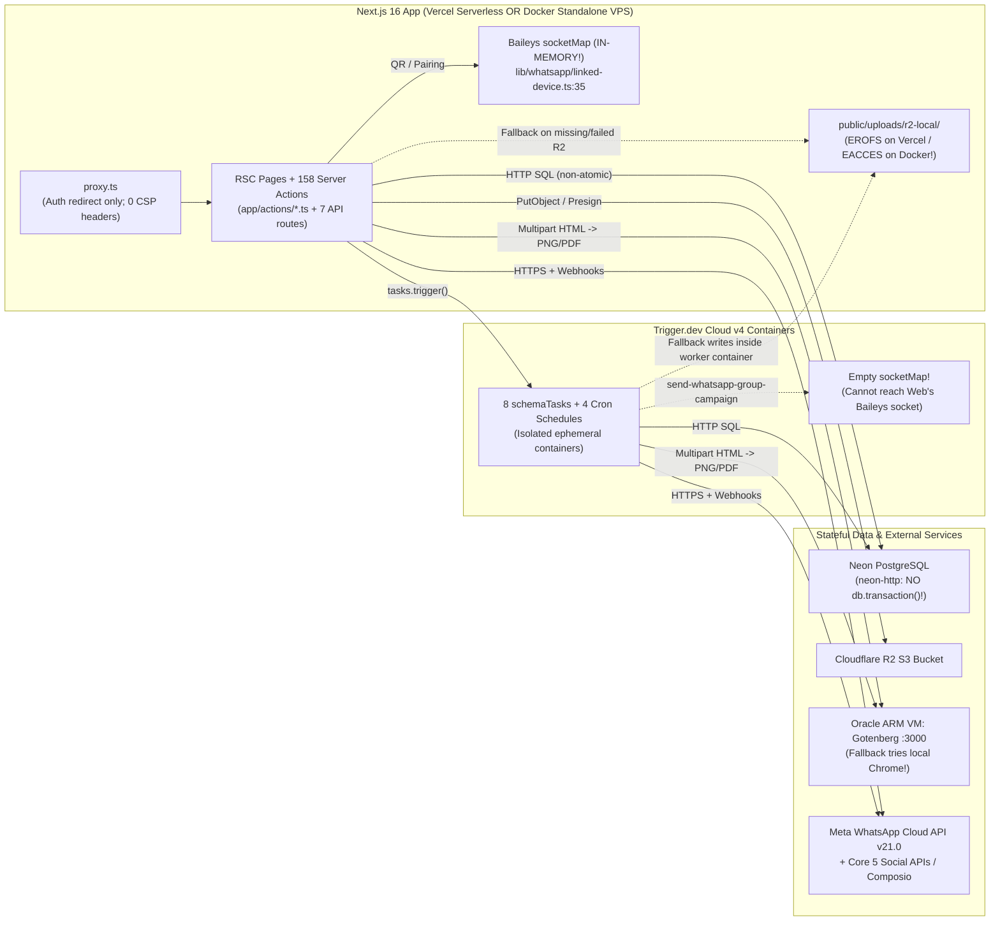

# 00 — Ground-Truth Inventory, Brief-vs-Code Ledger & Production Topology Map

**Agent**: `a00-truth` (Wave 0 — Truth & Architecture Auditor)
**Repository**: `c:\dev\al-ramlah-travels\web` (branch `audit/production-hardening`)
**Companion Findings File**: `docs/audit/findings/A00.md` (`A00-001` through `A00-026`)
**Verification Standard**: Every number, table, route, action, task, env var, and discrepancy below is extracted directly from runtime Drizzle metadata, TypeScript AST, and source files (`file:line`), treating `docs/PLATFORM_MASTER_BRIEF.md` as 0% trusted until proven.

---

## 1. Executive Ground-Truth Scorecard

### 1.1 Codebase Counts: Brief Claim vs Actual Code

| Dimension | Master Brief Claim | Actual Code Ground Truth | Verdict & Notes |
|---|---|---|---|
| **PostgreSQL Tables** | `43` (§1.4, §8.2) | **`43` tables** (`740` columns, `104` indexes, `60` FKs, `0` `CHECK` constraints) | **Count matches**, but column contracts in §8.3.6 (`visa_rates`) and §8.3.7 (`group_departures`) contradict code (`A00-026`), and `drizzle/` (`0000`+`0001`) creates only **`42` tables** (`W0-002`, `A00-020`). |
| **PostgreSQL Enums** | `46` (§1.4, §8.2) | **`46` `pgEnum` definitions** (`217` enum values total) | **Count matches**, but `whatsapp_message_type` (`db/schema/whatsapp-crm.ts:36`) has `18` values duplicating 9 lowercase + 9 UPPERCASE (`A00-019`), and `drizzle/` creates only **`45` enums** (`W0-002`). |
| **Schema Files (`db/schema/`)** | `9` domain files + `index.ts` (§8.1) | **`10` `.ts` files** (`9` domain modules + `db/schema/index.ts`) | **Matches**. |
| **App Router `page.tsx` Files** | `12` active + `14` redirects (§7.1–§7.3) | **`26` `page.tsx` files** (`12` real pages + `14` `redirect()` stubs) | **Count matches**, but multiple redirect query params & hub tab names contradict Brief §7.2–§7.3 and break admin navigation (`A00-015`). |
| **App Router `layout.tsx` Files** | `3` (§2.2, §7.1) | **`3` `layout.tsx` files** (`app/layout.tsx`, `app/(public)/layout.tsx`, `app/admin/(dashboard)/layout.tsx`) | **Matches**. |
| **Resilience & SEO Route Files** | Implied production-ready (§2.2, §6.1) | **`0` `error.tsx`, `0` `global-error.tsx`, `0` `not-found.tsx`, `0` `loading.tsx`, `0` `robots.ts`, `0` `sitemap.ts`** | **Missing** (`A00-023`). |
| **API Route Handlers (`route.ts`)** | `7` (§9.3) | **`7` `route.ts` files** | **Matches**, though `/api/uploads/local` is an unguarded local-disk XSS/EROFS hazard in prod (`A00-003`). |
| **Server Action Modules (`app/actions/`)** | `12` modules, ~`88` listed actions (§9.2) | **`12` `"use server"` modules**, **`158` exported functions** | **Module count matches; function count understated by 70** (includes unauthenticated `executeScheduledPostNowAction` `A00-001` + 14 duplicate/alias exports `A00-024`). |
| **Trigger.dev Files (`trigger/`)** | `9` background tasks + `4` crons in `schedules.task.ts` (§9.4) | **`14` `.ts` files** (`8` `schemaTask`s + `4` `schedules.task` crons = **`12` registered tasks** across `9` `.task.ts` files + `5` support modules) | **Discrepancy**: `8` on-demand tasks (not `9`), and only `2` of `4` crons live in `trigger/schedules.task.ts`; the other `2` live in `publish-social-post.task.ts:471` and `send-whatsapp-broadcast.task.ts:636` (`A00-026`). |
| **Env Vars (`process.env` / `lib/env.ts` / `.env.example`)** | `28` documented, "All validated through Zod in `lib/env.ts`" (§4.2) | **`32` distinct env vars read in code**, **`30` in `.env.example`**, **`33` fields in `lib/env.ts`** (`6` required/defaulted + **`27` `.optional()`**) | **Major Discrepancy**: All `27` integration/crypto secrets in `lib/env.ts:34–79` are `.optional()` even in prod, URLs default to `http://localhost:3000` (`L24,28`), `SKIP_ENV_VALIDATION=1` injects placeholder secrets (`L95–111`), and runtime files bypass `lib/env.ts` via raw `process.env.*` (`A00-020`). |
| **NPM Packages (`package.json`)** | Curated production stack (§4.1) | **`37` `dependencies` + `15` `devDependencies`** (`52` total) | `pino` is imported directly (`lib/whatsapp/linked-device.ts:2`) without being declared in `package.json`; `cn`, `react-is`, `shadcn`, `@trigger.dev/build` misplaced/unused (`A00-021`, `W0-006`). |
| **Test Suite (`tests/`)** | `21` test files, `429` tests (§1.4, §4.1.7) | **`21` files in `tests/`** = **`20` `.test.ts` files** + **`1` `tests/test-env.ts` helper** (`132` `describe` suites, `429` `it` cases) | **`20` actual test files** (+ 1 setup file); when isolated from live Neon `.env`, **`422` pass and `7` fail** because 6 tests mutate live Neon DB (`W0-003`). |

### 1.2 Runtime, Build, Dependency Audit & Migration-Drift Baseline (`docs/audit/w0-env-baseline.md`)

| Check / Target | Result | Ground-Truth Telemetry & Findings (`W0-001`–`W0-007`) |
|---|---|---|
| **Host Runtime & Container EOL** | `node v24.22.1` / `npm 11.19.1` | **`W0-005` (P1)**: `Dockerfile:7` uses `FROM node:20-alpine AS base` — **Node 20 reached EOL on `2026-04-30`** (>6.5 months unpatched as of Nov 2026); `package.json` lacks `"engines"`. |
| **Disposable Audit Postgres** | `postgres:16-alpine` (`PostgreSQL 16.16`) | Container `alramlah-audit-pg` on `127.0.0.1:54329` (`audit` / `alramlah_audit`), guarded by `.env.audit` + `tests/helpers/audit-guard.ts` (`assertAuditSafeEnvironment()`, 9/9 self-tests pass). |
| **Raw `drizzle-kit migrate` & `db/seed.ts`** | **FAIL (`exit 1`)** against TCP PG | **`W0-004` (P1)**: `pg`/`postgres` absent from `package.json`; `drizzle-kit` forces Neon WebSocket, and `db/index.ts:12,29` hardcodes `neon-http` (`https://api.0.0.1/sql`). Also `db/index.ts:1` `dotenv/config` + `DATABASE_URL_POOLED` trap leaks to `.env` unless both URLs are overridden. |
| **Live Drizzle `migrate()` vs `db/schema/*`** | **DRIFT (`42/43` tables)** | **`W0-002` (P0)**: `drizzle/0000_noisy_leader.sql` + `0001_cynical_proudstar.sql` create **`42` tables / `724` cols / `45` enums** vs `db/schema/*` (`43` tables / `740` cols / `46` enums). Missing: `whatsapp_linked_device_sessions` (`16` cols, `2` idx), enum `whatsapp_linked_device_status`, and two-way missing partial unique index `idx_marketing_channels_external_handle` (`scripts/sync-slice40-schema.ts:116–119`). |
| **2× `db/seed.ts` Idempotency** | **CORRUPTS DATA on Run #2** | **`W0-001` (P0)**: Both runs `exit 0` (`2` users, `8` cities, `6` airlines, `18` hotels, `11` vehicles, `12` sectors, `128` transport_rates, `12` ziyarat, `4` packages, `5` departures, `3` slides, `5` faqs), **but `db/seed.ts:175–187` overwrites `long_term` (`90d / PKR 68,000 / 750 SAR`) to `30d / PKR 42,500 / 470 SAR` on Run #2** (PKR 25,500/pilgrim underquote!) and seeds weak default passwords `Admin@123456` / `Staff@123456` (**`W0-007` P0**). |
| **`npm run typecheck`** | **PASS (`exit 0`)** | `tsc --noEmit` passes with `0` errors. |
| **`npm run lint`** | **PASS w/ Warnings (`exit 0`)** | `0` errors, **`212` warnings** (`react-hooks/set-state-in-effect`, `react-hooks/purity` `Date.now()` in `applications-kanban-board.tsx:595,599`, `@typescript-eslint/no-explicit-any`, `no-img-element`, `no-unused-vars`). |
| **`npm test` (Isolated from `.env`)** | **FAIL (`exit 1`) — `422` pass / `7` fail** | **`W0-003` (P0)**: `429` tests across `132` suites (`108.5s`). **6 tests** in `whatsapp-linked-device-and-groups.test.ts` & `whatsapp-multi-number-system.test.ts` execute live `INSERT`/`UPDATE`/`DELETE` SQL against Neon prod when `.env` is active; **1 test** (`trigger-v4-webhook-and-realtime-copilot.test.ts:432`) depends on live `social_integrations` state. |
| **`npm run build` (`next build --webpack`)** | **PASS (`36` App Router routes)** | Webpack compiled (`15.3m`), TS check (`22.2m` due to `tsconfig.json` scanning `.next`/`scripts`/`tests`), `27/27` static worker pass (`28.4s`). **`4` static `○` routes** (`/admin/login`, `/_not-found`, `/_global-error`, `/favicon.ico`) + **`32` dynamic `ƒ` routes** (incl. `/`, `/privacy`, `/terms`!). `.next/static` = **`4.10 MB`** (top chunks: `385.0 KB`, `347.7 KB`, `235.7 KB`, `196.3 KB`, `185.2 KB`). |
| **`npm audit --omit=dev`** | **FAIL (`exit 1`) — `9` vulns** | **`W0-006` (P0)**: `1 critical, 2 high, 4 moderate, 2 low` — led by **`next@16.3.4` (`3` Critical unauth RCEs: `GHSA-vcvr-r3jv-pc5j`, `GHSA-2464-fhr4-w9xw`, `GHSA-673q-mjm6-r5xr`, plus SSRF `GHSA-cjq9-62q9-8jv4` & cache poisoning -> upgrade to `16.4.6+`)**, `@prisma/config -> deepmerge-ts` (High), and `shadcn` CLI in prod `dependencies`. |
| **Installed Audit Tooling** | **MISSING** | `@playwright/test` = `False`, `knip` = `False`, `gitleaks` = `False`, `pg` = `False`. |

---

## 2. Database Schema Ground-Truth Inventory (`db/schema/*`)

### 2.1 All `43` PostgreSQL Tables (`740` Columns, `104` Indexes, `60` Foreign Keys, `0` `CHECK` Constraints)

| # | SQL Table (`exportName`) | `file:line` | Cols | Indexes (`Unique`) | Foreign Keys (`ON DELETE`) |
|---|---|---|---|---|---|
| 1 | `applications` (`applications`) | `db/schema/applications.ts:98` | 50 | 5 (`1` UQ): `idx_app_ref_number` [UQ], `idx_app_phone`, `idx_app_status`, `idx_app_created`, `idx_app_assigned_staff` | `departure_city_id` → `departure_cities.id` (`NO ACTION`); `preferred_airline_id` → `airlines.id` (`NO ACTION`); `group_package_id` → `group_packages.id` (`NO ACTION`); `group_departure_id` → `group_departures.id` (`NO ACTION`); `ziyarat_vehicle_id` → `vehicles.id` (`NO ACTION`); `assigned_staff_user_id` → `user.id` (`SET NULL`) |
| 2 | `application_hotel_stays` (`applicationHotelStays`) | `db/schema/applications.ts:201` | 17 | 2 (`0` UQ): `idx_stay_app_id`, `idx_stay_hotel_id` | `application_id` → `applications.id` (`CASCADE`); `hotel_id` → `hotels.id` (`NO ACTION`) |
| 3 | `application_transport_segments` (`applicationTransportSegments`) | `db/schema/applications.ts:244` | 12 | 2 (`0` UQ): `idx_segment_app_id`, `idx_segment_sector_id` | `application_id` → `applications.id` (`CASCADE`); `sector_id` → `transport_sectors.id` (`NO ACTION`); `vehicle_id` → `vehicles.id` (`NO ACTION`) |
| 4 | `application_quotes` (`applicationQuotes`) | `db/schema/applications.ts:282` | 27 | 2 (`0` UQ): `idx_quote_app_id`, `idx_quote_payment_status` | `application_id` → `applications.id` (`CASCADE`); `quoted_by_user_id` → `user.id` (`SET NULL`) |
| 5 | `user` (`user`) | `db/schema/auth.ts:16` | 9 | 2 (`0` UQ): `idx_user_email`, `idx_user_role` | — |
| 6 | `session` (`session`) | `db/schema/auth.ts:39` | 8 | 2 (`1` UQ): `idx_session_user_id`, `idx_session_token` [UQ] | `user_id` → `user.id` (`CASCADE`) |
| 7 | `account` (`account`) | `db/schema/auth.ts:63` | 13 | 1 (`0` UQ): `idx_account_user_id` | `user_id` → `user.id` (`CASCADE`) |
| 8 | `verification` (`verification`) | `db/schema/auth.ts:93` | 6 | 1 (`0` UQ): `verification_identifier_idx` | — |
| 9 | `visa_rates` (`visaRates`) | `db/schema/catalog.ts:71` | 14 | 0 (`0` UQ) | `updated_by_user_id` → `user.id` (`NO ACTION`) |
| 10 | `airlines` (`airlines`) | `db/schema/catalog.ts:94` | 10 | 2 (`0` UQ): `idx_airline_active`, `idx_airline_sort` | — |
| 11 | `departure_cities` (`departureCities`) | `db/schema/catalog.ts:120` | 8 | 2 (`0` UQ): `idx_departure_city_active`, `idx_departure_city_sort` | — |
| 12 | `hotels` (`hotels`) | `db/schema/catalog.ts:146` | 32 | 4 (`0` UQ): `idx_hotel_city`, `idx_hotel_rating`, `idx_hotel_active`, `idx_hotel_featured` | — |
| 13 | `vehicles` (`vehicles`) | `db/schema/catalog.ts:212` | 15 | 3 (`0` UQ): `idx_vehicle_category`, `idx_vehicle_active`, `idx_vehicle_sort` | — |
| 14 | `transport_sectors` (`transportSectors`) | `db/schema/catalog.ts:244` | 17 | 2 (`0` UQ): `idx_sector_code`, `idx_sector_active` | — |
| 15 | `transport_rates` (`transportRates`) | `db/schema/catalog.ts:285` | 7 | 3 (`1` UQ): `idx_transport_rate_sector_vehicle` [UQ], `idx_transport_rate_sector`, `idx_transport_rate_vehicle` | `sector_id` → `transport_sectors.id` (`CASCADE`); `vehicle_id` → `vehicles.id` (`CASCADE`) |
| 16 | `ziyarat_places` (`ziyaratPlaces`) | `db/schema/catalog.ts:338` | 10 | 2 (`0` UQ): `idx_ziyarat_city`, `idx_ziyarat_active` | — |
| 17 | `hero_slides` (`heroSlides`) | `db/schema/cms.ts:37` | 13 | 2 (`0` UQ): `idx_hero_active`, `idx_hero_sort` | — |
| 18 | `testimonials` (`testimonials`) | `db/schema/cms.ts:66` | 12 | 2 (`0` UQ): `idx_testimonial_active`, `idx_testimonial_featured` | — |
| 19 | `faqs` (`faqs`) | `db/schema/cms.ts:92` | 8 | 2 (`0` UQ): `idx_faq_category`, `idx_faq_active` | — |
| 20 | `contact_messages` (`contactMessages`) | `db/schema/cms.ts:114` | 11 | 2 (`0` UQ): `idx_contact_status`, `idx_contact_created` | — |
| 21 | `group_packages` (`groupPackages`) | `db/schema/packages.ts:41` | 27 | 3 (`0` UQ): `idx_package_tier`, `idx_package_active`, `idx_package_featured` | `airline_id` → `airlines.id` (`NO ACTION`); `makkah_hotel_id` → `hotels.id` (`NO ACTION`); `madinah_hotel_id` → `hotels.id` (`NO ACTION`) |
| 22 | `group_departures` (`groupDepartures`) | `db/schema/packages.ts:99` | 20 | 3 (`0` UQ): `idx_departure_package`, `idx_departure_date`, `idx_departure_status` | `package_id` → `group_packages.id` (`CASCADE`); `departure_city_id` → `departure_cities.id` (`NO ACTION`) |
| 23 | `agency_settings` (`agencySettings`) | `db/schema/settings.ts:4` | 17 | 0 (`0` UQ) | `updated_by_user_id` → `user.id` (`NO ACTION`) |
| 24 | `social_integrations` (`socialIntegrations`) | `db/schema/social-scheduler.ts:87` | 17 | 3 (`1` UQ): `idx_social_integrations_provider_acc` [UQ], `idx_social_integrations_provider`, `idx_social_integrations_active` | `created_by_user_id` → `user.id` (`SET NULL`) |
| 25 | `scheduled_posts` (`scheduledPosts`) | `db/schema/social-scheduler.ts:133` | 19 | 4 (`0` UQ): `idx_scheduled_posts_scheduled_for`, `idx_scheduled_posts_status`, `idx_scheduled_posts_post_asset`, `idx_scheduled_posts_trigger_run` | `post_asset_id` → `post_assets.id` (`SET NULL`); `created_by_user_id` → `user.id` (`SET NULL`) |
| 26 | `scheduled_post_targets` (`scheduledPostTargets`) | `db/schema/social-scheduler.ts:192` | 15 | 3 (`1` UQ): `idx_scheduled_post_targets_idempotency` [UQ], `idx_scheduled_post_targets_post_integration`, `idx_scheduled_post_targets_status` | `scheduled_post_id` → `scheduled_posts.id` (`CASCADE`); `integration_id` → `social_integrations.id` (`CASCADE`) |
| 27 | `suppliers` (`suppliers`) | `db/schema/suppliers-and-marketing.ts:95` | 14 | 2 (`1` UQ): `idx_supplier_slug` [UQ], `idx_supplier_active` | — |
| 28 | `supplier_flyers` (`supplierFlyers`) | `db/schema/suppliers-and-marketing.ts:133` | 31 | 2 (`0` UQ): `idx_flyer_supplier`, `idx_flyer_status` | `supplier_id` → `suppliers.id` (`CASCADE`); `created_by_user_id` → `user.id` (`SET NULL`) |
| 29 | `supplier_flyer_packages` (`supplierFlyerPackages`) | `db/schema/suppliers-and-marketing.ts:201` | 42 | 4 (`1` UQ): `idx_pkg_item_post_code` [UQ], `idx_pkg_item_flyer`, `idx_pkg_item_supplier`, `idx_pkg_item_sharing_price` | `flyer_id` → `supplier_flyers.id` (`CASCADE`); `supplier_id` → `suppliers.id` (`CASCADE`); `published_group_package_id` → `group_packages.id` (`SET NULL`); `published_group_departure_id` → `group_departures.id` (`SET NULL`) |
| 30 | `post_assets` (`postAssets`) | `db/schema/suppliers-and-marketing.ts:287` | 13 | 3 (`1` UQ): `idx_post_asset_code` [UQ], `idx_post_asset_flyer`, `idx_post_asset_kind` | `supplier_id` → `suppliers.id` (`CASCADE`); `flyer_id` → `supplier_flyers.id` (`CASCADE`); `flyer_package_id` → `supplier_flyer_packages.id` (`CASCADE`) |
| 31 | `marketing_channels` (`marketingChannels`) | `db/schema/suppliers-and-marketing.ts:324` | 13 | 4 (`1` UQ): `idx_channel_platform`, `idx_channel_area`, `idx_channel_active`, `idx_channel_external_id` [UQ] | — |
| 32 | `daily_post_distributions` (`dailyPostDistributions`) | `db/schema/suppliers-and-marketing.ts:355` | 15 | 3 (`0` UQ): `idx_dist_date`, `idx_dist_channel`, `idx_dist_asset` | `channel_id` → `marketing_channels.id` (`CASCADE`); `post_asset_id` → `post_assets.id` (`CASCADE`); `paired_follow_up_asset_id` → `post_assets.id` (`SET NULL`); `posted_by_user_id` → `user.id` (`SET NULL`) |
| 33 | `outreach_contacts` (`outreachContacts`) | `db/schema/suppliers-and-marketing.ts:402` | 18 | 3 (`1` UQ): `idx_outreach_wa_number` [UQ], `idx_outreach_status`, `idx_outreach_cooldown` | — |
| 34 | `outreach_logs` (`outreachLogs`) | `db/schema/suppliers-and-marketing.ts:446` | 12 | 2 (`0` UQ): `idx_outreach_log_contact`, `idx_outreach_log_sent_at` | `contact_id` → `outreach_contacts.id` (`CASCADE`); `post_asset_id` → `post_assets.id` (`SET NULL`); `flyer_id` → `supplier_flyers.id` (`SET NULL`); `application_id` → `applications.id` (`SET NULL`); `sent_by_user_id` → `user.id` (`SET NULL`) |
| 35 | `whatsapp_accounts` (`whatsappAccounts`) | `db/schema/whatsapp-crm.ts:100` | 27 | 2 (`1` UQ): `idx_wa_acc_phone_id` [UQ], `idx_wa_acc_active` | — |
| 36 | `whatsapp_conversations` (`whatsappConversations`) | `db/schema/whatsapp-crm.ts:168` | 23 | 5 (`1` UQ): `idx_wa_conv_acc_phone` [UQ], `idx_wa_conv_last_msg`, `idx_wa_conv_outreach`, `idx_wa_conv_app`, `idx_wa_conv_detected_code` | `account_id` → `whatsapp_accounts.id` (`CASCADE`); `outreach_contact_id` → `outreach_contacts.id` (`SET NULL`); `application_id` → `applications.id` (`SET NULL`); `assigned_user_id` → `user.id` (`SET NULL`) |
| 37 | `whatsapp_messages` (`whatsappMessages`) | `db/schema/whatsapp-crm.ts:223` | 27 | 3 (`1` UQ): `idx_wa_msg_wamid` [UQ], `idx_wa_msg_conv_created`, `idx_wa_msg_status` | `conversation_id` → `whatsapp_conversations.id` (`CASCADE`) |
| 38 | `whatsapp_templates` (`whatsappTemplates`) | `db/schema/whatsapp-crm.ts:267` | 17 | 2 (`1` UQ): `idx_wa_tmpl_acc_name_lang` [UQ], `idx_wa_tmpl_status` | `account_id` → `whatsapp_accounts.id` (`CASCADE`) |
| 39 | `whatsapp_broadcasts` (`whatsappBroadcasts`) | `db/schema/whatsapp-crm.ts:300` | 20 | 2 (`0` UQ): `idx_wa_bc_acc_status`, `idx_wa_bc_scheduled` | `account_id` → `whatsapp_accounts.id` (`CASCADE`); `template_id` → `whatsapp_templates.id` (`RESTRICT`); `created_by_user_id` → `user.id` (`SET NULL`) |
| 40 | `whatsapp_broadcast_recipients` (`whatsappBroadcastRecipients`) | `db/schema/whatsapp-crm.ts:338` | 12 | 3 (`0` UQ): `idx_wa_bc_recip_broadcast`, `idx_wa_bc_recip_wamid`, `idx_wa_bc_recip_phone` | `broadcast_id` → `whatsapp_broadcasts.id` (`CASCADE`); `outreach_contact_id` → `outreach_contacts.id` (`SET NULL`) |
| 41 | `whatsapp_quick_replies` (`whatsappQuickReplies`) | `db/schema/whatsapp-crm.ts:370` | 10 | 2 (`1` UQ): `idx_wa_qr_shortcut` [UQ], `idx_wa_qr_active` | `account_id` → `whatsapp_accounts.id` (`CASCADE`) |
| 42 | `whatsapp_auto_reply_rules` (`whatsappAutoReplyRules`) | `db/schema/whatsapp-crm.ts:396` | 16 | 1 (`0` UQ): `idx_wa_arr_active_prio` | `account_id` → `whatsapp_accounts.id` (`CASCADE`) |
| 43 | `whatsapp_linked_device_sessions` (`whatsappLinkedDeviceSessions`) | `db/schema/whatsapp-crm.ts:551` | 16 | 2 (`0` UQ): `idx_wa_linked_session_key`, `idx_wa_linked_status` | — |

**Foreign-Key `ON DELETE` Distribution (`60` total)**:
- `CASCADE`: `24` FKs
- `SET NULL`: `18` FKs
- `RESTRICT`: `1` FK (`whatsapp_broadcasts.template_id → whatsapp_templates.id`)
- `NO ACTION` (implicit default): **`17` FKs** — see `A00-016` (causes Postgres `23503` constraint failures when deleting catalog items or users who updated `visa_rates`/`agency_settings`).
- **Missing FKs on ID columns**: `applications.supplier_id` (`db/schema/applications.ts:144`), `applications.source_channel_id` (`L143`), `application_quotes.supplier_id` (`L296`), `scheduled_posts.paired_follow_up_post_id` (`db/schema/social-scheduler.ts:147`), and `whatsapp_conversations.forwarded_to_agent_conversation_id` (`db/schema/whatsapp-crm.ts:190`) store UUIDs without DB-level foreign key constraints.
- **camelCase SQL Column Anomaly**: `hotels.imageUrl` (`db/schema/catalog.ts:154`), `vehicles.imageUrl` (`L222`), and `ziyarat_places.imageUrl` (`L345`) use `"imageUrl"` (camelCase SQL column name) while every other table uses snake_case (`image_url`).

### 2.2 All `46` PostgreSQL Enums

| # | SQL Enum (`exportName`) | `file:line` | # | Values |
|---|---|---|---|---|
| 1 | `application_source` (`applicationSourceEnum`) | `db/schema/applications.ts:36` | 3 | `custom_builder`, `group_booking`, `hajj_inquiry` |
| 2 | `application_status` (`applicationStatusEnum`) | `db/schema/applications.ts:42` | 5 | `pending_quote`, `quoted`, `approved`, `rejected`, `cancelled` |
| 3 | `builder_preset_mode` (`builderPresetModeEnum`) | `db/schema/applications.ts:50` | 8 | `complete_umrah`, `visa_only`, `flights_only`, `hotels_only`, `transport_only`, `custom_mix`, `group_package`, `hajj_consultation` |
| 4 | `city_sequence` (`citySequenceEnum`) | `db/schema/applications.ts:61` | 6 | `makkah_madinah`, `madinah_makkah`, `makkah_madinah_makkah`, `makkah_madinah_jeddah`, `makkah_only`, `madinah_only` |
| 5 | `flight_route_type` (`flightRouteTypeEnum`) | `db/schema/applications.ts:70` | 2 | `direct`, `connecting` |
| 6 | `cabin_class` (`cabinClassEnum`) | `db/schema/applications.ts:75` | 2 | `economy`, `business` |
| 7 | `transport_service_type` (`transportServiceTypeEnum`) | `db/schema/applications.ts:77` | 2 | `private`, `shared` |
| 8 | `ziyarat_scope` (`ziyaratScopeEnum`) | `db/schema/applications.ts:82` | 3 | `makkah_only`, `madinah_only`, `both` |
| 9 | `payment_status` (`paymentStatusEnum`) | `db/schema/applications.ts:88` | 3 | `unpaid`, `partially_paid`, `paid_in_full` |
| 10 | `user_role` (`roleEnum`) | `db/schema/auth.ts:14` | 2 | `super_admin`, `staff` |
| 11 | `visa_tier` (`visaTierEnum`) | `db/schema/catalog.ts:22` | 2 | `short_term`, `long_term` |
| 12 | `city_name` (`cityNameEnum`) | `db/schema/catalog.ts:24` | 2 | `makkah`, `madinah` |
| 13 | `hotel_access_type` (`hotelAccessTypeEnum`) | `db/schema/catalog.ts:26` | 2 | `walking`, `shuttle` |
| 14 | `meal_plan_type` (`mealPlanTypeEnum`) | `db/schema/catalog.ts:31` | 4 | `room_only`, `breakfast`, `half_board`, `full_board` |
| 15 | `room_category` (`roomCategoryEnum`) | `db/schema/catalog.ts:38` | 2 | `shared`, `private` |
| 16 | `room_type` (`roomTypeEnum`) | `db/schema/catalog.ts:40` | 4 | `sharing`, `double`, `triple`, `quad` |
| 17 | `vehicle_category` (`vehicleCategoryEnum`) | `db/schema/catalog.ts:47` | 6 | `sedan`, `suv`, `van`, `minibus`, `bus`, `train` |
| 18 | `vehicle_booking_mode` (`vehicleBookingModeEnum`) | `db/schema/catalog.ts:56` | 3 | `private_only`, `shared_and_private`, `shared_only` |
| 19 | `sector_point_type` (`sectorPointTypeEnum`) | `db/schema/catalog.ts:62` | 2 | `airport`, `hotel` |
| 20 | `faq_category` (`faqCategoryEnum`) | `db/schema/cms.ts:17` | 6 | `general`, `visa`, `hotels`, `transport`, `packages`, `hajj` |
| 21 | `message_status` (`messageStatusEnum`) | `db/schema/cms.ts:26` | 4 | `unread`, `read`, `replied`, `archived` |
| 22 | `package_tier` (`packageTierEnum`) | `db/schema/packages.ts:22` | 5 | `economy`, `bronze`, `silver`, `gold`, `vip_5star` |
| 23 | `group_departure_status` (`groupDepartureStatusEnum`) | `db/schema/packages.ts:30` | 4 | `open`, `filling_fast`, `sold_out`, `closed` |
| 24 | `social_provider` (`socialProviderEnum`) | `db/schema/social-scheduler.ts:23` | 5 | `instagram`, `facebook`, `tiktok`, `youtube`, `gmb` |
| 25 | `social_integration_status` (`socialIntegrationStatusEnum`) | `db/schema/social-scheduler.ts:31` | 3 | `ACTIVE`, `EXPIRED`, `PENDING_SELECTION` |
| 26 | `social_post_format` (`socialPostFormatEnum`) | `db/schema/social-scheduler.ts:37` | 3 | `FEED`, `REEL`, `STORY` |
| 27 | `scheduled_post_type` (`scheduledPostTypeEnum`) | `db/schema/social-scheduler.ts:43` | 5 | `single_image`, `carousel`, `video`, `story`, `offer` |
| 28 | `scheduled_post_campaign_stage` (`scheduledPostCampaignStageEnum`) | `db/schema/social-scheduler.ts:51` | 3 | `step_1_spotlight_hook`, `step_2_all_packages`, `standalone` |
| 29 | `scheduled_post_status` (`scheduledPostStatusEnum`) | `db/schema/social-scheduler.ts:56` | 7 | `draft`, `scheduled`, `publishing`, `completed`, `partially_failed`, `failed`, `cancelled` |
| 30 | `scheduled_post_target_status` (`scheduledPostTargetStatusEnum`) | `db/schema/social-scheduler.ts:66` | 5 | `pending`, `publishing`, `published`, `failed`, `skipped` |
| 31 | `supplier_category` (`supplierCategoryEnum`) | `db/schema/suppliers-and-marketing.ts:24` | 3 | `group_packages`, `custom_packages`, `both` |
| 32 | `commission_mode` (`commissionModeEnum`) | `db/schema/suppliers-and-marketing.ts:30` | 2 | `included_in_flyer`, `net_plus_markup` |
| 33 | `flyer_status` (`flyerStatusEnum`) | `db/schema/suppliers-and-marketing.ts:35` | 6 | `extracted`, `wrapped`, `draft_extracted`, `verified`, `posters_generated`, `archived` |
| 34 | `poster_asset_type` (`posterAssetTypeEnum`) | `db/schema/suppliers-and-marketing.ts:44` | 3 | `multi_package_sheet`, `single_package_spotlight`, `custom_quotation_pdf` |
| 35 | `channel_platform` (`channelPlatformEnum`) | `db/schema/suppliers-and-marketing.ts:50` | 8 | `whatsapp_group`, `whatsapp_community`, `whatsapp_status`, `instagram`, `facebook`, `tiktok`, `youtube`, `google_business` |
| 36 | `distribution_dispatch_status` (`distributionDispatchStatusEnum`) | `db/schema/suppliers-and-marketing.ts:61` | 7 | `planned`, `queued`, `queued_auto`, `sent`, `posted`, `manual_logged`, `failed` |
| 37 | `distribution_stage` (`distributionStageEnum`) | `db/schema/suppliers-and-marketing.ts:74` | 3 | `step_1_spotlight_hook`, `step_2_all_packages`, `standalone` |
| 38 | `contact_lead_status` (`contactLeadStatusEnum`) | `db/schema/suppliers-and-marketing.ts:80` | 8 | `prospect`, `interested`, `active_conversation`, `contacted_cooldown`, `replied_active`, `quoted`, `booked_client`, `do_not_contact` |
| 39 | `whatsapp_message_direction` (`whatsappMessageDirectionEnum`) | `db/schema/whatsapp-crm.ts:23` | 2 | `inbound`, `outbound` |
| 40 | `whatsapp_message_status` (`whatsappMessageStatusEnum`) | `db/schema/whatsapp-crm.ts:28` | 5 | `pending`, `sent`, `delivered`, `read`, `failed` |
| 41 | `whatsapp_message_type` (`whatsappMessageTypeEnum`) | `db/schema/whatsapp-crm.ts:36` | **18** | `text`, `image`, `document`, `audio`, `video`, `template`, `interactive`, `sticker`, `reaction`, `TEXT`, `IMAGE`, `DOCUMENT`, `AUDIO`, `VIDEO`, `TEMPLATE`, `INTERACTIVE`, `STICKER`, `REACTION` (**Case duplicate bug `A00-019`**) |
| 42 | `whatsapp_template_category` (`whatsappTemplateCategoryEnum`) | `db/schema/whatsapp-crm.ts:57` | 3 | `MARKETING`, `UTILITY`, `AUTHENTICATION` |
| 43 | `whatsapp_template_status` (`whatsappTemplateStatusEnum`) | `db/schema/whatsapp-crm.ts:63` | 5 | `APPROVED`, `PENDING`, `REJECTED`, `PAUSED`, `DISABLED` |
| 44 | `whatsapp_broadcast_status` (`whatsappBroadcastStatusEnum`) | `db/schema/whatsapp-crm.ts:71` | 6 | `draft`, `scheduled`, `processing`, `completed`, `failed`, `cancelled` |
| 45 | `whatsapp_auto_reply_match_type` (`whatsappAutoReplyMatchTypeEnum`) | `db/schema/whatsapp-crm.ts:80` | 4 | `CONTAINS`, `EXACT`, `STARTS_WITH`, `REGEX` |
| 46 | `whatsapp_linked_device_status` (`whatsappLinkedDeviceStatusEnum`) | `db/schema/whatsapp-crm.ts:88` | 5 | `disconnected`, `connecting`, `qr_ready`, `pairing_code_ready`, `connected` |

### 2.3 Drizzle Migration Journal vs Schema Drift (`drizzle/` + `W0-002` / `A00-020`)

- **`web/drizzle/meta/_journal.json`** tracks **2 migrations**:
  1. `0000_noisy_leader.sql`
  2. `0001_cynical_proudstar.sql`
- **Live Migration Execution vs `db/schema/*` (`W0-002`)**:
  - `db/schema/*` defines **`43` tables / `740` columns / `46` enums / `104` explicit indexes / `60` FKs**.
  - Applying `0000_noisy_leader.sql` + `0001_cynical_proudstar.sql` to empty PostgreSQL 16 creates **`42` tables / `724` columns / `45` enums**:
    1. **Missing table**: `whatsapp_linked_device_sessions` (`16` columns, `2` indexes: `idx_wa_linked_session_key`, `idx_wa_linked_status`).
    2. **Missing enum**: `whatsapp_linked_device_status` (`disconnected`, `connecting`, `qr_ready`, `pairing_code_ready`, `connected`).
    3. **Two-way missing partial unique index**: `idx_marketing_channels_external_handle` on `marketing_channels (external_group_id_or_handle) WHERE external_group_id_or_handle IS NOT NULL` — created directly on Neon by `scripts/sync-slice40-schema.ts:116–119`, yet absent from **both** `web/drizzle/` AND `db/schema/suppliers-and-marketing.ts:324–353`!
- **Stale Parent-Root `../drizzle/` Directory & Ad-Hoc Patch Scripts (`scripts/`)**:
  - Parent repo root `../drizzle/` retains a stale legacy migration folder (`0000_ambiguous_star_brand.sql`, `0001_careless_dormammu.sql`, plus unjournaled `0001_phase2_whatsapp_and_social.sql` & `0002_phase3_enterprise_crm_and_social.sql`).
  - `scripts/sync-phase3-columns.ts`, `scripts/sync-slice40-schema.ts` (containing destructive `DELETE` statements at `L55–66`), and `scripts/audit-and-sync-schema.ts` remain in `web/scripts/`.

---

## 3. Next.js 16 Route, Layout, Redirect & API Handler Inventory (`app/`)

### 3.1 Layouts (`3` files) & Special App Router Files (`0` files)

- **Layouts (`3`)**:
  1. `app/layout.tsx` (71 lines) — Root HTML shell, Cormorant Garamond / Plus Jakarta Sans / JetBrains Mono / Noto Naskh Arabic fonts, `ThemeProvider` locked to light mode.
  2. `app/(public)/layout.tsx` (45 lines) — Queries `agencySettings`, renders `PublicHeader`, `PublicFooter`, `WhatsappFab`.
  3. `app/admin/(dashboard)/layout.tsx` (104 lines) — Calls `await requireAdmin()`, queries unread badge counts, renders `AdminSidebar`, `AdminTopbar`, `CommandPalette`.
- **Special Resilience & SEO Files (`0`)**: `0` `error.tsx`, `0` `global-error.tsx`, `0` `not-found.tsx`, `0` `loading.tsx`, `0` `robots.ts`, `0` `sitemap.ts` (`A00-023`).

### 3.2 Active Pages (`12` real `page.tsx` files)

| # | Route Path | Source File (`lines`) | Dynamic / Auth |
|---|---|---|---|
| 1 | `/` | `app/(public)/page.tsx` (327) | `force-dynamic`, Public |
| 2 | `/privacy` | `app/(public)/privacy/page.tsx` (209) | `force-dynamic`, Public |
| 3 | `/terms` | `app/(public)/terms/page.tsx` (187) | `force-dynamic`, Public |
| 4 | `/admin/login` | `app/admin/(auth)/login/page.tsx` (237) | Public (redirects if authenticated in `proxy.ts:28`) |
| 5 | `/admin` | `app/admin/(dashboard)/page.tsx` (354) | `await requireAdmin()` |
| 6 | `/admin/studio` | `app/admin/(dashboard)/studio/page.tsx` (95) | `await requireAdmin()` |
| 7 | `/admin/campaigns` | `app/admin/(dashboard)/campaigns/page.tsx` (365) | `await requireAdmin()` |
| 8 | `/admin/desk` | `app/admin/(dashboard)/desk/page.tsx` (348) | `await requireAdmin()` |
| 9 | `/admin/catalog` | `app/admin/(dashboard)/catalog/page.tsx` (112) | `await requireAdmin()` |
| 10 | `/admin/settings` | `app/admin/(dashboard)/settings/page.tsx` (189) | `await requireAdmin()` |
| 11 | `/admin/applications/[id]` | `app/admin/(dashboard)/applications/[id]/page.tsx` (199) | `await requireAdmin()` |
| 12 | `/admin/applications/[id]/voucher` | `app/admin/(dashboard)/applications/[id]/voucher/page.tsx` (529) | `await requireAdmin()` (**Pilgrims locked out — `A00-011`**) |

### 3.3 Hub `?tab=` Ground-Truth vs Brief §7.2 Claims

| Hub Route | Client Hub Parser (`file:line`) | Actual Valid `?tab=` Values in Code | Brief §7.2 Claimed `?tab=` Values | Discrepancy Verdict (`A00-015`) |
|---|---|---|---|---|
| `/admin` | `app/admin/(dashboard)/page.tsx:19–23` | None (`range=7d\|30d\|90d\|all` only) | `?lookup=ART-...` opens `Cmd+K` (`L955`) | **BROKEN**: `lookup` is completely ignored on `/admin`. |
| `/admin/studio` | `components/admin/hubs/studio-hub-client.tsx:206–215` | `studio` (default), `packages` | `?tab=studio`, `?tab=packages` (`L956`) | **Matches**. |
| `/admin/campaigns` | `components/admin/hubs/campaigns-hub-client.tsx:343, 438` | `social` (default), `whatsapp`, `outreach` | `?tab=calendar`, `?tab=whatsapp_queue`, `?tab=broadcasts`, `?tab=outreach` (`L957`) | **3 of 4 Brief tabs DO NOT EXIST** (`calendar`, `whatsapp_queue`, `broadcasts` all fall back to `social`). |
| `/admin/desk` | `components/admin/hubs/desk-hub-client.tsx:334, 351–388` | `pipeline` (default), `inbox`, `web_messages` (aliases `messages` → `web_messages`) | `?tab=inbox`, `?tab=applications`, `?tab=messages` (`L958`) | **`applications` tab does not exist** (falls back to `pipeline`); `DeskHubClient` **ignores its `initialTab` prop**; `?lookup=` only checks `"1"`. |
| `/admin/catalog` | `components/admin/hubs/catalog-hub-client.tsx:74–81` | `hotels` (default), `visa`, `transport`, `ziyarat`, `flights`, `suppliers`, `cms` | `?tab=visa`, `hotels`, `vehicles`, `transport`, `ziyarat`, `flights`, `groups`, `suppliers`, `content` (`L959`) | **3 Brief tabs DO NOT EXIST** (`vehicles`, `groups`, `content` all fall back to `hotels`!). |
| `/admin/settings` | `components/admin/hubs/connections-settings-client.tsx:95–100` | `connections` (default), `whatsapp`, `infrastructure`, `agency`, `staff` | `?tab=waba`, `?tab=devices`, `?tab=social`, `?tab=gotenberg`, `?tab=staff` (`L960`) | **4 of 5 Brief tabs DO NOT EXIST** (`waba`, `devices`, `social`, `gotenberg` all fall back to `connections`!). |

### 3.4 All `14` Legacy Admin Redirect Stubs: Code vs Brief §7.3 vs Target Hub Reality

| # | Legacy Path (`app/admin/(dashboard)/.../page.tsx`) | Actual Code `redirect()` Target (`line 4`) | Brief §7.3 Claimed Target | Lands on Intended View? |
|---|---|---|---|---|
| 1 | `/admin/applications` | `/admin/desk?tab=pipeline` | `/admin/desk?tab=applications` (`L971`) | Lands on Pipeline, **drops `?filter=overdue`** from `/admin` SLA banner (`page.tsx:186`)! |
| 2 | `/admin/messages` | `/admin/desk?tab=inbox` | `/admin/desk?tab=messages` (`L972`) | **WRONG TAB**: Sends Website Contact Messages to **WhatsApp Inbox** instead of `?tab=web_messages`! |
| 3 | `/admin/distribution` | `/admin/campaigns?tab=social` | `/admin/campaigns?tab=distribution` (`L973`) | **WRONG TAB**: Sends WA Distribution Matrix to **Social Scheduler** instead of `?tab=whatsapp`! |
| 4 | `/admin/outreach` | `/admin/campaigns?tab=outreach` | `/admin/campaigns?tab=outreach` (`L974`) | OK |
| 5 | `/admin/supplier-flyers` | `/admin/studio?tab=studio` | `/admin/studio?tab=flyers` (`L975`) | Code works (`studio`); Brief §7.3 `?tab=flyers` does not exist. |
| 6 | `/admin/groups` | `/admin/studio?tab=packages` | `/admin/catalog?tab=groups` (`L976`) | Code works (`studio?tab=packages`); Brief §7.3 hub & tab are wrong. |
| 7 | `/admin/post-lookup` | `/admin/desk?lookup=1` | `/admin?lookup=open` (`L977`) | Code opens palette on `/admin/desk`; Brief §7.3 `/admin?lookup=open` does nothing. |
| 8 | `/admin/hotels` | `/admin/catalog?tab=hotels` | `/admin/catalog?tab=hotels` (`L979`) | OK |
| 9 | `/admin/transport` | `/admin/catalog?tab=transport` | `/admin/catalog?tab=transport` (`L980`) | OK |
| 10 | `/admin/ziyarat` | `/admin/catalog?tab=ziyarat` | `/admin/catalog?tab=ziyarat` (`L981`) | OK |
| 11 | `/admin/flights` | `/admin/catalog?tab=flights` | `/admin/catalog?tab=flights` (`L982`) | OK |
| 12 | `/admin/visa` | `/admin/catalog?tab=visa` | `/admin/catalog?tab=visa` (`L983`) | OK |
| 13 | `/admin/content` | `/admin/catalog?tab=cms` | `/admin/catalog?tab=content` (`L984`) | Code works (`cms`); Brief §7.3 `?tab=content` falls back to `hotels`. |
| 14 | `/admin/users` | `/admin/settings?tab=staff` | `/admin/settings?tab=users` (`L985`) | Code works (`staff`); Brief §7.3 `?tab=users` falls back to `connections`. |

### 3.5 All `7` API Route Handlers (`app/api/**/route.ts`)

| # | File (`lines`) | HTTP Methods | Auth / Verification Mechanism | Notes |
|---|---|---|---|---|
| 1 | `app/api/auth/[...all]/route.ts` (5) | `GET`, `POST` | Better Auth handler (`toNextJsHandler(auth)`) | Handles `/api/auth/*` sessions & sign-in. |
| 2 | `app/api/webhooks/whatsapp/route.ts` (809) | `GET`, `POST` | `GET`: `hub.verify_token` vs DB/`WHATSAPP_VERIFY_TOKEN`; `POST`: `x-hub-signature-256` HMAC (`META_APP_SECRET`) | Decouples inbound auto-replies to `process-inbound-whatsapp`. |
| 3 | `app/api/oauth/social/[provider]/route.ts` (180) | `GET` | `await requireAdmin()` + `oauth_state` / PKCE cookies | Initiates Composio or direct Core 5 OAuth. |
| 4 | `app/api/oauth/social/[provider]/callback/route.ts` (277) | `GET` | `await requireAdmin()` + `oauth_state` cookie validation | Exchanges code, encrypts tokens (`AES-256-GCM`). |
| 5 | `app/api/oauth/social/[provider]/composio-callback/route.ts` (173) | `GET` | `await requireAdmin()` + `composio_state` cookie validation | Stores `composio:<id>` encrypted token. |
| 6 | `app/api/uploads/presign/route.ts` (74) | `POST` | `await requireAdmin()` + Zod validation | Returns R2 presigned PUT URL or `/api/uploads/local` fallback URL. |
| 7 | `app/api/uploads/local/route.ts` (81) | `POST`, `PUT` | `await requireAdmin()` | **P0 Hazard (`A00-003`)**: Writes arbitrary MIME/HTML/SVG to `public/uploads/r2-local/`. |

---

## 4. Server Action Ground-Truth Inventory (`12` Modules, `158` Exported Functions)

| # | Module | Exports | Guard Summary & Every Exported Function (`line`: Auth Guard) |
|---|---|---|---|
| 1 | `app/actions/applications.ts` | **9** | **Public lead/lookup actions** (0 `requireAdmin`): `generateApplicationReference` (`L35`: **unnecessary public helper export `A00-024`**), `submitCustomApplication` (`L80`), `submitGroupBookingApplication` (`L387`), `submitGroupPackageApplication` (`L572` → `submitGroupBookingApplication`), `submitGroupBooking` (`L578` → `submitGroupBookingApplication`), `submitHajjInquiryApplication` (`L596`), `submitHajjApplication` (`L706` → `submitHajjInquiryApplication`), `submitHajjInquiry` (`L712` → `submitHajjInquiryApplication`), `lookupApplicationStatus` (`L812`). |
| 2 | `app/actions/catalog.ts` | **27** | **21 `requireAdmin` + 2 delegating aliases + 4 `requireSuperAdmin`**: `upsertHotel` (`L47`), `toggleHotelActive` (`L134`), `deleteHotel` (`L146`), `upsertVehicle` (`L181`), `toggleVehicleActive` (`L234`), `deleteVehicle` (`L246`), `deleteTransportVehicle` (`L277` → `deleteVehicle`), `upsertTransportSector` (`L281`), `toggleSectorActive` (`L338`), `deleteTransportSector` (`L350`), `upsertTransportRate` (`L386`), `deleteTransportRate` (`L452`), `upsertZiyaratPlace` (`L472`), `toggleZiyaratActive` (`L515`), `deleteZiyaratPlace` (`L527`), `deleteZiyaratPoi` (`L559` → `deleteZiyaratPlace`), `upsertAirline` (`L567`), `toggleAirlineActive` (`L610`), `deleteAirline` (`L622`), `upsertDepartureCity` (`L654`), `toggleDepartureCityActive` (`L693`), `deleteDepartureCity` (`L705`), `updateVisaRate` (`L754`), `updateAgencySettings` (`L802`: `requireSuperAdmin`), `createStaffUser` (`L859`: `requireSuperAdmin`), `toggleUserActive` (`L905`: `requireSuperAdmin`), `updateUserRole` (`L920`: `requireSuperAdmin`). |
| 3 | `app/actions/cms.ts` | **12** | **11 `requireAdmin` + 1 intentional public**: `upsertHeroSlide` (`L20`), `toggleHeroSlideActive` (`L69`), `deleteHeroSlide` (`L81`), `upsertTestimonial` (`L93`), `toggleTestimonialActive` (`L140`), `deleteTestimonial` (`L152`), `upsertFaq` (`L164`), `toggleFaqActive` (`L203`), `deleteFaq` (`L215`), `updateContactMessageStatus` (`L233`), `deleteContactMessage` (`L253`), `submitContactMessage` (`L264`: Public). |
| 4 | `app/actions/command-lookup.ts` | **1** | **1 `requireAdmin`**: `searchPostPackagesCommandAction` (`L78`). |
| 5 | `app/actions/groups.ts` | **7** | **5 `requireAdmin` + 2 duplicate public aliases (`A00-024`)**: `upsertGroupPackage` (`L35`), `toggleGroupPackageActive` (`L112`), `deleteGroupPackage` (`L124`), `upsertGroupDeparture` (`L160`), `deleteGroupDeparture` (`L233`), `submitGroupBooking` (`L269` → `submitGroupBookingApplication`), `submitHajjInquiry` (`L273` → `submitHajjInquiryApplication`). |
| 6 | `app/actions/marketing-ops.ts` | **21** | **19 `requireAdmin` + 2 delegating aliases**: `upsertSupplier` (`L56`), `uploadRawFlyerFileAction` (`L124`), `extractSupplierFlyerDraftAction` (`L150`), `upsertSupplierFlyerWithPackages` (`L200`), `generateMultiPackageSheetForFlyer` (`L429`), `generateSingleSpotlightForCard` (`L601`), `publishFlyerCardToPublicGroupPackages` (`L965`), `publishAllFlyerCardsToPublicGroupPackagesAction` (`L1009`), `convertPostLookupToApplication` (`L1089`), `upsertMarketingChannel` (`L1214`), `dispatchOrLogDistribution` (`L1272`), `upsertOutreachContact` (`L1380`), `sendPersonalOutreachAction` (`L1440`), `markContactInboundReplyAction` (`L1543`), `testGotenbergConnectionAction` (`L1571`), `ingestFinishedPosterOrFlyerAction` (`L1600`), `updateExtractedFlyerCardAction` (`L1884`), `updatePackageSpotlightImageAction` (`L2027`), `deleteSupplierFlyerAction` (`L2109`), `dispatchDistributionMatrixPostsAction` (`L2201` → `dispatchOrLogDistribution`), `sendDirect1on1OutreachMessageAction` (`L2205` → `sendPersonalOutreachAction`). |
| 7 | `app/actions/quotes.ts` | **4** | **4 `requireAdmin`**: `saveApplicationQuote` (`L50`), `updateApplicationStatus` (`L334`), `generateApplicationLuxuryPdf` (`L742`), `startApplicationLuxuryPdfRunAction` (`L824`). |
| 8 | `app/actions/quoting-copilot.ts` | **5** | **5 `requireStaffSession` → `requireAdmin`**: `generateWaConversationCopilotDraftAction` (`L83`), `generateApplicationQuoteCopilotDraftAction` (`L168`), `startWhatsappCopilotRunAction` (`L257`), `startApplicationCopilotRunAction` (`L350`), `triggerQuotingCopilotAction` (`L416` → `startApplicationCopilotRunAction`). |
| 9 | `app/actions/social-scheduler.ts` | **20** | **17 `requireAdmin` + 2 delegating aliases + 1 UNAUTHENTICATED P0 BUG (`A00-001`)**: `listSocialIntegrationsAction` (`L116`), `getPendingSocialAccountCandidatesAction` (`L167`), `selectSocialAccountCandidateAction` (`L264`), `refreshSocialIntegrationTokenAction` (`L479`), `runProactiveTokenRefreshAction` (`L529` → `refreshSocialIntegrationTokenAction`), `disconnectSocialIntegrationAction` (`L536`), `saveManualSocialIntegrationAction` (`L573`), `listScheduledPostsAction` (`L683`), `generateArtFirstCommentAction` (`L776`), `syncSocialPostAnalyticsAction` (`L908`), `syncAllPublishedPostsAnalyticsAction` (`L947`), `createScheduledSocialPostAction` (`L986`), `scheduleSocialPostAction` (`L1231` → `createScheduledSocialPostAction`), **`executeScheduledPostNowAction` (`L1443`: NO AUTH GUARD — P0 `A00-001`!)**, `cancelScheduledPostAction` (`L1667`), `retryFailedPostTargetAction` (`L1768`), `generateSocialCaptionsCopilotAction` (`L1937`), `rescheduleSocialPostAction` (`L1963`), `getNextFreeSocialSlotAction` (`L2031`), `listStudioMediaLibraryAssetsAction` (`L2076`). |
| 10 | `app/actions/trigger-realtime.ts` | **5** | **4 `requireAdmin` + 1 delegating alias**: `mintRealtimeRunPublicTokenAction` (`L71`), `getTaskRunProgressAction` (`L141`), `createRealtimeRunTokenAction` (`L273` → `mintRealtimeRunPublicTokenAction`), `createBatchRealtimeRunTokensAction` (`L284`), `listActiveRunsByTagsAction` (`L369`). |
| 11 | `app/actions/whatsapp-crm.ts` | **36** | **30 `requireAdmin` + 2 `requireSuperAdmin` + 4 delegating aliases**: `upsertWhatsappAccountAction` (`L91`), `syncWhatsappTemplatesAction` (`L283`), `listWhatsappConversationsAction` (`L400`), `getConversationMessagesAction` (`L506`), `getWhatsappConversationThreadAction` (`L528` → `getConversationMessagesAction`), `toggleWhatsappConversationPinAction` (`L539`), `toggleWhatsappConversationArchiveAction` (`L560`), `assignWhatsappConversationAgentAction` (`L581`), `addWhatsappConversationInternalNoteAction` (`L606`), `sendWhatsappConversationReplyAction` (`L653`), `sendApplicationLuxuryPdfViaWhatsappAction` (`L871`), `upsertQuickReplyAction` (`L1030`), `upsertWhatsappQuickReplyAction` (`L1103` → `upsertQuickReplyAction`), `deleteQuickReplyAction` (`L1107`), `deleteWhatsappQuickReplyAction` (`L1119` → `deleteQuickReplyAction`), `createAndQueueWhatsappBroadcastAction` (`L1127`: `requireSuperAdmin`), `getWhatsappBroadcastDetailsAction` (`L1384`), `retryFailedWhatsappBroadcastRecipientsAction` (`L1437`: `requireSuperAdmin`), `markConversationMessagesAsReadAction` (`L1607`), `markConversationReadAction` (`L1706` → `markConversationMessagesAsReadAction`), `sendWhatsAppInteractiveButtonsAction` (`L1710`), `sendWhatsAppInteractiveListAction` (`L1819`), `sendWhatsAppReactionAction` (`L1930`), `createWhatsAppTemplateAction` (`L2020`), `deleteWhatsAppTemplateAction` (`L2131`), `toggleWhatsAppAutoResponderAction` (`L2209`), `triggerManualMediaMirrorAction` (`L2257`), `listWhatsappAutoReplyRulesAction` (`L2299`), `upsertWhatsappAutoReplyRuleAction` (`L2327`), `deleteWhatsappAutoReplyRuleAction` (`L2402`), `toggleWhatsappAutoReplyRuleAction` (`L2417`), `ensureDefaultAutoReplyRulesAction` (`L2438`), `updateWhatsappGreetingSettingsAction` (`L2499`), `updateConversationIntentAction` (`L2556`), `handoffConversationToDedicatedAgentAction` (`L2586`), `completeEmbeddedSignupCoexistenceAction` (`L2683`). |
| 12 | `app/actions/whatsapp-linked-device.ts` | **11** | **11 `requireAdmin`**: `getLinkedDeviceStatusAction` (`L90`), `listLinkedDeviceSessionsAction` (`L115`), `createLinkedDeviceSessionSlotAction` (`L139`), `updateLinkedDeviceSessionSlotAction` (`L168`), `deleteLinkedDeviceSessionSlotAction` (`L202`), `startLinkedDeviceConnectionAction` (`L227`), `disconnectLinkedDeviceAction` (`L270`), `syncRealWhatsappGroupsAction` (`L294`), `syncAllConnectedLinkedDevicesAction` (`L318`), `purgeFakeMarketingChannelsAction` (`L352`: **Destructive P0 bug `A00-002`**), `dispatchAutomatedWhatsappGroupsCampaignAction` (`L404`). |

---

## 5. Trigger.dev Cloud v4 Task, Queue & Cron Inventory (`trigger.config.ts`, `trigger/*`)

- **Worker Config (`trigger.config.ts`)**: `project: process.env.TRIGGER_PROJECT_ID || "proj_alramlah_travels"`, `maxDuration: 300`, `retries: { maxAttempts: 3 }`, `dirs: ["./trigger"]`.
- **Dedicated Queues (`trigger/queues.ts:7–27`)**:
  1. `gotenbergQueue` (`name: "gotenberg-render-queue"`, `concurrencyLimit: 2`)
  2. `whatsappBroadcastQueue` (`name: "whatsapp-broadcast-queue"`, `concurrencyLimit: 1`)
  3. `socialPublishQueue` (`name: "social-publish-queue"`, `concurrencyLimit: 5`)
- **Support Modules (`5`)**: `trigger/index.ts` (18 lines), `trigger/dispatch.ts` (644 lines), `trigger/errors.ts` (334 lines), `trigger/metadata.ts` (322 lines), `trigger/queues.ts` (27 lines).

### 5.1 All `12` Registered Tasks & Scheduled Crons (`9` `.task.ts` files)

| # | Task ID | Kind & Cron (`Asia/Karachi`) | Source File (`line`) | Notes / Production Defects |
|---|---|---|---|---|
| 1 | `extract-packages` | `schemaTask` | `trigger/extract-packages.task.ts:476` | Multimodal flyer extraction + poster fan-out. |
| 2 | `render-gotenberg-asset` | `schemaTask` (`gotenbergQueue`) | `trigger/render-gotenberg-asset.task.ts:396` | Falls back to local Chrome CDP on error (`A00-009`). |
| 3 | `quoting-copilot` | `schemaTask` | `trigger/quoting-copilot.task.ts:193` | Note: `startApplicationCopilotRunAction` (`quoting-copilot.ts:391`) bypasses Trigger and runs inline! |
| 4 | `process-inbound-whatsapp` | `schemaTask` | `trigger/process-inbound-whatsapp.task.ts:318` | Async auto-responder + R2 media mirror dispatch. |
| 5 | `mirror-whatsapp-media` | `schemaTask` | `trigger/mirror-whatsapp-media.task.ts:51` | Writes to `public/uploads/r2-local/` if R2 fails (`A00-003`). |
| 6 | `send-whatsapp-broadcast` | `schemaTask` (`whatsappBroadcastQueue`) | `trigger/send-whatsapp-broadcast.task.ts:563` | Uses `wait.until()` + chunked recipient throttling. |
| 7 | `send-whatsapp-group-campaign` | `schemaTask` | `trigger/send-whatsapp-group-campaign.task.ts:281` | **BROKEN in Trigger Cloud (`A00-004`)**: reads empty process-local `socketMap`; hardcodes `03214629700@s.whatsapp.net` (`A00-013`). |
| 8 | `publish-social-post` | `schemaTask` (`socialPublishQueue`) | `trigger/publish-social-post.task.ts:367` | Calls `wait.until(scheduledFor)` then `executeScheduledPostNowAction`. |
| 9 | `sweep-due-social-posts` | `schedules.task` (`*/5 * * * *`) | `trigger/publish-social-post.task.ts:471` | **Not** in `schedules.task.ts` as claimed in Brief §9.4 (`A00-026`). |
| 10 | `sweep-due-whatsapp-broadcasts` | `schedules.task` (`*/5 * * * *`) | `trigger/send-whatsapp-broadcast.task.ts:636` | **Not** in `schedules.task.ts` as claimed in Brief §9.4 (`A00-026`). |
| 11 | `proactive-social-token-refresh` | `schedules.task` (`0 */6 * * *`) | `trigger/schedules.task.ts:299` | Refreshes tokens expiring within 7 days. |
| 12 | `sla-overdue-quote-monitor` | `schedules.task` (`*/30 * * * *`) | `trigger/schedules.task.ts:466` | **BROKEN (`A00-010`)**: skips 100% of web leads + mutates `applications.specialRequests`. |

*(Summary: **`8` on-demand `schemaTask`s** — not `9` as Brief §9.4 claims — plus **`4` scheduled `schedules.task` crons** = **`12` registered tasks** across `9` `.task.ts` files.)*

---

## 6. Environment Variable Ground-Truth Matrix

Comparison of every `process.env.*` / `env.*` read across runtime code against `web/lib/env.ts:1–123` (`33` declared Zod fields: `6` required/defaulted + `27` `.optional()`), `.env.example`, and Brief §4.2. Note that `lib/env.ts:117` throws on missing `DATABASE_URL*` / `BETTER_AUTH_SECRET` unless `SKIP_ENV_VALIDATION === "1"` or `NEXT_PHASE === "phase-production-build"` (`L82–84`), **but** marks all `27` integration/crypto vars `.optional()` (`z.string().optional()`), defaults `BETTER_AUTH_URL` & `NEXT_PUBLIC_APP_URL` to `http://localhost:3000` (`L24,28`), substitutes placeholder secrets when `SKIP_ENV_VALIDATION=1` (`L95–111`), and most runtime modules read `process.env.*` directly instead of importing `env` from `lib/env.ts` (`A00-020`):

| # | Variable Name | Read in Runtime Code (`file:line` sample) | In `lib/env.ts` (`1–123`)? | In `.env.example`? | In Brief §4.2? | Audit Status |
|---|---|---|---|---|---|---|
| 1 | `DATABASE_URL` | `db/index.ts:17`, `drizzle.config.ts:9`, `lib/env.ts:97` | **Required** (`L4–10`; placeholder on `SKIP_ENV_VALIDATION=1`) | Yes | Yes | Bypass risk if `SKIP_ENV_VALIDATION=1` (`A00-020`) |
| 2 | `DATABASE_URL_POOLED` | `db/index.ts:16`, `lib/env.ts:100` | **Required** (`L11–17`; placeholder on `SKIP_ENV_VALIDATION=1`) | Yes | Yes | `dotenv/config` precedence trap (`W0-003`) |
| 3 | `BETTER_AUTH_SECRET` | `lib/env.ts:103`, `lib/social/crypto.ts:32`, `lib/whatsapp/encryption.ts:42` | **Required** (`min(32)` `L18–20`; placeholder on `SKIP_ENV_VALIDATION=1`) | Yes | Yes | Used as crypto key fallback when `ENCRYPTION_KEY` unset! |
| 4 | `BETTER_AUTH_URL` | `lib/auth.ts:21`, `lib/env.ts:105`, `next.config.ts:13` | **Defaulted** (`default("http://localhost:3000")` `L21–24`) | Yes | Yes | **Silent localhost default in prod (`A00-020`)** |
| 5 | `NEXT_PUBLIC_APP_URL` | `app/layout.tsx:42`, `lib/auth-client.ts:9`, `lib/env.ts:107` | **Defaulted** (`default("http://localhost:3000")` `L25–28`) | Yes | Yes | **Silent localhost default in prod (`A00-020`)** |
| 6 | `NODE_ENV` | `lib/env.ts:109`, `lib/whatsapp/encryption.ts:34`, `lib/social/crypto.ts:25` | **Defaulted** (`default("development")` `L29–31`) | Yes | No (standard) | OK |
| 7 | `ENCRYPTION_KEY` | `lib/whatsapp/encryption.ts:24`, `lib/social/crypto.ts:14` | `.optional()` (`L56` — no 64-hex check!) | Yes | Yes | **Optional in prod; falls back to `BETTER_AUTH_SECRET` (`A00-020`)** |
| 8 | `R2_ACCOUNT_ID` | `lib/storage/r2.ts:115, 286`, `settings/page.tsx:159` | `.optional()` (`L34`) | Yes | Yes | **Optional in prod -> triggers local disk fallback (`A00-003`)** |
| 9 | `R2_ACCESS_KEY_ID` | `lib/storage/r2.ts:116, 287`, `settings/page.tsx:159` | `.optional()` (`L35`) | Yes | Yes | **Optional in prod (`A00-003`)** |
| 10 | `R2_SECRET_ACCESS_KEY` | `lib/storage/r2.ts:117, 288` | `.optional()` (`L36`) | Yes | Yes | **Optional in prod (`A00-003`)** |
| 11 | `R2_BUCKET_NAME` | `lib/storage/r2.ts:118, 289`, `settings/page.tsx:159` | `.optional()` (`L37`) | Yes | Yes | **Optional in prod (`A00-003`)** |
| 12 | `R2_PUBLIC_URL` | `lib/storage/r2.ts:119, 290`, `next.config.ts:14` | `.optional()` (`L38`) | Yes | Yes | **Optional in prod (`A00-003`)** |
| 13 | `OPENROUTER_API_KEY` | `lib/ai/extract-packages.ts:352`, `quoting-copilot.ts:1402`, `caption-copilot.ts:212`, `intent-classifier.ts:212` | `.optional()` (`L43`) | Yes | Yes | Optional in prod (no check that >=1 AI key exists) |
| 14 | `GEMINI_API_KEY` | `lib/ai/extract-packages.ts:351`, `quoting-copilot.ts:1405`, `caption-copilot.ts:213` | `.optional()` (`L42`) | Yes | Yes | Optional in prod |
| 15 | `GOOGLE_GENERATIVE_AI_API_KEY` | `lib/ai/extract-packages.ts:350`, `quoting-copilot.ts:1404`, `settings/page.tsx:156` | `.optional()` (`L41`) | **NO** | **NO** | Undocumented in `.env.example` & Brief |
| 16 | `OPENROUTER_FAST_MODEL` | `lib/whatsapp/intent-classifier.ts:252` | **NO** | **NO** | **NO** | **Missing from `lib/env.ts`, `.env.example` & Brief** |
| 17 | `OPENAI_API_KEY` | **NEVER READ IN CODE** (only declared in `lib/env.ts:44`) | `.optional()` (`L44`) | Yes | Yes | **Dead env var** (no `@ai-sdk/openai` installed!) |
| 18 | `TRIGGER_PROJECT_ID` | `trigger.config.ts:4` | `.optional()` (`L48`) | Yes | Yes | Optional in prod |
| 19 | `TRIGGER_SECRET_KEY` | `trigger/dispatch.ts:43, 583`, `settings/page.tsx:161` | `.optional()` (`L47`) | Yes | Yes | **Optional in prod -> triggers inline lambda execution (`A00-009`)** |
| 20 | `NEXT_PUBLIC_TRIGGER_PUBLIC_API_KEY` | **NEVER READ IN CODE** (only declared in `lib/env.ts:49`) | `.optional()` (`L49`) | Yes | Yes | **Dead env var** (scoped `publicAccessToken` minted per run) |
| 21 | `GOTENBERG_API_URL` | `lib/posters/gotenberg.ts:18, 89`, `settings/page.tsx:162` | `.optional()` (`L52`) | Yes | Yes | **Optional in prod -> defaults to `localhost:3001` & Chrome fallback (`A00-009`)** |
| 22 | `GOTENBERG_API_KEY` | `lib/posters/gotenberg.ts:29, 96` | `.optional()` (`L53`) | Yes | Yes | Optional in prod |
| 23 | `META_APP_ID` | `lib/whatsapp/meta-api.ts:313` | `.optional()` (`L59`) | Yes | Yes | Optional in prod |
| 24 | `META_APP_SECRET` | `lib/whatsapp/meta-api.ts:314`, `webhook-signature.ts:44` | `.optional()` (`L60`) | Yes | Yes | **Optional in prod (required for webhook HMAC!)** |
| 25 | `WHATSAPP_VERIFY_TOKEN` | `app/api/webhooks/whatsapp/route.ts:44` | `.optional()` (`L61`) | Yes | Yes | **Optional in prod** |
| 26 | `FACEBOOK_CLIENT_ID` | `lib/social/providers/facebook.ts:106`, `instagram.ts:261` | `.optional()` (`L64`) | Yes | Yes | Optional in prod |
| 27 | `FACEBOOK_CLIENT_SECRET` | `lib/social/providers/facebook.ts:131`, `instagram.ts:286` | `.optional()` (`L65`) | Yes | Yes | Optional in prod |
| 28 | `TIKTOK_CLIENT_KEY` | `lib/social/providers/tiktok.ts:124, 171, 257` | `.optional()` (`L66`) | Yes | Yes | Optional in prod |
| 29 | `TIKTOK_CLIENT_SECRET` | `lib/social/providers/tiktok.ts:172, 258` | `.optional()` (`L67`) | Yes | Yes | Optional in prod |
| 30 | `TIKTOK_REDIRECT_BASE_URL` | `app/api/oauth/social/[provider]/route.ts:95`, `callback/route.ts:125` | `.optional()` (`L68`) | **NO** | **NO** | Missing from `.env.example` & Brief |
| 31 | `GOOGLE_OAUTH_CLIENT_ID` | `lib/social/providers/youtube.ts:90`, `gmb.ts:70` | `.optional()` (`L69`) | Yes | Yes | Optional in prod |
| 32 | `GOOGLE_OAUTH_CLIENT_SECRET` | `lib/social/providers/youtube.ts:117`, `gmb.ts:97` | `.optional()` (`L70`) | Yes | Yes | Optional in prod |
| 33 | `COMPOSIO_API_KEY` | `lib/social/composio.ts:106, 129` | `.optional()` (`L73`) | Yes | Yes | Optional in prod |
| 34 | `POSTIZ_API_URL` / `POSTIZ_API_KEY` / `WACRM_API_URL` / `WACRM_API_KEY` | **NEVER READ IN CODE** (active legacy schema fields in `lib/env.ts:76–79`) | `.optional()` (`L76–79`, 4 fields) | **NO** | **NO** | **4 dead legacy fields in `lib/env.ts`** |
| 35 | `WHATSAPP_MOCK_MODE` | `lib/whatsapp/meta-api.ts:654` | **NO** | **NO** | **NO** | Dev/mock flag — must block in prod! |
| 36 | `CLOUDFLARE_API_TOKEN` / `APPDATA` | `lib/storage/r2.ts:54, 59` | **NO** | **NO** | **NO** | Wrangler fallback (`A00-003`) — remove! |
| 37 | `CHROME_BIN` | `lib/posters/chromium-cdp.ts:8` | **NO** | **NO** | **NO** | Local Chrome fallback (`A00-009`) |
| 38 | `SKIP_ENV_VALIDATION` / `NEXT_PHASE` | `db/index.ts:18–19`, `lib/env.ts:83–84` | Internal bypass flags (`L82–84`) | No | No | `SKIP_ENV_VALIDATION=1` injects placeholder secrets (`A00-020`) |

---

## 7. NPM Dependency & Import Reconciliation (`package.json`)

- **Declared `dependencies` (`37`)**: `@ai-sdk/google`, `@aws-sdk/client-s3`, `@aws-sdk/s3-request-presigner`, `@base-ui/react`, `@dnd-kit/core`, `@dnd-kit/sortable`, `@dnd-kit/utilities`, `@neondatabase/serverless`, `@openrouter/ai-sdk-provider`, `@shadcn/react`, `@trigger.dev/build`, `@trigger.dev/react-hooks`, `@trigger.dev/sdk`, `@whiskeysockets/baileys`, `ai`, `better-auth`, `class-variance-authority`, `cmdk`, `cn`, `date-fns`, `drizzle-orm`, `embla-carousel-react`, `input-otp`, `lucide-react`, `next` (`16.3.4`), `qrcode`, `react`, `react-day-picker`, `react-dom`, `react-is`, `react-resizable-panels`, `recharts`, `shadcn`, `sharp`, `tw-animate-css`, `ws`, `zod`.
- **Declared `devDependencies` (`15`)**: `@tailwindcss/postcss`, `@types/node`, `@types/qrcode`, `@types/react`, `@types/react-dom`, `@types/ws`, `dotenv` (note: `dotenv` is in `devDependencies` yet imported at runtime top-level in `db/index.ts:1`!), `drizzle-kit`, `eslint`, `eslint-config-next`, `prettier`, `prettier-plugin-tailwindcss`, `tailwindcss`, `tsx`, `typescript`.
- **Dependency Anomalies (`A00-021`, `W0-006`)**:
  1. **Undeclared Direct Runtime Import**: `pino` is imported at `lib/whatsapp/linked-device.ts:2` and listed in `next.config.ts:99` `serverExternalPackages`, yet is **absent from `package.json`**.
  2. **`dotenv` in `devDependencies` but imported in production**: `db/index.ts:1` runs `import "dotenv/config"`. In `Dockerfile:52`, `standalone` tracing bundles it, but any `npm ci --omit=dev` non-standalone deployment will crash with `ERR_MODULE_NOT_FOUND: dotenv`.
  3. **Unused / Misplaced Runtime Packages**: `"cn": "^0.4.0"` (accidental squatted package — `lib/utils.ts` defines `cn` locally), `"react-is": "^19.3.1"` (`0` imports), `"shadcn": "^4.21.0"` (CLI tool in `dependencies`, pulling vulnerable `deepmerge` / `minimatch` into prod — `W0-006`), `"@trigger.dev/build": "4.8.3"` (build plugin in `dependencies`).
  4. **Missing Transactional Email Packages**: `0` email libraries (`resend`, `@react-email/components`, `nodemailer`) installed (`A00-012`).

---

## 8. Automated Test Suite Inventory (`tests/`)

Total files in `tests/`: **`21` files** = **`20` `.test.ts` test files** + **`1` helper (`tests/test-env.ts`)**, containing **`132` `describe()` suites** and **`429` `it()` tests** (`tsx --test tests/*.test.ts`). *(Note: `@w0-env` added `tests/helpers/audit-guard.ts` during Wave 0; when `.env` is isolated via `.env.audit`, **`422` tests pass and `7` fail** because `6` tests in `whatsapp-linked-device-and-groups.test.ts` & `whatsapp-multi-number-system.test.ts` execute live `INSERT`/`UPDATE`/`DELETE` SQL against Neon prod when `.env` is present, and `1` test in `trigger-v4-webhook-and-realtime-copilot.test.ts:432` depends on ambient live `social_integrations` state — `W0-003`.)*

| # | Test File | Lines | `describe` Suites | `it` Tests |
|---|---|---|---|---|
| 1 | `tests/ai-quoting-copilot.test.ts` | 666 | 5 | 10 |
| 2 | `tests/composio-and-social-oauth.test.ts` | 963 | 9 | 25 |
| 3 | `tests/domain-and-validation.test.ts` | 1,437 | 14 | 63 |
| 4 | `tests/marketing-and-suppliers.test.ts` | 293 | 5 | 15 |
| 5 | `tests/multimodal-and-gotenberg.test.ts` | 622 | 5 | 29 |
| 6 | `tests/social-phase2-reels-and-comments.test.ts` | 955 | 7 | 18 |
| 7 | `tests/social-phase3-calendar-copilot-and-providers.test.ts` | 461 | 6 | 20 |
| 8 | `tests/social-preview-and-analytics.test.ts` | 243 | 1 | 6 |
| 9 | `tests/social-providers-validation.test.ts` | 710 | 8 | 34 |
| 10 | `tests/trigger-dispatch-wiring.test.ts` | 131 | 1 | 4 |
| 11 | `tests/trigger-v4-and-schedules.test.ts` | 752 | 6 | 17 |
| 12 | `tests/trigger-v4-webhook-and-realtime-copilot.test.ts` | 604 | 9 | 20 |
| 13 | `tests/whatsapp-auto-reply-rules.test.ts` | 267 | 4 | 10 |
| 14 | `tests/whatsapp-intent-coexistence.test.ts` | 83 | 1 | 6 |
| 15 | `tests/whatsapp-linked-device-and-groups.test.ts` | 408 | 11 | 29 |
| 16 | `tests/whatsapp-multi-number-system.test.ts` | 341 | 9 | 17 |
| 17 | `tests/whatsapp-phase2-bot-and-media.test.ts` | 709 | 6 | 17 |
| 18 | `tests/whatsapp-phase3-flows-and-broadcasts.test.ts` | 462 | 19 | 42 |
| 19 | `tests/whatsapp-security-and-detector.test.ts` | 620 | 5 | 40 |
| 20 | `tests/ziyarat-scope-sync.test.ts` | 184 | 1 | 7 |
| — | `tests/test-env.ts` *(helper, not a test file)* | 5 | 0 | 0 |
| **Total** | **`20` `.test.ts` + `1` helper (`21` files)** | **10,916** | **132** | **429** |

---

## 9. Exhaustive Brief-vs-Code Discrepancy Ledger (`SWARM_PROMPT.md` §5.2)

| # | `SWARM_PROMPT.md` §5.2 Question / Claim | Verdict | Exact `file:line` Evidence & Ground-Truth Reality |
|---|---|---|---|
| 1 | Exact counts vs Brief (`43` tables, `46` enums, `12` action modules, `14` legacy redirects, `21` test files, `429` tests) | **MIXED** | `43` tables, `46` enums, `12` action modules, `14` redirects, `429` `it()` blocks match; **however**, exported Server Actions = **`158`** (vs ~`88` in Brief §9.2), `.test.ts` files = **`20`** (`+1` `test-env.ts` helper = `21`), on-demand Trigger tasks = **`8`** (not `9`) + **`4`** crons (`2` outside `schedules.task.ts`). |
| 2 | `whatsapp_message_type` enum containing both lowercase and UPPERCASE members (`text` and `TEXT`, etc.) | **CONFIRMED** (`A00-019`) | `db/schema/whatsapp-crm.ts:36–55` defines `18` members: `text..reaction` + `TEXT..REACTION`. |
| 3 | Legacy redirect query-param tab mismatches across all 14 redirects and 5 hubs | **CONFIRMED — SEVERE** (`A00-015`) | `/admin/messages` (`messages/page.tsx:4`) redirects to `?tab=inbox` instead of `?tab=web_messages`; `/admin/distribution` (`distribution/page.tsx:4`) redirects to `?tab=social` instead of `?tab=whatsapp`; `/admin/applications` drops `?filter=overdue` from `/admin` (`page.tsx:186`); `DeskHubClient` (`desk-hub-client.tsx:351–373`) ignores `initialTab`; `11` tab slugs in Brief §7.2/§7.3 (`waba`, `devices`, `social`, `gotenberg`, `users`, `calendar`, `whatsapp_queue`, `broadcasts`, `distribution`, `vehicles`, `content`) do not exist in code! |
| 4 | Masar visa brackets: Brief `10/15/21/30` days vs schema `withMasar28DaysSar` vs `lib/domain/visa-calc.ts` | **CONFIRMED — P0 MONEY BUG** (`A00-005`) | `db/schema/catalog.ts:82` is `with_masar_28_days_sar` (`withMasar28DaysSar`); `lib/domain/visa-calc.ts:74–75` applies `rates.withMasar28DaysSar ?? 545` to `22..30` days under label `"With Masar ≤30 Days"`; **worse**, `submitCustomApplication` (`app/actions/applications.ts:122–128`) never passes `sarToPkrRate`, so `visa-calc.ts:78` skips ALL Masar SAR brackets and charges flat `shortTermPricePkr`! |
| 5 | Reactive Engagement Engine (is anything scheduled/calling it?) | **CONFIRMED PARTIAL / MANUAL-ONLY** (`A00-017`) | `lib/social/reactive-engagement.ts` (`AGENTS.md`) **does not exist**, though `lib/social/analytics.ts:534–601` evaluates `parentPost.engagementPlugConfig`, calls `adapter.publishComment` (`instagram`/`facebook`/`youtube`), and stamps `triggeredAt`. **However**, evaluation runs **only on manual analytics sync** (zero cron/webhook), is fed **fake SHA-256 mock stats** on `composio:`/API errors (`A00-008`), and posts a top-level self-comment rather than replying to commenters. |
| 6 | Smart Insights Banner (AI vs static `if/else`?) | **CONFIRMED STATIC `if`s** (`A00-018`) | `app/admin/(dashboard)/page.tsx:178–231` has 4 hardcoded `if` checks (`overdueSlaCount`, `topHotel`, `nearFullBatch`, `topCity`). Zero AI/LLM calls, and **never checks expiring social tokens** despite Brief §6.2 (`L799`). |
| 7 | Cross-Channel Analytics sync cron | **CONFIRMED MANUAL ONLY** (`A00-008`) | Zero analytics sync cron exists in `trigger/`. Only manual `syncAllPublishedPostsAnalyticsAction` (`app/actions/social-scheduler.ts:947`), and `lib/social/analytics.ts:63, 381–383` fabricates SHA-256 mock stats in production for all `composio:` accounts and API errors! |
| 8 | SLA column on `applications` vs `sla-overdue-quote-monitor` cron effect | **CONFIRMED BROKEN** (`A00-010`) | `applications` (`db/schema/applications.ts:98–190`) has **no SLA column**. `trigger/schedules.task.ts:382–396` skips any app with a row in `application_quotes` — skipping **100% of web leads** (which insert a `grandTotalPkr: 0` row at submission in `applications.ts:301, 511, 649`) — and mutates customer `applications.specialRequests` (`schedules.task.ts:406–416`)! |
| 9 | Public pilgrim voucher access (`/admin/applications/[id]/voucher` auth-locked!) | **CONFIRMED LOCKED & NO QR** (`A00-011`) | `app/admin/(dashboard)/applications/[id]/voucher/page.tsx:28` calls `await requireAdmin()` (and `proxy.ts:20` blocks `/admin/*`), has **zero QR code**, and does not check `status === "approved"`. `status-tracker.tsx` has zero voucher link. |
| 10 | Online quote approval by pilgrim | **CONFIRMED MISSING + BROKEN WA LINK** (`A00-011`) | Zero public Server Action or button allows a pilgrim to approve/decline a quote online; `status-tracker.tsx:686` only renders a `wa.me` CTA that omits `03 → 923` normalization (`https://wa.me/03274029701` — broken link!). |
| 11 | `payments` table vs `applicationQuotes.paymentStatus` | **CONFIRMED NO `payments` TABLE** (`A00-011`) | No `payments` table exists in `db/schema/*`; only `payment_status` enum + `amount_paid_pkr` integer on `application_quotes` (`db/schema/applications.ts:305–306`), and `saveApplicationQuote` (`quotes.ts:206–238`) overwrites `version: 1` in-place. |
| 12 | Email delivery of quotes (any email SDK/SMTP/Resend in `package.json` or purely `mailto:`/none?) | **CONFIRMED `mailto:` ONLY** (`A00-012`) | Zero email SDK/SMTP/Resend in `package.json` or `app/actions/quotes.ts`; `components/admin/applications/quote-dispatch-bar.tsx:151–160` renders a client-side `mailto:` link with no PDF URL/attachment. |
| 13 | Password reset / email verification | **CONFIRMED MISSING** (`A00-012`) | `lib/auth.ts:26–30` has `emailAndPassword: { enabled: true }` with **zero** `sendResetPassword` or `emailVerification` config; `app/admin/(auth)/login/page.tsx` has no forgot-password UI. |
| 14 | Password hashing (`bcrypt` claim vs Better Auth `scrypt` default) | **CONFIRMED `scrypt`** (`A00-012`) | `lib/auth.ts:26–30` uses Better Auth's built-in default **scrypt** hasher (no custom `password.hash` override and no `bcrypt`/`bcryptjs` in `package.json`), contradicting Brief §4.1.9 (`L413`) & §8.3.3 (`L1044`). |
| 15 | `neon-http` driver `db.transaction()` support (`db/index.ts`) | **CONFIRMED UNSUPPORTED** (`A00-006`) | `db/index.ts:3, 31` uses `drizzle-orm/neon-http`, which throws on `db.transaction()`. `0` `.transaction(` calls exist in the codebase; `applications.ts:316–327` uses non-atomic sequential inserts + manual `DELETE` compensation. |
| 16 | Duplicate action exports (`submitGroupBooking*`, `submitHajjInquiry*`, etc.) | **CONFIRMED** (`A00-024`) | `submitGroupBooking` & `submitHajjInquiry` are exported from BOTH `app/actions/applications.ts:578, 712` AND `app/actions/groups.ts:269, 273`, alongside 12 other alias wrappers across `catalog.ts`, `marketing-ops.ts`, `social-scheduler.ts`, `trigger-realtime.ts`, and `whatsapp-crm.ts`. |

---

## 10. Codebase Security & Hygiene Sweeps (`SWARM_PROMPT.md` §7.A00)

1. **`TODO` / `FIXME` / `HACK` / `XXX`**: `0` occurrences in application runtime source (`app/`, `components/`, `lib/`, `db/`, `trigger/`); `2` instructional occurrences in `.agents/skills/` markdown docs.
2. **`.transaction(` Calls**: **`0` occurrences** across the entire repository (`A00-006`).
3. **`console.*` PII / Credential Leaks**: `78` `console.error`/`warn`/`log`/`debug` statements in runtime code (`app/`, `components/`, `lib/`). Most log caught `err` objects; **critical leak at `lib/whatsapp/linked-device.ts:534, 537, 330, 634`** where `console.log` prints live WhatsApp 8-character account-linking pairing codes (`formattedCode`), phone digits (`cleanDigits`), and WhatsApp JIDs/names in cleartext (`A00-022`).
4. **Mock / Fake / Destructive Hacks in Production Code**:
   - `purgeFakeMarketingChannelsAction` (`app/actions/whatsapp-linked-device.ts:352–399`) wipes non-WhatsApp social channels (`A00-002`).
   - `dispatchViaWhatsAppBridge` (`lib/bridges/marketing-bridges.ts:207–262`) swallows Meta API/decryption failures and inserts fake `wamid.bridge_*` `"sent"` rows (`A00-007`).
   - `buildDeterministicMockAnalytics` (`lib/social/analytics.ts:25–68, 355–383`) fabricates SHA-256 fake impressions/likes/comments/shares/clicks for all `composio:` tokens and caught API errors (`A00-008`).
   - `isMetaMockToken` (`lib/whatsapp/meta-api.ts:650–659, 629, 718`) returns synthetic media buffers if `WHATSAPP_MOCK_MODE=true` or token starts with `mock_`/`sim_`/`test_`.
   - `desk-hub-client.tsx:2290–2293` hardcodes fake staff IDs (`staff_me`, `agent_hamza`, `agent_bilal`, `agent_dedicated_ai`) causing FK crashes (`A00-013`).
5. **Hardcoded Phone Numbers / URLs / IDs**:
   - `trigger/send-whatsapp-group-campaign.task.ts:153, 211, 243` hardcodes `"03214629700@s.whatsapp.net"` (`A00-013`).
   - `components/admin/campaigns/whatsapp-broadcast-drawer.tsx:558` and `connections-settings-client.tsx:1173` fallback to `"+923008451122"`.
   - `03274029701` and `03190462638` are hardcoded across `lib/posters/render-*.ts`, `lib/domain/marketing-ops.ts`, and `lib/social/caption-copilot.ts` instead of reading `agency_settings`, and `status-tracker.tsx:686`, `contact-section.tsx:137`, and `group-booking-modal.tsx:250` generate broken `https://wa.me/03274029701` URLs (`A00-011`, `A00-025`).
   - `.mcp.json:9` contains Trigger project ref `"proj_<redacted>"` (non-secret project identifier, differs from `trigger.config.ts:4` fallback `"proj_alramlah_travels"`).
6. **Secret & Token Scan (Tracked Files, Untracked Non-`.env` Files & Full `git log -p --all`)**:
   - `.gitignore` excludes `.env*` (`!.env.example`) and `.next-dev.log`.
   - **`0` `.env` files tracked in Git** (`git ls-files` verified across all 7 commits).
   - **`0` leaked API keys, tokens, or private keys** matched across tracked source files or `git log -p --all` (`sk-or-v1-`, `AIzaSy`, `EAA...`, `tr_prod_`/`tr_dev_`, `ghp_`, `AKIA`, `postgres://` credentials).

---

## 11. Production Topology Map & Cross-Process Failure Matrix (`SWARM_PROMPT.md` §5.4)

### 11.1 Runtime Process & Network Boundary Diagram

### 11.2 Cross-Boundary Failure Matrix: Vercel Serverless vs Docker Standalone VPS vs Trigger.dev Cloud

| Subsystem / Code Path | Behavior on **Vercel Serverless** | Behavior on **Single-Host Docker VPS (`Dockerfile`)** | Behavior on **Trigger.dev Cloud Worker** | Required Production Fix |
|---|---|---|---|---|
| **Baileys Multi-Number Linked Devices** (`lib/whatsapp/linked-device.ts:35`, `whatsapp-linked-device.ts:426–441`) | **FAILS (`A00-004`)**: Lambda freeze kills WebSocket; `void runSendWhatsappGroupCampaignInline()` killed on response flush. | Connects in-process ONLY if `replicas = 1` AND `TRIGGER_SECRET_KEY` is **unset** (if `TRIGGER_SECRET_KEY` is set, delegates to Trigger Cloud which fails!). | **FAILS 100% (`A00-004`)**: Worker container has an empty `socketMap`; `getConnectedSocket()` returns `null`. | Extract Baileys into a dedicated single-instance stateful sidecar (Oracle VM / VPS) called via HMAC HTTP API by both Web and Trigger.dev. |
| **Cloudflare R2 Storage & Local Upload Fallback** (`lib/storage/r2.ts:53–82, 242–259`, `app/api/uploads/local/route.ts`) | **CRASHES (`EROFS`) (`A00-003`)**: `/var/task/public` is read-only; if it wrote to `/tmp`, URL `/uploads/r2-local/...` 404s. | **CRASHES (`EACCES`) (`A00-003`)**: `Dockerfile:51–56` copies `public/` owned by `root:root`, then runs `USER nextjs` without writable volume; if made writable, exposes pilgrim PII & stored XSS! | **SILENT 404 (`A00-003`)**: Worker writes `/uploads/r2-local/...` onto its ephemeral container disk, saves relative URL to Neon, and Web returns `404`! | Fail fast in `NODE_ENV=production` if R2 S3 upload fails; disable `/api/uploads/local` in prod; remove `~/.wrangler` scraping. |
| **Gotenberg Poster & PDF Rendering** (`lib/posters/gotenberg.ts:89, 170–176`, `chromium-cdp.ts`) | Works **only** while Oracle Gotenberg is reachable over HTTPS; on timeout/error, falls back to spawning `chrome` (`ENOENT` crash `A00-009`). | Same: `Dockerfile` (`node:20-alpine`) has **no Chromium installed**, so `chromium-cdp.ts` fallback throws `"No local Chrome/Edge/Chromium binary found"`. | Same: Trigger.dev container has no desktop Chrome unless Puppeteer build extension is added; masks real Gotenberg HTTP error. | Block `renderViaLocalChrome` when `NODE_ENV=production`; enforce `GOTENBERG_API_URL` + `GOTENBERG_API_KEY` over HTTPS/Tailscale/Cloudflare Tunnel with health monitoring. |
| **Trigger.dev Inline Execution Fallback** (`trigger/dispatch.ts:183–265, 288–362`) | **TIMEOUT CRASH (`A00-009`)**: If `TRIGGER_SECRET_KEY` is unset or `sdkTasks.trigger` fails, 60–300s AI/Gotenberg/Broadcast jobs run inside the request lambda and get killed at function timeout. | Blocks Node event loop (`sharp` + multi-page PDF buffers) and drops in-flight tasks on container restart/deploy. | N/A (runs inside Trigger Cloud). | Require `TRIGGER_SECRET_KEY` in `NODE_ENV=production` and disable `inlineRunner` fallback in prod (`A00-009`, `A00-020`). |
| **Neon Serverless Driver** (`db/index.ts:12, 31`) | `neon-http` works statelessly per query, **but** lacks `db.transaction()`, causing non-atomic partial writes & seat overbooking (`A00-006`). | Same: `neon-http` cannot run interactive `BEGIN...COMMIT` transactions (`A00-006`). | Same: multi-row updates in `extract-packages`, `publish-social-post`, and `schedules.task.ts` are non-transactional. | Add `Pool` (`drizzle-orm/neon-serverless`) client for transactional multi-table writes (`dbWs.transaction(...)`). |
| **Container Runtime (`Dockerfile:3`)** | Managed by Vercel (Node 20/22). | `node:20-alpine` (Node 20 LTS reaches EOL April 2026 — already past EOL in Nov 2026!). | Managed by Trigger.dev v4 runtime. | Upgrade `Dockerfile` base image to `node:22-alpine` with pinned digest and `HEALTHCHECK`. |
