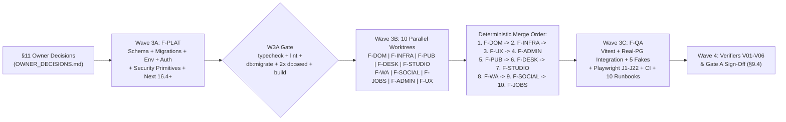

# 02 — Exclusive File Ownership Map & Wave 3 Merge Topology (`W3A → W3B → W3C`)

**Author**: `w2-spec` (Wave 2 Ownership Architect & Spec 0024 Author)  
**Target Workspace**: `c:\dev\al-ramlah-travels\web` (+ parent infrastructure paths `../scripts/oracle-gotenberg/**` & `../.github/workflows/**`)  
**Branch Strategy**: Base branch `audit/production-hardening`; per-fixer isolated worktrees (`workspace: "share"`) in Wave 3B  
**Verification Verdict**: **376 / 376** real workspace files across `app/`, `components/`, `lib/`, `db/`, `drizzle/`, `trigger/`, `scripts/`, `tests/`, `hooks/`, `public/`, `nginx/`, and root config are mapped **1-to-1** with **`0` unowned files** and **`0` doubly-owned files**.

---

## 1. Canonical 12-Fixer Roster & Wave 3 Execution Order

All Wave 2 Triage (`02-triage.md`), Spec `0024` milestones, Wave 3 Fixers (`03-fix-log.md`), and Wave 4 Verifiers (`04-verification.md`) **MUST** use these exact 12 Fixer IDs and 3 serialized sub-waves:

| Sub-Wave | Execution Mode | Fixer ID | Role & Domain Scope | Existing Files Owned (`web/`) | New / External Paths Owned |
| :--- | :--- | :--- | :--- | :---: | :--- |
| **W3A** | **Serialized Foundation** *(runs FIRST on `audit/production-hardening` before any W3B worktree forks)* | **`F-PLAT`** | Shared hot platform, Next.js/Docker/Nginx config, Drizzle schema & migrations, seed idempotency, Better Auth + RBAC guards, fail-closed `lib/env.ts`, security primitives (`logger`, `rate-limit`, `audit-log`), `/api/health`, root layout & error boundaries | **63** | `app/api/health/**`, `app/error.tsx`, `app/global-error.tsx`, `app/not-found.tsx`, `instrumentation.ts`, `lib/logger.ts`, `lib/rate-limit.ts`, `lib/audit-log.ts`, `lib/security/**`, `db/schema/audit-logs.ts`, `drizzle/0003_*.sql`, `tests/w3/f-plat/**` |
| **W3B** | **Parallel Worktrees** *(10 strictly disjoint `workspace: "share"` branches forked from post-W3A HEAD)* | **`F-DOM`** | Pure domain calculators, 9 Haramain business invariants, phone/JID normalization SSoT (`lib/phone.ts` + `lib/whatsapp/phone-utils.ts`), brand constants, and all Zod validation schemas | **24** | `lib/constants/brand.ts`, `tests/w3/f-dom/**` |
| **W3B** | Parallel Worktree | **`F-INFRA`** | Cloudflare R2 public/private storage split, presigned & private media proxy routes, Gotenberg v8 `/html` & Chromium CDP prod-block clients, `logo-icon.png` compression, committed real-client PDF purge, and Oracle ARM VM scripts | **21** | `app/api/media/**`, `../scripts/oracle-gotenberg/**` (5 files), `tests/w3/f-infra/**` |
| **W3B** | Parallel Worktree | **`F-PUB`** | Public pilgrim routes (`/`, `/privacy`, `/terms`, tokenized `/quote/*` & `/voucher/*`), public header/footer/FAB, 6-step Custom Journey Builder, Group Booking Modal, Hajj 2027 Inquiry, Contact form, Status Tracker, and `app/actions/applications.ts` | **35** | `app/(public)/quote/**`, `app/(public)/voucher/**`, `app/(public)/refund-policy/**`, `tests/w3/f-pub/**` |
| **W3B** | Parallel Worktree | **`F-DESK`** | Admin Overview Dashboard (`/admin` KPIs, charts, CSV export), global `Cmd+K` Command Palette, Applications Kanban Board, Dossier & Quote Worksheet, Group Packages actions, 3-Page Gotenberg Quotation PDF renderer, and Admin Voucher | **23** | `app/admin/(dashboard)/quotes/**`, `components/admin/command-palette*`, `tests/w3/f-desk/**` |
| **W3B** | Parallel Worktree | **`F-STUDIO`** | Multimodal BYO-Poster & Supplier Studio (`/admin/studio`), AI Layer (`extract-packages.ts`, `quoting-copilot.ts` + `app/actions/quoting-copilot.ts`), HTML Poster Renderers (`multi-package`, `single-package`), and `app/actions/marketing-ops.ts` | **11** | `app/admin/(dashboard)/flyers/**`, `lib/posters/render-*-poster.ts`, `tests/w3/f-studio/**` |
| **W3B** | Parallel Worktree | **`F-WA`** | Meta WhatsApp Cloud API v21.0, Baileys Linked-Device Engine & sidecar client, `/api/webhooks/whatsapp`, 3-Priority Auto-Responder, Guided Umrah Intake, `STOP`/`do_not_contact` enforcement, Marketing Bridges, and Live Desk Hub (`/admin/desk`) | **21** | `app/admin/(dashboard)/whatsapp/**`, `components/admin/desk/meta-template-builder-modal.tsx`, `tests/w3/f-wa/**` |
| **W3B** | Parallel Worktree | **`F-SOCIAL`** | Core 5 Social OAuth (`IG`, `FB`, `TikTok`, `YouTube`, `GBP v1`), Publishers, Token Refresh, PKT Time-Slots, Caption Copilot, Real Analytics (no SHA-256 mocks), Campaigns Hub (`/admin/campaigns`), Broadcast Drawer, and 14-Day VIP Outreach UI | **34** | `app/admin/(dashboard)/social/**`, `tests/w3/f-social/**` |
| **W3B** | Parallel Worktree | **`F-JOBS`** | Trigger.dev Cloud v4 worker config (`trigger.config.ts`), `dispatch.ts` prod fail-closed guard, `rethrowAsTaskError` wiring across all 8 `schemaTask`s & 4 crons, `trigger-realtime.ts` scoped tokens, and `copilot-realtime-run-banner.tsx` | **17** | `lib/trigger/**`, `tests/w3/f-jobs/**` |
| **W3B** | Parallel Worktree | **`F-ADMIN`** | Catalog & CMS 16-entity CRUD (`catalog.ts`, `cms.ts`), FK-safe soft-delete guards, `revalidatePath` hub freshness, Settings Hub & `Config Health` tab (`?tab=health`), `lib/company-info.ts` SSoT, and 10 remaining legacy `/admin/*` redirect stubs | **36** | `components/admin/settings/**`, `tests/w3/f-admin/**` |
| **W3B** | Parallel Worktree | **`F-UX`** | Shared `@base-ui/react` (`base-nova`) UI primitives (`components/ui/**`), Admin Dashboard Shell (`layout.tsx`, `admin-sidebar.tsx`, `admin-topbar.tsx`, `status-badge.tsx`), WCAG 2.2 AA contrast tokens, `tabular-nums`, focus traps & `320px` mobile reflow | **69** | `components/admin/shell/**`, `app/admin/(dashboard)/error.tsx`, `app/admin/(dashboard)/loading.tsx`, `tests/w3/f-ux/**` |
| **W3C** | **Serialized Post-Merge QA, CI & Ops** *(runs AFTER all W3B branches merge cleanly)* | **`F-QA`** | `vitest.config.ts` (`assertAuditSafeEnvironment` + `disableNetConnect`), repair/migration of 20 legacy `tests/*.test.ts`, real-PG `tests/integration/**` (incl. 158-action AuthZ auto-runner & concurrency), `tests/fakes/**`, Playwright `tests/e2e/**` (`J1`–`J22`), `.github/workflows/ci.yml`, and 10 Ops Runbooks (`RB-01`..`RB-10`) | **22** | `vitest.config.ts`, `playwright.config.ts`, `tests/setup/**`, `tests/fakes/**`, `tests/unit/**`, `tests/integration/**`, `tests/e2e/**`, `.github/workflows/ci.yml` (`../.github/workflows/**`), `docs/audit/runbooks/RB-01..10.md` |
| — | **TOTAL** | **12 Fixers** | **100.0% Workspace Partition (`0` Unowned · `0` Overlapping)** | **376** | Disjoint per-fixer namespaces |

---

## 2. Disambiguated Real-Path Rules (Critical Collision Prevention)

Static enumeration of `c:\dev\al-ramlah-travels\web` uncovered 9 path differences between `AGENTS.md` / `PLATFORM_MASTER_BRIEF.md` shorthand and actual on-disk paths. Every fixer and verifier must follow these exact bindings:

1. **Phone Normalization Dual-File SSoT (`F-DOM`)**: Both `lib/phone.ts` AND `lib/whatsapp/phone-utils.ts` belong exclusively to **`F-DOM`**. **`F-WA`** owns `lib/whatsapp/**` **EXCEPT** `lib/whatsapp/phone-utils.ts`. (`lib/utils.ts` re-exports `formatWhatsAppPhone` from `./phone` and `cn`; `lib/utils.ts` is owned by **`F-PLAT`** in W3A so `"cn": "^0.4.0"` can be replaced alongside `package.json`.)
2. **Realtime Copilot Banner Inside `components/admin/desk/` (`F-JOBS` vs `F-WA`)**: On disk, `copilot-realtime-run-banner.tsx` resides at `components/admin/desk/copilot-realtime-run-banner.tsx`. It is owned exclusively by **`F-JOBS`**. **`F-WA`** owns `components/admin/desk/**` **EXCEPT** `components/admin/desk/copilot-realtime-run-banner.tsx` (plus `F-WA` owns `components/admin/whatsapp/whatsapp-linked-device-card.tsx`).
3. **Global Command Palette & Kanban Board (`F-DESK`)**: On disk, `CommandPalette` resides at `components/layout/command-palette.tsx` and the Kanban pipeline board resides at `components/admin/hubs/applications-kanban-board.tsx`. Both belong exclusively to **`F-DESK`** (alongside `app/actions/command-lookup.ts` and `app/actions/quotes.ts`).
4. **Split of `components/layout/` Across Public, Desk & Admin Shell (`F-PUB` / `F-DESK` / `F-UX`)**:
   - **`F-PUB`** owns `components/layout/public-header.tsx`, `components/layout/public-footer.tsx`, and `components/layout/whatsapp-fab.tsx` (rendered solely by `app/(public)/layout.tsx`).
   - **`F-DESK`** owns `components/layout/command-palette.tsx`.
   - **`F-UX`** owns `components/layout/admin-sidebar.tsx`, `components/layout/admin-topbar.tsx`, and `components/layout/status-badge.tsx` (plus `app/admin/(dashboard)/layout.tsx`, `components/theme-provider.tsx`, and `hooks/use-mobile.ts`).
5. **Actual Poster Renderer & Copilot Action Filenames (`F-STUDIO`)**:
   - On disk, `lib/posters/` contains `gotenberg.ts` (**`F-INFRA`**), `chromium-cdp.ts` (**`F-INFRA`**), `render-quotation-pdf.ts` (**`F-DESK`**), and `extract-supplier-flyer.ts`, `render-multi-package-poster.ts`, `render-single-package-poster.ts` (**`F-STUDIO`**). Any new poster templates (`render-*-poster.ts`) also belong to **`F-STUDIO`**.
   - `app/actions/quoting-copilot.ts` belongs to **`F-STUDIO`** (paired with `lib/ai/quoting-copilot.ts`), and legacy redirect `app/admin/(dashboard)/supplier-flyers/page.tsx` belongs to **`F-STUDIO`**.
6. **AI Helpers Inside `lib/social/` and `lib/whatsapp/` (`F-SOCIAL` & `F-WA`)**:
   - `lib/social/caption-copilot.ts` stays inside `lib/social/**` under **`F-SOCIAL`** (zero exception needed on `lib/social/**`).
   - `lib/whatsapp/intent-classifier.ts` stays inside `lib/whatsapp/**` under **`F-WA`**.
7. **Settings Hub Client & `lib/company-info.ts` (`F-ADMIN`)**:
   - On disk, the Settings UI client lives at `components/admin/hubs/connections-settings-client.tsx` (and legacy `components/admin/catalog/settings-client.tsx`). Both, plus `lib/company-info.ts`, belong to **`F-ADMIN`**.
   - **Backward-Compatibility Rule**: Because `F-PUB`, `F-DESK`, and `F-STUDIO` import `getCompanyInfo`, `CompanyInfo`, `buildWhatsappUrl`, and `DEFAULT_COMPANY_INFO` from `lib/company-info.ts`, **`F-ADMIN`** may add new optional/populated fields (`dtsLicense`, `moraLicense`, `ntn`, `iban`, etc.) and fix normalization bugs, but MUST NOT rename or remove existing `CompanyInfo` properties during W3B.
8. **14 Legacy Redirect `page.tsx` Stubs Partition (`0` Overlap)**:
   - `app/admin/(dashboard)/applications/page.tsx` → **`F-DESK`**
   - `app/admin/(dashboard)/supplier-flyers/page.tsx` → **`F-STUDIO`**
   - `app/admin/(dashboard)/distribution/page.tsx` & `app/admin/(dashboard)/outreach/page.tsx` → **`F-SOCIAL`**
   - Remaining 10 stubs (`content`, `flights`, `groups`, `hotels`, `messages`, `post-lookup`, `transport`, `users`, `visa`, `ziyarat` under `app/admin/(dashboard)/*/page.tsx`) → **`F-ADMIN`**
9. **Red→Green Tests Without `tests/*.test.ts` Merge Conflicts (`W3B` vs `W3C`)**:
   - Existing 22 files in `tests/` (`20` `.test.ts` + `tests/test-env.ts` + `tests/helpers/audit-guard.ts`) are owned exclusively by **`F-QA`** in **W3C**.
   - During **W3A** and **W3B**, each fixer writes its mandatory red→green unit/regression tests in its own disjoint directory **`tests/w3/<fixer-id>/*.test.ts`** (e.g., `tests/w3/f-dom/invariants-and-phones.test.ts`, `tests/w3/f-wa/webhook-and-stop-dnc.test.ts`). **`F-PLAT`** updates `package.json` `"test"` in W3A so `tests/w3/**/*.test.ts` executes cleanly alongside existing suites, and **`F-QA`** unifies all suites under Vitest + real-PG integration + Playwright E2E in **W3C**.

---

## 3. Exhaustive Per-Fixer Ownership Rules & Real File Inventory

### 3.1 Wave 3A — Serialized Platform Foundation (`F-PLAT`)

- **Fixer ID**: `F-PLAT`
- **Sub-Wave**: `W3A` (executes directly on `audit/production-hardening` **before** W3B branches fork)
- **Rule Patterns**:
  - Root & build configs: `package.json`, `package-lock.json`, `pnpm-lock.yaml`, `pnpm-workspace.yaml`, `next.config.ts`, `next-env.d.ts`, `tsconfig.json`, `tsconfig.tsbuildinfo`, `eslint.config.mjs`, `postcss.config.mjs`, `components.json`, `drizzle.config.ts`, `.gitignore`, `.dockerignore`, `.env.example`, `.prettierrc`, `.prettierignore`, `.mcp.json`, `.next-dev.log`, `skills-lock.json`, `Dockerfile`, `nginx/**`, `proxy.ts`, `instrumentation.ts`, `AGENTS.md`, `CLAUDE.md`, `README.md`, `design.md`
  - Root App Router shell & health/auth APIs: `app/layout.tsx`, `app/globals.css`, `app/favicon.ico`, `app/error.tsx`, `app/global-error.tsx`, `app/not-found.tsx`, `app/api/auth/**`, `app/api/health/**`, `app/admin/(auth)/**`
  - Core env, auth, security & observability primitives: `lib/.gitkeep`, `lib/env.ts`, `lib/utils.ts`, `lib/auth.ts`, `lib/auth-client.ts`, `lib/auth-guard.ts`, `lib/logger.ts`, `lib/rate-limit.ts`, `lib/audit-log.ts`, `lib/security/**`, `lib/obs/**`, `lib/audit/**`
  - Database client, Drizzle schema, SQL migrations, seed & CLI scripts: `db/**`, `drizzle/**`, `scripts/**`
  - W3A regression tests: `tests/w3/f-plat/**`
- **Exact Existing Files (`63` files)**:
  - Root (`25`): `.dockerignore`, `.env.example`, `.gitignore`, `.mcp.json`, `.next-dev.log`, `.prettierignore`, `.prettierrc`, `AGENTS.md`, `CLAUDE.md`, `Dockerfile`, `README.md`, `components.json`, `design.md`, `drizzle.config.ts`, `eslint.config.mjs`, `next-env.d.ts`, `next.config.ts`, `package-lock.json`, `package.json`, `pnpm-lock.yaml`, `pnpm-workspace.yaml`, `postcss.config.mjs`, `proxy.ts`, `skills-lock.json`, `tsconfig.json`, `tsconfig.tsbuildinfo` *(note: `.next-dev.log`, `tsconfig.tsbuildinfo`, `pnpm-lock.yaml` slated for cleanup/untracking as applicable)*
  - `nginx/` (`1`): `nginx/nginx.conf`
  - `app/` (`5`): `app/favicon.ico`, `app/globals.css`, `app/layout.tsx`, `app/admin/(auth)/login/page.tsx`, `app/api/auth/[...all]/route.ts`
  - `lib/` (`6`): `lib/.gitkeep`, `lib/auth-client.ts`, `lib/auth-guard.ts`, `lib/auth.ts`, `lib/env.ts`, `lib/utils.ts`
  - `db/` (`13`): `db/index.ts`, `db/schema.ts`, `db/schema/applications.ts`, `db/schema/auth.ts`, `db/schema/catalog.ts`, `db/schema/cms.ts`, `db/schema/index.ts`, `db/schema/packages.ts`, `db/schema/settings.ts`, `db/schema/social-scheduler.ts`, `db/schema/suppliers-and-marketing.ts`, `db/schema/whatsapp-crm.ts`, `db/seed.ts`
  - `drizzle/` (`7`): `drizzle/0000_noisy_leader.sql`, `drizzle/0001_cynical_proudstar.sql`, `drizzle/0001_suppliers_marketing_and_meal_plans.sql`, `drizzle/0002_whatsapp_crm_social_scheduler_and_studio.sql`, `drizzle/meta/0000_snapshot.json`, `drizzle/meta/0001_snapshot.json`, `drizzle/meta/_journal.json`
  - `scripts/` (`5`): `scripts/audit-and-sync-schema.ts`, `scripts/db-package-cleanup.ts`, `scripts/purge-all-demo-data.ts`, `scripts/sync-phase3-columns.ts`, `scripts/sync-slice40-schema.ts`
- **Mandatory W3A Deliverables Frozen Before W3B Forks**:
  1. Transactional DB export (`withTransaction` / `dbPool` via `@neondatabase/serverless` WebSocket `Pool` in prod & `pg.Pool` for local TCP Postgres `127.0.0.1:54329`) in `db/index.ts` without breaking existing `db.query.*` / `db.select()` callers.
  2. Reconciled Drizzle schema + forward SQL migration (`43` existing tables incl. `whatsapp_linked_device_sessions` + new `audit_logs`, `rate_limit`, `rate_limit_buckets`, `applications.sla_overdue_at` / quote acceptance token columns, `idx_marketing_channels_external_handle`, FK `ON DELETE` fixes, CHECK constraints).
  3. Shared helpers with stable signatures for W3B callers: `lib/logger.ts` (zero-PII redaction + `serializeError`), `lib/rate-limit.ts` (`enforceRateLimit`), `lib/audit-log.ts` (`recordAuditLog`), `lib/security/html-escape.ts` & `lib/security/ssrf-guard.ts` (`escapeHtml`, `assertSafeExternalUrl`), and `lib/auth-guard.ts` (`requireAdmin`, `requireSuperAdmin` checking live `user.isActive`).

---

### 3.2 Wave 3B — Parallel Domain & Feature Worktrees (`F-DOM` .. `F-UX`)

#### 1. `F-DOM` — Pure Domain Logic, 9 Invariants, Phone SSoT & Zod Schemas
- **Sub-Wave**: `W3B` (`workspace: "share"`)
- **Rule Patterns**: `lib/domain/**`, `lib/validations/**`, `lib/constants/**`, `lib/phone.ts`, `lib/whatsapp/phone-utils.ts`, `tests/w3/f-dom/**`
- **Exact Existing Files (`24` files)**:
  - `lib/constants/admin-shortcuts.ts`
  - `lib/domain/date-chaining.ts`, `lib/domain/dates.ts`, `lib/domain/index.ts`, `lib/domain/marketing-ops.ts`, `lib/domain/quote-hints.ts`, `lib/domain/room-splitter.ts`, `lib/domain/rooms.ts`, `lib/domain/vehicle-capacity.ts`, `lib/domain/vehicles.ts`, `lib/domain/visa-calc.ts`, `lib/domain/visa.ts`
  - `lib/phone.ts`, `lib/whatsapp/phone-utils.ts`
  - `lib/validations/application.ts`, `lib/validations/catalog.ts`, `lib/validations/cms.ts`, `lib/validations/index.ts`, `lib/validations/inventory.ts`, `lib/validations/marketing.ts`, `lib/validations/quote.ts`, `lib/validations/social-scheduler.ts`, `lib/validations/whatsapp-crm.ts`, `lib/validations/whatsapp-linked-device.ts`

#### 2. `F-INFRA` — R2 Storage, Upload/Media Endpoints, Gotenberg/CDP Clients, Assets & Oracle VM
- **Sub-Wave**: `W3B` (`workspace: "share"`)
- **Rule Patterns**: `lib/storage/**`, `lib/posters/gotenberg.ts`, `lib/posters/chromium-cdp.ts`, `app/api/uploads/**`, `app/api/media/**`, `public/**`, `../scripts/oracle-gotenberg/**`, `tests/w3/f-infra/**`
- **Exact Existing Files (`21` in `web/` + `5` in `../scripts/oracle-gotenberg/`)**:
  - `lib/storage/r2.ts`
  - `lib/posters/gotenberg.ts`, `lib/posters/chromium-cdp.ts`
  - `app/api/uploads/local/route.ts`, `app/api/uploads/presign/route.ts`
  - `public/.gitkeep`, `public/logo-icon.png`, `public/logo.jpg`, `public/tiktok-app-icon-1024.png`
  - `public/uploads/r2-local/posters/sheets/art-am-21d-all-52b_sheet_1_4k.png`, `art-am-21d-all-52b_sheet_1_vector.pdf`, `art-up-15d-all-f88_sheet_1_4k.png`, `art-up-15d-all-f88_sheet_1_vector.pdf`
  - `public/uploads/r2-local/posters/spotlights/art-am-21d-04_4k.png`, `art-am-21d-04_vector.pdf`
  - `public/uploads/sample-posts/ammaar-raw-17cards.jpg`, `ammaar-spotlight-04.png`, `ammaar-wrapped-sheet.png`, `upsky-raw-15d.jpeg`, `upsky-wrapped-15d.jpeg`, `zahoor-adil-rafi-quotation.pdf` *(P0 PII purge target)*
  - Parent repo (`5`): `../scripts/oracle-gotenberg/.env.example`, `../scripts/oracle-gotenberg/Caddyfile`, `../scripts/oracle-gotenberg/README.md`, `../scripts/oracle-gotenberg/docker-compose.yml`, `../scripts/oracle-gotenberg/setup-oracle-arm.sh`

#### 3. `F-PUB` — Public Pilgrim Routes, Journey Builder, Group Modal, Hajj, Contact, Tracker & Legal
- **Sub-Wave**: `W3B` (`workspace: "share"`)
- **Rule Patterns**: `app/(public)/**`, `components/public/**`, `components/planner/**`, `components/layout/public-header.tsx`, `components/layout/public-footer.tsx`, `components/layout/whatsapp-fab.tsx`, `app/actions/applications.ts`, `tests/w3/f-pub/**`
- **Exact Existing Files (`35` files)**:
  - `app/(public)/layout.tsx`, `app/(public)/page.tsx`, `app/(public)/privacy/page.tsx`, `app/(public)/terms/page.tsx`
  - `app/actions/applications.ts`
  - `components/layout/public-footer.tsx`, `components/layout/public-header.tsx`, `components/layout/whatsapp-fab.tsx`
  - `components/planner/city-sequence-module.tsx`, `custom-journey-builder.tsx`, `dates-and-travellers-bar.tsx`, `flight-preferences-module.tsx`, `hotel-card.tsx`, `hotel-selection-module.tsx`, `index.ts`, `lead-capture-dialog.tsx`, `live-summary-card.tsx`, `mode-preset-pills.tsx`, `planner-context.tsx`, `planner-date-picker.tsx`, `review-and-submit-step.tsx`, `room-allocator.tsx`, `segment-card.tsx`, `service-pillar-toggles.tsx`, `transport-selection-module.tsx`, `vehicle-capacity-pill.tsx`, `wizard-stepper.tsx`, `ziyarat-selection-module.tsx`
  - `components/public/contact-section.tsx`, `group-booking-modal.tsx`, `group-packages-section.tsx`, `hajj-inquiry-section.tsx`, `hero-slider.tsx`, `marketing-sections.tsx`, `status-tracker.tsx`

#### 4. `F-DESK` — Overview Dashboard, `Cmd+K` Lookup, Kanban, Dossier, Quote Worksheet, PDF & Voucher
- **Sub-Wave**: `W3B` (`workspace: "share"`)
- **Rule Patterns**: `app/admin/(dashboard)/page.tsx`, `app/admin/(dashboard)/applications/**`, `app/admin/(dashboard)/quotes/**`, `components/admin/dashboard/**`, `components/admin/applications/**`, `components/admin/hubs/applications-kanban-board.tsx`, `components/layout/command-palette.tsx`, `components/admin/command-palette*`, `app/actions/quotes.ts`, `app/actions/command-lookup.ts`, `app/actions/groups.ts`, `lib/posters/render-quotation-pdf.ts`, `tests/w3/f-desk/**`
- **Exact Existing Files (`23` files)**:
  - `app/admin/(dashboard)/page.tsx`, `app/admin/(dashboard)/applications/page.tsx`, `app/admin/(dashboard)/applications/[id]/page.tsx`, `app/admin/(dashboard)/applications/[id]/voucher/page.tsx`
  - `app/actions/command-lookup.ts`, `app/actions/groups.ts`, `app/actions/quotes.ts`
  - `components/admin/applications/application-dossier.tsx`, `applications-filters.tsx`, `applications-kpi-strip.tsx`, `applications-table.tsx`, `quote-dispatch-bar.tsx`, `quote-worksheet-form.tsx`, `voucher-print-button.tsx`
  - `components/admin/dashboard/dashboard-charts.tsx`, `executive-kpi-cards.tsx`, `export-csv-button.tsx`, `group-occupancy-card.tsx`, `recent-applications-table.tsx`, `smart-insights-banner.tsx`
  - `components/admin/hubs/applications-kanban-board.tsx`
  - `components/layout/command-palette.tsx`
  - `lib/posters/render-quotation-pdf.ts`

#### 5. `F-STUDIO` — Multimodal BYO-Poster Studio, AI Layer & HTML Poster Renderers
- **Sub-Wave**: `W3B` (`workspace: "share"`)
- **Rule Patterns**: `app/admin/(dashboard)/studio/**`, `app/admin/(dashboard)/flyers/**`, `app/admin/(dashboard)/supplier-flyers/**`, `components/admin/studio/**`, `components/admin/hubs/studio-hub-client.tsx`, `lib/ai/**`, `lib/posters/extract-supplier-flyer.ts`, `lib/posters/render-multi-package-poster.ts`, `lib/posters/render-single-package-poster.ts`, `lib/posters/render-*-poster.ts` *(excluding `render-quotation-pdf.ts`)*, `app/actions/marketing-ops.ts`, `app/actions/quoting-copilot.ts`, `tests/w3/f-studio/**`
- **Exact Existing Files (`11` files)**:
  - `app/admin/(dashboard)/studio/page.tsx`, `app/admin/(dashboard)/supplier-flyers/page.tsx`
  - `app/actions/marketing-ops.ts`, `app/actions/quoting-copilot.ts`
  - `components/admin/hubs/studio-hub-client.tsx`, `components/admin/studio/studio-realtime-run-banner.tsx`
  - `lib/ai/extract-packages.ts`, `lib/ai/quoting-copilot.ts`
  - `lib/posters/extract-supplier-flyer.ts`, `lib/posters/render-multi-package-poster.ts`, `lib/posters/render-single-package-poster.ts`

#### 6. `F-WA` — WhatsApp Cloud API, Baileys Linked-Device, Webhooks, Bot, Intake, Bridges & Desk Hub
- **Sub-Wave**: `W3B` (`workspace: "share"`)
- **Rule Patterns**: `app/api/webhooks/whatsapp/**`, `lib/whatsapp/**` *(EXCEPT `lib/whatsapp/phone-utils.ts` owned by `F-DOM`)*, `lib/bridges/**`, `app/actions/whatsapp-crm.ts`, `app/actions/whatsapp-linked-device.ts`, `app/admin/(dashboard)/desk/**`, `app/admin/(dashboard)/whatsapp/**`, `components/admin/desk/**` *(EXCEPT `components/admin/desk/copilot-realtime-run-banner.tsx` owned by `F-JOBS`)*, `components/admin/whatsapp/**`, `components/admin/hubs/desk-hub-client.tsx`, `tests/w3/f-wa/**`
- **Exact Existing Files (`21` files)**:
  - `app/api/webhooks/whatsapp/route.ts`
  - `app/admin/(dashboard)/desk/page.tsx`
  - `app/actions/whatsapp-crm.ts`, `app/actions/whatsapp-linked-device.ts`
  - `components/admin/desk/whatsapp-auto-reply-studio.tsx`
  - `components/admin/hubs/desk-hub-client.tsx`
  - `components/admin/whatsapp/whatsapp-linked-device-card.tsx`
  - `lib/bridges/marketing-bridges.ts`
  - `lib/whatsapp/auto-responder.ts`, `encryption.ts`, `intake-flow.ts`, `intent-classifier.ts`, `linked-device-auth-postgres.ts`, `linked-device.ts`, `media-mirror.ts`, `meta-api.ts`, `post-ref-detector.ts`, `template-send-builder.ts`, `template-variables.ts`, `webhook-body.ts`, `webhook-signature.ts`

#### 7. `F-SOCIAL` — Core 5 Social OAuth, Publishers, Time-Slots, Analytics, Campaigns Hub & Outreach UI
- **Sub-Wave**: `W3B` (`workspace: "share"`)
- **Rule Patterns**: `app/api/oauth/social/**`, `lib/social/**`, `app/actions/social-scheduler.ts`, `app/admin/(dashboard)/campaigns/**`, `app/admin/(dashboard)/social/**`, `app/admin/(dashboard)/distribution/**`, `app/admin/(dashboard)/outreach/**`, `components/admin/campaigns/**`, `components/admin/marketing/**`, `components/admin/hubs/campaigns-hub-client.tsx`, `tests/w3/f-social/**`
- **Exact Existing Files (`34` files)**:
  - `app/api/oauth/social/[provider]/route.ts`, `app/api/oauth/social/[provider]/callback/route.ts`, `app/api/oauth/social/[provider]/composio-callback/route.ts`
  - `app/admin/(dashboard)/campaigns/page.tsx`, `app/admin/(dashboard)/distribution/page.tsx`, `app/admin/(dashboard)/outreach/page.tsx`
  - `app/actions/social-scheduler.ts`
  - `components/admin/campaigns/campaign-realtime-status.tsx`, `social-calendar-view.tsx`, `social-platform-preview.tsx`, `studio-media-picker-modal.tsx`, `whatsapp-broadcast-drawer.tsx`
  - `components/admin/hubs/campaigns-hub-client.tsx`
  - `components/admin/marketing/distribution-client.tsx`, `outreach-client.tsx`, `post-lookup-client.tsx`, `supplier-flyers-client.tsx`
  - `lib/social/analytics-aggregate.ts`, `analytics.ts`, `caption-copilot.ts`, `composio.ts`, `crypto.ts`, `first-comment.ts`, `normalize-media.ts`, `preview-formatter.ts`, `time-slots.ts`, `token-refresh.ts`, `types.ts`
  - `lib/social/providers/facebook.ts`, `gmb.ts`, `index.ts`, `instagram.ts`, `tiktok.ts`, `youtube.ts`

#### 8. `F-JOBS` — Trigger.dev v4 Config, Dispatch, Realtime Tokens/Banner & All Durable Tasks/Crons
- **Sub-Wave**: `W3B` (`workspace: "share"`)
- **Rule Patterns**: `trigger.config.ts`, `trigger/**`, `lib/trigger/**`, `app/actions/trigger-realtime.ts`, `components/admin/desk/copilot-realtime-run-banner.tsx`, `components/admin/copilot-realtime-run-banner.tsx`, `tests/w3/f-jobs/**`
- **Exact Existing Files (`17` files)**:
  - `trigger.config.ts`
  - `trigger/dispatch.ts`, `errors.ts`, `extract-packages.task.ts`, `index.ts`, `metadata.ts`, `mirror-whatsapp-media.task.ts`, `process-inbound-whatsapp.task.ts`, `publish-social-post.task.ts`, `queues.ts`, `quoting-copilot.task.ts`, `render-gotenberg-asset.task.ts`, `schedules.task.ts`, `send-whatsapp-broadcast.task.ts`, `send-whatsapp-group-campaign.task.ts`
  - `app/actions/trigger-realtime.ts`
  - `components/admin/desk/copilot-realtime-run-banner.tsx`

#### 9. `F-ADMIN` — Catalog/CMS 16-Entity CRUD, Settings Hub, Config Health, Agency SSoT & Redirects
- **Sub-Wave**: `W3B` (`workspace: "share"`)
- **Rule Patterns**: `app/admin/(dashboard)/catalog/**`, `app/admin/(dashboard)/settings/**`, 10 legacy redirect stubs (`content`, `flights`, `groups`, `hotels`, `messages`, `post-lookup`, `transport`, `users`, `visa`, `ziyarat` under `app/admin/(dashboard)/*/page.tsx`), `components/admin/catalog/**`, `components/admin/settings/**`, `components/admin/hubs/catalog-hub-client.tsx`, `components/admin/hubs/connections-settings-client.tsx`, `app/actions/catalog.ts`, `app/actions/cms.ts`, `lib/company-info.ts`, `tests/w3/f-admin/**`
- **Exact Existing Files (`36` files)**:
  - `app/admin/(dashboard)/catalog/page.tsx`, `app/admin/(dashboard)/settings/page.tsx`
  - Legacy redirects (`10`): `app/admin/(dashboard)/content/page.tsx`, `flights/page.tsx`, `groups/page.tsx`, `hotels/page.tsx`, `messages/page.tsx`, `post-lookup/page.tsx`, `transport/page.tsx`, `users/page.tsx`, `visa/page.tsx`, `ziyarat/page.tsx`
  - `app/actions/catalog.ts`, `app/actions/cms.ts`
  - `lib/company-info.ts`
  - `components/admin/hubs/catalog-hub-client.tsx`, `components/admin/hubs/connections-settings-client.tsx`
  - `components/admin/catalog/airline-dialog.tsx`, `content-client.tsx`, `content-dialogs.tsx`, `departure-batch-dialog.tsx`, `departure-city-dialog.tsx`, `flights-client.tsx`, `group-package-dialog.tsx`, `groups-client.tsx`, `hotel-dialog.tsx`, `hotels-client.tsx`, `messages-client.tsx`, `sector-dialog.tsx`, `settings-client.tsx`, `transport-client.tsx`, `users-client.tsx`, `vehicle-dialog.tsx`, `visa-client.tsx`, `ziyarat-client.tsx`, `ziyarat-dialog.tsx`

#### 10. `F-UX` — Shared Base UI Primitives, Admin Shell, WCAG 2.2 AA Contrast & Mobile Reflow
- **Sub-Wave**: `W3B` (`workspace: "share"`)
- **Rule Patterns**: `components/ui/**`, `components/admin/shell/**`, `hooks/**`, `app/admin/(dashboard)/layout.tsx`, `app/admin/(dashboard)/error.tsx`, `app/admin/(dashboard)/loading.tsx`, `components/.gitkeep`, `components/theme-provider.tsx`, `components/layout/admin-sidebar.tsx`, `components/layout/admin-topbar.tsx`, `components/layout/status-badge.tsx`, `tests/w3/f-ux/**`
- **Exact Existing Files (`69` files)**:
  - `app/admin/(dashboard)/layout.tsx`
  - `components/.gitkeep`, `components/theme-provider.tsx`
  - `components/layout/admin-sidebar.tsx`, `components/layout/admin-topbar.tsx`, `components/layout/status-badge.tsx`
  - `hooks/.gitkeep`, `hooks/use-mobile.ts`
  - `components/ui/*` (`61` Base UI `base-nova` primitives: `accordion.tsx` through `tooltip.tsx`)

---

### 3.3 Wave 3C — Post-Merge QA, Integration/E2E Suites, CI & Ops Runbooks (`F-QA`)

- **Fixer ID**: `F-QA`
- **Sub-Wave**: `W3C` (executes on `audit/production-hardening` **after** all 10 W3B worktrees merge)
- **Rule Patterns**: `vitest.config.ts`, `playwright.config.ts`, `tests/**` (all legacy `tests/*.test.ts`, `tests/helpers/**`, `tests/setup/**`, `tests/fakes/**`, `tests/unit/**`, `tests/integration/**`, `tests/e2e/**`, plus consolidation of `tests/w3/**`), `.github/workflows/**` & `../.github/workflows/**`, `docs/audit/runbooks/**`
- **Exact Existing Files (`22` files)**:
  - `tests/test-env.ts`, `tests/helpers/audit-guard.ts`
  - `tests/ai-quoting-copilot.test.ts`, `composio-and-social-oauth.test.ts`, `domain-and-validation.test.ts`, `marketing-and-suppliers.test.ts`, `multimodal-and-gotenberg.test.ts`, `social-phase2-reels-and-comments.test.ts`, `social-phase3-calendar-copilot-and-providers.test.ts`, `social-preview-and-analytics.test.ts`, `social-providers-validation.test.ts`, `trigger-dispatch-wiring.test.ts`, `trigger-v4-and-schedules.test.ts`, `trigger-v4-webhook-and-realtime-copilot.test.ts`, `whatsapp-auto-reply-rules.test.ts`, `whatsapp-intent-coexistence.test.ts`, `whatsapp-linked-device-and-groups.test.ts`, `whatsapp-multi-number-system.test.ts`, `whatsapp-phase2-bot-and-media.test.ts`, `whatsapp-phase3-flows-and-broadcasts.test.ts`, `whatsapp-security-and-detector.test.ts`, `ziyarat-scope-sync.test.ts`

---

## 4. Cross-Boundary Request Rules & Wave 3 Merge Order

### 4.1 Hard Non-Overlap Rules
1. **Zero Unauthorized Touches**: A fixer MUST NOT modify, delete, rename, or format any file outside its assigned ownership rules above. Running `git diff --name-only` on a fixer's branch must match 100% against its rule set.
2. **Cross-Boundary Need During W3B**: If a W3B fixer discovers it needs an export, column, Zod field, or prop owned by another fixer:
   - **Never edit the other fixer's file.**
   - Post a concise `@coordinator` + `@<peer-fixer>` board message citing the `T-ID`, exact file path, and requested TypeScript signature.
   - If the target is a W3A `F-PLAT` file (`package.json`, `db/schema/*`, `lib/env.ts`, `proxy.ts`, `app/globals.css`), `@coordinator` applies a surgical post-W3B integration commit or sequences a micro-patch after W3B merge.
3. **Exported Function Signature Stability**: When modifying shared modules imported by other W3B fixers (e.g., `F-DOM` editing `lib/domain/*` or `lib/phone.ts`; `F-INFRA` editing `lib/storage/r2.ts` or `lib/posters/gotenberg.ts`; `F-ADMIN` editing `lib/company-info.ts`; `F-UX` editing `components/ui/*`), preserve existing export names and make new parameters optional with safe defaults so sibling W3B branches pass `npm run typecheck` independently before merge.

### 4.2 Deterministic Wave 3 Execution & Merge Sequence (`W3A → W3B → W3C`)

1. **Step 1 — Wave 3A (`F-PLAT`)**: Runs alone on `audit/production-hardening`. Upgrades `next` (fixing Critical RCEs), cleans `package.json`, hardens `lib/env.ts`, `lib/auth.ts`, `lib/auth-guard.ts`, `proxy.ts`, `app/globals.css` (`@custom-variant dark` + WCAG tokens), `db/index.ts` (transactions), `db/schema/*` + `drizzle/` forward migration + idempotent `db/seed.ts`, `/api/health`, `lib/logger.ts`, `lib/rate-limit.ts`, `lib/audit-log.ts`, and `lib/security/*`. Verified green (`typecheck`, `lint`, fresh `db:migrate`, `2× db:seed`, `build`) before W3B spawns.
2. **Step 2 — Wave 3B (`10` Parallel `workspace: "share"` Fixers)**: All 10 fixers fork from the verified W3A commit, implement their assigned `T-ID`s + `tests/w3/<fixer-id>/*.test.ts` red→green tests, and verify `npm run typecheck && npm run lint` in their own workspace.
3. **Step 3 — Deterministic W3B Merge Order**: Branches merge back into `audit/production-hardening` bottom-up (leaf libraries & UI primitives first, feature consumers second, background task runners last):
   `F-DOM` → `F-INFRA` → `F-UX` → `F-ADMIN` → `F-PUB` → `F-DESK` → `F-STUDIO` → `F-WA` → `F-SOCIAL` → `F-JOBS`, followed by a full post-merge `typecheck + lint + build` check and updates to `docs/audit/03-fix-log.md`.
4. **Step 4 — Wave 3C (`F-QA`)**: Runs on the unified W3A+W3B tree to wire `vitest.config.ts` (`assertAuditSafeEnvironment()` + `disableNetConnect()`), update the 11 bug-codifying assertions in legacy `tests/*.test.ts`, add `tests/fakes/*`, `tests/integration/*` (including the 158-action AuthZ auto-runner and SQL concurrency suite), `tests/e2e/j01..j22.spec.ts`, `.github/workflows/ci.yml`, and `docs/audit/runbooks/RB-01..10.md`, closing with `npm run typecheck && npm run lint && npm test && npm run build` + Playwright E2E green for Wave 4 verification.
