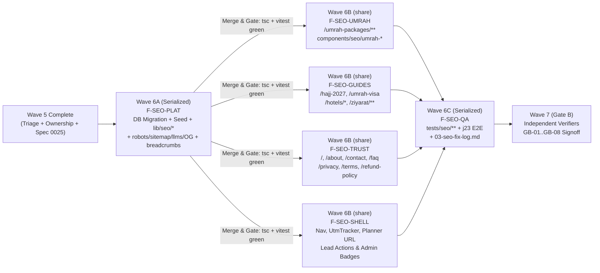

# Wave 6 SEO & GEO Disjoint File Ownership Map (`02-seo-ownership.md`)

- **Architect**: `s16-spec`
- **Governing Spec**: [`docs/specs/0025-public-site-seo-readiness.md`](file:///c:/dev/al-ramlah-travels/web/docs/specs/0025-public-site-seo-readiness.md)
- **Master Triage**: [`docs/audit/seo/02-seo-triage.md`](file:///c:/dev/al-ramlah-travels/web/docs/audit/seo/02-seo-triage.md) (`SEO-001`–`SEO-031`)
- **Zero-Collision Invariant**: Within **Wave 6B** (`4` parallel `workspace: "share"` swarm workers), the intersection of owned file paths between any two fixers is **strictly empty (`A ∩ B = ∅`)**. Shared schemas, `lib/seo/*` utilities, `<PublicBreadcrumbs />`, `db/seed.ts`, and root metadata routes land **first** in serialized **Wave 6A (`F-SEO-PLAT`)** before Wave 6B branches fork.

---

## 1. Execution Topology (`Wave 6A` → `Wave 6B` → `Wave 6C`)

---

## 2. Critical Real-Path Disambiguations (Read Before Spawning Fixers)

1. **`slug` Columns Already Exist on `groupPackages` & `hajjPackages`**:
   - `db/schema/packages.ts:48` (`groupPackages.slug`) and `db/schema/packages.ts:173` (`hajjPackages.slug`) are already `text("slug").notNull().unique()`. Do **not** generate duplicate `slug` DDL on `packages.ts`. Only `applications` (`db/schema/applications.ts`) and `contactMessages` (`db/schema/cms.ts`) require the 7 nullable attribution columns (`drizzle/0003_seo_lead_attribution.sql`).
2. **Real Server Action Paths in `app/actions/`**:
   - There are **NO** `app/actions/hajj.ts` or `app/actions/contact.ts` files in this repository.
   - All 4 public lead actions (`submitCustomApplication`, `submitGroupBookingApplication`, `submitHajjInquiryApplication`, and hardened `submitPublicContactInquiryAction`) live in **`app/actions/applications.ts`** (`F-SEO-SHELL`), while `app/actions/groups.ts` (`F-SEO-SHELL`) owns group admin/revalidation and `app/actions/cms.ts` (`F-SEO-SHELL`) holds the legacy `submitContactMessage` wrapper that must delegate to `submitPublicContactInquiryAction` (`SEO-024`).
   - Admin catalog & Studio flyer actions (`app/actions/catalog.ts`, `app/actions/marketing-ops.ts`) are wired to `revalidatePublicSeoPaths()` and `buildSemanticPackageSlug()` in **Wave 6A (`F-SEO-PLAT`)** so zero Wave 6B workers touch admin catalog/studio actions.
3. **Why `components/layout/breadcrumbs.tsx` Lands in Wave 6A (`F-SEO-PLAT`)**:
   - Placing `<PublicBreadcrumbs />` in Wave 6A (`F-SEO-PLAT`) allows `F-SEO-UMRAH`, `F-SEO-GUIDES`, and `F-SEO-TRUST` to import `@/components/layout/breadcrumbs` directly during parallel Wave 6B execution and pass `npm run typecheck` independently without waiting on `F-SEO-SHELL`.
4. **Cross-Component Prop Stability Across Wave 6B**:
   - `F-SEO-UMRAH` imports `GroupBookingModal` (read-only) inside `components/seo/umrah-package-booking-cta.tsx` using existing `BookingModalPackage` props — `F-SEO-SHELL` MUST NOT make breaking prop changes to `GroupBookingModal`.
   - `F-SEO-GUIDES` imports `HajjInquirySection` (read-only) inside `app/(public)/hajj-2027/page.tsx` passing `packages={hajjPackages}` — `F-SEO-SHELL` MUST preserve the existing `{ packages?: ... }` prop signature.
   - `F-SEO-TRUST` imports `ContactSection` (read-only) inside `app/(public)/contact/page.tsx` passing `settings={companyInfo}` — `F-SEO-SHELL` MUST preserve `{ settings?: AgencyContactInfo | null }`.
5. **Isolated Unit Test Directories in Wave 6A/6B**:
   - Each fixer writes its unit tests strictly under `tests/w6/<fixer-id>/*.test.{ts,tsx}` (`f-seo-plat`, `f-seo-umrah`, `f-seo-guides`, `f-seo-trust`, `f-seo-shell`). None of the Wave 6A/6B fixers may edit existing Gate A tests unless updating `proxy` `X-Robots-Tag` assertion strings if needed (`F-SEO-PLAT` verifies `npm test` green before Wave 6B starts).

---

## 3. Fixer-by-Fixer Exclusive File Ownership & Export Contracts

### 3.1 `F-SEO-PLAT` — Serialized Foundation (`Wave 6A`)

- **Assigned `SEO-ID`s (`12`)**: `SEO-001`, `SEO-002`, `SEO-003`, `SEO-007`, `SEO-008`, `SEO-009`, `SEO-010`, `SEO-011`, `SEO-012`, `SEO-013`, `SEO-014`, `SEO-027`
- **Workspace**: Direct (`inherit`) or single `share` branch merged into `audit/production-hardening` **before** Wave 6B begins.
- **Exclusive Owned Paths**:
  - **Database Schema, Migration & Seed**:
    - `db/schema/applications.ts` *(7 nullable attribution columns + `idx_applications_utm_source_campaign`)*
    - `db/schema/cms.ts` *(7 nullable attribution columns + `idx_contact_messages_utm_source`)*
    - `drizzle/0003_seo_lead_attribution.sql` *(new — idempotent `ADD COLUMN IF NOT EXISTS` + `CREATE INDEX IF NOT EXISTS`)*
    - `drizzle/meta/*` *(updated journal/snapshot if generated)*
    - `db/seed.ts` *(rolling PKT departure horizons across `pkg1`–`pkg4` & `LHE`/`KHI`/`ISB`, `hajjPackages` `A+`/`A`/`B`/`C`, rolling `hotels.validUntil`, distinct Ziyarat/hotel imagery, 12+ dynamic-safe FAQs)*
  - **Shared SEO / Brand / Utility Contracts**:
    - `lib/constants/brand.ts` *(`BRAND_WEBSITE_URL = "https://alramlahtravels.com"`, `BRAND_WEBSITE_DOMAIN = "alramlahtravels.com"`)*
    - `lib/company-info.ts` *(`, Pakistan` in `DEFAULT_OFFICE_ADDRESS`, `BRAND_SOCIAL_URLS` fallback, `toTelHref()`, `formatPkPhoneDisplay()`, `getCachedCompanyInfo = cache(...)`)*
    - `components/public/public-utils.ts` *(deterministic `formatPkr(amount)` helper avoiding locale hydration mismatch)*
    - `components/public/arabic-text.tsx` *(RTL `dir="rtl"` + `lang="ar"` BiDi script isolation)*
    - `lib/seo/metadata.ts` *(new — `CANONICAL_ORIGIN`, `getCanonicalSiteUrl()`, `buildPublicMetadata({ path, title, description, ogImage, ogType, noIndex })`)*
    - `lib/seo/json-ld.ts` *(new — `serializeJsonLd()`, `<JsonLd />`, `buildTravelAgencyJsonLd()`, `buildWebSiteJsonLd()`, `buildBreadcrumbJsonLd()`, `buildFaqPageJsonLd()`, `buildUmrahPackageJsonLd()`, `buildHajjServiceJsonLd()`, `buildHotelItemListJsonLd()`, `buildTouristAttractionListJsonLd()`)*
    - `lib/seo/og-card.tsx` *(new — `renderLuxuryOgCard({ eyebrow, title, subtitle, badges, footerNote })` returning `1200×630` `ImageResponse`)*
    - `lib/seo/utm.ts` *(new — `UTM_STORAGE_KEY = "alramlah_attribution_v1"`, `AttributionPayload`, `strictAttributionSchema`, `sanitizeAttributionInput()`, `captureFirstTouchAttribution()`, `readStoredAttribution()`, `inferAcquisitionChannel()`, `formatWhatsAppAttributionSuffix()`)*
    - `lib/seo/slugs.ts` *(new — `UMRAH_GATEWAY_CITIES`, `HARAMAIN_CITIES`, `buildSemanticPackageSlug()`, `normalizeRouteSlug()`)*
    - `lib/seo/public-queries.ts` *(new — cached, wholesale-SAR-stripped DTO loaders: `getPublicGroupPackages()`, `getPublicGroupPackageBySlug()`, `getPublicGroupPackagesByCity()`, `getPublicHajjPackages()`, `getPublicVisaRates()`, `getPublicHotelsCatalog()`, `getPublicVehiclesCatalog()`, `getPublicZiyaratCatalog()`, `getPublicFaqs()`, `getPublicHeroSlides()`, `getPublicTestimonials()`)*
    - `lib/seo/revalidate-public.ts` *(new — `PUBLIC_SEO_PATHS`, `revalidatePublicSeoPaths(extraSlugs?)`)*
    - `components/layout/breadcrumbs.tsx` *(new — `<PublicBreadcrumbs items={BreadcrumbEntry[]} />` using Base UI `render` prop + `<JsonLd />`)*
  - **Root Discovery, Metadata, Edge Headers & Admin Catalog Hooks**:
    - `app/robots.ts` *(new)*
    - `app/sitemap.ts` *(new)*
    - `public/llms.txt` *(new)*
    - `app/opengraph-image.tsx` *(new)*
    - `app/layout.tsx` *(`metadataBase: getCanonicalSiteUrl()`, `55`c default title, `"%s | Al Ramlah Travels"` template, `154`c description, `en_PK` OG, Twitter card, `googleBot` directives, `preload: false` on `JetBrains_Mono` & `Amiri`)*
    - `app/admin/layout.tsx` *(new — `robots: { index: false, follow: false, nocache: true }`)*
    - `app/(public)/voucher/[token]/page.tsx` + `app/(public)/voucher/[token]/forbidden.tsx` *(new — `forbidden()` HTTP `403` + `noarchive, nosnippet`)*
    - `proxy.ts` *(`X-Robots-Tag: noindex, nofollow, noarchive, nosnippet` on `/admin/*`, `/api/*`, `/voucher/*`, `/quote/*`)*
    - `next.config.ts` *(`experimental.authInterrupts: true`, `/admin/social` `308` redirect, `www.alramlahtravels.com` → `https://alramlahtravels.com/:path*` `308` host redirect)*
    - `nginx/nginx.conf` *(dedicated `www.alramlahtravels.com` `301` server block to `https://alramlahtravels.com$request_uri`)*
    - `app/actions/catalog.ts` *(wire `revalidatePublicSeoPaths()`)*
    - `app/actions/marketing-ops.ts` *(wire `buildSemanticPackageSlug()` + `revalidatePublicSeoPaths()`)*
    - `tests/w6/f-seo-plat/*.test.{ts,tsx}` *(new)*
- **Wave 6A Exit Gate**: Migration applied cleanly (`drizzle-kit migrate` / SQL execution against test/dev DB), `2× npm run db:seed` idempotent, `npm run typecheck` (`0` errors), and `npx vitest run` (`100%` green).

---

### 3.2 `F-SEO-UMRAH` — Parallel Umrah Hub, `[slug]` & Gateway City Spokes (`Wave 6B`)

- **Assigned `SEO-ID`s (`2`)**: `SEO-015`, `SEO-016`
- **Workspace**: `share` (parallel in Wave 6B)
- **Exclusive Owned Paths**:
  - `app/(public)/umrah-packages/page.tsx` *(new)*
  - `app/(public)/umrah-packages/[slug]/page.tsx` *(new)*
  - `app/(public)/umrah-packages/[slug]/opengraph-image.tsx` *(new)*
  - `app/(public)/umrah-packages/from-[city]/page.tsx` *(new — `dynamicParams = false`, strictly `lahore`, `karachi`, `islamabad`)*
  - `components/seo/umrah-*.{ts,tsx}` *(new — e.g. `umrah-package-booking-cta.tsx`, `umrah-city-gateway-data.ts`, `umrah-package-comparison-table.tsx`, `umrah-departures-schedule.tsx`)*
  - `tests/w6/f-seo-umrah/*.test.{ts,tsx}` *(new)*
- **Forbidden Paths (Must NOT Touch)**: Any file outside the 6 globs above (do NOT edit `components/public/group-booking-modal.tsx`, `components/public/group-packages-section.tsx`, `lib/seo/*`, `app/sitemap.ts`, or `components/layout/*`).

---

### 3.3 `F-SEO-GUIDES` — Parallel Hajj 2027, Umrah Visa, Hotels & Ziyarat Spokes (`Wave 6B`)

- **Assigned `SEO-ID`s (`4`)**: `SEO-017`, `SEO-018`, `SEO-019`, `SEO-020`
- **Workspace**: `share` (parallel in Wave 6B)
- **Exclusive Owned Paths**:
  - `app/(public)/hajj-2027/page.tsx` *(new)*
  - `app/(public)/umrah-visa/page.tsx` *(new)*
  - `app/(public)/hotels/[city]/page.tsx` *(new — `dynamicParams = false`, strictly `makkah`, `madinah`)*
  - `app/(public)/ziyarat/page.tsx` *(new)*
  - `app/(public)/ziyarat/[city]/page.tsx` *(new — `dynamicParams = false`, strictly `makkah`, `madinah`)*
  - `components/seo/guides-*.{ts,tsx}` *(new — e.g. `guides-hajj-maktab-table.tsx`, `guides-visa-pricing-table.tsx`, `guides-hotel-directory.tsx`, `guides-ziyarat-directory.tsx`)*
  - `tests/w6/f-seo-guides/*.test.{ts,tsx}` *(new)*
- **Forbidden Paths (Must NOT Touch)**: Any file outside the 7 globs above (do NOT edit `components/public/hajj-inquiry-section.tsx`, `lib/seo/*`, `app/sitemap.ts`, or `components/layout/*`).

---

### 3.4 `F-SEO-TRUST` — Parallel Homepage SEO/LCP, `/about`, `/contact`, `/faq` & Legal Spokes (`Wave 6B`)

- **Assigned `SEO-ID`s (`4`)**: `SEO-021`, `SEO-022`, `SEO-023`, `SEO-028`
- **Workspace**: `share` (parallel in Wave 6B)
- **Exclusive Owned Paths**:
  - `app/(public)/page.tsx` *(explicit `/` metadata, `TravelAgency` + `WebSite` + `FAQPage` JSON-LD, wholesale-stripped DTO usage, direct RSC `MarketingSections` render, dynamic section skeletons)*
  - `app/(public)/about/page.tsx` *(new)*
  - `app/(public)/contact/page.tsx` *(new — imports `ContactSection` read-only with `{ settings: companyInfo }`)*
  - `app/(public)/faq/page.tsx` *(new)*
  - `app/(public)/privacy/page.tsx` *(metadata + breadcrumbs + cross-links + §3 `alramlah_attribution_v1` disclosure)*
  - `app/(public)/terms/page.tsx` *(metadata `150–160`c + breadcrumbs + cross-links)*
  - `app/(public)/refund-policy/page.tsx` *(metadata `50–60`c title & `150–160`c desc + breadcrumbs + cross-links)*
  - `components/public/hero-slider.tsx` *(stable semantic `<h1>`, Next.js 16 `preload` on Slide 0 only + lazy non-initial slides, remove `"15,000+"`, normalize `#custom-builder` → `/#journey-builder`)*
  - `components/public/marketing-sections.tsx` *(convert to zero-JS Server Component, `id="faq" scroll-mt-20`, Pakistani/diaspora search headings, contextual `<Link>`s)*
  - `components/public/faq-accordion-client.tsx` *(new — extracted interactive FAQ leaf island)*
  - `components/seo/trust-*.{ts,tsx}` *(new — e.g. `trust-home-overview.tsx`, `trust-legal-crosslinks.tsx`, `trust-eeat-credentials.tsx`, `trust-faq-fanout-data.ts`)*
  - `tests/w6/f-seo-trust/*.test.{ts,tsx}` *(new)*
- **Forbidden Paths (Must NOT Touch)**: `app/(public)/layout.tsx`, `components/public/contact-section.tsx`, `components/public/group-packages-section.tsx`, `components/public/hajj-inquiry-section.tsx`, `components/layout/*`, `components/planner/*`, `lib/seo/*`.

---

### 3.5 `F-SEO-SHELL` — Parallel Navigation, `<UtmTracker />`, Planner URL Prefill, Lead Actions & Admin Telemetry (`Wave 6B`)

- **Assigned `SEO-ID`s (`8`)**: `SEO-004`, `SEO-005`, `SEO-006`, `SEO-024`, `SEO-025`, `SEO-029`, `SEO-030`, `SEO-031`
- **Workspace**: `share` (parallel in Wave 6B)
- **Exclusive Owned Paths**:
  - **Public Layout, `404` & Navigation Chrome**:
    - `app/(public)/layout.tsx` *(mount `<Suspense fallback={null}><UtmTracker /></Suspense>` + `getCachedCompanyInfo()`)*
    - `app/not-found.tsx` *(`404` metadata, `PublicHeader`/`PublicFooter` recovery shell, dynamic WhatsApp)*
    - `components/layout/public-header.tsx` *(crawlable hub links, `aria-current="page"`, `loading="eager"` on `40×40` logo, fixed-width prayer pill, `سفريات الرملة` Arabic sync)*
    - `components/layout/public-footer.tsx` *(4-column crawlable hubs, delete `/admin` link, internal `<Link href="/">alramlahtravels.com</Link>`, E.164 `tel:` links)*
    - `components/layout/whatsapp-fab.tsx` *(concise `formatWhatsAppAttributionSuffix()` context on `wa.me` CTA)*
    - `components/seo/utm-tracker.tsx` *(new)*
  - **Planner URL Prefill & Interactive Funnel Sections (Preserving Existing Prop Contracts)**:
    - `components/planner/**` *(`<Suspense>` `<PlannerUrlHydrator />` for `?preset=`, `?departureCity=`, `?citySequence=`, `?hotelId=`, `?ziyaratCity=` winning over `sessionStorage`; `next/dynamic` Steps 2–6 & `LeadCaptureDialog`; `readStoredAttribution()` + off-home `/?trackRef=...#track-status` navigation)*
    - `components/public/group-packages-section.tsx` *(`<Link href="/umrah-packages/${pkg.slug}">`, city/hub links, `bronze`/`economy` filter support, `0`-tier `"On Request"` on `multiHotelOptions`, single `next/dynamic` `GroupBookingModal`, branded `bannerUrl === null` fallback)*
    - `components/public/group-booking-modal.tsx` *(`readStoredAttribution()`, `0`-tier `multiHotelOptions` disabled guard, off-home `/?trackRef=...#track-status`)*
    - `components/public/hajj-inquiry-section.tsx` *(`coerceMaktabCode` `"A+"` fix, explicit `packages = []` closed handling, `/hajj-2027` link, `readStoredAttribution()`, off-home `/?trackRef=...#track-status`)*
    - `components/public/contact-section.tsx` *(`readStoredAttribution()`, E.164 `tel:` links, `OD-10` verified license display)*
    - `components/public/status-tracker.tsx` *(`<Suspense>` `?trackRef=ART-...` prefill)*
  - **Validations, Lead Server Actions & Admin Attribution Surfaces**:
    - `lib/validations/application.ts` *(optional `attribution: strictAttributionSchema.optional()`)*
    - `lib/validations/cms.ts` *(optional `attribution: strictAttributionSchema.optional()`)*
    - `app/actions/applications.ts` *(persist 7 attribution columns across all 4 public lead actions + post-submit `waMessage` attribution suffix)*
    - `app/actions/groups.ts` *(forward `attribution`, `revalidatePublicSeoPaths()`, slug stability)*
    - `app/actions/cms.ts` *(delegate `submitContactMessage` → `submitPublicContactInquiryAction` + `revalidatePublicSeoPaths()`)*
    - `app/actions/quotes.ts` *(7 formula-safe attribution columns in `exportApplicationsCsvAction` + `getCanonicalSiteUrl()` & `?trackRef=` in `sendApplicationQuotationEmailAction`)*
    - `components/admin/applications/application-dossier.tsx` + `app/admin/(dashboard)/applications/[id]/page.tsx`
    - `components/admin/catalog/messages-client.tsx` + `app/admin/(dashboard)/catalog/page.tsx`
    - `tests/w6/f-seo-shell/*.test.{ts,tsx}` *(new)*
- **Forbidden Paths (Must NOT Touch)**: `app/(public)/page.tsx`, `app/(public)/{privacy,terms,refund-policy,about,contact,faq,hajj-2027,umrah-visa}/**`, `app/(public)/{umrah-packages,hotels,ziyarat}/**`, `components/public/{hero-slider,marketing-sections,public-utils,arabic-text}.tsx`, `components/layout/breadcrumbs.tsx`, `lib/seo/*`, `app/actions/{catalog,marketing-ops}.ts`.

---

### 3.6 `F-SEO-QA` — Serialized Post-Merge Gate B Harness & Audit Re-Score (`Wave 6C`)

- **Assigned `SEO-ID`s (`1`)**: `SEO-026`
- **Workspace**: Direct (`inherit`) after `F-SEO-UMRAH`, `F-SEO-GUIDES`, `F-SEO-TRUST`, and `F-SEO-SHELL` are all merged cleanly into `audit/production-hardening`.
- **Exclusive Owned Paths**:
  - `tests/seo/*.test.{ts,tsx}` *(new — unified metadata CTR `50–60`c/`150–160`c, canonicals, JSON-LD Rich-Results, wholesale-SAR confidentiality, `>=50%` 4-gram Jaccard differentiation, internal link zero-orphan checks)*
  - `tests/integration/seo-utm-attribution.integration.test.ts` *(new — real DB round-trip for 7 attribution columns + formula-safe CSV export)*
  - `tests/e2e/j23-seo-crawl-and-attribution.spec.ts` *(new — Playwright live crawl of `robots.txt`, `sitemap.xml`, `/llms.txt`, all hubs/spokes, `/voucher/invalid` `404` + `X-Robots-Tag`, and full UTM → Spoke → Builder prefill → Submission → Admin Dossier badge journey)*
  - `docs/audit/seo/post-fix/*.{json,md}` *(new — post-Wave-6 `nextjs_seo_geo_cli.py` empirical score capture `>= 90/100`)*
  - `docs/audit/seo/03-seo-fix-log.md` *(new — complete `SEO-001`–`SEO-031` commit SHA & test matrix)*

---

## 4. Pairwise Wave 6B Disjointness Proof Matrix

| Directory / File Group | `F-SEO-UMRAH` | `F-SEO-GUIDES` | `F-SEO-TRUST` | `F-SEO-SHELL` | Overlap? |
| :--- | :---: | :---: | :---: | :---: | :---: |
| `app/(public)/umrah-packages/**` | **WRITE** | — | — | — | **0** |
| `app/(public)/{hajj-2027,umrah-visa,hotels,ziyarat}/**` | — | **WRITE** | — | — | **0** |
| `app/(public)/{page.tsx,about,contact,faq,privacy,terms,refund-policy}` | — | — | **WRITE** | — | **0** |
| `app/(public)/layout.tsx` & `app/not-found.tsx` | — | — | — | **WRITE** | **0** |
| `components/seo/umrah-*` | **WRITE** | — | — | — | **0** |
| `components/seo/guides-*` | — | **WRITE** | — | — | **0** |
| `components/seo/trust-*` & `components/public/{hero-slider,marketing-sections,faq-accordion-client}.tsx` | — | — | **WRITE** | — | **0** |
| `components/seo/utm-tracker.tsx` & `components/layout/{public-header,public-footer,whatsapp-fab}.tsx` | — | — | — | **WRITE** | **0** |
| `components/planner/**` & `components/public/{group-packages-section,group-booking-modal,hajj-inquiry-section,contact-section,status-tracker}.tsx` | Read-only import (`GroupBookingModal`) | Read-only import (`HajjInquirySection`) | Read-only import (`ContactSection`) | **WRITE** *(non-breaking props)* | **0** |
| `lib/validations/{application,cms}.ts`, `app/actions/{applications,groups,cms,quotes}.ts`, `components/admin/**` | — | — | — | **WRITE** | **0** |
| `tests/w6/<fixer-id>/**` | `f-seo-umrah/` | `f-seo-guides/` | `f-seo-trust/` | `f-seo-shell/` | **0** |
