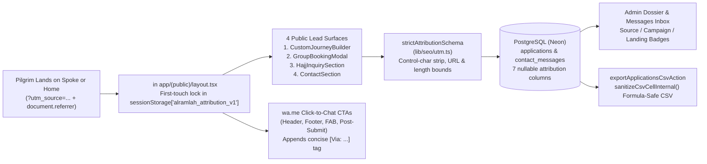

# Wave 5 SEO & GEO Audit — `S14`: End-to-End UTM, Landing Page & Referrer Lead Attribution

- **Auditor:** `s13-s15` (Read-Only Wave 5 Auditor)
- **Branch / Commit:** `audit/production-hardening` (`6c54d4c`)
- **Date:** 2026-11-15
- **Scope:** Database attribution columns (`applications` & `contact_messages`), client-side first-touch UTM/landing-page/referrer capture (`sessionStorage`), Zod validation & sanitization, all 4 public lead Server Actions, `wa.me` Click-to-Chat attribution tags, Admin Application Dossier, Admin Contact Messages Inbox, Admin CSV Export, and `/privacy` §3 disclosure sync.
- **Primary Wave 6 Fixer Owners:** `F-SEO-PLAT` (additive DB schema/migration + `lib/seo/utm.ts`), `F-SEO-SHELL` (`components/seo/utm-tracker.tsx`, lead forms, Server Actions, Admin UI & CSV export), `F-SEO-TRUST` (`/privacy` §3 table update).

---

## 1. Executive Summary

Al Ramlah Travels already tracks **social flyer reverse-lookup** (`sourcePostCode`, `sourceChannelId`, `supplierId` in [db/schema/applications.ts](file:///c:/dev/al-ramlah-travels/web/db/schema/applications.ts#L201-L210) for `ART-...` WhatsApp bot leads), **but has 0% attribution visibility for web organic SEO, AI search (`chatgpt.com`, `perplexity.ai`, `google.com`), Google Ads, Meta Ads, or GBP referrals**:

1. **Zero Web Attribution Columns in PostgreSQL:** Neither `applications` ([db/schema/applications.ts](file:///c:/dev/al-ramlah-travels/web/db/schema/applications.ts#L127-L240)) nor `contact_messages` ([db/schema/cms.ts](file:///c:/dev/al-ramlah-travels/web/db/schema/cms.ts#L120-L144)) stores `utmSource`, `utmMedium`, `utmCampaign`, `utmContent`, `utmTerm`, `landingPage`, or `httpReferrer`.
2. **100% Attribution Loss on Multi-Page Spoke Navigation:** When a pilgrim lands on `/umrah-packages/from-lahore?utm_source=google&utm_medium=cpc&utm_campaign=ramadan_2027` from `https://www.google.com/` and clicks `"Customize from Lahore"` (`/?departureCity=LHE#journey-builder`), the URL query string is replaced and `document.referrer` becomes same-origin — permanently erasing both the paid/organic campaign parameters and the external referrer before any form is submitted.
3. **Hidden Duplicate Contact Action Bypass:** While `ContactSection` ([contact-section.tsx:5,82](file:///c:/dev/al-ramlah-travels/web/components/public/contact-section.tsx#L5)) calls hardened `submitPublicContactInquiryAction` ([app/actions/applications.ts:2301-2378](file:///c:/dev/al-ramlah-travels/web/app/actions/applications.ts#L2301-L2378)), [app/actions/cms.ts:705-751](file:///c:/dev/al-ramlah-travels/web/app/actions/cms.ts#L705-L751) still exports a legacy un-rate-limited, un-honeypot-guarded `submitContactMessage` Server Action! If a Wave 6 fixer wires `/contact` to `submitContactMessage`, rate limiting, honeypot spam protection, E.164 phone normalization, and UTM attribution would all be bypassed.

| Finding ID | Severity | Category | Summary | Primary Wave 6 Owner |
| :--- | :--- | :--- | :--- | :--- |
| `S14-001` | **P0** | `data-integrity` | `applications` and `contact_messages` lack `utm_*`, `landing_page`, and `http_referrer` columns | `F-SEO-PLAT` |
| `S14-002` | **P0** | `seo` | Zero client-side first-touch UTM, `landingPage`, and external `httpReferrer` persistence across multi-page spoke-to-builder navigations | `F-SEO-PLAT` / `F-SEO-SHELL` |
| `S14-003` | **P1** | `functional` | All 4 public lead forms, Zod schemas, and Server Actions omit/strip web attribution metadata | `F-SEO-SHELL` |
| `S14-004` | **P1** | `security` | Legacy `submitContactMessage` (`app/actions/cms.ts:705`) duplicates `submitPublicContactInquiryAction` without rate limiting, honeypot check, E.164 normalization, or attribution | `F-SEO-SHELL` |
| `S14-005` | **P1** | `functional` | Admin Application Dossier, Contact Messages Inbox, and Admin CSV Export (`exportApplicationsCsvAction`) surface zero web/SEO/paid attribution fields | `F-SEO-SHELL` |
| `S14-006` | **P2** | `seo` | Direct & post-submit `wa.me` Click-to-Chat CTAs omit compact source/landing attribution context, leaving WhatsApp-first SEO conversions dark | `F-SEO-SHELL` |
| `S14-007` | **P2** | `compliance` | Privacy Policy §3 (`app/(public)/privacy/page.tsx:218-257`) explicitly enumerates `sessionStorage` keys and must disclose `alramlah_attribution_v1` | `F-SEO-TRUST` |

---

## 2. End-to-End Attribution Architecture & Additive Schema Plan

### 2.1 Dataflow Architecture



### 2.2 Exact Additive Drizzle Schema & Migration Plan (`F-SEO-PLAT`)

**Design Choice — Explicit Nullable Columns Over Opaque JSONB:**
Adding 7 explicit, length-bounded nullable columns (rather than an untyped `attribution_json` blob) enables zero-downtime `ALTER TABLE ... ADD COLUMN IF NOT EXISTS` deployment, direct SQL indexing (`utm_source`, `utm_campaign`), full Drizzle TypeScript inference, zero breakage of existing `db/seed.ts` or test fixtures, and trivial 1:1 mapping into `exportApplicationsCsvAction`.

1. **Table 1 — `applications` ([db/schema/applications.ts:201-215](file:///c:/dev/al-ramlah-travels/web/db/schema/applications.ts#L201-L215)):**
   ```ts
   // Web SEO, GEO & Paid Campaign First-Touch Attribution (Nullable / Additive)
   utmSource: varchar("utm_source", { length: 120 }),
   utmMedium: varchar("utm_medium", { length: 120 }),
   utmCampaign: varchar("utm_campaign", { length: 160 }),
   utmContent: varchar("utm_content", { length: 160 }),
   utmTerm: varchar("utm_term", { length: 160 }),
   landingPage: text("landing_page"),       // Relative path + query, max 512 chars (e.g. "/umrah-packages/from-lahore?utm_source=google")
   httpReferrer: text("http_referrer"),     // External origin/URL, max 512 chars (e.g. "https://chatgpt.com/" or "https://www.google.com/")
   ```
   - Add composite B-tree index in `applications` table config:
     `index("idx_applications_utm_source_campaign").on(table.utmSource, table.utmCampaign)`

2. **Table 2 — `contactMessages` ([db/schema/cms.ts:120-144](file:///c:/dev/al-ramlah-travels/web/db/schema/cms.ts#L120-L144)):**
   ```ts
   utmSource: varchar("utm_source", { length: 120 }),
   utmMedium: varchar("utm_medium", { length: 120 }),
   utmCampaign: varchar("utm_campaign", { length: 160 }),
   utmContent: varchar("utm_content", { length: 160 }),
   utmTerm: varchar("utm_term", { length: 160 }),
   landingPage: text("landing_page"),
   httpReferrer: text("http_referrer"),
   ```
   - Add index: `index("idx_contact_messages_utm_source").on(table.utmSource)`

3. **SQL Migration (`drizzle/NNNN_seo_lead_attribution.sql`):**
   ```sql
   ALTER TABLE "applications" ADD COLUMN IF NOT EXISTS "utm_source" varchar(120);
   ALTER TABLE "applications" ADD COLUMN IF NOT EXISTS "utm_medium" varchar(120);
   ALTER TABLE "applications" ADD COLUMN IF NOT EXISTS "utm_campaign" varchar(160);
   ALTER TABLE "applications" ADD COLUMN IF NOT EXISTS "utm_content" varchar(160);
   ALTER TABLE "applications" ADD COLUMN IF NOT EXISTS "utm_term" varchar(160);
   ALTER TABLE "applications" ADD COLUMN IF NOT EXISTS "landing_page" text;
   ALTER TABLE "applications" ADD COLUMN IF NOT EXISTS "http_referrer" text;
   CREATE INDEX IF NOT EXISTS "idx_applications_utm_source_campaign" ON "applications" ("utm_source", "utm_campaign");

   ALTER TABLE "contact_messages" ADD COLUMN IF NOT EXISTS "utm_source" varchar(120);
   ALTER TABLE "contact_messages" ADD COLUMN IF NOT EXISTS "utm_medium" varchar(120);
   ALTER TABLE "contact_messages" ADD COLUMN IF NOT EXISTS "utm_campaign" varchar(160);
   ALTER TABLE "contact_messages" ADD COLUMN IF NOT EXISTS "utm_content" varchar(160);
   ALTER TABLE "contact_messages" ADD COLUMN IF NOT EXISTS "utm_term" varchar(160);
   ALTER TABLE "contact_messages" ADD COLUMN IF NOT EXISTS "landing_page" text;
   ALTER TABLE "contact_messages" ADD COLUMN IF NOT EXISTS "http_referrer" text;
   CREATE INDEX IF NOT EXISTS "idx_contact_messages_utm_source" ON "contact_messages" ("utm_source");
   ```

### 2.3 Sanitization, First-Touch Rules & Security Guardrails (`lib/seo/utm.ts`)

1. **First-Touch Session Persistence (`UTM_STORAGE_KEY = "alramlah_attribution_v1"`):**
   - On first mount in `app/(public)/layout.tsx`, `<UtmTracker />` (wrapped in `<Suspense fallback={null}>` so it never forces dynamic SSR bailout on static/ISR public pages!) checks `window.sessionStorage.getItem("alramlah_attribution_v1")`.
   - If absent, it records `landingPage = pathname + search` (capped at `512` chars), `httpReferrer` (recorded **only** if `document.referrer` parses as `http:`/`https:` with a hostname different from `window.location.hostname`, stripping URL credentials and `#fragment`), and any `utm_source`, `utm_medium`, `utm_campaign`, `utm_content`, `utm_term` present on the landing URL.
   - If a later navigation in the same tab introduces **new** explicit `utm_*` params (e.g., user clicks a second ad), `utm_*` updates while `landingPage` and initial external `httpReferrer` remain locked to first-touch.
   - Bonus AI/Search Referrer Inference Helper (display-only in Admin UI, never mutating raw `utmSource` in DB): when `utmSource` is `null` and `httpReferrer` matches `chatgpt.com`, `perplexity.ai`, `claude.ai`, `gemini.google.com`, `google.*`, `bing.com`, `facebook.com`, or `instagram.com`, display a clean channel badge (`AI Search: ChatGPT`, `Organic Search: Google`, etc.) in `ApplicationDossier`!
2. **Input Sanitization (`sanitizeAttributionInput` in `lib/seo/utm.ts`):**
   - Strip ASCII control characters (`[\x00-\x1F\x7F]`) and trim whitespace; empty strings normalize to `null`.
   - Enforce `landingPage.startsWith("/")` and reject `//` protocol-relative strings so `landingPage` can never store an external open-redirect or `javascript:` URI.
   - Parse `httpReferrer` via `new URL(val)`, allow only `http:` / `https:`, clear `url.username = ""`, `url.password = ""`, `url.hash = ""`, and truncate to `512` chars.
   - All CSV cells in `exportApplicationsCsvAction` MUST continue passing through `sanitizeCsvCellInternal()` ([app/actions/quotes.ts:191-209](file:///c:/dev/al-ramlah-travels/web/app/actions/quotes.ts#L191-L209)) so malicious query strings like `?utm_campaign==CMD|' /C calc'!A0` are neutralized with a leading `'`.

---

## 3. Detailed Findings (§3.3 Format)

### S14-001 — `applications` and `contact_messages` tables lack web UTM, landing-page, and HTTP referrer columns

- Severity: P0
- Category: data-integrity
- Where: [db/schema/applications.ts:127-240](file:///c:/dev/al-ramlah-travels/web/db/schema/applications.ts#L127-L240), [db/schema/cms.ts:120-144](file:///c:/dev/al-ramlah-travels/web/db/schema/cms.ts#L120-L144)
- Brief claim contradicted (if any): `N/A — implicit production expectation` (end-to-end marketing & SEO ROI attribution on customer dossiers).
- Evidence:
  ```ts
  // db/schema/applications.ts:201-210 — only social post reverse-lookup columns exist:
  sourcePostCode: varchar("source_post_code", { length: 32 }),
  sourceChannelId: uuid("source_channel_id"),
  supplierId: uuid("supplier_id").references(() => suppliers.id, { onDelete: "set null" }),

  // db/schema/cms.ts:120-144 — zero source/attribution columns on contactMessages:
  export const contactMessages = pgTable("contact_messages", {
    id: uuid("id").primaryKey().defaultRandom(),
    name: text("name").notNull(), ...
    adminNotes: text("admin_notes"),
    createdAt: timestamp("created_at", { withTimezone: true }).notNull().defaultNow(),
  })
  ```
- Impact (business terms): Management cannot measure which SEO spoke (`/umrah-packages/from-lahore`, `/umrah-visa`, `/hajj-2027`, `/hotels/makkah`), Google/Meta ad campaign, or AI search engine (`chatgpt.com`, `perplexity.ai`) generated PKR millions in approved Umrah/Hajj bookings versus zero-converting traffic, leading to blind ad spend and zero SEO ROI visibility.
- Root cause: Database schema originally modeled only `ART-...` social post reverse-lookup (`Spec 0002`) without web `utm_*`, `landing_page`, or `http_referrer` columns.
- Recommended fix: Add the 7 nullable attribution columns (`utm_source`, `utm_medium`, `utm_campaign`, `utm_content`, `utm_term`, `landing_page`, `http_referrer`) plus B-tree indexes to both `applications` (`db/schema/applications.ts`) and `contactMessages` (`db/schema/cms.ts`), and generate an additive `ADD COLUMN IF NOT EXISTS` migration.
- Test to add: `tests/seo/attribution-schema.test.ts` — verifies Drizzle table metadata for `applications` and `contactMessages` exposes all 7 nullable attribution columns and round-trips sanitized attribution values.
- Effort: S (< 1 hr)
- Confidence: High
- Needs owner decision: no
---

### S14-002 — Zero client-side first-touch UTM, landing-page, and external-referrer capture across page transitions

- Severity: P0
- Category: seo
- Where: [app/(public)/layout.tsx:46-71](file:///c:/dev/al-ramlah-travels/web/app/(public)/layout.tsx#L46-L71)
- Brief claim contradicted (if any): `N/A — implicit production expectation`
- Evidence: `app/(public)/layout.tsx` renders `<PublicHeader>`, `<main>{children}</main>`, `<PublicFooter>`, and `<WhatsAppFab>`, with zero client-side attribution listener (`components/seo/utm-tracker.tsx` does not exist anywhere in the repository).
- Impact (business terms): Every pilgrim who enters on an SEO spoke or paid landing URL (e.g., `/umrah-visa?utm_source=google&utm_medium=cpc`) and clicks a CTA to `/#journey-builder` or `/contact` loses 100% of their `utm_*` query parameters and external `document.referrer` on the very first internal `<Link>` click.
- Root cause: No first-touch session persistence utility or root public layout tracker exists to capture initial entry URL parameters and external `document.referrer` before client-side routing mutates `window.location`.
- Recommended fix: Create `lib/seo/utm.ts` (`readStoredAttribution`, `captureFirstTouchAttribution`, `sanitizeAttributionInput`) and `components/seo/utm-tracker.tsx` (wrapped in `<Suspense fallback={null}>` inside `app/(public)/layout.tsx`) persisting non-PII first-touch attribution into `window.sessionStorage["alramlah_attribution_v1"]`.
- Test to add: `tests/seo/utm-tracker.test.ts` — simulates landing on `/umrah-packages/from-lahore?utm_source=google&utm_campaign=lahore_2027` with `referrer = "https://www.google.com/"`, followed by internal navigation to `/?departureCity=LHE#journey-builder` with same-origin referrer, asserting `readStoredAttribution()` preserves `landingPage === "/umrah-packages/from-lahore?utm_source=google&utm_campaign=lahore_2027"`, `utmSource === "google"`, `utmCampaign === "lahore_2027"`, and `httpReferrer === "https://www.google.com/"`.
- Effort: M (1–4 hr)
- Confidence: High
- Needs owner decision: no
---

### S14-003 — All 4 public lead forms, Zod schemas, and Server Actions strip/ignore attribution fields

- Severity: P1
- Category: functional
- Where: [lib/validations/application.ts:144-578](file:///c:/dev/al-ramlah-travels/web/lib/validations/application.ts#L144-L578), [app/actions/applications.ts:753-1788,2266-2378](file:///c:/dev/al-ramlah-travels/web/app/actions/applications.ts#L753-L1788), [components/planner/lead-capture-dialog.tsx:69-87](file:///c:/dev/al-ramlah-travels/web/components/planner/lead-capture-dialog.tsx#L69-L87), [components/planner/review-and-submit-step.tsx:154-232](file:///c:/dev/al-ramlah-travels/web/components/planner/review-and-submit-step.tsx#L154-L232), [components/public/group-booking-modal.tsx:266-286](file:///c:/dev/al-ramlah-travels/web/components/public/group-booking-modal.tsx#L266-L286), [components/public/hajj-inquiry-section.tsx:868-902](file:///c:/dev/al-ramlah-travels/web/components/public/hajj-inquiry-section.tsx#L868-L902), [components/public/contact-section.tsx:82-91](file:///c:/dev/al-ramlah-travels/web/components/public/contact-section.tsx#L82-L91)
- Brief claim contradicted (if any): `N/A — implicit production expectation`
- Evidence:
  - `strictCustomApplicationSchema`, `strictGroupBookingSchema`, and `strictHajjInquirySchema` in `lib/validations/application.ts` and `strictPublicContactMessageSchema` in `app/actions/applications.ts:2266-2299` strip unknown keys by default and define no `attribution` object or `utm*` fields.
  - Note also that Custom Journey Builder has **two** distinct submission entrypoints — `ReviewAndSubmitStep` (`review-and-submit-step.tsx:154`) AND `LeadCaptureDialog` (`lead-capture-dialog.tsx:69`) — both calling `submitCustomApplication(fullPayload)`.
- Impact (business terms): Even with DB columns and `<UtmTracker />` installed, leads submitted from any of the 5 client form handlers across the 4 public lead funnels will write `NULL` attribution into PostgreSQL unless every form payload, Zod schema, and Server Action `.insert(...)` is wired end-to-end.
- Root cause: Submission schemas and form handlers were authored prior to web attribution requirements.
- Recommended fix: Add an optional `attribution?: AttributionPayload` field validated by `strictAttributionSchema` (`lib/seo/utm.ts`) to `strictCustomApplicationSchema`, `strictGroupBookingSchema`, `strictHajjInquirySchema`, and `strictPublicContactMessageSchema`; attach `attribution: readStoredAttribution()` in all 5 client submit handlers (`ReviewAndSubmitStep`, `LeadCaptureDialog`, `GroupBookingModal`, `HajjInquirySection`, `ContactSection`); and persist the sanitized 7 columns inside `submitCustomApplication`, `submitGroupBookingApplication`, `submitHajjInquiryApplication`, and `submitPublicContactInquiryAction` (falling back server-side to sanitized `headers().get("referer")` only when client `landingPage`/`httpReferrer` are absent).
- Test to add: `tests/seo/lead-actions-attribution.test.ts` — calls all 4 Server Actions with mock `attribution` payloads (including hostile control chars, 2,000-char strings, and `javascript:alert(1)` `landingPage`) and asserts sanitized DB persistence and rejection/nulling of unsafe URLs.
- Effort: M (1–4 hr)
- Confidence: High
- Needs owner decision: no
---

### S14-004 — Legacy `submitContactMessage` in `app/actions/cms.ts` duplicates `submitPublicContactInquiryAction` without rate limiting, honeypot, E.164 normalization, or attribution

- Severity: P1
- Category: security
- Where: [app/actions/cms.ts:705-751](file:///c:/dev/al-ramlah-travels/web/app/actions/cms.ts#L705-L751) vs [app/actions/applications.ts:2301-2378](file:///c:/dev/al-ramlah-travels/web/app/actions/applications.ts#L2301-L2378)
- Brief claim contradicted (if any): `N/A — implicit production expectation`
- Evidence:
  ```ts
  // app/actions/cms.ts:705-728 — exported "use server" action with NO rate limit, NO honeypot, NO normalizePublicPhone, NO attribution!
  export async function submitContactMessage(input: unknown) {
    const parsed = publicContactMessageSchema.safeParse(input)
    ...
    const [created] = await db.insert(schema.contactMessages).values({
      name: data.name,
      phone: data.phone, // raw un-normalized string!
      ...
    })
  }
  ```
- Impact (business terms): `submitContactMessage` is a live Next.js `"use server"` endpoint callable directly over HTTP POST without authentication, bypassing the 5-per-10-min IP rate limit (`enforceRateLimit("submit-contact")`), anti-bot honeypot (`hasTriggeredHoneypot`), E.164 phone normalization, and UTM attribution enforced by `submitPublicContactInquiryAction`. Worse, any Wave 6 fixer building `/contact` could accidentally import `submitContactMessage` instead of `submitPublicContactInquiryAction`.
- Root cause: `T-055` introduced hardened `submitPublicContactInquiryAction` in `app/actions/applications.ts` and updated `contact-section.tsx`, but left the unhardened `submitContactMessage` exported in `app/actions/cms.ts`.
- Recommended fix: Delegate `submitContactMessage` in `app/actions/cms.ts` directly to `submitPublicContactInquiryAction(input)` (preserving any existing test imports while closing the unguarded Server Action surface and unifying attribution persistence in one place), and ensure `/contact` (`app/(public)/contact/page.tsx`) reuses `ContactSection` / `submitPublicContactInquiryAction`.
- Test to add: `tests/seo/contact-action-parity.test.ts` — asserts calling `submitContactMessage` enforces honeypot rejection, E.164 phone normalization, and UTM attribution persistence identically to `submitPublicContactInquiryAction`.
- Effort: S (< 1 hr)
- Confidence: High
- Needs owner decision: no
---

### S14-005 — Admin Application Dossier, Contact Messages Inbox, and Admin CSV Export surface zero web attribution telemetry

- Severity: P1
- Category: functional
- Where: [components/admin/applications/application-dossier.tsx:177-223](file:///c:/dev/al-ramlah-travels/web/components/admin/applications/application-dossier.tsx#L177-L223), [components/admin/catalog/messages-client.tsx:27-38,343-448](file:///c:/dev/al-ramlah-travels/web/components/admin/catalog/messages-client.tsx#L27-L38), [app/actions/quotes.ts:2300-2348](file:///c:/dev/al-ramlah-travels/web/app/actions/quotes.ts#L2300-L2348)
- Brief claim contradicted (if any): `N/A — implicit production expectation`
- Evidence:
  - `ApplicationDossier` (`application-dossier.tsx:190-205`) renders badges for `application.source`, `application.sourcePostCode`, and `application.supplier`, with zero display of `utmSource`, `utmMedium`, `utmCampaign`, `landingPage`, or `httpReferrer`.
  - `MessagesClient` (`messages-client.tsx:27-38`) omits attribution fields from `ContactMessageData` and the message reader pane.
  - `exportApplicationsCsvAction` (`app/actions/quotes.ts:2300-2313`) exports 12 columns ending at `"Submission Date (PKT)"`, omitting `UTM Source`, `UTM Medium`, `UTM Campaign`, `Landing Page`, and `HTTP Referrer`.
- Impact (business terms): Quoting agents cannot tell whether a lead came from `/hajj-2027`, `/umrah-packages/from-lahore`, a Google Search ad, or ChatGPT, and Super Admins exporting monthly CSV reports for accounting/marketing review have zero campaign columns to pivot on.
- Root cause: Admin UI components and CSV export column definitions predate web lead attribution fields.
- Recommended fix:
  1. In `components/admin/applications/application-dossier.tsx`, add a compact **"Acquisition & Attribution"** strip/badges when any of `utmSource`, `utmMedium`, `utmCampaign`, `landingPage`, or `httpReferrer` is non-null (including inferred search/AI channel badge when `httpReferrer` is external organic/AI).
  2. In `components/admin/catalog/messages-client.tsx` (and its server loader in `app/admin/(dashboard)/catalog/page.tsx`), render `utmSource`/`utmCampaign`/`landingPage` badges in the message reader header.
  3. In `exportApplicationsCsvAction` (`app/actions/quotes.ts:2300-2348`), append `"UTM Source"`, `"UTM Medium"`, `"UTM Campaign"`, `"UTM Content"`, `"UTM Term"`, `"Landing Page"`, and `"HTTP Referrer"` columns — passing every value through existing `sanitizeCsvCellInternal()` (`L191-209`) to neutralize CSV formula injection (`=`, `+`, `-`, `@`, `\t`, `\r`, `|`).
- Test to add: `tests/seo/csv-attribution-export.test.ts` — verifies `exportApplicationsCsvAction` includes the 7 attribution headers and neutralizes `utmCampaign = "=1+1"` / `"@SUM(A1:A2)"` into `"'=1+1"` / `"'@SUM(A1:A2)"`.
- Effort: M (1–4 hr)
- Confidence: High
- Needs owner decision: no
---

### S14-006 — Direct & post-submission `wa.me` Click-to-Chat CTAs omit source and landing-page context

- Severity: P2
- Category: seo
- Where: [components/layout/whatsapp-fab.tsx:22-37](file:///c:/dev/al-ramlah-travels/web/components/layout/whatsapp-fab.tsx#L22-L37), [components/layout/public-header.tsx:66-70](file:///c:/dev/al-ramlah-travels/web/components/layout/public-header.tsx#L66-L70), [components/layout/public-footer.tsx:101-106](file:///c:/dev/al-ramlah-travels/web/components/layout/public-footer.tsx#L101-L106), [app/actions/applications.ts:1273-1285,1564-1575,1771-1778](file:///c:/dev/al-ramlah-travels/web/app/actions/applications.ts#L1273-L1285)
- Brief claim contradicted (if any): `N/A — implicit production expectation`
- Evidence:
  ```tsx
  // components/layout/whatsapp-fab.tsx:22-25 — identical generic greeting regardless of which spoke page or ad brought the pilgrim:
  const whatsappUrl = toWaMeUrl(
    primaryWhatsapp,
    "Assalam-o-Alaikum Al Ramlah Travels! I would like to inquire about Umrah / Hajj pilgrimage packages."
  )
  ```
- Impact (business terms): In Pakistan's pilgrimage market, a high share of mobile visitors click the floating WhatsApp FAB or header WhatsApp button directly from an SEO spoke (e.g. `/umrah-packages/from-karachi` or `/umrah-visa`) without submitting a web form first. Because the prefilled WhatsApp text carries zero page/source context, staff in `/admin/desk` cannot tell which page or campaign prompted the WhatsApp conversation.
- Root cause: `WhatsAppFab`, `PublicHeader`, and Server Action `waMessage` builders construct static strings without consulting current pathname or stored first-touch attribution.
- Recommended fix: Add a pure helper `formatWhatsAppAttributionSuffix(attribution, currentPathname)` in `lib/seo/utm.ts` that appends a concise, human-friendly trailing line when context exists (e.g., `\nPage: /umrah-packages/from-lahore (Source: google/cpc)` — capped at `<= 80` chars, never exposing ugly raw URLs), and wire it into `WhatsAppFab` (client-aware), spoke-level WhatsApp CTAs, and post-submission `waMessage` builders in `app/actions/applications.ts`.
- Test to add: `tests/seo/whatsapp-attribution-prefill.test.ts` — asserts `formatWhatsAppAttributionSuffix` formats clean page + `utm_source` context, omits noise on direct `/` visits without UTMs, and caps length at 80 chars.
- Effort: S (< 1 hr)
- Confidence: High
- Needs owner decision: no
---

### S14-007 — Privacy Policy §3 explicitly enumerates `sessionStorage` keys and will drift when `alramlah_attribution_v1` is added

- Severity: P2
- Category: compliance
- Where: [app/(public)/privacy/page.tsx:218-257](file:///c:/dev/al-ramlah-travels/web/app/(public)/privacy/page.tsx#L218-L257)
- Brief claim contradicted (if any): `N/A — implicit production expectation` (Pakistan PDPA 2023 transparency & truthful privacy disclosures established in `T-080`).
- Evidence: `app/(public)/privacy/page.tsx` §3 (*Cookies, Session Storage & Zero Third-Party Ad Trackers*) renders an explicit HTML `<table>` listing exact storage identifiers (`better-auth.session_token` and `alramlah_planner_draft_v1`).
- Impact (business terms): Introducing `sessionStorage["alramlah_attribution_v1"]` without adding a corresponding row in `/privacy` §3 renders the published storage inventory incomplete/inaccurate under PDPA 2023 and GDPR diaspora scrutiny.
- Root cause: `/privacy` §3 uses an explicit storage-key allowlist table rather than vague boilerplate (a great privacy practice from `T-080` that requires synchronous update whenever a new browser storage key is added).
- Recommended fix: Add a row to the `/privacy` §3 table (`app/(public)/privacy/page.tsx:230-255`) documenting `alramlah_attribution_v1` (`Browser sessionStorage`, `Public Visitors`, `Preserves non-PII first-touch landing page, external referrer, and UTM campaign tags across page clicks until tab close; contains zero personal data or cross-site tracking cookies`).
- Test to add: `tests/seo/privacy-storage-disclosure.test.tsx` — renders `/privacy` and asserts `alramlah_attribution_v1` and `alramlah_planner_draft_v1` are both disclosed in §3.
- Effort: S (< 1 hr)
- Confidence: High
- Needs owner decision: no