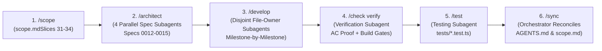

# Al Ramlah Travels — Complete Phase 2 Integration & CDD Subagent Roadmap

**Date**: 2026-11-07
**Status**: Active Execution Plan (Slices 31–34 / Specs `0012`–`0015`)
**Architecture**: Next.js 16.3.4 (App Router, RSC, Server Actions), React 19.2.8, Neon Serverless PostgreSQL (`@neondatabase/serverless`), Drizzle ORM (`0.45.x`), Better Auth (`1.4.x`), Trigger.dev Cloud (`4.8.3`), Cloudflare R2 (`@aws-sdk/client-s3`), Sharp (`0.34.x`), Oracle Cloud Gotenberg (`8.x`), Vercel AI SDK (`ai` + `@openrouter/ai-sdk-provider`), and Base UI (`@base-ui/react`).

---

## 1. Executive Summary & Audit Status

Instead of self-hosting three heavyweight NestJS/Prisma/BullMQ/Redis monorepos (`services/postiz-app`, `services/wacrm`, and `services/trigger.dev`), we ported their core business logic natively into our unified Next.js 16 + Drizzle ORM + Neon PostgreSQL application (`web/`) across **Slices 27–30** (`Specs 0008–0011`), and we recently fixed 12 cross-cutting domain, security, and state machine bugs (verified with **217/217 passing unit tests** and **0 TypeScript errors**).

| Reference Service | Ported Location in `web/` | Current Coverage | What Is Live Today | High-Leverage Phase 2 Gaps (Slices 31–34) |
| :--- | :--- | :---: | :--- | :--- |
| **`services/wacrm`** (Meta WhatsApp Cloud API CRM) | `db/schema/whatsapp-crm.ts` `lib/whatsapp/*` `app/api/webhooks/whatsapp/route.ts` `app/actions/whatsapp-crm.ts` | **~75%** | AES-256-GCM token vault, constant-time `x-hub-signature-256` HMAC webhook verification, inbound text & receipt ingestion, 24h service window tracking, automatic 14-day outreach cooldown unlock on reply, `ART-...` Post Ref auto-detection, quick replies, 3-page PDF quotes, and paced template broadcasts. | **1.** Inbound pilgrim media (passport photos, voice notes, payment receipts) stores volatile Meta `mediaId` without downloading to Cloudflare R2. **2.** `ART-...` regex detection is passive (creates a badge for staff instead of auto-replying with package details + 3-page PDF in 3 seconds). **3.** Missing `markMessageAsRead` (blue ticks), interactive reply buttons/list menus, and live Meta template status/creation sync. |
| **`services/postiz-app`** (Social Media Scheduler & OAuth Engine) | `db/schema/social-scheduler.ts` `lib/social/*` `app/api/oauth/social/*` `app/actions/social-scheduler.ts` | **~65%** | Core 5 providers (`instagram`, `facebook`, `tiktok`, `youtube`, `gmb`), PKCE + HMAC-signed OAuth start/callback routes, AES-256-GCM token storage, `sharp` 1080p JPEG normalizer, 2-step Spotlight -> Multi-Package Sheet campaigns, and Calendar UI in `/admin/campaigns`. | **1.** OAuth callback auto-picks `pages[0]` / `locations[0]` (cannot choose which Facebook Page, IG Business account, or GMB location to bind). **2.** Reactive-only token refresh (needs proactive cron before TikTok/YouTube/Meta tokens expire). **3.** No Facebook Reels/Stories 3-phase chunked video upload, no IG `resolveReleaseId` timeout recovery, no First-Comment auto-plug (`ART-...` WhatsApp CTA), and no Core 5 post analytics sync. |
| **`services/trigger.dev`** (Trigger.dev v4 Durable Workers & AI Agents) | `trigger.config.ts` `trigger/*.task.ts` `lib/ai/extract-packages.ts` | **~60%** | 4 durable tasks (`extract-packages`, `publish-social-post`, `send-whatsapp-broadcast`, `render-gotenberg-asset`) using `task()`, `wait.for()`, `wait.until()`, and `idempotencyKeys`, plus a zero-config local dev fallback (`setTimeout` / `Promise.resolve`) when `TRIGGER_SECRET_KEY` is absent. | **1.** Missing `schemaTask()` runtime payload validation, `queue()` concurrency caps, per-task `retry` / `AbortTaskRunError` discrimination, and `schedules.task()` crons. **2.** Sequential `for...of` loops instead of `batchTrigger` / `batchTriggerAndWait`. **3.** No `metadata.set()` + `@trigger.dev/react-hooks` (`useRealtimeRun`) live progress bars in `/admin/studio` & `/admin/campaigns` (currently requires `router.refresh()`). **4.** No durable AI Quoting Copilot / Concierge agent. |

---

## 2. How Our CDD Pipeline + Subagent Orchestration Works

Per [`AGENTS.md`](../AGENTS.md) and [`docs/scope/scope.md`](scope/scope.md), our engineering process combines **Context-Driven Development (`jsmastery-pro/skills` Beta tier)** with **Subagent-Driven Architecture**:

### Core Orchestration Rules from `AGENTS.md`
1. **Main Thread = Orchestrator & Reviewer**: The main agent maintains clean context, coordinates `docs/scope/scope.md`, reviews subagent outputs, runs database migrations (`npm run db:push`), and executes final quality gates.
2. **Zero-Conflict File Ownership**: When spawning parallel `/architect` or `/develop` subagents, **no two active subagents may ever edit the same file concurrently**. Shared schema changes (`db/schema/*`) are either sequenced first in Milestone 1 or owned by a single designated subagent per wave.
3. **Beta Tier Rigor**: Every slice follows the full Beta lifecycle:
   - `[ ] Design it (spec): /architect <feature>` -> produces `docs/specs/NNNN-slug.md` with `## Context`, `## Requirements` (`AC-1..AC-N`), `## Decision`, and `## Build plan` (2–5 milestones).
   - `[ ] Build it: /develop <feature>` -> executes the spec's `## Build plan` milestone by milestone.
   - `[ ] Verify it: /check verify <feature>` -> proves every `AC` against the real code and saves a verification report in `docs/reviews/`.
   - `[ ] Test it: /test <feature>` -> writes comprehensive unit/integration tests in `tests/*.test.ts` verified via `npm test`.

---

## 3. Complete 4-Wave Technical Roadmap (Slices 31–34 / Specs `0012`–`0015`)

### Wave 1 — Slice 31 (Feature #35 · Spec `0012`)
**Title**: `Trigger.dev v4 Hardening, Queues, Schedules & Realtime React Hooks`
**Spec File**: `web/docs/specs/0012-trigger-v4-hardening-queues-and-realtime-hooks.md`
**Target Directories**: `web/trigger.config.ts`, `web/trigger/*`, `web/app/actions/trigger-realtime.ts`, `web/components/admin/studio/*`, `web/components/admin/campaigns/*`

#### Key Deliverables & Acceptance Criteria
- **AC-1 (`schemaTask` & Error Discrimination)**: Upgrade all tasks in `web/trigger/*.task.ts` from raw `task()` to `schemaTask({ id, schema: z.object(...), retry, queue })`. Wrap non-retryable permanent errors (HTTP `400`, `401`, `403`, invalid Meta template, revoked OAuth token) in `AbortTaskRunError` so Trigger.dev only retries transient `429` / `5xx` failures.
- **AC-2 (Dedicated Concurrency Queues)**: Define shared queues in `web/trigger/queues.ts`:
  - `gotenbergQueue` (`concurrencyLimit: 2`) to protect the Oracle Cloud Always Free Gotenberg instance from OOM crashes.
  - `whatsappBroadcastQueue` (`concurrencyLimit: 1`) to guarantee strict sequential anti-ban pacing across overlapping campaign runs.
  - `socialPublishQueue` (`concurrencyLimit: 5`) to bound parallel social uploads.
- **AC-3 (Parallel Fan-Out via `batchTrigger`)**: Refactor sequential `for (const target of targets)` loops in `web/app/actions/social-scheduler.ts` and `web/trigger/extract-packages.task.ts` to use `batchTrigger` / `batchTriggerAndWait` with deterministic `idempotencyKeys`.
- **AC-4 (Live Progress Metadata & Public Token Minting)**: Instrument `extract-packages.task.ts`, `publish-social-post.task.ts`, `send-whatsapp-broadcast.task.ts`, and `render-gotenberg-asset.task.ts` with `metadata.set("stage", ...)` and `metadata.set("progress", 0..100)`. Add a Server Action in `web/app/actions/trigger-realtime.ts` that mints scoped `auth.createPublicToken({ scopes: { read: { runs: [runId] } } })` (with a deterministic local polling fallback when `TRIGGER_SECRET_KEY` is absent).
- **AC-5 (Realtime Studio & Campaign UI)**: Wire `@trigger.dev/react-hooks` (`useRealtimeRun`) into `/admin/studio` (multimodal flyer extraction + 4K Gotenberg rendering progress bar) and `/admin/campaigns` (live WhatsApp broadcast recipient counter + social publish status badges), eliminating manual `router.refresh()` clicks.
- **AC-6 (Declarative Cron Schedules)**: Create `web/trigger/schedules.task.ts` using `schedules.task()` for:
  1. `proactive-social-token-refresh` (runs every 6 hours to refresh expiring OAuth tokens).
  2. `sla-overdue-quote-monitor` (runs every 30 minutes to flag >24h unquoted applications and notify staff).

---

### Wave 2 — Slice 32 (Feature #36 · Spec `0013`)
**Title**: `WaCRM Phase 2: Inbound Media R2 Pipeline, Instant ART-... Auto-Responder Bot, Interactive Messages & Template Sync`
**Spec File**: `web/docs/specs/0013-wacrm-phase2-media-bot-interactive-and-templates.md`
**Target Directories**: `web/db/schema/whatsapp-crm.ts`, `web/lib/whatsapp/*`, `web/app/api/webhooks/whatsapp/route.ts`, `web/app/actions/whatsapp-crm.ts`, `web/components/admin/desk/*`

#### Key Deliverables & Acceptance Criteria
- **AC-1 (Inbound Pilgrim Media -> Cloudflare R2 Pipeline)**: When `/api/webhooks/whatsapp` receives an `image`, `document`, `audio`, or `video` message (such as a pilgrim's passport bio-page scan, payment receipt, or Urdu voice note), enqueue a durable task (`mirror-whatsapp-media.task.ts`) that calls Meta Graph API `GET /{media-id}`, streams the binary payload with `Authorization: Bearer <token>`, uploads it to Cloudflare R2 (`lib/storage/r2.ts`), and updates `waMessages.mediaUrl` + `waMessages.mediaMimeType` for permanent rendering in `/admin/desk?tab=inbox`.
- **AC-2 (3-Second `ART-...` Auto-Responder Bot)**: When an inbound WhatsApp message matches `extractPostRefCodes(text)` (`ART-[A-Z0-9-]+`), automatically look up the matching `postAssets` + `supplierFlyerPackages` record and—when the `autoReplyPostRef` setting is enabled—immediately dispatch a branded WhatsApp response containing the package summary (Makkah/Madinah hotels, nights, Quad/Triple/Double PKR rates), the 1080p Spotlight image or 3-page Quotation PDF (`pdfUrl`), and interactive quick-reply buttons (`Book Now`, `Customize Dates`, `Talk to Agent`).
- **AC-3 (`markMessageAsRead` Blue-Tick Receipts & Reaction Support)**: Add `markWhatsAppMessageAsRead(wabaMessageId)` in `web/lib/whatsapp/meta-api.ts` (`POST /{phone-number-id}/messages` with `{ status: "read", message_id }`) triggered automatically when an admin opens a conversation in `/admin/desk?tab=inbox` or when the auto-responder bot replies. Support inbound/outbound emoji reactions (`type: "reaction"`).
- **AC-4 (Interactive Reply Buttons & List Menus)**: Extend `web/lib/whatsapp/meta-api.ts` and `web/app/actions/whatsapp-crm.ts` with `sendInteractiveButtonsMessage` (up to 3 quick-reply buttons, e.g., `Quad Sharing`, `Triple Sharing`, `Double Sharing`) and `sendInteractiveListMessage` (up to 10 structured options, e.g., Departure City or Month selector), plus interactive composer controls in `/admin/desk?tab=inbox`.
- **AC-5 (Meta Template Creation & Webhook Lifecycle Sync)**: Add `createMetaMessageTemplate` and `deleteMetaMessageTemplate` (`POST/DELETE /{waba-id}/message_templates`) in `web/lib/whatsapp/meta-api.ts`, and handle `message_template_status_update` events in `/api/webhooks/whatsapp/route.ts` so `waTemplates.status` (`APPROVED`, `REJECTED`, `PAUSED`) updates automatically in real time.

---

### Wave 3 — Slice 33 (Feature #37 · Spec `0014`)
**Title**: `Postiz Phase 2: Multi-Page OAuth Selector, Proactive Token Refresh, Reels/Stories Upload, First-Comment Plug & Analytics`
**Spec File**: `web/docs/specs/0014-postiz-phase2-oauth-selector-reels-comments-analytics.md`
**Target Directories**: `web/db/schema/social-scheduler.ts`, `web/lib/social/*`, `web/app/api/oauth/social/*`, `web/app/actions/social-scheduler.ts`, `web/components/admin/campaigns/*`, `web/components/admin/settings/*`

#### Key Deliverables & Acceptance Criteria
- **AC-1 (Multi-Account / Page / Location OAuth Selection Modal)**: Replace the hardcoded `pages[0]` / `locations[0]` auto-selection in `web/app/api/oauth/social/[provider]/callback/route.ts`. When a Meta user owns multiple Facebook Pages / Instagram Business accounts or a Google user manages multiple GMB locations, store the encrypted candidate list in a short-lived pending session cookie/record and present an Account/Page Picker modal in `/admin/settings` so the admin chooses the exact brand page(s) to bind.
- **AC-2 (Proactive Token Refresh Worker & Error Recovery)**: Implement `refreshExpiringSocialTokens` in `web/lib/social/token-refresh.ts` (invoked by the 6-hour Trigger.dev cron in `schedules.task.ts`), refreshing tokens expiring within 24 hours with AES-256-GCM re-encryption and marking `status = 'REAUTH_REQUIRED'` only on permanent `invalid_grant` / `OAuthException 190` errors.
- **AC-3 (Facebook Reels & Stories 3-Phase Chunked Upload + IG `resolveReleaseId` Recovery)**: Upgrade `web/lib/social/providers/facebook.ts` to support Facebook Reels (`/video_reels` 3-phase `start` -> binary upload -> `finish`) and Photo/Video Stories (`/photo_stories`, `/video_stories`). Upgrade `web/lib/social/providers/instagram.ts` with Postiz's `resolveReleaseId` fallback query (`GET /{ig-user-id}/media?fields=id,shortcode,timestamp`) when Meta's `media_publish` times out with error `-2` / `2207051` after container completion.
- **AC-4 (First-Comment Auto-Plug for `ART-...` Conversion)**: Add `firstCommentText` support to `scheduledPosts` (`web/db/schema/social-scheduler.ts`) and `publish-social-post.task.ts`. Immediately after publishing a post on Instagram (`POST /{media-id}/comments`), Facebook (`POST /{post-id}/comments`), or YouTube (`POST /youtube/v3/commentThreads`), automatically post the first comment containing the package's `ART-...` code, Quad/Triple/Double rates, and a direct `wa.me/923274029701?text=Assalamu%20Alaikum%20I%20want%20details%20for%20ART-...` click-to-WhatsApp link.
- **AC-5 (Core 5 Social Post Analytics Sync)**: Add `syncSocialAnalytics` in `web/lib/social/analytics.ts` and a metrics drawer in `/admin/campaigns?tab=social` to fetch and store impressions, reach, likes, comments, shares, and clicks across Instagram Insights, Facebook Page Insights, YouTube Data API `videos.list(statistics)`, TikTok `/v2/video/query/`, and GMB Performance API.

---

### Wave 4 — Slice 34 (Feature #38 · Spec `0015`)
**Title**: `Durable AI Quoting Copilot & WhatsApp Concierge Agent`
**Spec File**: `web/docs/specs/0015-durable-ai-quoting-copilot-and-whatsapp-concierge.md`
**Target Directories**: `web/lib/ai/quoting-copilot.ts`, `web/trigger/quoting-copilot.task.ts`, `web/app/actions/quoting-copilot.ts`, `web/components/admin/desk/*`

#### Key Deliverables & Acceptance Criteria
- **AC-1 (Durable AI Quoting Copilot Task)**: Build `web/trigger/quoting-copilot.task.ts` and `web/lib/ai/quoting-copilot.ts` using Vercel AI SDK (`generateText` / `streamText` with Zod `Output.object()` via OpenRouter/Gemini) and Drizzle ORM read-only tools:
  - `lookupPostCodeTool` (queries `postAssets` + `supplierFlyerPackages` by `ART-...` code, hotel, or price).
  - `calculateCustomQuoteHintsTool` (invokes `calculateQuoteWorksheetHints` from `lib/domain/quote-hints.ts` against live `hotels`, `visaRates`, `transportRates`, `ziyaratTours`, and `flightOfferings`).
  - `checkBatchAvailabilityTool` (queries `groupPackages` + `groupDepartureBatches` for open seats).
- **AC-2 (One-Click AI Draft Reply & Quote Pre-Fill in `/admin/desk`)**: In `/admin/desk?tab=inbox` and `/admin/applications/[id]`, add an **"AI Draft Quote & Reply"** button that analyzes the pilgrim's WhatsApp thread or application requirements, proposes an itemized SAR/PKR quote worksheet breakdown + a polite English/Roman-Urdu WhatsApp response draft, and lets the staff member review, edit, and approve before sending.
- **AC-3 (Human-in-the-Loop Safety & Audit Logging)**: Enforce strict human-in-the-loop approval for all AI-generated custom quotes so the AI never commits binding custom pricing without staff confirmation unless matching an already-approved published `ART-...` package card.

---

## 4. Parallel Subagent Execution Matrix (Zero File Overlap)

Because our 4 slices are designed with clean module boundaries, we can run our subagents with **maximum parallelism and zero merge conflicts**:

| CDD Phase | Subagent 1 | Subagent 2 | Subagent 3 | Subagent 4 |
| :--- | :--- | :--- | :--- | :--- |
| **Step 1: `/architect`** *(All 4 Run in Parallel)* | **Spec `0012` Architect** Writes `docs/specs/0012-trigger-v4-hardening-queues-and-realtime-hooks.md` | **Spec `0013` Architect** Writes `docs/specs/0013-wacrm-phase2-media-bot-interactive-and-templates.md` | **Spec `0014` Architect** Writes `docs/specs/0014-postiz-phase2-oauth-selector-reels-comments-analytics.md` | **Spec `0015` Architect** Writes `docs/specs/0015-durable-ai-quoting-copilot-and-whatsapp-concierge.md` |
| **Step 2: `/develop` M1** *(Schema & Core Foundations)* | **Trigger v4 Worker Engineer** Owns `trigger.config.ts`, `trigger/queues.ts`, `trigger/*.task.ts`, `app/actions/trigger-realtime.ts` | **WaCRM Backend Engineer** Owns `db/schema/whatsapp-crm.ts`, `lib/whatsapp/*`, `app/api/webhooks/whatsapp/route.ts`, `app/actions/whatsapp-crm.ts` | **Postiz Backend Engineer** Owns `db/schema/social-scheduler.ts`, `lib/social/*`, `app/api/oauth/social/*`, `app/actions/social-scheduler.ts` | **AI Copilot Backend Engineer** Owns `lib/ai/quoting-copilot.ts`, `trigger/quoting-copilot.task.ts`, `app/actions/quoting-copilot.ts` |
| **Step 3: `/develop` M2** *(4-Hub Admin UI Integration)* | **Studio Realtime UI Engineer** Owns `components/admin/studio/*` | **Desk Inbox & Copilot UI Engineer** Owns `components/admin/desk/*` | **Campaigns & Settings OAuth UI Engineer** Owns `components/admin/campaigns/*`, `components/admin/settings/*` | *(Merged with Desk Inbox UI Engineer to prevent overlap on `/admin/desk`)* |
| **Step 4: `/check verify` & `/test`** | **Verification & Test Engineer (`tests/trigger-v4-and-schedules.test.ts`)** | **Verification & Test Engineer (`tests/whatsapp-phase2-bot-and-media.test.ts`)** | **Verification & Test Engineer (`tests/social-phase2-reels-and-comments.test.ts`)** | **Verification & Test Engineer (`tests/ai-quoting-copilot.test.ts`)** |

---

## 5. Immediate Next Step

1. **Roadmap & Scope Saved**: This roadmap is saved in `web/docs/roadmap-wacrm-postiz-trigger-v2.md` and registered in `web/docs/scope/scope.md` as **Slices 31–34 (Features #35–#38)**.
2. **Next Action**: Spawn the **4 parallel `/architect` subagents** to author Specs `0012`, `0013`, `0014`, and `0015` in `web/docs/specs/`, tick their `Design it (spec)` boxes in `web/docs/scope/scope.md`, and immediately proceed into `/develop` with our parallel backend subagents.
