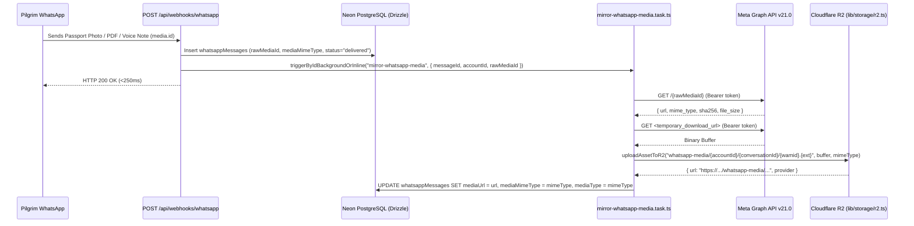

# 0013. WaCRM Phase 2: Inbound Media R2 Pipeline, Instant Post Code Auto-Responder Bot, Interactive Messages, and Template Sync

**Date**: 2026-11-07
**Status**: Approved

## Summary

This specification defines Phase 2 of the native WhatsApp Cloud API CRM (`WaCRM`) for Al Ramlah Travels (`Slice 32` / `Feature #36`). Building upon the foundational WhatsApp engine introduced in Spec `0009`, this slice delivers five high-leverage operational capabilities:
1. **Durable Inbound Media to Cloudflare R2 Pipeline**: Automatically resolves volatile Meta `mediaId` attachments (`image`, `document`, `audio`, `video`, `sticker`)—including pilgrim passport bio-page scans, bank transfer receipts, and Urdu voice notes—via Meta Graph API `GET /{media-id}`, streams the binary payload with `Authorization: Bearer <token>`, uploads it to Cloudflare R2 (`lib/storage/r2.ts`), and persists `mediaUrl` and `mediaMimeType` on `whatsappMessages` via `trigger/mirror-whatsapp-media.task.ts` (with deterministic inline local fallback).
2. **Instant 3-Second `ART-...` Post Ref Auto-Responder Bot**: Upgrades passive `ART-...` post code detection into an active, loop-safe concierge bot (`lib/whatsapp/auto-responder.ts`). When an inbound message contains an `ART-...` reference code and `autoReplyEnabled` is active, the bot automatically resolves the matching `postAssets` and `supplierFlyerPackages` record, sends a branded package summary (Makkah/Madinah hotels, nights, Quad/Triple/Double PKR retail rates) along with the 3-page PDF (`pdfUrl`) or 1080p Spotlight image (`imageUrl` / `spotlightPosterUrl`) and interactive quick-reply buttons (`Book Now`, `Customize Dates`, `Talk to Agent`), and logs the outbound bot response in `whatsappMessages`.
3. **Blue-Tick Read Receipts (`markWhatsAppMessageAsRead`) & Emoji Reactions**: Dispatches official Meta read receipts (`POST /{phone-number-id}/messages` with `{ messaging_product: "whatsapp", status: "read", message_id }`) when a consultant opens a thread in `/admin/desk?tab=inbox` or when the auto-responder bot replies, and supports inbound/outbound emoji reactions (`type: "reaction"`).
4. **Interactive Reply Buttons & List Menus**: Extends `lib/whatsapp/meta-api.ts`, `app/actions/whatsapp-crm.ts`, and `/api/webhooks/whatsapp/route.ts` with `sendInteractiveButtonsMessage` (up to 3 quick-reply buttons) and `sendInteractiveListMessage` (up to 10 structured list rows across sections), plus structured parsing of inbound `interactive` (`button_reply`, `list_reply`) payloads.
5. **Meta Template Lifecycle Creation, Deletion & Webhook Sync**: Adds `createMetaMessageTemplate` and `deleteMetaMessageTemplate` (`POST` / `DELETE /{waba-id}/message_templates`) and real-time webhook ingestion of `message_template_status_update` events to synchronize `whatsappTemplates.status` (`APPROVED`, `REJECTED`, `PAUSED`, `DISABLED`).

## Context

In Slice 28 (`Spec 0009`), Al Ramlah Travels replaced external WhatsApp aggregators and standalone Supabase microservices by embedding a native Meta WhatsApp Cloud API v21.0 engine directly into `web/`. While Phase 1 established encrypted account management, constant-time HMAC webhook verification, 24-hour customer service window enforcement, 14-day outreach cooldown auto-unlocking, and paced template broadcasts, four critical production gaps remain in daily pilgrim operations:

1. **Volatile Inbound Pilgrim Media (`mediaId` Expiration)**: When an intending pilgrim sends a photograph of their Pakistani passport bio-page, a Meezan/HBL bank deposit slip PDF, or an Urdu voice note over WhatsApp, Meta's webhook only delivers a short-lived `media.id` reference rather than a public URL. Currently, `/api/webhooks/whatsapp/route.ts` logs `[Image]`, `[Document]`, or `[Voice Note]` without downloading the binary asset. Because Meta expires temporary media URLs and requires a two-step authenticated fetch (`GET /{media-id}` to retrieve the temporary download URL, followed by a `Bearer`-authenticated binary stream download), consultants cannot view pilgrim documents or listen to voice notes inside `/admin/desk?tab=inbox`.
2. **Passive `ART-...` Post Reference Detection**: Marketing campaigns across Askari 10 WhatsApp groups, Instagram, and Facebook instruct prospects to message codes like `ART-AM-21D-01` on WhatsApp. Currently, `post-ref-detector.ts` extracts the code and badges the conversation row for staff, but the pilgrim receives no immediate reply until a human consultant opens the desk. Delivering an instant 3-second automated reply with the exact Makkah/Madinah hotel distances, Quad/Triple/Double PKR pricing, visual flyer/PDF attachment, and interactive action buttons (`Book Now`, `Customize Dates`, `Talk to Agent`) captures high-intent leads while their attention is at its peak.
3. **Lack of Interactive Menus, Blue-Tick Read Receipts, and Reactions**: Typing free-form answers slows down mobile pilgrims. Meta WhatsApp Cloud API natively supports interactive reply buttons (up to 3 tap-to-reply buttons) and interactive list messages (up to 10 structured options, such as selecting a departure month or room sharing tier), as well as blue-tick read status synchronization (`status: "read"`) and message reactions (`type: "reaction"`).
4. **Manual Template Status Polling**: Creating new seasonal Umrah templates currently requires leaving the Al Ramlah portal for Meta Business Suite and manually clicking "Sync Templates" to check whether Meta has approved or rejected a template. Subscribing to `message_template_status_update` webhook events and exposing direct template creation/deletion APIs completes the self-contained CRM lifecycle.

## Requirements

**User stories**:
- As an agency visa and ticketing consultant, I want inbound pilgrim passport photos, bank transfer PDFs, and Urdu voice notes to be automatically mirrored to Cloudflare R2 and rendered inline inside `/admin/desk?tab=inbox` so that I never lose access to expiring Meta media attachments.
- As an intending pilgrim inquiring about a marketing post code (such as `ART-AM-21D-01`), I want to receive an instant automated WhatsApp reply within 3 seconds containing the package's Makkah and Madinah hotels, Quad/Triple/Double PKR rates, the 3-page quotation PDF or spotlight poster, and interactive quick-reply buttons (`Book Now`, `Customize Dates`, `Talk to Agent`) so that I can review the itinerary immediately.
- As an outreach administrator, I want to toggle the `ART-...` Auto-Responder Bot on or off per WhatsApp account and enforce a per-conversation cooldown guard so that repeated messages with the same post code never trigger infinite reply loops.
- As a customer support agent, I want inbound messages to be marked as read (blue ticks on the pilgrim's phone) when I open a conversation or trigger the auto-responder, and I want to send and view emoji reactions and interactive button/list menus directly from `/admin/desk?tab=inbox`.
- As a marketing manager, I want to submit new WhatsApp templates to Meta, delete obsolete templates, and have template approval statuses (`APPROVED`, `REJECTED`, `PAUSED`, `DISABLED`) update automatically via Meta webhooks.

**Acceptance criteria**:
- **AC-1 (Inbound Pilgrim Media -> Cloudflare R2 Pipeline)**: Inbound pilgrim media (`image`, `document`, `audio`, `video`, `sticker`) arriving at `/api/webhooks/whatsapp/route.ts` captures the Meta `mediaId` (`rawMediaId`) and initial MIME type (`mediaMimeType`), and dispatches `trigger/mirror-whatsapp-media.task.ts` via `triggerByIdBackgroundOrInline`. The worker resolves the temporary download URL via Meta Graph API `GET /{media-id}`, downloads the binary stream with `Authorization: Bearer <accessToken>`, uploads the buffer to Cloudflare R2 (`lib/storage/r2.ts` under deterministic key `whatsapp-media/{accountId}/{conversationId}/{wamid}.{ext}`), and updates `whatsappMessages.mediaUrl` and `whatsappMessages.mediaMimeType` (with an inline local fallback in development/test environments).
- **AC-2 (Instant 3-Second `ART-...` Post Ref Auto-Responder Bot)**: Module `lib/whatsapp/auto-responder.ts` evaluates inbound text and interactive replies containing an `ART-...` reference code. When the account's `autoReplyEnabled` setting (`waSettings.autoReplyEnabled` / `whatsappAccounts.autoReplyEnabled`) is `true` and the conversation passes the loop-prevention cooldown guard (has not auto-replied to the same `(conversationId, postCode)` within the cooldown window, default 24 hours), it looks up the package in `postAssets` + `supplierFlyerPackages`, dispatches:
  1. The 3-page PDF (`pdfUrl` / `spotlightPdfUrl`) or Spotlight poster image (`imageUrl` / `spotlightPosterUrl`) if available, and
  2. A branded package summary message (Makkah/Madinah hotels, nights, distances, flight route, and Sharing/Quad/Triple/Double PKR retail breakdown) with 3 interactive quick-reply buttons (`Book Now`, `Customize Dates`, `Talk to Agent`),
  and logs the outbound bot message(s) in `whatsappMessages` and stamps `lastAutoRepliedPostCode` + `lastAutoRepliedAt` on `whatsappConversations`.
- **AC-3 (`markWhatsAppMessageAsRead` Blue-Tick Receipts & Reaction Support)**: `lib/whatsapp/meta-api.ts` exports `markWhatsAppMessageAsRead` (`POST /{phone-number-id}/messages` with `{ messaging_product: "whatsapp", status: "read", message_id }`) and `sendReactionMessage` (`type: "reaction"` with `{ message_id, emoji }`). Opening a thread in `/admin/desk?tab=inbox` (or invoking `markConversationReadAction`) marks the latest unread inbound `wamid` as read on Meta and resets `unreadCount = 0`. Inbound `reaction` webhook events are ingested and stored cleanly.
- **AC-4 (Interactive Reply Buttons & List Menus)**: `lib/whatsapp/meta-api.ts` and `app/actions/whatsapp-crm.ts` implement `sendInteractiveButtonsMessage` (enforcing 1–3 reply buttons, title max 20 chars, unique button IDs) and `sendInteractiveListMessage` (button label max 20 chars, 1–10 total rows across sections, row title max 24 chars, optional description max 72 chars). Webhook handler `/api/webhooks/whatsapp/route.ts` parses inbound `interactive` (`button_reply` and `list_reply`) payloads, preserving both the selected option `id` (`interactiveReplyId`) and `title` (`body`), and routes quick-reply button selections (e.g., `art_book:ART-AM-21D-01`) appropriately.
- **AC-5 (Meta Template Lifecycle Management & Webhook Status Sync)**: `lib/whatsapp/meta-api.ts` and `app/actions/whatsapp-crm.ts` implement `createMetaMessageTemplate` (`POST /{waba-id}/message_templates`) and `deleteMetaMessageTemplate` (`DELETE /{waba-id}/message_templates?name=...`). Webhook handler `/api/webhooks/whatsapp/route.ts` processes `change.field === "message_template_status_update"` events, mapping Meta template events (`APPROVED`, `REJECTED`, `PAUSED`, `DISABLED`, `PENDING`) to `whatsappTemplates.status` and recording `rejectionReason` when provided.
- **AC-6 (Admin Desk Inbox UI Enhancements)**: `/admin/desk?tab=inbox` (`components/admin/desk/*`) renders persisted R2 inbound media inline (image lightbox/preview, PDF document download card, HTML5 `<audio controls>` player for voice notes, and video player), provides an interactive message composer mode (Reply Buttons builder with up to 3 buttons and List Menu builder with sections/rows), triggers blue-tick read receipts when opening unread threads, and exposes an `ART-...` Auto-Responder Bot toggle switch in the inbox header/settings bar.
- **AC-7 (Zero-Config Offline/Mock Execution)**: When live Meta Graph API credentials are absent or simulated in local development and automated test suites (`NODE_ENV !== "production"` or mock token prefixes), all Phase 2 Meta API operations (`fetchMediaMetadata`, `downloadMediaBinary`, `markWhatsAppMessageAsRead`, `sendReactionMessage`, `sendInteractiveButtonsMessage`, `sendInteractiveListMessage`, `createMetaMessageTemplate`, `deleteMetaMessageTemplate`) degrade gracefully with deterministic synthetic payloads (`wamid.sim_*`, synthetic media buffers, and local `/uploads/r2-local/...` URLs) without throwing unhandled network errors.

## Options considered

### Option 1: Proxy Meta Media On-Demand via Next.js Streaming Route Without Object Storage

Instead of downloading inbound media to Cloudflare R2 during webhook ingestion, store only Meta's `media.id` in `whatsappMessages` and build an internal Next.js API route (`/api/whatsapp/media/[mediaId]`) that calls Meta Graph API on the fly whenever an admin views the conversation.

**Pros**:
- Zero storage footprint in Cloudflare R2 for inbound images or voice notes.
- Faster initial webhook execution if background workers are unavailable.

**Cons**:
- **Meta Media URLs & IDs Expire**: Meta WhatsApp Cloud API purges hosted media after 30 days (and temporary download URLs expire within 5 minutes). Pilgrim passport scans and bank payment receipts must be retained permanently for Ministry of Religious Affairs compliance and booking verification.
- **High Latency & Rate Limits**: Every time a staff member opens or refreshes `/admin/desk?tab=inbox`, the browser would trigger two sequential round-trip requests to `graph.facebook.com` per image/audio message, quickly exhausting Meta Graph API rate limits and degrading inbox responsiveness.

### Option 2: External Chatbot SaaS (ManyChat / Wati Flow Builder) for `ART-...` Auto-Replies

Delegate `ART-...` keyword auto-replies and interactive button flows to a third-party visual flow builder connected via webhook forwarding.

**Pros**:
- Provides a drag-and-drop flow canvas outside the codebase.

**Cons**:
- **No Direct Access to Neon PostgreSQL**: An external bot cannot atomically query `supplierFlyerPackages` and `postAssets` to pull live Makkah/Madinah hotel names, distances, Quad/Triple/Double PKR retail pricing, or dynamic 3-page quotation PDFs generated by Gotenberg.
- **Split Conversation State**: Messages sent by an external flow builder do not automatically appear in `whatsappMessages` or link to `applications` and `outreachContacts` without brittle bidirectional syncing.

### Option 3 (Chosen): Durable Trigger.dev R2 Media Mirroring + Native Drizzle `ART-...` Auto-Responder & Interactive Engine

Enqueue inbound media downloads via a Trigger.dev v4 `schemaTask` (`trigger/mirror-whatsapp-media.task.ts`) with inline local fallback (`triggerByIdBackgroundOrInline`) that streams binaries into Cloudflare R2 (`lib/storage/r2.ts`), while executing the `ART-...` Post Ref Auto-Responder (`lib/whatsapp/auto-responder.ts`), interactive message builders, blue-tick receipts, and template webhook sync natively inside `web/`.

**Pros**:
- **Permanent Archival in Cloudflare R2**: Pilgrim passport scans, payment slips, and voice notes are permanently stored under deterministic R2 keys with zero egress fees and instant CDN rendering in `/admin/desk?tab=inbox`.
- **Sub-3-Second Webhook Response + Zero Timeout Risk**: Offloading binary downloads to `mirror-whatsapp-media.task.ts` keeps `/api/webhooks/whatsapp` fast while ensuring retries on transient network hiccups.
- **Deep Domain Integration**: `lib/whatsapp/auto-responder.ts` queries `postAssets` and `supplierFlyerPackages` directly via Drizzle ORM, formatting accurate PKR rates, hotel distances, and interactive `Book Now` / `Customize Dates` / `Talk to Agent` buttons in a single transaction.
- **Unified Offline/Test Ergonomics**: Works identically in production (Trigger.dev Cloud + Cloudflare R2 + Meta Graph API v21.0) and in local dev/test (`triggerByIdBackgroundOrInline` + local `/uploads/r2-local/` fallback + simulated `wamid.sim_*` receipts).

**Cons**:
- Requires adding minor schema columns to `db/schema/whatsapp-crm.ts` for raw media tracking, interactive payloads, template rejection reasons, and auto-responder loop protection.

## Decision

**Chosen option**: Option 3: Durable Trigger.dev R2 Media Mirroring + Native Drizzle `ART-...` Auto-Responder & Interactive Engine.

We will extend `web/db/schema/whatsapp-crm.ts`, `web/lib/whatsapp/*`, `web/trigger/mirror-whatsapp-media.task.ts`, `web/app/api/webhooks/whatsapp/route.ts`, `web/app/actions/whatsapp-crm.ts`, and `web/components/admin/desk/*` to implement the complete Phase 2 WaCRM suite natively.

## Architecture and Technical Design

### 1. Component and Directory Structure

```text
web/
├── db/
│   └── schema/
│       └── whatsapp-crm.ts                 # Extended enums & columns for media, bot settings, interactive & templates
├── lib/
│   ├── validations/
│   │   └── whatsapp-crm.ts                 # Zod schemas for interactive buttons/lists, reactions, templates, bot toggle
│   └── whatsapp/
│       ├── meta-api.ts                     # Media fetch/download, markAsRead, reactions, interactive buttons/list, template CRUD
│       ├── auto-responder.ts               # Instant 3s ART-... Post Ref lookup, cooldown guard & interactive reply dispatcher
│       ├── post-ref-detector.ts            # Existing ART-... extractor + helper enrichment
│       └── media-mirror.ts                 # Core Meta media download -> R2 upload -> DB update helper
├── trigger/
│   └── mirror-whatsapp-media.task.ts       # Durable schemaTask wrapper invoking mirrorWhatsappMediaToR2
├── app/
│   ├── api/
│   │   └── webhooks/
│   │       └── whatsapp/
│   │           └── route.ts                # Inbound media queueing, auto-responder trigger, interactive replies & template status webhook
│   └── actions/
│       └── whatsapp-crm.ts                 # Server Actions for interactive send, mark read, reactions, bot toggle, template CRUD
└── components/
    └── admin/
        └── desk/
            └── ...                         # R2 media players/lightboxes, interactive composer, blue-tick trigger, auto-reply toggle
```

### 2. Schema Additions (`web/db/schema/whatsapp-crm.ts`)

To support all Phase 2 capabilities while maintaining backward compatibility with existing queries and tests:

1. **Enum Extensions**:
   - `whatsappMessageTypeEnum`: Add `"sticker"` and `"reaction"` to existing `["text", "image", "document", "audio", "video", "template", "interactive", "sticker", "reaction"]`.
   - `whatsappTemplateStatusEnum`: Add `"DISABLED"` to existing `["APPROVED", "PENDING", "REJECTED", "PAUSED", "DISABLED"]`.

2. **`whatsappAccounts` Additions (Account-Level `waSettings` / Auto-Responder Config)**:
   - `autoReplyEnabled: boolean("auto_reply_enabled").notNull().default(true)` — Controls whether inbound `ART-...` post code inquiries automatically receive an instant bot response.
   - `autoReplyCooldownMinutes: integer("auto_reply_cooldown_minutes").notNull().default(1440)` — Per-conversation + per-post-code cooldown window (default 24 hours = 1440 minutes) to prevent bot loops.

3. **`whatsappConversations` Additions (Loop-Prevention State)**:
   - `lastAutoRepliedPostCode: varchar("last_auto_replied_post_code", { length: 64 })` — Last `ART-...` code that triggered an automatic reply in this conversation.
   - `lastAutoRepliedAt: timestamp("last_auto_replied_at", { withTimezone: true })` — Timestamp of the last automatic bot reply.

4. **`whatsappMessages` Additions (Inbound Media Mirroring, Interactive & Reactions)**:
   - `rawMediaId: varchar("raw_media_id", { length: 128 })` — Original Meta Graph API `media.id` for inbound media attachments.
   - `mediaMimeType: varchar("media_mime_type", { length: 128 })` — Normalized MIME type (e.g., `image/jpeg`, `application/pdf`, `audio/ogg; codecs=opus`, `video/mp4`, `image/webp`).
   - `mediaSha256: varchar("media_sha256", { length: 128 })` — Optional SHA-256 hash provided by Meta webhook.
   - `interactivePayload: jsonb("interactive_payload").$type<Record<string, unknown>>()` — Structured interactive button/list definition (for outbound messages) or `{ type, id, title, description }` reply metadata (for inbound interactive clicks).
   - `reactionEmoji: varchar("reaction_emoji", { length: 32 })` — Emoji character for `reaction` messages or reactions applied to an existing message.
   - `isAutoReply: boolean("is_auto_reply").notNull().default(false)` — Flags messages dispatched automatically by the `ART-...` Auto-Responder Bot.

5. **`whatsappTemplates` Additions (Lifecycle & Rejection Diagnostics)**:
   - `rejectionReason: text("rejection_reason")` — Reason supplied by Meta when a template transitions to `REJECTED` or `DISABLED`.

### 3. Inbound Media to Cloudflare R2 Pipeline (`AC-1`)



- **R2 Key Naming Convention**:
  `whatsapp-media/{accountId}/{conversationId}/{sanitizedWamid}.{ext}`
  where `{ext}` is deterministically mapped from `mime_type` (`image/jpeg` -> `jpg`, `image/png` -> `png`, `image/webp` -> `webp`, `application/pdf` -> `pdf`, `audio/ogg` -> `ogg`, `audio/mpeg` -> `mp3`, `video/mp4` -> `mp4`, fallback `bin`).
- **Meta API Signatures in `lib/whatsapp/meta-api.ts`**:
  ```typescript
  export interface MetaMediaMetadata {
    id: string
    url: string
    mime_type: string
    sha256?: string
    file_size?: number
  }

  export async function fetchWhatsAppMediaMetadata(args: {
    mediaId: string
    accessToken: string
  }): Promise<MetaMediaMetadata>

  export async function downloadWhatsAppMediaBinary(args: {
    mediaUrl: string
    accessToken: string
  }): Promise<{ buffer: Buffer; contentType: string }>
  ```

### 4. Instant 3-Second `ART-...` Post Ref Auto-Responder Bot (`AC-2`)

Implemented in `web/lib/whatsapp/auto-responder.ts`:

- **Trigger Condition**:
  1. Inbound message is of type `text` or `interactive` and `extractPostRefCodes(bodyText)` returns at least one `ART-...` code.
  2. Account has `autoReplyEnabled === true`.
  3. **Loop-Prevention & Cooldown Guard**:
     If `conversation.lastAutoRepliedPostCode === matchedCode` AND `conversation.lastAutoRepliedAt` is within `account.autoReplyCooldownMinutes` (default 1440 mins / 24h) of `now`, the bot skips auto-replying and returns `{ skipped: true, reason: "cooldown_active" }`.
- **Package Resolution**:
  Queries `supplierFlyerPackages` joined with `supplierFlyers` and `postAssets` where `upper(postCode) = normalizedCode`:
  - Extracts `makkahHotelName`, `makkahNights`, `makkahDistanceLabel`, `madinahHotelName`, `madinahNights`, `madinahDistanceLabel`, `outboundRoute`, `outboundDateLabel`, `returnDateLabel`, and retail prices (`retailSharingPkr`, `retailQuadPkr`, `retailTriplePkr`, `retailDoublePkr`).
  - Identifies primary visual/document attachment: prefers `postAssets.pdfUrl` or `supplierFlyerPackages.spotlightPdfUrl` (sent via `sendDocumentMessage`), or falls back to `postAssets.imageUrl` or `supplierFlyerPackages.spotlightPosterUrl` (sent via `sendImageMessage`).
- **Outbound Dispatch Sequence**:
  1. Calls `markWhatsAppMessageAsRead` on the triggering inbound `wamid` so the pilgrim immediately sees blue ticks.
  2. If a PDF or Spotlight image URL exists on the resolved record, dispatches the media attachment and logs an outbound `whatsappMessages` record (`isAutoReply: true`).
  3. Dispatches `sendInteractiveButtonsMessage` containing the formatted package breakdown in the body and 3 interactive quick-reply buttons:
     - `{ id: "art_book:${code}", title: "Book Now" }`
     - `{ id: "art_dates:${code}", title: "Customize Dates" }`
     - `{ id: "art_agent:${code}", title: "Talk to Agent" }`
  4. Logs the outbound `interactive` message row (`isAutoReply: true`) in `whatsappMessages` and updates `whatsappConversations` (`lastAutoRepliedPostCode = code`, `lastAutoRepliedAt = now`, `lastMessageAt = now`).

### 5. Blue-Tick Read Receipts, Reactions & Interactive Messages (`AC-3`, `AC-4`)

- **Blue-Tick Receipts (`markWhatsAppMessageAsRead`)**:
  ```typescript
  export async function markWhatsAppMessageAsRead(args: {
    phoneNumberId: string
    accessToken: string
    messageId: string
  }): Promise<{ success: boolean }>
  ```
  *(Alias `markMessageAsRead` preserved for backward compatibility).*
- **Emoji Reactions (`sendReactionMessage`)**:
  ```typescript
  export async function sendReactionMessage(args: {
    phoneNumberId: string
    accessToken: string
    to: string
    messageId: string
    emoji: string
  }): Promise<MetaSendResult>
  ```
- **Interactive Reply Buttons (`sendInteractiveButtonsMessage`)**:
  ```typescript
  export interface InteractiveReplyButton {
    id: string
    title: string // Max 20 chars enforced
  }

  export interface SendInteractiveButtonsArgs {
    phoneNumberId: string
    accessToken: string
    to: string
    headerText?: string
    bodyText: string
    footerText?: string
    buttons: InteractiveReplyButton[] // 1..3 buttons enforced
    contextMessageId?: string
  }

  export async function sendInteractiveButtonsMessage(
    args: SendInteractiveButtonsArgs
  ): Promise<MetaSendResult>
  ```
- **Interactive List Messages (`sendInteractiveListMessage`)**:
  ```typescript
  export interface InteractiveListRow {
    id: string
    title: string // Max 24 chars enforced
    description?: string // Max 72 chars enforced
  }

  export interface InteractiveListSection {
    title: string // Max 24 chars enforced
    rows: InteractiveListRow[]
  }

  export interface SendInteractiveListArgs {
    phoneNumberId: string
    accessToken: string
    to: string
    headerText?: string
    bodyText: string
    footerText?: string
    buttonText: string // Max 20 chars enforced
    sections: InteractiveListSection[] // Total 1..10 rows enforced
    contextMessageId?: string
  }

  export async function sendInteractiveListMessage(
    args: SendInteractiveListArgs
  ): Promise<MetaSendResult>
  ```

### 6. Meta Template Lifecycle & Webhook Status Sync (`AC-5`)

- **Template Creation & Deletion in `lib/whatsapp/meta-api.ts`**:
  ```typescript
  export interface CreateMetaTemplateArgs {
    wabaId: string
    accessToken: string
    name: string // lowercase alphanumeric + underscores
    language: string // e.g. "en_US", "ur"
    category: "MARKETING" | "UTILITY" | "AUTHENTICATION"
    headerText?: string
    bodyText: string
    footerText?: string
    buttons?: Array<
      | { type: "QUICK_REPLY"; text: string }
      | { type: "URL"; text: string; url: string }
      | { type: "PHONE_NUMBER"; text: string; phone_number: string }
    >
  }

  export async function createMetaMessageTemplate(
    args: CreateMetaTemplateArgs
  ): Promise<{ id: string; status: "APPROVED" | "PENDING" | "REJECTED" | "PAUSED" | "DISABLED" }>

  export async function deleteMetaMessageTemplate(args: {
    wabaId: string
    accessToken: string
    name: string
  }): Promise<{ success: boolean }>
  ```
- **Webhook Status Synchronization in `/api/webhooks/whatsapp/route.ts`**:
  When `change.field === "message_template_status_update"`, the webhook extracts:
  - `event`: mapped to `"APPROVED" | "PENDING" | "REJECTED" | "PAUSED" | "DISABLED"`
  - `message_template_id`: `String(val.message_template_id)`
  - `message_template_name`: `val.message_template_name`
  - `message_template_language`: `val.message_template_language`
  - `reason`: `val.reason ?? val.other_info?.description ?? null`
  and updates the matching row in `whatsappTemplates` by `metaTemplateId` or `(accountId, name, language)`.

## Build plan

### Milestone 1: Schema Extensions, Validation Contracts & Meta Graph API v21.0 Phase 2 Client
- Extend `web/db/schema/whatsapp-crm.ts` with Phase 2 enum values (`sticker`, `reaction`, `DISABLED`), account auto-responder settings (`autoReplyEnabled`, `autoReplyCooldownMinutes`), conversation auto-reply tracking (`lastAutoRepliedPostCode`, `lastAutoRepliedAt`), message media/interactive/reaction columns (`rawMediaId`, `mediaMimeType`, `mediaSha256`, `interactivePayload`, `reactionEmoji`, `isAutoReply`), and template `rejectionReason`.
- Extend `web/lib/validations/whatsapp-crm.ts` with Zod schemas for interactive buttons, interactive list menus, reactions, mark-as-read, auto-responder settings toggle, and Meta template creation/deletion.
- Expand `web/lib/whatsapp/meta-api.ts` with `fetchWhatsAppMediaMetadata`, `downloadWhatsAppMediaBinary`, `markWhatsAppMessageAsRead`, `sendReactionMessage`, `sendInteractiveButtonsMessage`, `sendInteractiveListMessage`, `createMetaMessageTemplate`, and `deleteMetaMessageTemplate`, complete with zero-config offline/dev simulation fallbacks (**AC-1**, **AC-3**, **AC-4**, **AC-5**, **AC-7**).

### Milestone 2: Inbound Media R2 Mirror Pipeline & Instant 3-Second `ART-...` Auto-Responder Bot
- Create `web/lib/whatsapp/media-mirror.ts` and durable task `web/trigger/mirror-whatsapp-media.task.ts` (`schemaTask`) to resolve Meta `mediaId` metadata, stream binary content with `Bearer` token authentication, upload to Cloudflare R2 (`uploadAssetToR2`), and update `whatsappMessages.mediaUrl` and `whatsappMessages.mediaMimeType` (**AC-1**, **AC-7**).
- Create `web/lib/whatsapp/auto-responder.ts` implementing `runPostRefAutoResponder` with `autoReplyEnabled` checks, per-conversation + post-code cooldown loop protection, `supplierFlyerPackages` + `postAssets` lookup, 3-page PDF / Spotlight poster dispatch, and interactive 3-button (`Book Now`, `Customize Dates`, `Talk to Agent`) summary dispatch (**AC-2**, **AC-7**).

### Milestone 3: Webhook Route Upgrade & WhatsApp CRM Server Actions
- Upgrade `web/app/api/webhooks/whatsapp/route.ts` to:
  1. Capture inbound media (`image`, `document`, `audio`, `video`, `sticker`) `rawMediaId` & `mediaMimeType` and trigger `mirror-whatsapp-media` via `triggerByIdBackgroundOrInline`.
  2. Parse inbound `interactive` (`button_reply`, `list_reply`) and `reaction` messages and store structured metadata.
  3. Trigger `runPostRefAutoResponder` when an inbound message contains an `ART-...` code or interactive quick-reply action.
  4. Handle `change.field === "message_template_status_update"` webhook events to update `whatsappTemplates.status` (`APPROVED`, `REJECTED`, `PAUSED`, `DISABLED`) and `rejectionReason` in real time (**AC-1**, **AC-2**, **AC-3**, **AC-4**, **AC-5**).
- Extend `web/app/actions/whatsapp-crm.ts` with Server Actions for sending interactive button/list messages, sending reactions, marking conversations as read with Meta blue ticks, toggling the `ART-...` Auto-Responder Bot, and creating/deleting Meta message templates (**AC-2**, **AC-3**, **AC-4**, **AC-5**).

### Milestone 4: `/admin/desk?tab=inbox` UI Integration & Verification Suite
- Upgrade `/admin/desk?tab=inbox` (`web/components/admin/desk/*`) to render persisted R2 inbound media (images, PDFs, HTML5 audio player for voice notes, video player), interactive message bubbles, an interactive composer mode (Buttons & List builders), automatic blue-tick read action on thread open, and an `ART-...` Auto-Responder Bot toggle switch (**AC-6**).
- Write unit and integration tests in `web/tests/whatsapp-phase2-bot-and-media.test.ts` verifying R2 media mirroring, `ART-...` auto-responder formatting and loop prevention, interactive buttons/list payload validation, blue-tick read receipts, and `message_template_status_update` webhook synchronization (**AC-1** through **AC-7**).
