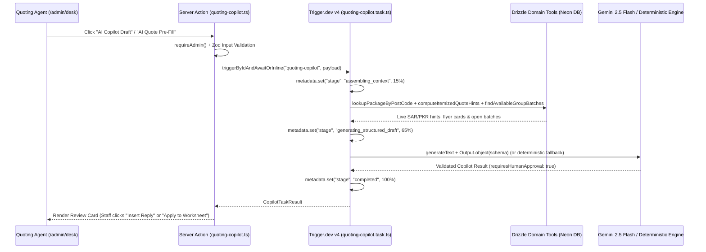

# 0015. Durable AI Quoting Copilot and WhatsApp Concierge Agent

**Date**: 2026-11-07
**Status**: Approved

## Summary

This specification introduces a durable AI Quoting Copilot and WhatsApp Concierge Agent for Al Ramlah Travels (`Slice 34` / `Feature #38`). Built on the Vercel AI SDK (`generateText` + `Output.object()` via `@openrouter/ai-sdk-provider` with Google Gemini 2.5 Flash and Claude 3.5 Sonnet fallbacks), Trigger.dev v4 durable `schemaTask` execution, and read-only Drizzle ORM domain tools against Neon PostgreSQL, the copilot assists agency staff across both tabs of `/admin/desk` (`?tab=inbox` and `?tab=pipeline`) as well as `/admin/applications/[id]`. Quoting agents can generate context-aware bilingual (English and polite Roman Urdu hospitality) WhatsApp reply drafts, match `ART-...` post reference codes and live group departure batches, and pre-fill itemized SAR/PKR quotation worksheets in one click—all governed by strict Human-in-the-Loop (HITL) approval so AI recommendations never commit binding pricing or send customer messages without explicit staff confirmation.

## Context

In Slices 27–30 (`Specs 0008–0011`), Al Ramlah Travels consolidated its administrative portal into four operational hubs and launched a native Meta WhatsApp Cloud API shared inbox (`/admin/desk?tab=inbox`), an interactive `@dnd-kit` Kanban pipeline (`/admin/desk?tab=pipeline`), an itemized SAR/PKR quoting worksheet (`/admin/applications/[id]`), and a deterministic rate-hint engine (`web/lib/domain/quote-hints.ts`). However, quoting agents still face four high-friction manual steps during peak Umrah and Hajj inquiry hours:

1. **Manual Context Assembly Across Multiple Tables**: When a pilgrim messages on WhatsApp asking for a custom 14-day family package or references a promotional flyer code (`ART-AM-21D-04`), the agent must mentally cross-reference `post_assets`, `supplier_flyer_packages`, `group_packages`, `group_departures`, `hotels`, `visa_rates`, `transport_rates`, and `agency_settings.sar_to_pkr_rate` before composing a reply.
2. **Repetitive Bilingual Hospitality Drafting**: Pilgrims in Pakistan frequently communicate in a mix of English and Roman Urdu (`"Assalamu Alaikum, 4 adults ke liye November mein 15 days package chahiye Makkah shuttle hotel ke sath"`). Writing warm, accurate, Haramain-hospitality responses with formatted Quad/Triple/Double pricing bullets takes 3–5 minutes per thread.
3. **Manual Worksheet Transcription**: Even though `calculateApplicationRateHints` computes reference SAR/PKR breakdowns for an application, staff must still manually copy values into the quote worksheet inputs, calculate supplier net cost versus agency commission margin, and write customer-facing executive notes (`quoteNotesCustomer`) and internal admin audit notes (`internalNotesAdmin`).
4. **Lack of Durable AI Execution & Offline Testability**: Running multi-step LLM calls with database tool lookups directly inside a blocking UI thread without durable orchestration risks serverless timeouts on slow provider responses, while lacking a deterministic rule-based fallback prevents offline local development and fast CI unit testing when `OPENROUTER_API_KEY` is absent.

## Requirements

**User stories**:
- As a WhatsApp quoting concierge in `/admin/desk?tab=inbox`, I want to click **"AI Copilot Draft"** on any active conversation so that the system inspects the pilgrim's recent messages, resolves any detected `ART-...` post codes or open group batches, and drafts a warm bilingual (English + polite Roman Urdu greeting) response with verified PKR pricing bullets that I can insert into the composer with one click.
- As a senior quoting specialist in `/admin/desk?tab=pipeline` and `/admin/applications/[id]`, I want a 1-click **"AI Quote Pre-Fill & Summary"** action that computes itemized SAR/PKR rates from live catalog inventory (`hotels`, `visa_rates`, `transport_rates`, `ziyarat_places`, `airlines`, `agency_settings`), proposes an itemized worksheet breakdown plus customer and internal notes, and lets me review and apply the numbers into the form without auto-submitting or bypassing human sign-off.
- As an agency operations director, I want every AI copilot recommendation to enforce strict Human-in-the-Loop (HITL) safety—never sending a WhatsApp message or transitioning an application to `quoted` / `approved` without explicit staff confirmation—and to record which model or deterministic fallback generated the draft.
- As a platform engineer, I want the AI Quoting Copilot to run both as a Trigger.dev v4 `schemaTask` (`quoting-copilot`) with live `metadata.set()` progress telemetry and via a deterministic zero-key fallback engine in `web/lib/ai/quoting-copilot.ts`, ensuring 100% deterministic unit test coverage.

**Acceptance criteria**:
- **AC-1**: Read-only domain tools & context assembler in `web/lib/ai/quoting-copilot.ts` that query live Neon PostgreSQL inventory via Drizzle ORM:
  1. `lookupPackageByPostCode` (queries `postAssets` + `supplierFlyerPackages` by `ART-...` code, hotel name, or price, returning retail and net Sharing/Quad/Triple/Double PKR tariffs, flight routes, Makkah/Madinah hotels, and asset URLs).
  2. `computeItemizedQuoteHints` (wraps `calculateQuoteWorksheetHints` / `calculateApplicationRateHints` from `lib/domain/quote-hints.ts` with live `hotels`, `visaRates`, `transportRates`, `ziyaratTours` (`ziyaratPlaces` + `vehicles`), `flightOfferings` (`airlines` + `departureCities`), and `systemSettings` (`agencySettings.sarToPkrRate`) SAR-to-PKR exchange rate).
  3. `findAvailableGroupBatches` (queries `groupPackages` + `groupDepartureBatches` (`groupDepartures`) with available seats `totalSeats - bookedSeats > 0` and active status).
- **AC-2**: Structured AI Quoting Copilot generator in `web/lib/ai/quoting-copilot.ts` using Vercel AI SDK (`generateText` + `Output.object()` with a strict Zod schema via `@openrouter/ai-sdk-provider` / `google/gemini-2.5-flash` primary and `anthropic/claude-3.5-sonnet` / `@ai-sdk/google` fallbacks) plus a deterministic rule-based fallback engine when `OPENROUTER_API_KEY` (and `GEMINI_API_KEY`) is absent in local dev/tests.
- **AC-3**: Durable background task `web/trigger/quoting-copilot.task.ts` (`schemaTask` with `metadata.set()` progress stages: `assembling_context`, `running_domain_tools`, `generating_structured_draft`, `completed`) and Server Actions in `web/app/actions/quoting-copilot.ts` (`generateWaConversationCopilotDraftAction` and `generateApplicationQuoteCopilotDraftAction`) protected by `requireAdmin()`.
- **AC-4**: In `/admin/desk?tab=inbox`, add an **"AI Copilot Draft"** button & review card that reads the pilgrim's recent WhatsApp messages + detected `ART-...` codes, generates a bilingual (English + polite Roman Urdu hospitality greeting) reply draft alongside recommended package/pricing bullets, and inserts the approved text into the reply box on staff click without auto-sending.
- **AC-5**: In `/admin/desk?tab=pipeline` (and `/admin/applications/[id]`), enable 1-click AI Quote Worksheet pre-fill / executive summary generation with strict Human-in-the-Loop safety (AI drafts populate client form state or preview cards for staff review and are never sent to customers or persisted as finalized `quoted`/`approved` records without explicit staff confirmation).
- **AC-6**: Full unit test coverage in `web/tests/ai-quoting-copilot.test.ts` covering deterministic fallback generation, domain tool calculations (`lookupPackageByPostCode`, `computeItemizedQuoteHints`, `findAvailableGroupBatches`), Zod schema validation, and Human-in-the-Loop safety invariants.

## Options considered

### Option 1: Autonomous Auto-Replying & Auto-Quoting LLM Agent Connected Directly to Webhooks
Wire an unconstrained LLM agent directly into `/api/webhooks/whatsapp` and application submission hooks so it autonomously replies to free-form customer questions and writes binding quotes directly to `application_quotes`.

**Pros**:
- Zero staff clicks required for custom inquiries.
- Instant 24/7 responses even outside working hours.

**Cons**:
- **Unacceptable financial and commercial risk**: Hallucinated or miscalculated custom quotes could commit the agency to below-cost hotel or flight rates.
- Violates Al Ramlah Travels' high-touch luxury Haramain concierge positioning where senior quoting specialists verify supplier seat blocks and seasonal surcharges before committing custom rates.
- Note: Instant 3-second deterministic auto-replies for pre-approved `ART-...` post codes are already handled safely by the rule-based WaCRM Phase 2 bot in `Spec 0013`; free-form custom quoting requires a human-in-the-loop copilot.

### Option 2 (Chosen): Durable Human-in-the-Loop AI Quoting Copilot with Read-Only Drizzle Domain Tools & Deterministic Fallback
Build a read-only domain tool layer and context assembler in `web/lib/ai/quoting-copilot.ts`, orchestrate structured generation via Vercel AI SDK (`generateText` + `Output.object()`) inside a durable Trigger.dev v4 `schemaTask` (`web/trigger/quoting-copilot.task.ts`) with inline fallback via `triggerByIdAndAwaitOrInline`, and surface interactive review cards in `/admin/desk` and `/admin/applications/[id]`.

**Pros**:
- **Zero Hallucinated Arithmetic**: All SAR-to-PKR conversions, Masar visa tiers, hotel bed/room allocations, and transport sector tariffs are computed deterministically by `computeItemizedQuoteHints` (`calculateApplicationRateHints`) before the LLM synthesizes the explanation and bilingual reply draft.
- **Strict Human-in-the-Loop Safety**: The copilot returns structured draft objects (`WaCopilotDraftResult` and `ApplicationQuoteCopilotResult`) that staff review, edit, and explicitly insert or apply. It never mutates `application_quotes` or calls `sendTextMessage` on its own.
- **Durable Execution + Offline Determinism**: Runs reliably on Trigger.dev Cloud with `metadata.set()` progress stages while falling back seamlessly to a deterministic rule-based synthesizer when API keys are omitted in local development or CI test suites.
- **Zero File Conflict with Parallel Waves**: Owns dedicated files (`web/lib/ai/quoting-copilot.ts`, `web/trigger/quoting-copilot.task.ts`, `web/app/actions/quoting-copilot.ts`) that integrate cleanly into `/admin/desk`.

**Cons**:
- Requires one staff click (`Insert into Reply` or `Apply to Quote Worksheet`) to commit the draft, which is an intentional safety guardrail.

### Option 3: Client-Side Browser-Only Prompting Without Backend Domain Tools
Pass only the visible DOM text from the browser to a generic `/api/chat` streaming endpoint without server-side database lookups or `quote-hints.ts` integration.

**Pros**:
- Minimal backend code.

**Cons**:
- The model has no access to live `supplier_flyer_packages` wholesale net costs, `agency_settings.sar_to_pkr_rate`, `visa_rates` Masar brackets, or `group_departures` seat counts, resulting in generic or inaccurate numbers.

## Decision

**Chosen option**: Option 2: Durable Human-in-the-Loop AI Quoting Copilot with Read-Only Drizzle Domain Tools & Deterministic Fallback.

Al Ramlah Travels will implement the AI Quoting Copilot and WhatsApp Concierge Agent as a read-only domain intelligence engine in `web/lib/ai/quoting-copilot.ts`, backed by a Trigger.dev v4 `schemaTask` in `web/trigger/quoting-copilot.task.ts`, authenticated Server Actions in `web/app/actions/quoting-copilot.ts`, and interactive review cards in `/admin/desk` (`?tab=inbox` and `?tab=pipeline`) and `/admin/applications/[id]`.

## Architecture and Technical Design

### 1. Component & File Architecture

```
web/
├── lib/
│   └── ai/
│       └── quoting-copilot.ts           # Read-only Drizzle tools, context assembler, Zod schemas, Vercel AI SDK + deterministic fallback
├── trigger/
│   └── quoting-copilot.task.ts          # Trigger.dev v4 schemaTask("quoting-copilot") with metadata.set() progress stages
├── app/
│   └── actions/
│       └── quoting-copilot.ts           # Server Actions: generateWaConversationCopilotDraftAction & generateApplicationQuoteCopilotDraftAction
├── components/
│   └── admin/
│       ├── desk/
│       │   └── desk-hub-client.tsx      # Inbox "AI Copilot Draft" review card + Pipeline 1-click AI Quote Summary drawer/modal
│       └── quote-worksheet-form.tsx     # "AI Pre-Fill & Executive Summary" button & review banner on /admin/applications/[id]
└── tests/
    └── ai-quoting-copilot.test.ts       # Comprehensive unit tests for AC-1 through AC-6
```

### 2. Read-Only Domain Tools & Context Assembler (`AC-1`)

`web/lib/ai/quoting-copilot.ts` exposes three read-only domain query & computation functions (usable both as pre-assembled context and as Vercel AI SDK `tool()` definitions) alongside a pure helper `calculateQuoteWorksheetHints` that aliases/wraps `calculateApplicationRateHints` from `web/lib/domain/quote-hints.ts`:

1. **`lookupPackageByPostCode(params: { query: string; limit?: number })`**:
   - Extracts any `ART-[A-Z0-9-]+` post reference codes or searches by hotel name, airline, or PKR price across `supplierFlyerPackages` joined with `supplierFlyers`, `suppliers`, and `postAssets`.
   - Returns structured package matches containing `postCode`, `title`, `airlineName`, `durationDays`, `departureDate`, `returnDate`, `makkahHotelName`, `makkahDistanceLabel`, `makkahNights`, `madinahHotelName`, `madinahDistanceLabel`, `madinahNights`, `mealPlanLabel`, retail rates (`sharingPricePkr`, `quadPricePkr`, `triplePricePkr`, `doublePricePkr`), wholesale net costs (`netSharingPkr`, `netQuadPkr`, `netTriplePkr`, `netDoublePkr`), supplier commission, and `pdfUrl` / `socialPosterUrl`.

2. **`computeItemizedQuoteHints(params: { applicationId?: string; applicationInput?: RateHintApplicationInput })`**:
   - Queries live Neon PostgreSQL catalog tables in parallel:
     - `hotels` (active Makkah & Madinah properties with SAR sharing/quad/triple/double and meal board rates)
     - `visaRates` (`short_term` and `long_term` Masar tier brackets)
     - `transportRates`, `transportSectors`, and `vehicles`
     - `ziyaratTours` (`ziyaratPlaces` and `vehicles.ziyaratRateSar`)
     - `flightOfferings` (`airlines` and `departureCities`)
     - `systemSettings` (`agencySettings.sarToPkrRate`, defaulting to `75` if unconfigured)
   - Invokes `calculateQuoteWorksheetHints` (wrapping `calculateApplicationRateHints` from `web/lib/domain/quote-hints.ts`) and adds estimated flight cost (`flightsTotalPkr` derived from matched group departure, flyer card, or default gateway airfare estimate per seat) plus recommended agency commission (`25,000 PKR` per adult/child bed or supplier markup).
   - Returns an itemized `CopilotQuoteWorksheetBreakdown` with both SAR and PKR figures and human-readable formula labels.

3. **`findAvailableGroupBatches(params?: { departureCityCode?: string; month?: string; minSeats?: number; limit?: number })`**:
   - Queries active `groupPackages` joined with `groupDepartures` (aliased as `groupDepartureBatches` in domain context), `airlines`, and `departureCities` where `status` is `'open'` or `'filling_fast'` and `(totalSeats - bookedSeats) >= (minSeats ?? 1)`.
   - Returns open batches sorted by `departureDate` ascending with `batchCode`, `departureDate`, `returnDate`, `availableSeats`, `totalSeats`, `quadPricePkr`, `triplePricePkr`, `doublePricePkr`, and `sharingPricePkr`.

### 3. Structured Zod Output Schemas & Dual-Mode Generator (`AC-2`)

All copilot outputs are validated against strict Zod schemas in `web/lib/ai/quoting-copilot.ts`:

```typescript
export const copilotQuoteWorksheetSchema = z.object({
  visaTotalPkr: z.number().int().nonnegative(),
  flightsTotalPkr: z.number().int().nonnegative(),
  makkahHotelTotalPkr: z.number().int().nonnegative(),
  madinahHotelTotalPkr: z.number().int().nonnegative(),
  transportTotalPkr: z.number().int().nonnegative(),
  ziyaratTotalPkr: z.number().int().nonnegative(),
  discountPkr: z.number().int().nonnegative().default(0),
  grandTotalPkr: z.number().int().nonnegative(),
  supplierNetCostPkr: z.number().int().nonnegative(),
  commissionPkr: z.number().int().nonnegative(),
  sarToPkrRate: z.number().positive(),
  quoteNotesCustomer: z.string().min(10),
  internalNotesAdmin: z.string().min(10),
  itemizedBullets: z.array(z.string()).min(1),
})

export const waCopilotDraftResultSchema = z.object({
  bilingualReplyDraft: z
    .string()
    .min(20)
    .describe(
      "Warm Haramain hospitality reply combining polite Roman Urdu greeting/closing with clear English package & pricing details"
    ),
  detectedIntentSummary: z.string(),
  detectedPostCodes: z.array(z.string()),
  recommendedPricingBullets: z.array(z.string()).min(1),
  matchedPackageCode: z.string().optional(),
  matchedBatchCode: z.string().optional(),
  suggestedQuoteWorksheet: copilotQuoteWorksheetSchema.optional(),
  confidence: z.enum(["high", "medium", "low"]),
  requiresHumanApproval: z.literal(true),
})
```

- **Primary AI Path**: When `OPENROUTER_API_KEY` or `GEMINI_API_KEY` is configured and `allowOfflineFallbackOnly` is not forced, `generateQuotingCopilotDraft` calls `generateText` with `Output.object({ schema })`, cascading across:
  1. `openrouter("google/gemini-2.5-flash")`
  2. `openrouter("anthropic/claude-3.5-sonnet")`
  3. `google("gemini-2.5-flash")`
- **Deterministic Fallback Engine**: When API keys are absent (or if all remote providers fail/timeout), `buildDeterministicWaCopilotDraft` and `buildDeterministicApplicationQuoteDraft` synthesize the exact same Zod-validated output using the real database tool results (`lookupPackageByPostCode`, `computeItemizedQuoteHints`, `findAvailableGroupBatches`), including a polite Roman Urdu hospitality greeting (`"Assalamu Alaikum wa Rahmatullahi wa Barakatuh! Al Ramlah Travels mein khush aamdeed..."`), accurate Quad/Triple/Double/Sharing PKR bullets, and itemized SAR/PKR worksheet totals where `grandTotalPkr === visaTotalPkr + flightsTotalPkr + makkahHotelTotalPkr + madinahHotelTotalPkr + transportTotalPkr + ziyaratTotalPkr - discountPkr`.

### 4. Trigger.dev v4 Durable Task & Server Actions (`AC-3`)



- **`web/trigger/quoting-copilot.task.ts`**:
  - Defined with `schemaTask({ id: "quoting-copilot", schema: quotingCopilotTaskPayloadSchema, retry: { maxAttempts: 2 }, run: async (payload) => ... })`.
  - Updates realtime run metadata via `metadata.set("stage", ...)` and `metadata.set("progress", ...)` across four stages (`assembling_context` -> `running_domain_tools` -> `generating_structured_draft` -> `completed`).
  - Wraps permanent validation errors (`InvalidCopilotTargetError`) in `AbortTaskRunError`.
- **`web/app/actions/quoting-copilot.ts`**:
  - `generateWaConversationCopilotDraftAction(rawInput)`: Authenticates via `requireAdmin()`, loads the `whatsappConversations` record and its recent `whatsappMessages` (up to 15 messages), extracts any `ART-...` codes from the thread and `conversation.detectedPostCode`, invokes the copilot via `triggerByIdAndAwaitOrInline`, and returns `{ success: true, draft, modelUsed, executionMode }`.
  - `generateApplicationQuoteCopilotDraftAction(rawInput)`: Authenticates via `requireAdmin()`, loads the `applications` record with `hotelStays`, `transportSegments`, `groupPackage`, `groupDeparture`, and latest `quotes`, computes live rate hints via `computeItemizedQuoteHints`, invokes the copilot via `triggerByIdAndAwaitOrInline`, and returns `{ success: true, draft, modelUsed, executionMode }`.

### 5. Admin UI Integration & Human-in-the-Loop Safety (`AC-4`, `AC-5`)

1. **WhatsApp Inbox Copilot Card (`/admin/desk?tab=inbox`)**:
   - Inside the active conversation composer header in `DeskHubClient`, adds an **"AI Copilot Draft"** button styled in Haramain Emerald & Metallic Gold (`#0A3622` / `#C5A059`).
   - Clicking invokes `generateWaConversationCopilotDraftAction({ conversationId })` and renders an inline **AI Concierge Draft Review Card** displaying:
     - Detected intent badge, model/source badge (`Gemini 2.5 Flash` or `Deterministic Catalog Engine`), and matched `ART-...` post code or batch badge.
     - Recommended package & pricing summary bullets.
     - Editable preview of the bilingual reply draft (English + polite Roman Urdu hospitality greeting).
     - **"Insert into Reply Box"** button (copies the draft into `replyText` state and focuses the textarea so staff can review/edit before pressing `Send`) and **"Dismiss"** button.
2. **Applications Pipeline & Quote Worksheet Pre-Fill (`/admin/desk?tab=pipeline` & `/admin/applications/[id]`)**:
   - On `/admin/applications/[id]` (`QuoteWorksheetForm`), adds an **"AI Copilot Pre-Fill & Summary"** button at the top of the Pricing Worksheet.
   - Clicking calls `generateApplicationQuoteCopilotDraftAction({ applicationId })` and populates a review banner showing the itemized PKR breakdown, customer-facing executive summary, and internal audit notes, with an **"Apply to Worksheet Fields"** button that fills the local form inputs (`visaTotalPkr`, `flightsTotalPkr`, `makkahHotelTotalPkr`, `madinahHotelTotalPkr`, `transportTotalPkr`, `ziyaratTotalPkr`, `discountPkr`, `supplierNetCostPkr`, `commissionPkr`, `quoteNotesCustomer`, `internalNotesAdmin`) without submitting or changing application status until the staff member explicitly clicks **"Save Draft Quote"** or **"Send Official Quote"**.
   - On `/admin/desk?tab=pipeline`, each Kanban card and table row provides a quick **"AI Quote Copilot"** action that previews the AI-calculated itemized estimate and links directly into the worksheet.

### 6. Key Invariants & Security Model

- **Human-in-the-Loop (HITL) Immutability Invariant**: Neither `generateWaConversationCopilotDraftAction`, `generateApplicationQuoteCopilotDraftAction`, nor `quotingCopilotTask` may ever call `sendTextMessage`, insert/update rows in `whatsapp_messages`, or insert/update rows in `application_quotes` or `applications`. All outputs carry `requiresHumanApproval: true`.
- **Arithmetic Integrity Invariant**: In every `suggestedQuoteWorksheet` returned by the copilot, `grandTotalPkr` must equal `Math.max(0, visaTotalPkr + flightsTotalPkr + makkahHotelTotalPkr + madinahHotelTotalPkr + transportTotalPkr + ziyaratTotalPkr - discountPkr)`. Even when an LLM generates the response, post-processing normalizes `grandTotalPkr` to match the exact sum of the itemized components.
- **Role-Based Access Control**: Both Server Actions enforce `requireAdmin()` (`staff` or `super_admin` session required). Unauthenticated requests are rejected before any database query or AI call executes.
- **Single Luxury Haramain Theme & Base UI Compliance**: All UI elements use Deep Emerald, Warm Ivory, Alabaster, and Metallic Gold tokens and `@base-ui/react` primitives (`render` prop pattern, zero `asChild`).

## Build plan

### Milestone 1: Read-Only Drizzle Domain Tools & Structured AI Quoting Copilot Engine (`AC-1`, `AC-2`)
- Create `web/lib/ai/quoting-copilot.ts` implementing:
  - `lookupPackageByPostCode` querying `postAssets` and `supplierFlyerPackages` (joined with `supplierFlyers` and `suppliers`) by `ART-...` code, hotel name, or price.
  - `computeItemizedQuoteHints` (and exported `calculateQuoteWorksheetHints` helper wrapping `calculateApplicationRateHints` from `web/lib/domain/quote-hints.ts`) querying live `hotels`, `visaRates`, `transportRates`, `transportSectors`, `vehicles`, `ziyaratPlaces`, `airlines`, `departureCities`, and `agencySettings.sarToPkrRate`.
  - `findAvailableGroupBatches` querying open `groupPackages` and `groupDepartures` (`totalSeats - bookedSeats > 0`).
  - Zod schemas (`copilotQuoteWorksheetSchema`, `waCopilotDraftResultSchema`, `applicationQuoteCopilotResultSchema`) and `generateQuotingCopilotDraft` using Vercel AI SDK (`generateText` + `Output.object()`) via `@openrouter/ai-sdk-provider` (`google/gemini-2.5-flash`) with deterministic rule-based fallback when `OPENROUTER_API_KEY` is absent.

### Milestone 2: Durable Trigger.dev v4 Task & Authenticated Server Actions (`AC-3`)
- Create `web/trigger/quoting-copilot.task.ts` using `schemaTask` (`id: "quoting-copilot"`) with Zod payload validation, `metadata.set()` progress telemetry (`assembling_context`, `running_domain_tools`, `generating_structured_draft`, `completed`), and `AbortTaskRunError` handling for non-retryable errors.
- Create `web/app/actions/quoting-copilot.ts` exposing `generateWaConversationCopilotDraftAction` and `generateApplicationQuoteCopilotDraftAction` guarded by `requireAdmin()` and dispatching via `triggerByIdAndAwaitOrInline`.

### Milestone 3: Desk Inbox Concierge UI & Quote Worksheet Pre-Fill Integration (`AC-4`, `AC-5`)
- Update `web/components/admin/desk/desk-hub-client.tsx` to add the **"AI Copilot Draft"** button and bilingual review card in `/admin/desk?tab=inbox` (with 1-click **"Insert into Reply Box"**) and the quick **"AI Quote Copilot"** preview drawer/modal in `/admin/desk?tab=pipeline`.
- Update `web/components/admin/quote-worksheet-form.tsx` on `/admin/applications/[id]` to add the **"AI Copilot Pre-Fill & Summary"** button and review banner that pre-fills itemized PKR fields and executive/internal notes into client form state with strict Human-in-the-Loop confirmation.

### Milestone 4: Verification & Unit Test Suite (`AC-6`)
- Create `web/tests/ai-quoting-copilot.test.ts` testing:
  - `lookupPackageByPostCode`, `computeItemizedQuoteHints` / `calculateQuoteWorksheetHints`, and `findAvailableGroupBatches` tool calculations.
  - Deterministic bilingual WhatsApp reply drafting (verifying Roman Urdu hospitality greeting + English package/pricing bullets + `ART-...` code detection).
  - Deterministic & AI-normalized `grandTotalPkr` arithmetic invariant (`visa + flights + makkah + madinah + transport + ziyarat - discount`).
  - Zod schema validation and `requiresHumanApproval: true` enforcement across both `quoting-copilot.ts` and `quoting-copilot.task.ts`.
- Run `npx tsc --noEmit` and `npm test` to verify zero TypeScript errors and 100% passing test suites.
