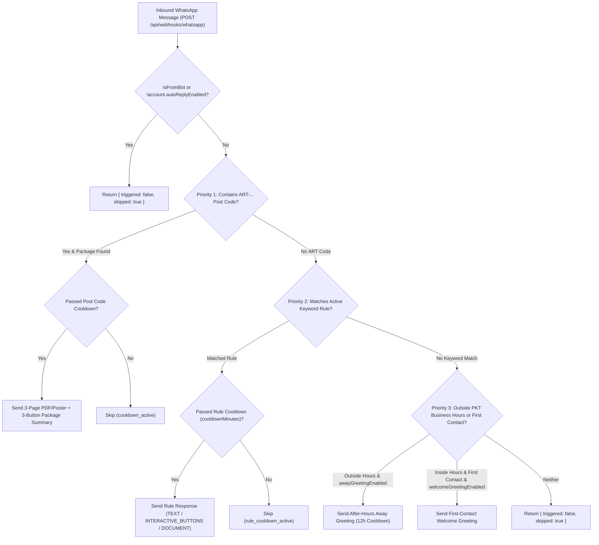

# 0017. WaCRM Custom Keyword Auto-Reply Rules Engine, Greeting Setup, and Quick-Reply Manager

**Date**: 2026-11-07
**Status**: Approved

## Summary

This specification defines **Slice 36 (Feature #40)** of the native WhatsApp Cloud API CRM (`WaCRM`) for Al Ramlah Travels. Building upon the Phase 2 `ART-...` Post Ref Auto-Responder Bot and Interactive Messaging Engine (`Spec 0013`), this slice expands the agency's WhatsApp automation into a 3-tier **Unified Inbound Auto-Responder Pipeline** paired with a self-service **Auto-Replies & Quick-Replies Setup Studio** inside `/admin/desk?tab=inbox`:

1. **Drizzle Schema Extensions (`web/db/schema/whatsapp-crm.ts`)**: Introduces `whatsappAutoReplyMatchTypeEnum` (`"CONTAINS"`, `"EXACT"`, `"STARTS_WITH"`, `"REGEX"`), the `whatsappAutoReplyRules` table for priority-ordered custom keyword auto-responders (`TEXT`, `INTERACTIVE_BUTTONS`, `DOCUMENT`) with per-rule cooldowns, and extends `whatsappAccounts` with configurable First-Contact Welcome Greeting, After-Hours (`Asia/Karachi` PKT) Away Greeting, and operating hours (`businessHoursStart`, `businessHoursEnd`).
2. **Unified 3-Priority Inbound Auto-Responder Pipeline (`web/lib/whatsapp/auto-responder.ts`)**: Evaluates every non-bot inbound message in strict priority order:
   - **Priority 1**: `ART-...` Package Code Auto-Responder (sends matched Makkah/Madinah hotel & PKR rate breakdown + 3-page PDF/Spotlight image + 3 interactive reply buttons).
   - **Priority 2**: Custom Keyword Auto-Reply Rules Engine (`matchKeywordAutoReplyRule(inboundText, rules)`) supporting `EXACT`, `CONTAINS`, `STARTS_WITH`, and safe `REGEX` triggers (e.g., `location`/`address`/`askari`, `hajj`/`maktab`, `documents`/`passport`, `bank`/`payment`/`iban`) with per-rule and per-conversation cooldown enforcement.
   - **Priority 3**: First-Contact Welcome Greeting & After-Hours (`Asia/Karachi` PKT) Away Greeting when an intending pilgrim initiates a new thread or messages outside configured Lahore office hours.
3. **One-Click Default Agency Preset Loader (`ensureDefaultAutoReplyRulesAction`)**: Seeds 4 ready-to-use Al Ramlah Travels keyword rules (`Office Location & Askari 10 Pin`, `Required Umrah Documents`, `Hajj 2027 Maktab A/B/C Guide`, `Bank & Payment Details`) idempotently for any active WhatsApp account.
4. **Full CRUD Server Actions (`web/app/actions/whatsapp-crm.ts`)**: Adds authenticated Server Actions for creating, updating, deleting, and toggling Custom Keyword Auto-Reply Rules, updating Welcome/Away Greeting & Cooldown settings, and managing `/shortcut` Quick Replies.
5. **Auto-Replies & Quick-Replies Setup Studio (`web/components/admin/desk/whatsapp-auto-reply-studio.tsx`)**: A 3-tab modal/drawer accessible directly from the `/admin/desk?tab=inbox` header allowing consultants and administrators to configure the `ART-...` Package Bot & Greeting Settings, manage Custom Keyword Auto-Reply Rules (with 1-click preset loading), and curate `/shortcut` staff Quick-Reply macros without leaving the inbox.

## Context

In Slice 32 (`Spec 0013`), Al Ramlah Travels launched the `ART-...` Post Ref Auto-Responder Bot (`processInboundPostRefAutoReply` in `web/lib/whatsapp/auto-responder.ts`), which automatically detects marketing post codes (such as `ART-AM-21D-01`) and replies within 3 seconds with package pricing, hotel distances, a 3-page PDF itinerary, and interactive buttons. However, three day-to-day operational gaps remain on the Askari 10 Lahore Haramain desk:

1. **High-Frequency Pilgrim FAQs Without an `ART-...` Code**: Over 60% of inbound WhatsApp messages from Pakistani pilgrims ask recurring operational questions that do not contain a marketing post code—specifically:
   - *"Where is your office located in Lahore? Send pin"* (`location`, `address`, `askari`, `office`)
   - *"What documents are required for Umrah visa?"* (`documents`, `passport`, `visa requirements`, `cnic`)
   - *"Do you have Hajj 2027 packages or Maktab A/B/C rates?"* (`hajj`, `maktab`, `aziziya`, `mina`)
   - *"Send your company bank account / IBAN for deposit"* (`bank`, `payment`, `iban`, `account number`, `meezan`)
   Currently, these messages receive no automated response until a human consultant manually types or pastes a reply.
2. **No First-Contact Welcome or After-Hours (`Asia/Karachi` PKT) Away Greeting**: When a new pilgrim messages Al Ramlah Travels for the first time with a generic greeting (*"Assalam o Alaikum"* / *"Hello"*) or messages at 2:00 AM PKT outside Lahore office hours (`09:00`–`21:00` PKT), the system neither welcomes them nor sets expectations on when a Haramain consultant will respond.
3. **Lack of Self-Service UI for Bot Rules, Greetings & `/shortcut` Quick Replies**: While `whatsappQuickReplies` and `upsertQuickReplyAction` exist in the database layer, desk consultants currently have no dedicated visual studio inside `/admin/desk?tab=inbox` to add/edit `/shortcut` macros, adjust `ART-...` bot cooldown minutes, configure Welcome/Away greetings, or manage keyword auto-reply rules.

## Requirements

**User stories**:
- As an intending pilgrim messaging Al Ramlah Travels about office location, required Umrah documents, Hajj 2027 Maktab tiers, or bank payment details, I want to receive an immediate, accurate automated response with interactive quick-reply buttons or PDF attachments so that my question is answered 24/7.
- As a first-time pilgrim messaging the agency or inquiring late at night outside `09:00`–`21:00` PKT (`Asia/Karachi`), I want to receive a polite Islamic welcome greeting or after-hours away notice so that I know my inquiry has been logged and when a consultant will follow up.
- As an Askari 10 Haramain desk administrator, I want a single **Auto-Replies & Quick-Replies Setup Studio** inside `/admin/desk?tab=inbox` where I can toggle the `ART-...` bot, configure Welcome/Away greetings and PKT business hours, create or seed custom keyword rules (`CONTAINS`, `EXACT`, `STARTS_WITH`, `REGEX`), and manage `/shortcut` staff quick-reply macros.

**Acceptance criteria**:
- **AC-1 (Drizzle Schema Extensions in `web/db/schema/whatsapp-crm.ts`)**:
  - Add `whatsappAutoReplyMatchTypeEnum` (`"CONTAINS"`, `"EXACT"`, `"STARTS_WITH"`, `"REGEX"`).
  - Add `whatsappAutoReplyRules` table with columns:
    - `id`: `uuid("id").primaryKey().defaultRandom()`
    - `accountId`: `uuid("account_id").notNull().references(() => whatsappAccounts.id, { onDelete: "cascade" })`
    - `name`: `text("name").notNull()`
    - `matchType`: `whatsappAutoReplyMatchTypeEnum("match_type").notNull().default("CONTAINS")`
    - `triggerKeywords`: `text("trigger_keywords").array().notNull()`
    - `responseType`: `varchar("response_type", { length: 32 }).$type<"TEXT" | "INTERACTIVE_BUTTONS" | "DOCUMENT">().notNull().default("TEXT")`
    - `responseBody`: `text("response_body").notNull()`
    - `responseMediaUrl`: `text("response_media_url")`
    - `responseMediaFilename`: `text("response_media_filename")`
    - `responseButtons`: `jsonb("response_buttons").$type<Array<{ id: string; title: string }>>().default([])`
    - `cooldownMinutes`: `integer("cooldown_minutes").notNull().default(60)`
    - `priority`: `integer("priority").notNull().default(100)`
    - `isActive`: `boolean("is_active").notNull().default(true)`
    - `createdAt`: `timestamp("created_at", { withTimezone: true }).notNull().defaultNow()`
    - `updatedAt`: `timestamp("updated_at", { withTimezone: true }).notNull().defaultNow()`
  - Extend `whatsappAccounts` with:
    - `welcomeGreetingEnabled`: `boolean("welcome_greeting_enabled").notNull().default(true)`
    - `welcomeGreetingText`: `text("welcome_greeting_text")`
    - `awayGreetingEnabled`: `boolean("away_greeting_enabled").notNull().default(true)`
    - `awayGreetingText`: `text("away_greeting_text")`
    - `businessHoursStart`: `text("business_hours_start").notNull().default("09:00")`
    - `businessHoursEnd`: `text("business_hours_end").notNull().default("21:00")`
- **AC-2 (Unified Inbound Auto-Responder Pipeline in `web/lib/whatsapp/auto-responder.ts`)**:
  - **Priority 1 (`ART-...` Package Code Auto-Responder)**: Evaluates inbound text/interactive payloads for `ART-...` codes first; when matched and outside cooldown, dispatches the package breakdown + 3-page PDF/image + 3 interactive buttons (`Book Now`, `Customize Dates`, `Talk to Agent`) and stops further pipeline evaluation.
  - **Priority 2 (Custom Keyword Auto-Reply Rules Engine)**: Exports pure matcher `matchKeywordAutoReplyRule(inboundText, rules)` sorting active rules by `priority ASC, createdAt ASC` and supporting case-insensitive `EXACT`, `CONTAINS`, `STARTS_WITH`, and safe `REGEX` (with `try/catch` and input length cap against catastrophic backtracking) for triggers like `location`/`address`/`askari`, `hajj`/`maktab`, `documents`/`passport`, and `bank`/`payment`/`iban`. Enforces a per-rule + per-conversation cooldown guard (`rule.cooldownMinutes`) via `whatsappMessages` (`interactivePayload.autoReplyRuleId`), and dispatches `TEXT`, `INTERACTIVE_BUTTONS`, or `DOCUMENT` replies.
  - **Priority 3 (First-Contact Welcome Greeting / After-Hours `Asia/Karachi` PKT Away Greeting)**: Exports deterministic helper `isWithinPktBusinessHours(date, startHHMM, endHHMM)`. When neither Priority 1 nor Priority 2 matched:
    - If current `Asia/Karachi` time is outside `businessHoursStart`–`businessHoursEnd` and `awayGreetingEnabled` is `true` (and no away greeting was sent in the last 12 hours), dispatches `awayGreetingText` (or default Al Ramlah Askari 10 after-hours message).
    - Otherwise, if the conversation is a new/first-contact thread (no prior outbound messages in `whatsappMessages`) and `welcomeGreetingEnabled` is `true`, dispatches `welcomeGreetingText` (or default Al Ramlah Askari 10 welcome greeting).
- **AC-3 (Default Seed / Preset Rules Loader — `ensureDefaultAutoReplyRulesAction`)**:
  - Implements `ensureDefaultAutoReplyRulesAction` (and exported constant `DEFAULT_AL_RAMLAH_AUTO_REPLY_RULES`) providing 4 ready-to-use Al Ramlah Travels keyword rules:
    1. `Office Location & Askari 10 Pin` (`CONTAINS`: `["location", "address", "askari", "office", "map", "where are you"]`, `INTERACTIVE_BUTTONS`)
    2. `Required Umrah Documents` (`CONTAINS`: `["documents", "passport", "visa requirements", "biometric", "requirements"]`, `INTERACTIVE_BUTTONS`)
    3. `Hajj 2027 Maktab A/B/C Guide` (`CONTAINS`: `["hajj", "maktab", "mina", "arafat", "aziziya"]`, `INTERACTIVE_BUTTONS`)
    4. `Bank & Payment Details` (`CONTAINS`: `["bank", "payment", "iban", "account number", "deposit", "meezan"]`, `INTERACTIVE_BUTTONS`)
- **AC-4 (CRUD Server Actions in `web/app/actions/whatsapp-crm.ts`)**:
  - Auto-Reply Rules CRUD: `listWhatsappAutoReplyRulesAction`, `upsertWhatsappAutoReplyRuleAction`, `deleteWhatsappAutoReplyRuleAction`, `toggleWhatsappAutoReplyRuleAction`, `ensureDefaultAutoReplyRulesAction`.
  - Greeting & Cooldown Settings: `updateWhatsappGreetingSettingsAction` (updating `autoReplyEnabled`, `autoReplyCooldownMinutes`, `welcomeGreetingEnabled`, `welcomeGreetingText`, `awayGreetingEnabled`, `awayGreetingText`, `businessHoursStart`, `businessHoursEnd`).
  - Quick Replies CRUD: `upsertWhatsappQuickReplyAction` (aliased with `upsertQuickReplyAction`) and `deleteWhatsappQuickReplyAction` (aliased with `deleteQuickReplyAction`).
- **AC-5 (Auto-Replies & Quick-Replies Setup Studio Modal/Drawer in `/admin/desk?tab=inbox`)**:
  - Creates `web/components/admin/desk/whatsapp-auto-reply-studio.tsx` and wires it into `web/components/admin/hubs/desk-hub-client.tsx` and the `/admin/desk` page server loader with 3 tabs:
    1. **`ART-...` Package Bot & Greeting Settings**: Master on/off toggle, cooldown minutes input/slider, First-Contact Welcome Greeting toggle + text editor, and After-Hours (`Asia/Karachi` PKT) Away Greeting toggle + `HH:MM` start/end hours + text editor.
    2. **Custom Keyword Auto-Reply Rules**: Priority-ordered rule list with active switch, match type badge (`CONTAINS`, `EXACT`, `STARTS_WITH`, `REGEX`), keyword pills, response type badge (`TEXT`, `INTERACTIVE_BUTTONS`, `DOCUMENT`), create/edit form (including up to 3 interactive reply buttons or document URL), delete button, and 1-click **"Load Default Agency Rules"** button.
    3. **`/shortcut` Quick-Replies Manager**: Searchable list and create/edit/delete form for staff `/shortcut` macros (`shortcut`, `title`, `category`, `bodyText`, `isActive`) that immediately sync with the `/` slash-command picker in the inbox composer.
- **AC-6 (Automated Unit & Validation Tests in `web/tests/whatsapp-auto-reply-rules.test.ts`)**:
  - Verifies `matchKeywordAutoReplyRule` across `EXACT`, `CONTAINS`, `STARTS_WITH`, and `REGEX` (including malformed regex safety), priority ordering (`priority ASC`), `isWithinPktBusinessHours` (`Asia/Karachi` UTC+5 boundary evaluation including overnight ranges), default Al Ramlah preset definitions, and Zod validation schemas (`upsertWhatsappAutoReplyRuleSchema`, `updateWhatsappGreetingSettingsSchema`, `upsertWhatsappQuickReplySchema`).

## Options considered

### Option 1: Hardcode Keyword Auto-Replies in Webhook Route (`route.ts`)

Embed static `if/else` string checks for `location`, `documents`, `hajj`, and `bank` directly inside `web/app/api/webhooks/whatsapp/route.ts`.

**Pros**:
- Requires zero database schema changes.

**Cons**:
- **No Admin Customization**: Desk managers cannot edit bank IBAN details, office hours, seasonal Hajj 2027 pricing text, or toggle individual rules without a code deployment.
- **No Per-Rule Cooldowns or Priorities**: Hardcoded checks cannot cleanly track per-rule cooldowns or support custom `EXACT`, `CONTAINS`, `STARTS_WITH`, and `REGEX` matchers.

### Option 2: External LLM Open-Ended Chatbot for Every Inbound Message

Route all non-`ART-...` inbound WhatsApp messages to an LLM completion endpoint that generates free-form replies automatically.

**Pros**:
- Handles arbitrary conversational phrasing without explicit keyword lists.

**Cons**:
- **Hallucination Risk on Compliance-Critical Data**: Bank IBANs, Askari 10 office addresses, Ministry of Religious Affairs visa document requirements, and PKR package rates must be 100% deterministic and agency-approved.
- **High Latency & Token Spend**: Adds multi-second LLM latency and cost on every inbound WhatsApp message, and risks runaway bot-to-bot conversations.

### Option 3 (Chosen): Database-Driven Priority Rules Engine + PKT Greeting Pipeline + Self-Service Desk Studio

Extend `whatsapp-crm.ts` with `whatsappAutoReplyRules` and account-level greeting/business-hours fields, execute a deterministic 3-priority pipeline (`ART-...` Package Bot -> Custom Keyword Rules Engine -> Welcome/Away PKT Greeting) inside `web/lib/whatsapp/auto-responder.ts`, and expose a 3-tab **Auto-Replies & Quick-Replies Setup Studio** inside `/admin/desk?tab=inbox`.

**Pros**:
- **100% Deterministic & Auditable**: Every automated reply uses agency-approved text, interactive buttons, or PDF documents with strict per-rule cooldown protection (`isAutoReply: true`).
- **Instant Sub-Second Matching**: Pure in-memory evaluation of active rules (`matchKeywordAutoReplyRule`) ordered by `priority ASC` with safe regex handling.
- **Complete Self-Service Control in `/admin/desk`**: Consultants and admins can load the 4 default Al Ramlah Travels rules in one click, customize PKT business hours (`09:00`–`21:00`), and manage `/shortcut` macros from a single modal.

**Cons**:
- Requires schema additions to `web/db/schema/whatsapp-crm.ts` and new CRUD actions in `web/app/actions/whatsapp-crm.ts`.

## Decision

**Chosen option**: Option 3: Database-Driven Priority Rules Engine + PKT Greeting Pipeline + Self-Service Desk Studio.

We will extend `web/db/schema/whatsapp-crm.ts`, `web/lib/validations/whatsapp-crm.ts`, `web/lib/whatsapp/auto-responder.ts`, `web/app/actions/whatsapp-crm.ts`, `web/components/admin/desk/whatsapp-auto-reply-studio.tsx`, and `web/components/admin/hubs/desk-hub-client.tsx` to deliver the unified 3-priority auto-responder and management studio.

## Architecture and Technical Design

### 1. Component and Directory Structure

```text
web/
├── db/
│   └── schema/
│       └── whatsapp-crm.ts                              # AC-1: whatsappAutoReplyMatchTypeEnum, whatsappAutoReplyRules, whatsappAccounts greeting columns
├── lib/
│   ├── validations/
│   │   └── whatsapp-crm.ts                              # AC-4/AC-6: Zod schemas for auto-reply rules, greeting settings, quick replies
│   └── whatsapp/
│       └── auto-responder.ts                            # AC-2/AC-3: 3-Priority pipeline, matchKeywordAutoReplyRule, isWithinPktBusinessHours, default presets
├── app/
│   ├── actions/
│   │   └── whatsapp-crm.ts                              # AC-3/AC-4: Rule CRUD, preset loader, greeting settings, quick replies CRUD
│   └── (admin)/.../desk/page.tsx                        # AC-5: Loads autoReplyRules & passes to DeskHubClient
├── components/
│   └── admin/
│       ├── desk/
│       │   └── whatsapp-auto-reply-studio.tsx           # AC-5: 3-Tab Auto-Replies & Quick-Replies Setup Studio Modal
│       └── hubs/
│           └── desk-hub-client.tsx                      # AC-5: Wires Studio trigger button, live state updates & /shortcut macros
└── tests/
    └── whatsapp-auto-reply-rules.test.ts                # AC-6: Unit tests for matchers, priority, PKT hours & Zod schemas
```

### 2. Drizzle Schema Design (`web/db/schema/whatsapp-crm.ts` — `AC-1`)

1. **Match Type Enum**:
   ```typescript
   export const whatsappAutoReplyMatchTypeEnum = pgEnum(
     "whatsapp_auto_reply_match_type",
     ["CONTAINS", "EXACT", "STARTS_WITH", "REGEX"]
   )
   ```
2. **`whatsappAccounts` Greeting & Business Hours Columns**:
   ```typescript
   welcomeGreetingEnabled: boolean("welcome_greeting_enabled").notNull().default(true),
   welcomeGreetingText: text("welcome_greeting_text"),
   awayGreetingEnabled: boolean("away_greeting_enabled").notNull().default(true),
   awayGreetingText: text("away_greeting_text"),
   businessHoursStart: text("business_hours_start").notNull().default("09:00"),
   businessHoursEnd: text("business_hours_end").notNull().default("21:00"),
   ```
3. **`whatsappAutoReplyRules` Table**:
   ```typescript
   export const whatsappAutoReplyRules = pgTable(
     "whatsapp_auto_reply_rules",
     {
       id: uuid("id").primaryKey().defaultRandom(),
       accountId: uuid("account_id")
         .notNull()
         .references(() => whatsappAccounts.id, { onDelete: "cascade" }),
       name: text("name").notNull(),
       matchType: whatsappAutoReplyMatchTypeEnum("match_type")
         .notNull()
         .default("CONTAINS"),
       triggerKeywords: text("trigger_keywords").array().notNull(),
       responseType: varchar("response_type", { length: 32 })
         .$type<"TEXT" | "INTERACTIVE_BUTTONS" | "DOCUMENT">()
         .notNull()
         .default("TEXT"),
       responseBody: text("response_body").notNull(),
       responseMediaUrl: text("response_media_url"),
       responseMediaFilename: text("response_media_filename"),
       responseButtons: jsonb("response_buttons")
         .$type<Array<{ id: string; title: string }>>()
         .default([]),
       cooldownMinutes: integer("cooldown_minutes").notNull().default(60),
       priority: integer("priority").notNull().default(100),
       isActive: boolean("is_active").notNull().default(true),
       createdAt: timestamp("created_at", { withTimezone: true }).notNull().defaultNow(),
       updatedAt: timestamp("updated_at", { withTimezone: true }).notNull().defaultNow(),
     },
     (table) => [
       index("idx_wa_arr_acc_active_prio").on(
         table.accountId,
         table.isActive,
         table.priority
       ),
     ]
   )
   ```

### 3. Unified 3-Priority Inbound Auto-Responder Pipeline (`web/lib/whatsapp/auto-responder.ts` — `AC-2`, `AC-3`)



- **Pure Keyword Matcher (`matchKeywordAutoReplyRule`)**:
  - Normalizes `inboundText` (trimmed, collapsed whitespace, lowercased for non-regex comparisons; capped at 2,000 characters for regex evaluation).
  - Filters rules to `isActive === true` with at least one non-empty keyword, sorted by `priority ASC`, then `createdAt ASC`.
  - Evaluates each keyword in `rule.triggerKeywords`:
    - `"EXACT"`: `normalizedInput === normalizedKeyword`
    - `"CONTAINS"`: `normalizedInput.includes(normalizedKeyword)`
    - `"STARTS_WITH"`: `normalizedInput.startsWith(normalizedKeyword)`
    - `"REGEX"`: Compiles `new RegExp(pattern, "i")` inside a `try/catch` block and tests against the length-capped input.
  - Returns `{ rule, matchedKeyword } | null`.
- **PKT Business Hours Evaluator (`isWithinPktBusinessHours`)**:
  - Uses `Intl.DateTimeFormat("en-GB", { timeZone: "Asia/Karachi", hour: "2-digit", minute: "2-digit", hour12: false })` to compute the current minute-of-day in Lahore (`0`..`1439`).
  - Compares against `businessHoursStart` (default `"09:00"`) and `businessHoursEnd` (default `"21:00"`), supporting both standard daytime windows (`start <= end`) and overnight windows (`start > end`).
- **4 Default Al Ramlah Travels Agency Rules (`DEFAULT_AL_RAMLAH_AUTO_REPLY_RULES`)**:
  1. **Office Location & Askari 10 Pin** (`priority: 10`, `matchType: "CONTAINS"`, keywords: `["location", "address", "askari", "office", "map", "where are you"]`, `responseType: "INTERACTIVE_BUTTONS"`).
  2. **Required Umrah Documents** (`priority: 20`, `matchType: "CONTAINS"`, keywords: `["documents", "passport", "visa requirements", "biometric", "requirements"]`, `responseType: "INTERACTIVE_BUTTONS"`).
  3. **Hajj 2027 Maktab A/B/C Guide** (`priority: 30`, `matchType: "CONTAINS"`, keywords: `["hajj", "maktab", "mina", "arafat", "aziziya"]`, `responseType: "INTERACTIVE_BUTTONS"`).
  4. **Bank & Payment Details** (`priority: 40`, `matchType: "CONTAINS"`, keywords: `["bank", "payment", "iban", "account number", "deposit", "meezan"]`, `responseType: "INTERACTIVE_BUTTONS"`).

## Build plan

### Milestone 1: Drizzle Schema Extensions, Validation Contracts & Unified 3-Priority Auto-Responder Engine
- Extend `web/db/schema/whatsapp-crm.ts` with `whatsappAutoReplyMatchTypeEnum`, `whatsappAutoReplyRules`, and `whatsappAccounts` greeting/business-hours columns (`welcomeGreetingEnabled`, `welcomeGreetingText`, `awayGreetingEnabled`, `awayGreetingText`, `businessHoursStart`, `businessHoursEnd`) and relations (**AC-1**).
- Extend `web/lib/validations/whatsapp-crm.ts` with `upsertWhatsappAutoReplyRuleSchema`, `deleteWhatsappAutoReplyRuleSchema`, `toggleWhatsappAutoReplyRuleSchema`, `updateWhatsappGreetingSettingsSchema`, and `upsertWhatsappQuickReplySchema` / `deleteWhatsappQuickReplySchema` (**AC-4**, **AC-6**).
- Upgrade `web/lib/whatsapp/auto-responder.ts` with `matchKeywordAutoReplyRule`, `isWithinPktBusinessHours`, `DEFAULT_AL_RAMLAH_AUTO_REPLY_RULES`, and the unified 3-priority pipeline inside `processInboundPostRefAutoReply` (**AC-2**, **AC-3**).

### Milestone 2: WhatsApp CRM Server Actions & Default Agency Preset Seeder
- Extend `web/app/actions/whatsapp-crm.ts` with:
  - `listWhatsappAutoReplyRulesAction`, `upsertWhatsappAutoReplyRuleAction`, `deleteWhatsappAutoReplyRuleAction`, `toggleWhatsappAutoReplyRuleAction`, and `ensureDefaultAutoReplyRulesAction` (**AC-3**, **AC-4**).
  - `updateWhatsappGreetingSettingsAction` for saving `ART-...` bot toggle, cooldown minutes, Welcome Greeting, Away Greeting, and PKT business hours (**AC-4**).
  - `upsertWhatsappQuickReplyAction` and `deleteWhatsappQuickReplyAction` (with path revalidation and backward-compatible aliases) (**AC-4**).

### Milestone 3: Auto-Replies & Quick-Replies Setup Studio UI & Verification Suite
- Create `web/components/admin/desk/whatsapp-auto-reply-studio.tsx` implementing the 3-tab Setup Studio (`ART-...` Package Bot & Greeting Settings, Custom Keyword Auto-Reply Rules with 1-click "Load Default Agency Rules", and `/shortcut` Quick-Replies Manager) and wire it into `web/components/admin/hubs/desk-hub-client.tsx` and the `/admin/desk` page server loader (**AC-5**).
- Create `web/tests/whatsapp-auto-reply-rules.test.ts` verifying `matchKeywordAutoReplyRule` (`EXACT`, `CONTAINS`, `STARTS_WITH`, `REGEX`), priority ordering, PKT business-hours evaluation (`isWithinPktBusinessHours`), default preset rule integrity, and Zod validation schemas (**AC-6**).
