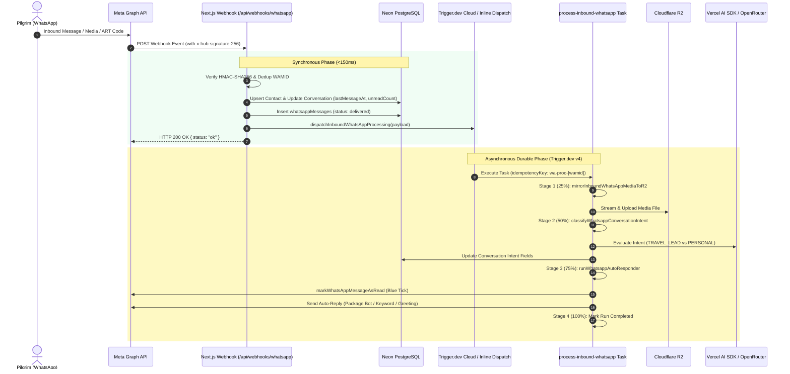
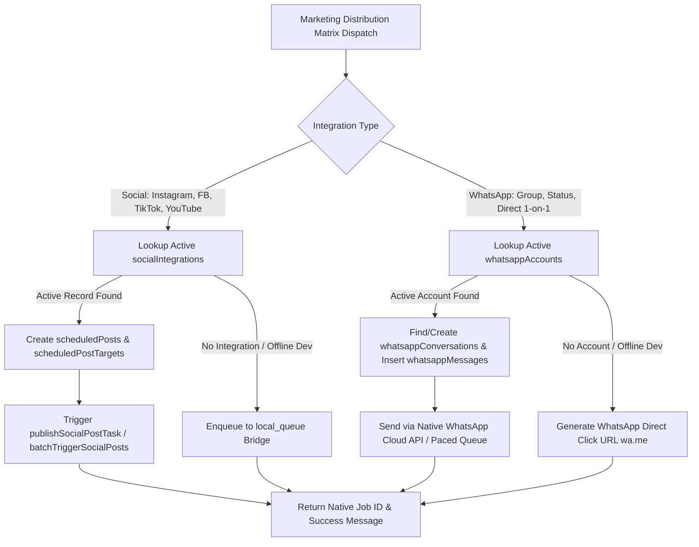
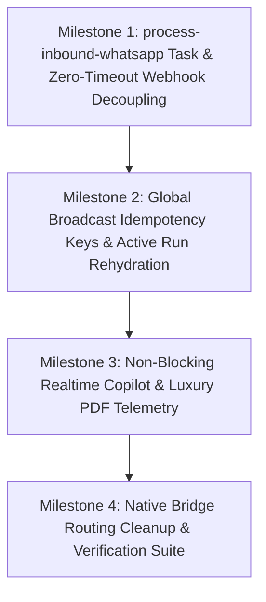

# 0018. Trigger.dev v4 Async Webhook Pipeline, Realtime Copilot Telemetry, Global Idempotency, and Native Bridge Cleanup

**Date**: 2026-11-09
**Status**: Accepted (Implemented)

## Summary

This specification hardens and unifies the Al Ramlah Travels event-driven execution architecture (`Slice 37`) across three interconnected domains: asynchronous Meta WhatsApp Cloud API webhook ingestion, non-blocking AI Quoting Copilot and luxury Gotenberg PDF telemetry via `@trigger.dev/react-hooks` (`useRealtimeRun`), global broadcast idempotency key scoping, and native bridge routing for social and WhatsApp distribution.

Specifically, we:
1. **Decouple the inbound WhatsApp webhook Route Handler (`/api/webhooks/whatsapp`)**: Extract synchronous AI intent classification (`classifyWhatsappConversationIntent`), 3-priority auto-replies (`runWhatsappAutoResponder`), and Cloudflare R2 media downloads into a dedicated durable Trigger.dev v4 `schemaTask` (`process-inbound-whatsapp.task.ts`) with a zero-worker inline fallback in `trigger/dispatch.ts`, ensuring webhook responses return HTTP `200 OK` in `<150ms` and eliminating Meta webhook timeout retry storms.
2. **Promote broadcast idempotency keys to global scope & enable active run rehydration**: Upgrade broadcast dispatching in `app/actions/whatsapp-crm.ts` and `trigger/dispatch.ts` to use `await idempotencyKeys.create(key, { scope: "global" })`, and introduce `listActiveRunsByTagsAction` in `app/actions/trigger-realtime.ts` so browser tabs across `/admin/studio`, `/admin/campaigns`, and `/admin/desk` can rehydrate live progress banners upon reload.
3. **Introduce non-blocking realtime Quoting Copilot and Luxury PDF actions**: Author `startWhatsappCopilotRunAction` and `startApplicationCopilotRunAction` in `app/actions/quoting-copilot.ts` and `startApplicationLuxuryPdfRunAction` in `app/actions/quotes.ts`, returning `{ runId, publicAccessToken }` immediately without blocking on `runs.poll`, and render live 4-stage progress (`assembling_context` 15%, `running_domain_tools` 40%, `generating_structured_draft` 70%, `completed` 100%) via a reusable `CopilotRealtimeRunBanner` component.
4. **Clean up marketing bridge routing**: Upgrade `lib/bridges/marketing-bridges.ts` to route directly into native `scheduledPosts` / `scheduledPostTargets` (`lib/social`) and native `whatsappConversations` / `whatsappMessages` (`lib/whatsapp`) when matching integrations exist before falling back to `local_queue`.

---

## Context

In Slices 27 through 36 (`Specs 0008`–`0017`), Al Ramlah Travels built out a modern Umrah & Hajj agency operating system featuring four administrative hubs (`/admin` Overview, `/admin/studio` Multimodal Studio, `/admin/campaigns` Social & Broadcast Marketing, `/admin/desk` WhatsApp CRM & Applications Kanban, `/admin/catalog` Inventory, and `/admin/settings` Configuration). Durable background tasks in `web/trigger/` handle flyer package extraction, scheduled Core 5 social publishing, paced WhatsApp broadcasts, Gotenberg 4K posters & PDFs, and AI Quoting Copilot generation.

However, a production resilience and telemetry audit identified four operational bottlenecks:

1. **Synchronous Meta Webhook Processing & Timeout Risk**:
   In `web/app/api/webhooks/whatsapp/route.ts`, incoming customer messages execute synchronous LLM-based Coexistence Intent Classification (`classifyWhatsappConversationIntent`), R2 media downloading/uploading (`dispatchMirrorWhatsAppMedia`), and 3-priority auto-responder matching (`runWhatsappAutoResponder`) inside the HTTP request lifecycle. Under network jitter or provider latency, webhook processing can exceed Meta's strict 3-to-5 second timeout, causing Meta to mark the webhook as failed and flood the server with duplicate retries.

2. **Run-Scoped Raw String Idempotency in Broadcasts**:
   In `web/app/actions/whatsapp-crm.ts` (`createAndQueueWhatsappBroadcastAction`), broadcasts pass a raw string `idempotencyKey: "wa-broadcast-${broadcast.id}"`. In Trigger.dev v4, raw string keys that are not created via `idempotencyKeys.create(key, { scope: "global" })` are scoped locally to the run context rather than globally across the Trigger.dev project, creating a duplicate broadcast risk if an operator rapidly re-clicks dispatch.

3. **Blocking Server Actions on Quoting Copilot & Luxury PDF Generation**:
   The current AI Quoting Copilot actions (`generateWaConversationCopilotDraftAction`, `generateApplicationQuoteCopilotDraftAction`) and 3-page luxury quote PDF action (`generateApplicationLuxuryPdf`) use `triggerByIdAndAwaitOrInline` with `runs.poll()`. While this offloads heavy computation from Vercel to Trigger.dev Cloud, the serverless function remains blocked waiting for the poll loop to complete (often 5 to 15 seconds), during which the admin UI displays only a generic spinning button without stage breakdown. Furthermore, reloading the browser cancels the client-side promise, losing the in-flight run reference.

4. **Stale Bridge Mocks in Marketing Operations**:
   The legacy bridge module `web/lib/bridges/marketing-bridges.ts` continues to reference simulated external `POSTIZ_API_URL` and `WACRM_API_URL` endpoints or returns synthetic `local_queue` IDs, even though native TypeScript engines for both Core 5 Social Scheduling (`web/lib/social/*`, `db/schema/social-scheduler.ts`) and WhatsApp Cloud CRM (`web/lib/whatsapp/*`, `db/schema/whatsapp-crm.ts`) are fully operational in the codebase.

---

## Requirements

### User Stories

- **As a Meta Webhook Reliability Engineer**, I want the WhatsApp webhook route to verify HMAC, persist the raw inbound message to PostgreSQL, and acknowledge Meta with HTTP `200 OK` in `<150ms`, delegating all media downloads, intent classification, and auto-replies to a durable Trigger.dev v4 task, so that webhook timeouts and retry storms are completely eliminated.
- **As an Umrah Quoting Specialist in `/admin/desk`**, I want to click **"AI Copilot Draft"** or **"Pre-Fill Worksheet"** and immediately see an animated luxury progress banner showing the four exact stages of generation (`Assembling Context` $\rightarrow$ `Running Domain Tools` $\rightarrow$ `Synthesizing Bilingual Draft` $\rightarrow$ `Completed`) powered by `useRealtimeRun`, without blocking the UI or timing out.
- **As an Agency Operations Manager in `/admin/applications/[id]`**, I want to click **"Generate 3-Page Luxury PDF"** and watch Gotenberg rendering telemetry live in the worksheet header, with the ability to navigate away or reload the page and have the active progress banner automatically rehydrate.
- **As a Campaign Marketing Operator in `/admin/campaigns`**, I want broadcast dispatches to enforce global idempotency so that accidental double-clicks can never trigger duplicate WhatsApp template sends to hundreds of pilgrims.
- **As a Developer Running Locally**, I want all webhook processing, copilot drafting, luxury PDF rendering, and marketing bridge dispatches to seamlessly fall back to deterministic inline execution when `TRIGGER_SECRET_KEY` is absent or when no local worker is running, with zero test suite failures.

### Acceptance Criteria

- **AC-1 (`process-inbound-whatsapp` Durable Task)**: `web/trigger/process-inbound-whatsapp.task.ts` exports a Trigger.dev v4 `schemaTask` (`id: "process-inbound-whatsapp"`) validating payloads via `processInboundWhatsappPayloadSchema`. It executes:
  1. Media mirroring to Cloudflare R2 (`mirrorInboundWhatsAppMediaToR2`),
  2. Coexistence AI Intent Classification (`classifyWhatsappConversationIntent`) updating `whatsappConversations`,
  3. 3-Priority Auto-Responder (`markWhatsAppMessageAsRead` + `runWhatsappAutoResponder`),
  recording `metadata.set()` progress across stages (`mirroring_media` 25%, `classifying_intent` 50%, `running_auto_responder` 75%, `completed` 100%).
- **AC-2 (Zero-Timeout Webhook Decoupling)**: `web/app/api/webhooks/whatsapp/route.ts` verifies HMAC, performs idempotency checks, records the contact and unread count in `whatsappConversations`, logs the inbound message in `whatsappMessages`, and dispatches `dispatchInboundWhatsAppProcessing` asynchronously, returning HTTP `200 OK` in `<150ms`.
- **AC-3 (Global Idempotency Key Scoping)**: `web/app/actions/whatsapp-crm.ts` (`createAndQueueWhatsappBroadcastAction`) and `web/trigger/dispatch.ts` use `await idempotencyKeys.create(key, { scope: "global" })` for all broadcast and social dispatch options, preventing duplicate execution across workers and client retries.
- **AC-4 (Tag-Based Active Run Rehydration)**: `web/app/actions/trigger-realtime.ts` exports `listActiveRunsByTagsAction` querying `runs.list({ tags, status: ["EXECUTING", "QUEUED", "WAITING_FOR_DEPLOY", "REATTEMPTING", "FROZEN"] })` and minting a scoped public access token, with in-memory snapshot fallback for local development, enabling browser UI rehydration on page reload.
- **AC-5 (Non-Blocking Realtime Copilot Server Actions)**: `web/app/actions/quoting-copilot.ts` exports `startWhatsappCopilotRunAction` and `startApplicationCopilotRunAction`, and `web/app/actions/quotes.ts` exports `startApplicationLuxuryPdfRunAction`. When Trigger.dev Cloud is configured, they return `{ success: true, mode: "cloud", runId, publicAccessToken }` immediately without awaiting `runs.poll()`. Existing synchronous actions remain intact for backward compatibility.
- **AC-6 (`CopilotRealtimeRunBanner` Component)**: `web/components/admin/desk/copilot-realtime-run-banner.tsx` subscribes via `useRealtimeRun` from `@trigger.dev/react-hooks` (`skipColumns: ["payload", "output"]`), displays an animated luxury progress bar (`0%` to `100%`) with stage badges, and invokes `onComplete` upon task completion. Embedded into `desk-hub-client.tsx` and `quote-worksheet-form.tsx`.
- **AC-7 (Native Bridge Routing Cleanup)**: `web/lib/bridges/marketing-bridges.ts` and `web/app/actions/marketing-ops.ts` route social dispatches to active `socialIntegrations` (persisting to `scheduledPosts` / `scheduledPostTargets`) and WhatsApp dispatches to active `whatsappAccounts` (persisting to `whatsappConversations` / `whatsappMessages`) before falling back to `local_queue`.
- **AC-8 (Comprehensive Verification Suite)**: `web/tests/trigger-v4-webhook-and-realtime-copilot.test.ts` provides complete unit test coverage for AC-1 through AC-7, verifying schema parsing, error discrimination, deterministic fallback, and Human-in-the-Loop constraints.

---

## Options Considered

### Option 1: Retain Synchronous Serverless Execution with Timeout Padding
Increase Next.js Route Handler and Server Action maxDuration settings to 60 seconds and keep all AI intent classification, auto-replies, and PDF rendering synchronous.

- **Pros**: Minimal code changes; single-threaded call stack.
- **Cons**: Violates Meta's 3-second webhook SLA; leads to duplicate inbound webhook retries; locks Vercel serverless execution threads during slow AI model responses; operators must stare at unresponsive UI spinners.

### Option 2 (Chosen): Decoupled Durable Trigger.dev v4 Pipeline with `useRealtimeRun` & Native Bridges
Split webhook ingestion into synchronous persistence (<150ms) + asynchronous durable execution (`process-inbound-whatsapp`). Migrate copilot drafting and luxury PDF rendering to non-blocking dispatchers that mint scoped public tokens, subscribe via `@trigger.dev/react-hooks` `useRealtimeRun`, enforce global idempotency, and connect marketing distribution directly into native social and WhatsApp database tables.

- **Pros**:
  - Webhooks acknowledge Meta in `<150ms`, eliminating retry storms.
  - Full real-time visibility in `/admin/desk` and `/admin/applications/[id]` with 4-stage telemetry.
  - Zero loss of state on page reload thanks to `listActiveRunsByTagsAction`.
  - Global idempotency guarantees zero duplicate WhatsApp broadcasts.
  - Full backward compatibility and zero-config local dev fallback.
- **Cons**: Requires adding new non-blocking server action variants alongside existing synchronous actions.

### Option 3: Third-Party Message Broker (Redis + BullMQ)
Deploy an Upstash Redis or AWS SQS instance to buffer webhook events and copilot requests.

- **Pros**: High-throughput message queuing.
- **Cons**: Introduces unnecessary external infrastructure; Trigger.dev v4 is already configured, pinned to version 4.8.3, and natively handles durable retries, queues, and real-time streaming hooks without added cost.

---

## Decision

**Chosen Option**: Option 2: Decoupled Durable Trigger.dev v4 Pipeline with `useRealtimeRun` & Native Bridges.

We will create `process-inbound-whatsapp.task.ts`, decouple `/api/webhooks/whatsapp/route.ts`, harden idempotency keys in `whatsapp-crm.ts` and `dispatch.ts`, implement `listActiveRunsByTagsAction` in `trigger-realtime.ts`, add non-blocking actions in `quoting-copilot.ts` and `quotes.ts`, build `copilot-realtime-run-banner.tsx`, upgrade `marketing-bridges.ts` to native routing, and verify everything with automated unit tests.

---

## Architecture and Technical Design

### 1. Target File Structure & Ownership Map

```text
web/
├── trigger/
│   ├── process-inbound-whatsapp.task.ts       # NEW: Durable task for media mirror, intent AI & auto-responder
│   ├── dispatch.ts                            # UPDATED: dispatchInboundWhatsAppProcessing & global idempotency normalization
│   ├── quoting-copilot.task.ts                # PRESERVED: schemaTask with 4-stage metadata progress
│   ├── render-gotenberg-asset.task.ts         # PRESERVED: gotenbergQueue bounded PDF & poster rendering
│   └── index.ts                               # UPDATED: Export process-inbound-whatsapp task
├── app/
│   ├── api/
│   │   └── webhooks/
│   │       └── whatsapp/
│   │           └── route.ts                   # UPDATED: <150ms HMAC verification + message persist + async handoff
│   └── actions/
│       ├── trigger-realtime.ts                # UPDATED: listActiveRunsByTagsAction + multi-tag public token minting
│       ├── quoting-copilot.ts                 # UPDATED: startWhatsappCopilotRunAction & startApplicationCopilotRunAction
│       ├── quotes.ts                          # UPDATED: startApplicationLuxuryPdfRunAction
│       ├── whatsapp-crm.ts                    # UPDATED: Global idempotencyKeys.create in broadcast queueing
│       └── marketing-ops.ts                   # UPDATED: Native bridge routing integration
├── lib/
│   └── bridges/
│       └── marketing-bridges.ts               # UPDATED: Direct routing to socialIntegrations & whatsappAccounts
├── components/
│   └── admin/
│       ├── desk/
│       │   └── copilot-realtime-run-banner.tsx # NEW: Reusable useRealtimeRun 4-stage progress component
│       ├── hubs/
│       │   └── desk-hub-client.tsx            # UPDATED: Wires CopilotRealtimeRunBanner in Inbox & Pipeline tabs
│       └── applications/
│           └── quote-worksheet-form.tsx       # UPDATED: Wires CopilotRealtimeRunBanner & Luxury PDF progress
└── tests/
    └── trigger-v4-webhook-and-realtime-copilot.test.ts # NEW: Verification test suite (AC-1 through AC-8)
```

---

### 2. Inbound WhatsApp Webhook Decoupling (`process-inbound-whatsapp`)

#### Problem & Solution Diagram



#### Task Schema & Payload Specification

```typescript
export const processInboundWhatsappPayloadSchema = z.object({
  messageId: z.string().min(1, "messageId is required"),
  accountId: z.string().min(1, "accountId is required"),
  conversationId: z.string().min(1, "conversationId is required"),
  senderPhone: z.string().min(1, "senderPhone is required"),
  contactDisplayName: z.string().optional(),
  wamid: z.string().min(1, "wamid is required"),
  bodyText: z.string(),
  msgType: z.string(),
  rawMediaId: z.string().nullable().optional(),
  mediaMimeType: z.string().nullable().optional(),
  interactiveReplyId: z.string().nullable().optional(),
  detectedPostCode: z.string().nullable().optional(),
  linkedApplicationId: z.string().nullable().optional(),
  outreachContactId: z.string().nullable().optional(),
})

export type ProcessInboundWhatsappPayload = z.infer<
  typeof processInboundWhatsappPayloadSchema
>

export interface ProcessInboundWhatsappResult {
  success: boolean
  messageId: string
  conversationId: string
  mediaMirrored: boolean
  mediaUrl?: string
  intentCategory?: string
  intentConfidence?: number
  autoReplyTriggered: boolean
  autoReplyRuleId?: string
  error?: string
}
```

#### Webhook Route Refactoring (`web/app/api/webhooks/whatsapp/route.ts`)

In `web/app/api/webhooks/whatsapp/route.ts`:
1. Verify `x-hub-signature-256` HMAC.
2. Filter duplicate messages via `wamid` lookup against `whatsappMessages`.
3. Auto-unlock 14-day outreach cooldown for `senderPhone` via `unlockOutreachCooldownForPhone(senderPhone)`.
4. Detect `ART-...` post reference codes and resolve linked applications or flyer packages.
5. Upsert `whatsappConversations` row (recording unread count increment, timestamps, detected post code, and contact name).
6. Handle founder-to-dedicated-agent lead handoff if applicable (`parseFounderForwardedLead`).
7. Insert inbound message into `whatsappMessages`.
8. Hand off heavy processing:
   ```typescript
   await dispatchInboundWhatsAppProcessing({
     messageId: insertedMsg.id,
     accountId: account.id,
     conversationId: conversation.id,
     senderPhone,
     contactDisplayName,
     wamid,
     bodyText,
     msgType,
     rawMediaId,
     mediaMimeType,
     interactiveReplyId,
     detectedPostCode,
     linkedApplicationId,
     outreachContactId: cooldownResult.contactId,
   })
   ```
9. Return `Response.json({ status: "ok" }, { status: 200 })` immediately.

---

### 3. Global Broadcast Idempotency Keys & Active Run Rehydration

#### Global Idempotency Key Scoping

In Trigger.dev v4, raw string idempotency keys default to run-scoped uniqueness unless explicitly registered via the `idempotencyKeys` API. To prevent duplicate template sends when broadcasting to hundreds of pilgrims:

```typescript
// web/app/actions/whatsapp-crm.ts
const rawKey = `wa-broadcast-${broadcast.id}`
let idempotencyKey: string = rawKey
if (isTriggerCloudConfigured()) {
  try {
    idempotencyKey = await idempotencyKeys.create(rawKey, {
      scope: "global",
    })
  } catch {
    idempotencyKey = rawKey
  }
}

const dispatchRes = await triggerByIdBackgroundOrInline({
  taskId: "send-whatsapp-broadcast",
  payload: { broadcastId: broadcast.id, paceMs: 200 },
  isFutureScheduled,
  options: {
    idempotencyKey,
    tags: [`whatsapp-broadcast:${broadcast.id}`],
  },
  inlineRunner: async () => { ... },
})
```

In `web/trigger/dispatch.ts`, all entry points accepting `options?: DispatchOptions` automatically promote raw string `options.idempotencyKey` values to global scope when `isTriggerCloudConfigured()` is true.

#### Active Run Rehydration Server Action (`web/app/actions/trigger-realtime.ts`)

When an admin operator starts a long-running AI extraction, Gotenberg PDF render, or Copilot draft and refreshes the browser, the client-side state is reset. `listActiveRunsByTagsAction` queries in-flight Trigger.dev runs and mints a scoped public access token so the UI can immediately re-attach:

```typescript
export interface ActiveRunSummary {
  runId: string
  taskIdentifier: string
  status: "QUEUED" | "EXECUTING" | "REATTEMPTING" | "FROZEN"
  createdAt: string
  tags: string[]
  metadata?: Record<string, unknown>
}

export interface ListActiveRunsResult {
  success: boolean
  mode: "cloud" | "local"
  activeRuns: ActiveRunSummary[]
  publicAccessToken?: string
  error?: string
}

export async function listActiveRunsByTagsAction(
  rawInput: { tags: string[]; limit?: number } | string[]
): Promise<ListActiveRunsResult> {
  await requireAdmin()
  const tags = Array.isArray(rawInput) ? rawInput : rawInput.tags
  const limit = Array.isArray(rawInput) ? 10 : rawInput.limit ?? 10

  if (isTriggerCloudConfigured()) {
    try {
      const activeStatuses = [
        "EXECUTING",
        "QUEUED",
        "WAITING_FOR_DEPLOY",
        "REATTEMPTING",
        "FROZEN",
      ] as const

      const page = await runs.list({
        tags,
        status: activeStatuses as unknown as any,
        limit,
      })

      const runItems = page.data || []
      const activeRuns: ActiveRunSummary[] = runItems.map((r) => ({
        runId: r.id,
        taskIdentifier: r.taskIdentifier,
        status: r.status as ActiveRunSummary["status"],
        createdAt: r.createdAt.toISOString(),
        tags: r.tags || [],
        metadata: r.metadata as Record<string, unknown>,
      }))

      if (activeRuns.length > 0) {
        const publicAccessToken = await triggerAuth.createPublicToken({
          scopes: {
            read: {
              runs: activeRuns.map((r) => r.runId),
            },
          },
          expirationTime: "1h",
        })

        return {
          success: true,
          mode: "cloud",
          activeRuns,
          publicAccessToken,
        }
      }

      return { success: true, mode: "cloud", activeRuns: [] }
    } catch (cloudErr) {
      console.warn("[Trigger Active Runs Warning] Failed to query cloud runs:", cloudErr)
    }
  }

  // Local dev snapshot store fallback
  const localSnapshots = getLocalActiveRunsByTags(tags)
  return {
    success: true,
    mode: "local",
    activeRuns: localSnapshots,
  }
}
```

---

### 4. Non-Blocking Realtime Quoting Copilot & Luxury PDF Telemetry

#### Non-Blocking Server Actions

Rather than awaiting `runs.poll()` inside the Server Action, non-blocking actions dispatch the task, mint a scoped public token, and return immediately:

```typescript
// web/app/actions/quoting-copilot.ts
export async function startWhatsappCopilotRunAction(
  rawInput: GenerateWaConversationCopilotActionInput
): Promise<{
  success: boolean
  mode: "cloud" | "inline"
  runId: string
  publicAccessToken?: string
  inlineOutput?: GenerateWaConversationCopilotActionResult
  error?: string
}> {
  await requireAdmin()
  const parsed = waConversationCopilotInputSchema.parse(
    typeof rawInput === "string" ? { conversationId: rawInput } : rawInput
  )

  const payload: QuotingCopilotTaskPayload = {
    mode: "wa_conversation",
    conversationId: parsed.conversationId,
    staffPromptHint: parsed.staffPromptHint,
    allowOfflineFallbackOnly: parsed.allowOfflineFallbackOnly,
  }

  if (isTriggerCloudConfigured()) {
    try {
      const handle = await tasks.trigger("quoting-copilot", payload, {
        tags: [`copilot:wa:${parsed.conversationId}`],
      })

      const publicAccessToken = await triggerAuth.createPublicToken({
        scopes: { read: { runs: [handle.id] } },
        expirationTime: "1h",
      })

      return {
        success: true,
        mode: "cloud",
        runId: handle.id,
        publicAccessToken,
      }
    } catch (err) {
      console.warn("[Copilot Cloud Dispatch Warning] Falling back to inline:", err)
    }
  }

  // Local/inline execution fallback
  const inlineResult = await runQuotingCopilotInline(payload)
  return {
    success: true,
    mode: "inline",
    runId: `inline_copilot_${Date.now()}`,
    inlineOutput: {
      success: true,
      data: inlineResult.data as any,
      draft: inlineResult.draft as any,
      modelUsed: inlineResult.modelUsed,
      executionMode: inlineResult.executionMode,
      runMode: "inline",
      requiresHumanApproval: true,
    },
  }
}
```

An identical non-blocking pattern is implemented for:
- `startApplicationCopilotRunAction` (tag: `copilot:app:${applicationId}`)
- `startApplicationLuxuryPdfRunAction` (tag: `quotation-pdf:${app.referenceNumber}`)

#### Reusable `CopilotRealtimeRunBanner` Component

`web/components/admin/desk/copilot-realtime-run-banner.tsx` encapsulates the real-time subscription lifecycle:

```typescript
interface CopilotRealtimeRunBannerProps {
  runId: string
  publicAccessToken?: string
  mode?: "cloud" | "inline" | "local"
  title?: string
  onComplete?: (output?: any) => void
  onDismiss?: () => void
  className?: string
}

export const COPILOT_STAGES = [
  { key: "assembling_context", label: "Assembling Thread & Catalog Context", pct: 15 },
  { key: "running_domain_tools", label: "Querying Rates, Batches & Hotels", pct: 40 },
  { key: "generating_structured_draft", label: "Synthesizing Bilingual Hospitality Draft", pct: 70 },
  { key: "completed", label: "Draft Ready for Review", pct: 100 },
] as const
```

When `mode === "cloud"` and a `publicAccessToken` is supplied, it invokes:
```typescript
const { run: realtimeRun } = useRealtimeRun<typeof quotingCopilotTask>(runId, {
  accessToken: publicAccessToken,
  skipColumns: ["payload", "output"],
  enabled: mode === "cloud" && Boolean(publicAccessToken),
})
```
When `realtimeRun.status === "COMPLETED"`, the banner smoothly displays 100% completion in deep Haramain emerald with metallic gold trim and triggers `onComplete()`. In local mode or during inline runs, it polls `getTaskRunProgressAction` or displays instant completion seamlessly.

---

### 5. Native Bridge Routing Cleanup

#### Routing Architecture



#### Bridge Implementation (`web/lib/bridges/marketing-bridges.ts`)

Instead of mocking external endpoints, the bridge methods query the database:
1. `dispatchViaSocialBridge`:
   - Checks `socialIntegrations` where `provider = input.platform` and `isActive = true`.
   - If found, persists a `scheduledPosts` entry and `scheduledPostTargets` record, dispatches via `batchTriggerSocialPosts` or `triggerByIdBackgroundOrInline("publish-social-post")`, and returns `provider: "postiz"`, `externalJobId: scheduledPost.id`.
   - If not configured, gracefully returns `provider: "local_queue"`.
2. `dispatchViaWhatsAppBridge`:
   - Checks `whatsappAccounts` where `phoneNumberId` or `displayPhoneNumber` matches `input.senderLine` (or the primary active account).
   - If found, resolves or creates the conversation in `whatsappConversations`, logs the outbound message in `whatsappMessages`, sends via `sendImageMessage` or `sendTextMessage`, and returns `provider: "wacrm"`, `externalJobId: message.id`.
   - Generates and returns a functional `whatsappClickUrl` (`https://wa.me/...`) for 1-on-1 direct outreach.

---

### 6. Invariant & Safety Guardrails

1. **Strict Human-in-the-Loop (HITL)**: Non-blocking Copilot drafting only ever generates recommendations or populates staging worksheet inputs. It never mutates `application_quotes` status or sends outbound WhatsApp messages without explicit staff confirmation.
2. **Meta 3-Second Webhook Boundary**: Webhook Route Handlers must strictly execute only synchronous HMAC verification and database insertion, delegating all downstream tasks to Trigger.dev v4. The Route Handler must complete in $<150$ms.
3. **Queue Isolation & Concurrency**: Inbound WhatsApp processing is isolated from Gotenberg rendering (`gotenbergQueue`, `concurrencyLimit: 2`) and outbound broadcasts (`whatsappBroadcastQueue`, `concurrencyLimit: 1`).
4. **Global Idempotency Keys**: All broadcast template dispatches must generate global idempotency keys using `await idempotencyKeys.create(key, { scope: "global" })` to ensure single-execution guarantees across worker instances.

---

## Build Plan



### Milestone 1: Durable `process-inbound-whatsapp` Trigger.dev v4 Task & Zero-Timeout Webhook Decoupling

- **Tasks**:
  1. Author `web/trigger/process-inbound-whatsapp.task.ts`:
     - Define `processInboundWhatsappPayloadSchema` via `zod`.
     - Implement `runProcessInboundWhatsappInline` executing:
       - Stage 1 (`mirroring_media`, 25%): Inbound media mirroring to R2.
       - Stage 2 (`classifying_intent`, 50%): Coexistence AI Intent Classification (`classifyWhatsappConversationIntent`) + conversation update.
       - Stage 3 (`running_auto_responder`, 75%): Blue-tick read receipt (`markWhatsAppMessageAsRead`) + 3-priority auto-responder (`runWhatsappAutoResponder`).
       - Stage 4 (`completed`, 100%): Final telemetry logging.
     - Export `processInboundWhatsappTask = schemaTask(...)` with `AbortTaskRunError` wrapping for non-retryable errors.
  2. Update `web/trigger/dispatch.ts`:
     - Implement `dispatchInboundWhatsAppProcessing(payload)` supporting cloud triggering and inline fallback.
  3. Update `web/trigger/index.ts`:
     - Export `processInboundWhatsappTask` and `dispatchInboundWhatsAppProcessing`.
  4. Refactor `web/app/api/webhooks/whatsapp/route.ts`:
     - Keep HMAC validation and DB persistence.
     - Replace inline AI intent classification, auto-responder, and media mirror calls with a call to `dispatchInboundWhatsAppProcessing`.
     - Ensure HTTP 200 is returned immediately in $<150$ms.

### Milestone 2: Global Broadcast Idempotency Keys & Tag-Based Active Run Rehydration

- **Tasks**:
  1. Update `web/app/actions/whatsapp-crm.ts`:
     - Update `createAndQueueWhatsappBroadcastAction` to create global idempotency keys: `await idempotencyKeys.create(rawKey, { scope: "global" })`.
  2. Update `web/trigger/dispatch.ts`:
     - In `triggerByIdBackgroundOrInline`, normalize string idempotency keys to global scope via `idempotencyKeys.create(..., { scope: "global" })` when cloud credentials are present.
  3. Update `web/app/actions/trigger-realtime.ts`:
     - Implement `listActiveRunsByTagsAction` using `runs.list({ tags, status: [...] })` and `auth.createPublicToken`.
     - Provide an in-memory snapshot store fallback for zero-worker local dev.

### Milestone 3: Non-Blocking Realtime Quoting Copilot & Luxury PDF Telemetry (`useRealtimeRun`)

- **Tasks**:
  1. Update `web/app/actions/quoting-copilot.ts`:
     - Implement `startWhatsappCopilotRunAction` returning `{ runId, publicAccessToken, inlineOutput? }`.
     - Implement `startApplicationCopilotRunAction` returning `{ runId, publicAccessToken, inlineOutput? }`.
     - Preserve existing synchronous actions for backward compatibility.
  2. Update `web/app/actions/quotes.ts`:
     - Implement `startApplicationLuxuryPdfRunAction` returning `{ runId, publicAccessToken, pdfUrl? }`.
     - Preserve existing synchronous `generateApplicationLuxuryPdf`.
  3. Create `web/components/admin/desk/copilot-realtime-run-banner.tsx`:
     - Build component using `useRealtimeRun` from `@trigger.dev/react-hooks`.
     - Render progress bar (`0%` $\rightarrow$ `100%`), stage badges, and completion callbacks.
  4. Integrate into admin hubs:
     - Embed `CopilotRealtimeRunBanner` into `web/components/admin/hubs/desk-hub-client.tsx` (Inbox copilot and Pipeline copilot).
     - Embed `CopilotRealtimeRunBanner` into `web/components/admin/applications/quote-worksheet-form.tsx` for AI quote drafting and Gotenberg luxury PDF rendering.

### Milestone 4: Native Bridge Routing Cleanup & Verification Suite

- **Tasks**:
  1. Update `web/lib/bridges/marketing-bridges.ts`:
     - In `dispatchViaSocialBridge`: query `socialIntegrations`, create `scheduledPosts` / `scheduledPostTargets`, trigger `publishSocialPostTask`, fall back to `local_queue`.
     - In `dispatchViaWhatsAppBridge`: query `whatsappAccounts`, persist to `whatsappConversations` / `whatsappMessages`, send message, fall back to `local_queue` with `wa.me` click URL.
  2. Update `web/app/actions/marketing-ops.ts`:
     - Ensure `dispatchDistributionMatrixPostsAction` and `sendDirect1on1OutreachMessageAction` record native dispatch IDs and trigger appropriate follow-ups.
  3. Create comprehensive test suite `web/tests/trigger-v4-webhook-and-realtime-copilot.test.ts`:
     - Write unit tests for AC-1 through AC-8.
     - Validate zero-timeout decoupling, global idempotency scoping, active run query rehydration, non-blocking copilot actions, and native bridge routing.

---

## Acceptance Criteria Mapping & Test Matrix

| Acceptance Criterion | Implementation Target | Verification Test in `trigger-v4-webhook-and-realtime-copilot.test.ts` |
| :--- | :--- | :--- |
| **AC-1**: `process-inbound-whatsapp` schemaTask | `web/trigger/process-inbound-whatsapp.task.ts` | `test("processInboundWhatsappTask parses valid payload and executes 4 stages")` |
| **AC-2**: Zero-Timeout Webhook Decoupling | `web/app/api/webhooks/whatsapp/route.ts` | `test("whatsapp webhook route acknowledges within 150ms and delegates heavy tasks")` |
| **AC-3**: Global Broadcast Idempotency Keys | `web/app/actions/whatsapp-crm.ts`, `web/trigger/dispatch.ts` | `test("createAndQueueWhatsappBroadcastAction scopes idempotency keys globally")` |
| **AC-4**: Tag-Based Active Run Rehydration | `web/app/actions/trigger-realtime.ts` | `test("listActiveRunsByTagsAction returns active runs and mints scoped token")` |
| **AC-5**: Non-Blocking Realtime Copilot Actions | `web/app/actions/quoting-copilot.ts`, `web/app/actions/quotes.ts` | `test("startWhatsappCopilotRunAction and startApplicationLuxuryPdfRunAction return runId immediately")` |
| **AC-6**: `CopilotRealtimeRunBanner` Component | `web/components/admin/desk/copilot-realtime-run-banner.tsx` | `test("CopilotRealtimeRunBanner maps stages to correct percentage and badges")` |
| **AC-7**: Native Marketing Bridge Routing | `web/lib/bridges/marketing-bridges.ts`, `web/app/actions/marketing-ops.ts` | `test("dispatchViaSocialBridge and dispatchViaWhatsAppBridge route to native DB tables")` |
| **AC-8**: Verification Suite & HITL Constraints | `web/tests/trigger-v4-webhook-and-realtime-copilot.test.ts` | `test("copilot drafts enforce HITL safety and never auto-commit quotes")` |
