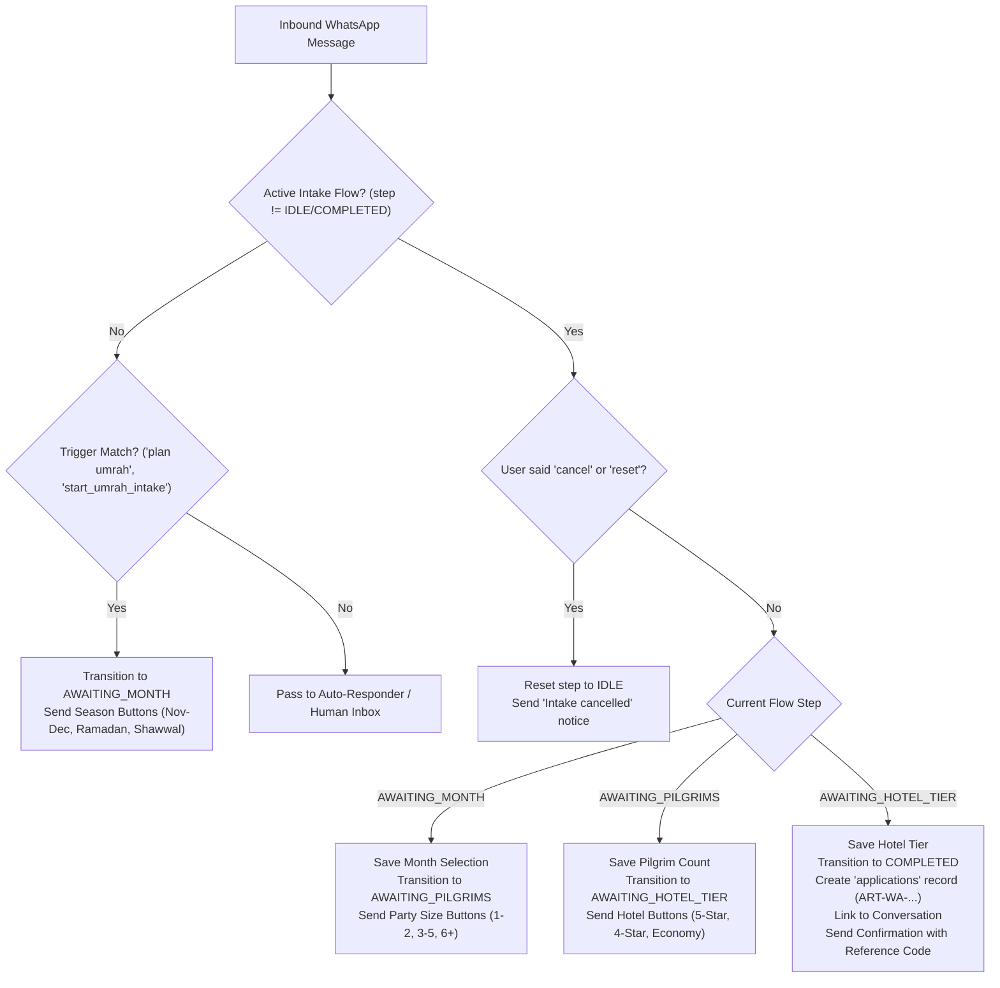
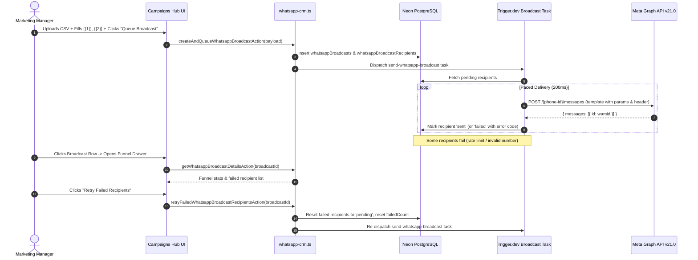

# 0019. WaCRM Phase 3: Live Realtime Inbox, Template Builder, Personalized Broadcast Wizard & Guided Intake Flow

**Date**: 2026-11-09
**Status**: Accepted (Implemented)

## Summary

This specification defines **Phase 3 of the native WhatsApp Cloud API CRM (`WaCRM`) for Al Ramlah Travels (`Slice 38` / `Feature #42`)**. Building upon the foundational Meta v21.0 engine (`Spec 0009`), the durable inbound media pipeline and `ART-...` auto-responder bot (`Spec 0013`), and the 3-priority keyword rules engine (`Spec 0017`), this slice delivers five major operational upgrades across `/admin/desk`, `/admin/campaigns`, and `/admin/settings`:

1. **Schema Extensions & Conversation Management**: Extends `web/db/schema/whatsapp-crm.ts` with `internalNotes` JSONB array (`[{ id, userId, userName, note, createdAt }]`) and `intakeFlowState` JSONB (`step`, collected answers, linked `applicationId`) on `whatsappConversations`, and adds `headerMediaUrl` and `defaultTemplateParams` on `whatsappBroadcasts`.
2. **Guided Multi-Step Umrah Intake Flow Engine (`web/lib/whatsapp/intake-flow.ts`)**: An interactive conversational state machine (adapted from `services/wacrm/src/lib/flows/engine.ts`) triggered by keywords (`"plan umrah"`, `"custom quote"`, `"start inquiry"`) or interactive buttons (`"start_umrah_intake"`). It guides intending pilgrims through Travel Month, Party Size (`1-2 Adults`, `Family 3-5`, `Group 6+`), and Hotel Category (`5-Star Clock Tower`, `4-Star Walking Distance`, `Economy Shuttle`), and automatically creates a tracked dossier in `applications` with reference code `ART-WA-...` in the Kanban Desk.
3. **Live Auto-Refreshing Desk Inbox with Pin, Archive, Assignment & Internal Team Notes**: Upgrades `web/components/admin/hubs/desk-hub-client.tsx` with visibility-aware adaptive live polling (4s foreground polling with pulse indicator badge and smooth state merge), thread Pinning (`isPinned`), Archiving (`isArchived`), Staff Consultant Assignment (`assignedUserId`), and an Internal Team Notes timeline.
4. **Full-Lifecycle Meta Template Builder Modal**: Wires `createWhatsAppTemplateAction` and `deleteWhatsAppTemplateAction` into a self-service **Create Meta Template Modal** in `web/components/admin/hubs/connections-settings-client.tsx` with Category (`MARKETING` / `UTILITY`), Language, Header Type (`NONE`, `TEXT`, `IMAGE`, `VIDEO`, `DOCUMENT`), dynamic `{{1}}` body previews, footer, and quick-reply / CTA buttons, plus 1-click template deletion.
5. **Personalized Broadcast Wizard, CSV Ingestion & Recipient Drilldown / Retry Drawer**: Upgrades `web/components/admin/hubs/campaigns-hub-client.tsx` and `web/app/actions/whatsapp-crm.ts` with dynamic `{{1}}` template variable mapping, token interpolation (`{{name}}`, `{{phone}}`), Header Media URL input, CSV contact parsing (`parseWhatsappBroadcastCsv`), and a **Broadcast Funnel & Recipient Drawer** with delivery breakdown and 1-click **"Retry Failed Recipients"** (`retryFailedWhatsappBroadcastRecipientsAction`).

## Context

In Slices 28, 32, and 36 (`Specs 0009, 0013, 0017`), Al Ramlah Travels embedded a native Meta WhatsApp Cloud API v21.0 engine directly into Next.js 16 and Neon PostgreSQL, replacing external aggregators. This engine established encrypted token storage, constant-time HMAC webhook verification, R2 media downloads, 24-hour customer service window tracking, instant `ART-...` flyer auto-replies, and a 3-priority keyword rules engine.

Despite these foundations, daily operations on the Askari 10 Lahore Haramain desk still face five critical operational bottlenecks:

1. **Static Desk Inbox & Blind Reloads**: Currently, consultants in `/admin/desk?tab=inbox` must manually reload the page or click a thread to see if a pilgrim has replied, or if an outbound quotation message transitioned from single grey tick (`sent`) to double blue ticks (`read`). A visibility-aware live synchronization loop is required to keep badges, messages, and read receipts updated without disrupting active typing or scroll position.
2. **Unorganized Inbound Triage (No Pinning, Archiving, Assignment, or Private Notes)**: High-value family inquiries get buried under spam or completed conversations. Consultants cannot pin VIP threads to the top, archive resolved inquiries, assign specific consultants (e.g., ticketing vs visa specialists), or leave private internal notes (e.g. *"Passport bio-page received, waiting on Meezan bank slip"*).
3. **High Drop-Off on Open-Ended Umrah Inquiries**: Over 40% of inbound WhatsApp leads do not mention a specific `ART-...` post code; instead, they send vague messages like *"Assalam o Alaikum, want Umrah package for 4 people in December"*. Typing back and forth across several hours creates fatigue. An automated, guided 3-step interactive WhatsApp intake flow (Month -> Group Size -> Hotel Tier) collects essential parameters within 60 seconds and auto-generates a dossier in the Kanban Desk.
4. **Portal Egress for Meta Template Creation**: Adding or modifying seasonal Umrah broadcast templates still requires logging into Meta Business Suite, crafting the template, waiting for approval, and returning to Al Ramlah Travels to click "Sync Templates". Consultants need a native Create Meta Template dialog directly in `/admin/settings` with instant schema validation and live preview.
5. **Rigid Broadcasts Without Variable Interpolation or Failure Recovery**: Broadcast campaigns currently send static text without recipient personalization (`{{1}}` cannot be replaced with the pilgrim's name). If a transient Meta rate limit or network glitch fails 12 out of 500 recipients, there is no recipient-level audit drawer and no 1-click button to retry only the failed recipients.

## Requirements

### User Stories

- **As a Haramain desk consultant**, I want the WhatsApp Inbox to update in real time with new pilgrim messages and blue-tick read receipts without losing my place or clearing my message draft, so that I can respond to pilgrims instantly.
- **As a ticketing/visa specialist**, I want to pin high-priority conversations, archive completed inquiries, assign conversations to specific team members, and record internal notes on a thread so that our team coordinates smoothly.
- **As an intending pilgrim**, when I ask for a custom Umrah quote or tap "Plan Umrah", I want an interactive conversational flow with quick-tap buttons to capture my travel month, party size, and hotel category, so that I get an immediate reference code without waiting for a consultant.
- **As a marketing manager**, I want to create and submit new Meta message templates directly within `/admin/settings` (with variable previews and button controls) and delete outdated ones without opening Meta Business Suite.
- **As a campaign administrator**, I want to upload a CSV file of contacts, map template parameters (`{{1}}` -> Name, `{{2}}` -> Season), specify an image/document header URL, inspect recipient delivery funnels (Sent -> Delivered -> Read -> Failed), and retry failed recipients with a single click.

### Acceptance Criteria

- **AC-1 (Schema Extensions & Conversation State)**:
  - `web/db/schema/whatsapp-crm.ts` adds to `whatsappConversations`:
    - `internalNotes`: `jsonb("internal_notes").$type<Array<{ id: string; userId: string; userName: string; note: string; createdAt: string }>>().default([])`.
    - `intakeFlowState`: `jsonb("intake_flow_state").$type<{ step: "IDLE" | "AWAITING_MONTH" | "AWAITING_PILGRIMS" | "AWAITING_HOTEL_TIER" | "COMPLETED"; month?: string; pilgrimCount?: string; hotelTier?: string; applicationId?: string; startedAt?: string; updatedAt?: string }>().default({ step: "IDLE" })`.
  - `web/db/schema/whatsapp-crm.ts` adds to `whatsappBroadcasts`:
    - `headerMediaUrl`: `text("header_media_url")`.
    - `defaultTemplateParams`: `jsonb("default_template_params").$type<Record<string, unknown> | string[]>().default({})`.
  - `whatsappBroadcastRecipients.templateParams` stores recipient-specific variable mappings or parameter lists.
- **AC-2 (Guided Multi-Step Umrah Intake Flow Engine — `web/lib/whatsapp/intake-flow.ts`)**:
  - Implements `handleIntakeFlowInbound` and `matchesIntakeTrigger`:
    - Triggers on keywords: `"plan umrah"`, `"custom quote"`, `"start inquiry"`, `"book umrah"`, `"umrah package"`, `"new booking"`, `"create inquiry"`, or button reply ID `"start_umrah_intake"` / `"art_intake_start"`.
    - **Step 1 (`AWAITING_MONTH`)**: Dispatches interactive reply buttons (or list) for upcoming seasons: `Nov - Dec 2026`, `Ramadan 2027`, `Shawwal / Spring`.
    - **Step 2 (`AWAITING_PILGRIMS`)**: Records month selection and dispatches party size buttons: `1-2 Adults (Couple)`, `Family 3-5 Persons`, `Group 6+ Persons`.
    - **Step 3 (`AWAITING_HOTEL_TIER`)**: Records pilgrim count and dispatches hotel category buttons: `5-Star Clock Tower`, `4-Star Walking Dist`, `Economy Shuttle`.
    - **Completion (`COMPLETED`)**: Stores answers, inserts an application into `applications` with `source: "whatsapp"`, status `"new"`, customer phone/name, and generated `referenceNumber` (`ART-WA-YYYYMMDD-XXXX`), links `whatsappConversations.applicationId`, and dispatches a confirmation message with reference code and assigned consultant notice.
    - Supports cancellation/reset if the user sends `"cancel"` or `"reset"`.
- **AC-3 (Conversation Management Server Actions)**:
  - `web/app/actions/whatsapp-crm.ts` implements:
    - `toggleWhatsappConversationPinAction`: Toggles `isPinned` boolean.
    - `toggleWhatsappConversationArchiveAction`: Toggles `isArchived` boolean.
    - `assignWhatsappConversationAgentAction`: Updates `assignedUserId` (with null support for unassigning).
    - `addWhatsappConversationInternalNoteAction`: Appends an internal note with current authenticated user ID, name, note content, and ISO timestamp.
- **AC-4 (Broadcast Upgrades, CSV Parsing & Retry Actions)**:
  - `web/app/actions/whatsapp-crm.ts` exports:
    - `parseWhatsappBroadcastCsv(csvContent: string)`: Extracts valid phone numbers and optional contact names from comma/tab/newline delimited text or CSV format.
    - `createAndQueueWhatsappBroadcastAction`: Upgraded to accept `headerMediaUrl`, `defaultTemplateParams`, and individual recipient parameter interpolations (`{{name}}`, `{{phone}}`).
    - `getWhatsappBroadcastDetailsAction(broadcastId: string)`: Returns broadcast summary, funnel metrics, and full recipient table (`id`, `contactPhone`, `status`, `wamid`, `templateParams`, `errorCode`, `errorMessage`, `sentAt`, `deliveredAt`, `readAt`).
    - `retryFailedWhatsappBroadcastRecipientsAction(broadcastId: string)`: Re-queues all `status === "failed"` recipients to `"pending"`, resets `failedCount = 0`, updates broadcast status to `"processing"`, and dispatches `send-whatsapp-broadcast` task (or inline fallback).
- **AC-5 (Live Auto-Refreshing Desk Inbox UI)**:
  - `web/components/admin/hubs/desk-hub-client.tsx` incorporates:
    - Adaptive background polling (every 4000ms when tab is visible; paused when hidden via `document.visibilityState`).
    - Live sync badge with green pulse dot (`● Live Sync` / `Paused`) and manual refresh button.
    - Non-destructive state merge: updates conversation list, unread counters, and delivery/read ticks in real time without stealing focus, resetting message drafts, or jittering scroll position.
    - Filter tabs: `All`, `Pinned`, `Unread`, `Archived`.
    - Pin, Archive, and Staff Assignment dropdown directly in the thread header.
    - Internal Team Notes popover/tab in conversation info sidebar.
- **AC-6 (Full-Lifecycle Meta Template Builder Modal in Connections Settings)**:
  - `web/components/admin/hubs/connections-settings-client.tsx` features:
    - "Create Meta Template" button launching the builder modal.
    - Form inputs: Template Name (`[a-z0-9_]+`), Category (`MARKETING` / `UTILITY`), Language (`en_US`, `ur`, `ar`), Header Format (`NONE`, `TEXT`, `IMAGE`, `VIDEO`, `DOCUMENT`), Body Text with `{{1}}` placeholders, Footer Text, and Buttons (`QUICK_REPLY`, `URL`, `PHONE_NUMBER`).
    - Live WhatsApp message bubble preview showing real-time variable replacement.
    - Submits via `createWhatsAppTemplateAction` to Meta Graph API and re-syncs template list.
    - 1-click Delete button with confirmation dialog via `deleteWhatsAppTemplateAction`.
- **AC-7 (Personalized Broadcast Wizard & Recipient Funnel Drawer)**:
  - `web/components/admin/hubs/campaigns-hub-client.tsx` provides:
    - Template variable input fields (`{{1}}`, `{{2}}`) when the selected template has body placeholders.
    - Header Media URL input when template specifies a media header.
    - CSV File Upload / Paste supporting `name,phone` for recipient lists.
    - Broadcast Recipient Drilldown Drawer: click any broadcast to view a side drawer with Sent -> Delivered -> Read -> Failed progress bars, per-recipient status table, and 1-click **"Retry Failed Recipients"** button.
- **AC-8 (Zero-Config Offline Simulation & Comprehensive Test Suite)**:
  - Deterministic offline simulation for Meta API calls when credentials are not configured (`NODE_ENV !== "production"`).
  - Comprehensive unit test file `web/tests/whatsapp-phase3-flows-and-broadcasts.test.ts` verifying flow state transitions, CSV parsing, variable extraction, and validation schemas.

## Options Considered

### Option 1: Full-Duplex WebSockets / Supabase Realtime for Desk Inbox

Use Supabase Realtime or a standalone WebSocket server to push message and status events to the client.

**Pros**:
- Instant sub-second event delivery without periodic HTTP polling.

**Cons**:
- **Architectural Mismatch**: Al Ramlah Travels is built natively on Next.js 16 App Router on Vercel with Neon Serverless PostgreSQL (`@neondatabase/serverless`). It has no persistent Node.js server to maintain long-lived WebSocket connections, and external WebSocket brokers (Pusher/Ably) add unnecessary cost and configuration overhead.
- **Complexity**: Managing reconnection logic, connection limits, and socket auth on mobile networks is error-prone.

### Option 2: Rely Only on Meta WhatsApp Flows API (Meta Hosted JSON Forms)

Delegate multi-step intake to Meta's native WhatsApp Flows feature (JSON-defined in-app form screens).

**Pros**:
- Renders a multi-page form sheet directly inside the WhatsApp client.

**Cons**:
- **High Client Incompatibility**: In Pakistan, a significant percentage of pilgrims use older Android devices or unofficial WhatsApp builds where Meta Flows frequently crash or fail to load.
- **Maintenance Burden**: Requires maintaining signed JSON schema endpoints, RSA encryption keys, and Meta Flow publishing pipelines.
- **Poor Transparency**: The agency cannot observe pilgrim interactions step by step as they happen.

### Option 3 (Chosen): Adaptive Smart-Polling Desk Inbox + Native Interactive Button/List State Machine Intake Flow + Direct Drizzle CRM Integration

Use visibility-aware 4-second client polling in the Desk Hub for live sync, combined with a deterministic server-side state machine (`web/lib/whatsapp/intake-flow.ts`) using standard Meta interactive buttons and lists, directly backed by Neon PostgreSQL and Drizzle ORM.

**Pros**:
- **100% Device Compatibility**: Interactive reply buttons and list menus work universally across all WhatsApp versions (iOS, Android, KaiOS, and WhatsApp Web).
- **Zero Additional Infrastructure**: Works on serverless Next.js and Neon PostgreSQL without external WebSocket servers or broker fees.
- **Real-Time Step Visibility**: Consultants can see the pilgrim answering each question in real time inside `/admin/desk?tab=inbox`.
- **Immediate Lead Creation**: Completed intake flows atomically create application records in `applications` and badge the conversation in the Kanban Desk.

## Decision

**Chosen option**: Option 3: Adaptive Smart-Polling Desk Inbox + Native Interactive Button/List State Machine Intake Flow + Direct Drizzle CRM Integration.

## Architecture and Technical Design

### 1. Component and Directory Structure

```text
web/
├── db/
│   └── schema/
│       └── whatsapp-crm.ts                    # AC-1: internalNotes, intakeFlowState, headerMediaUrl, defaultTemplateParams
├── lib/
│   ├── validations/
│   │   └── whatsapp-crm.ts                    # AC-1, AC-3, AC-4: Zod schemas for notes, pin/archive, assign, broadcast retry, CSV
│   └── whatsapp/
│       ├── intake-flow.ts                     # AC-2: Multi-step Umrah guided intake state machine & lead creator
│       ├── broadcast-csv.ts                   # AC-4: CSV recipient parser & phone normalizer
│       ├── template-variables.ts              # AC-4: Extract {{1}} variables & interpolate {{name}}/{{phone}} tokens
│       ├── auto-responder.ts                  # Integrates intake flow into unified inbound pipeline
│       └── meta-api.ts                        # Existing Meta Cloud API v21.0 methods
├── trigger/
│   └── send-whatsapp-broadcast.task.ts        # Upgraded to handle templateParams & headerMediaUrl per recipient
├── app/
│   ├── actions/
│   │   └── whatsapp-crm.ts                    # AC-3, AC-4: Server actions for pin, archive, assign, notes, broadcast drilldown & retry
│   └── api/
│       └── webhooks/
│           └── whatsapp/
│               └── route.ts                   # Ingests intake button replies & updates broadcast recipient delivery states
├── components/
│   └── admin/
│       ├── hubs/
│       │   ├── desk-hub-client.tsx            # AC-5: Live polling, pin/archive/assign controls, team notes & template variable composer
│       │   ├── connections-settings-client.tsx# AC-6: Full Meta Template Builder modal & template delete action
│       │   └── campaigns-hub-client.tsx       # AC-7: Personalized broadcast wizard, CSV import, delivery funnel drawer & 1-click retry
│       └── desk/
│           ├── whatsapp-conversation-notes.tsx# Dedicated internal team notes panel
│           └── ...
└── tests/
    └── whatsapp-phase3-flows-and-broadcasts.test.ts # AC-8: Unit tests for intake flow, CSV parser, and variable interpolation
```

### 2. Database Schema Extensions (`web/db/schema/whatsapp-crm.ts`)

```typescript
// --- 1. whatsappConversations Extensions ---
// Add internalNotes and intakeFlowState to whatsappConversations

export interface WhatsappInternalNote {
  id: string
  userId: string
  userName: string
  note: string
  createdAt: string
}

export type WhatsappIntakeStep =
  | "IDLE"
  | "AWAITING_MONTH"
  | "AWAITING_PILGRIMS"
  | "AWAITING_HOTEL_TIER"
  | "COMPLETED"

export interface WhatsappIntakeFlowState {
  step: WhatsappIntakeStep
  month?: string
  pilgrimCount?: string
  hotelTier?: string
  applicationId?: string
  startedAt?: string
  updatedAt?: string
}

// In whatsappConversations pgTable:
// internalNotes: jsonb("internal_notes").$type<WhatsappInternalNote[]>().default([]),
// intakeFlowState: jsonb("intake_flow_state").$type<WhatsappIntakeFlowState>().default({ step: "IDLE" }),

// --- 2. whatsappBroadcasts Extensions ---
// Add headerMediaUrl and defaultTemplateParams to whatsappBroadcasts

// In whatsappBroadcasts pgTable:
// headerMediaUrl: text("header_media_url"),
// defaultTemplateParams: jsonb("default_template_params").$type<Record<string, unknown> | string[]>().default({}),
```

### 3. Guided Umrah Intake Flow State Machine (`web/lib/whatsapp/intake-flow.ts`)



#### Step Details:

1. **Trigger Recognition**:
   - Matches keywords: `["plan umrah", "custom quote", "start inquiry", "book umrah", "umrah package", "new booking", "create inquiry", "umrah rates", "hajj inquiry"]` (case-insensitive `includes`).
   - Matches button reply IDs: `["start_umrah_intake", "art_intake_start", "btn_plan_umrah"]`.
2. **Step 1: Travel Month / Season (`AWAITING_MONTH`)**:
   - Header: `"Al Ramlah Travels • Umrah Planning (1/3)"`
   - Body: `"Assalam-o-Alaikum! Let's tailor your sacred journey to the Haramain. Which travel season or month do you plan to perform Umrah?"`
   - Buttons:
     1. `intake_m_novdec`: `"Nov - Dec 2026"`
     2. `intake_m_ramadan`: `"Ramadan 2027"`
     3. `intake_m_shawwal`: `"Shawwal / Spring"`
3. **Step 2: Pilgrim Count (`AWAITING_PILGRIMS`)**:
   - Header: `"Al Ramlah Travels • Umrah Planning (2/3)"`
   - Body: `"Masha'Allah. How many pilgrims will be traveling in your party? (Children and infants will be verified during visa issuance)."`
   - Buttons:
     1. `intake_p_couple`: `"1-2 Adults (Couple)"`
     2. `intake_p_family`: `"Family (3-5 Persons)"`
     3. `intake_p_group`: `"Group (6+ Persons)"`
4. **Step 3: Hotel Category (`AWAITING_HOTEL_TIER`)**:
   - Header: `"Al Ramlah Travels • Umrah Planning (3/3)"`
   - Body: `"What accommodation standard do you prefer for Makkah & Madinah?"`
   - Buttons:
     1. `intake_h_5star`: `"5★ Clock Tower/Front"`
     2. `intake_h_4star`: `"4★ Walking Distance"`
     3. `intake_h_economy`: `"Economy Shuttle"`
5. **Step 4: Completion & Lead Generation (`COMPLETED`)**:
   - Generates reference number: `ART-WA-${YYYYMMDD}-${random4}`.
   - Inserts record into `applications`:
     - `referenceNumber`: generated code
     - `customerName`: contact name or phone
     - `customerPhone`: sender phone
     - `customerWhatsapp`: sender phone
     - `source`: `"whatsapp"`
     - `status`: `"new"`
     - `notes`: `[WhatsApp Guided Intake]\nSeason: ${month}\nParty Size: ${pilgrimCount}\nHotel Tier: ${hotelTier}`
   - Updates `whatsappConversations`:
     - `applicationId`: new application ID
     - `intakeFlowState.step`: `"COMPLETED"`
   - Sends confirmation message:
     - Header: `"Inquiry Dossier Created • ${referenceNumber}"`
     - Body: `"Alhamdulillah! Your customized Umrah inquiry dossier has been registered.\n\n📌 Reference: *${referenceNumber}*\n🗓 Season: *${month}*\n👥 Party: *${pilgrimCount}*\n🏨 Category: *${hotelTier}*\n\nA dedicated Al Ramlah Haramain consultant from our Askari 10 Lahore desk has been assigned to prepare your itemized proposal and will follow up shortly.\n\nJazakAllah Khair."`

### 4. Broadcast Funnel & Retry Architecture



### 5. Pure Helper Utilities

#### A. CSV Recipient Parser (`web/lib/whatsapp/broadcast-csv.ts`)

```typescript
export interface ParsedBroadcastRecipient {
  phone: string
  name?: string
  customParams?: string[]
}

export interface ParseCsvResult {
  recipients: ParsedBroadcastRecipient[]
  validCount: number
  invalidCount: number
  errors: string[]
}

/**
 * Parses raw CSV/text into sanitized phone numbers and optional contact names.
 * Supports:
 * - "name,phone"
 * - "phone,name"
 * - Plain list of phone numbers (one per line or comma-separated)
 * - Header row detection (ignores lines starting with "name", "phone", "mobile")
 */
export function parseWhatsappBroadcastCsv(csvContent: string): ParseCsvResult
```

#### B. Template Variable Extractor & Interpolator (`web/lib/whatsapp/template-variables.ts`)

```typescript
/**
 * Finds all variable tokens in template text: {{1}}, {{2}}, etc.
 * Returns sorted unique indices, e.g. [1, 2].
 */
export function extractTemplateVariablePlaceholders(text: string): number[]

/**
 * Replaces {{1}}, {{2}} with provided values or interpolates {{name}} / {{phone}}.
 */
export function interpolateTemplateVariables(
  templateBody: string,
  variables: Record<string, string>,
  contact: { name?: string; phone: string }
): string
```

### 6. Server Actions Contract (`web/app/actions/whatsapp-crm.ts`)

```typescript
// 1. Conversation Management
export async function toggleWhatsappConversationPinAction(input: {
  conversationId: string
  isPinned: boolean
}): Promise<{ success: boolean; error?: string }>

export async function toggleWhatsappConversationArchiveAction(input: {
  conversationId: string
  isArchived: boolean
}): Promise<{ success: boolean; error?: string }>

export async function assignWhatsappConversationAgentAction(input: {
  conversationId: string
  assignedUserId: string | null
}): Promise<{ success: boolean; error?: string }>

export async function addWhatsappConversationInternalNoteAction(input: {
  conversationId: string
  note: string
}): Promise<{ success: boolean; note?: WhatsappInternalNote; error?: string }>

// 2. Broadcasts & Retries
export async function getWhatsappBroadcastDetailsAction(broadcastId: string): Promise<{
  success: boolean
  broadcast?: any
  recipients?: any[]
  funnel?: { total: number; sent: number; delivered: number; read: number; failed: number }
  error?: string
}>

export async function retryFailedWhatsappBroadcastRecipientsAction(broadcastId: string): Promise<{
  success: boolean
  retriedCount?: number
  triggerRunId?: string
  error?: string
}>
```

### 7. User Interface Designs

#### A. Live Auto-Refreshing Desk Inbox (`web/components/admin/hubs/desk-hub-client.tsx`)

- **Live Status Strip**: Positioned in the inbox header:
  - Green pulse indicator: `<span className="size-2 rounded-full bg-emerald-500 animate-pulse" /> Live Sync (4s)`
  - Manual Refresh Button with spinning icon when fetching.
- **Filter Bar**: `All` (default), `📌 Pinned`, `💬 Unread`, `📁 Archived`.
- **Thread Actions**:
  - `Pin / Unpin` button toggling `isPinned` with gold pin icon.
  - `Archive / Unarchive` button.
  - `Agent Assignment` selector displaying staff list.
  - `Team Notes` button opening a slide-out popover with timestamped notes.
- **Template Variable Composer**: When drafting a template reply outside the 24h window, if the selected template contains `{{1}}`, `{{2}}`, dynamic input fields appear to fill variables before sending.

#### B. Full-Lifecycle Meta Template Builder Modal (`web/components/admin/hubs/connections-settings-client.tsx`)

- Launched via a prominent **"+ Create Meta Template"** button on the WhatsApp Business Account card.
- **Left Form**:
  - Name (with regex helper: lowercase letters, numbers, underscores).
  - Category (`MARKETING`, `UTILITY`).
  - Language picker (`en_US`, `ur`, `ar`).
  - Header Format selector (`None`, `Text`, `Image`, `Video`, `Document`).
  - Body text area with quick-insert button for `{{#}}` variables.
  - Footer text (max 60 characters).
  - Button builder (up to 3 Quick Replies or CTA URL / Phone).
- **Right Column (Live Preview)**:
  - Real-time simulated WhatsApp smartphone chat bubble showing header, formatted body with placeholder tags highlighted in emerald/gold, footer, and action buttons.
- **Template Row Actions**:
  - Each template card in the catalog gets a trash icon to invoke `deleteWhatsAppTemplateAction` with confirmation modal.

#### C. Personalized Broadcast Wizard & Funnel Drawer (`web/components/admin/hubs/campaigns-hub-client.tsx`)

- **Wizard Additions**:
  - Dynamic variable fields for `{{1}}`, `{{2}}` (supports static string or token interpolation: `{{name}}`, `{{phone}}`).
  - Header Media URL input for templates with image/document/video headers.
  - Recipient Segment option: **"CSV File Import"** with drag-and-drop file upload or direct text paste.
- **Broadcast Recipient Drilldown Drawer**:
  - Clicking any broadcast card in the Recent Dispatches list opens a right-side drawer (`Sheet`).
  - Visual Funnel Strip:
    - Sent: blue progress bar
    - Delivered: emerald progress bar
    - Read: purple progress bar (blue ticks)
    - Failed: rose progress bar
  - Recipient Table: Phone, Name/Params, Status Badge, Sent/Read timestamps, Error reason.
  - Top Action: **"Retry Failed Recipients"** button (active when `failedCount > 0`), which immediately re-queues failed contacts and restarts the worker.

## Build plan

### Milestone 1: Schema Extensions, Conversation Management (Pin/Archive/Assign/Internal Notes) & Guided Umrah Intake Flow Engine
- Extend `web/db/schema/whatsapp-crm.ts` with `internalNotes` JSONB array and `intakeFlowState` JSONB on `whatsappConversations`, and add `headerMediaUrl` and `defaultTemplateParams` on `whatsappBroadcasts` (**AC-1**).
- Extend `web/lib/validations/whatsapp-crm.ts` with Zod schemas for:
  - `toggleWhatsappConversationPinSchema`, `toggleWhatsappConversationArchiveSchema`, `assignWhatsappConversationAgentSchema`, `addWhatsappConversationInternalNoteSchema` (**AC-3**).
  - `retryFailedWhatsappBroadcastSchema`, `getWhatsappBroadcastDetailsSchema`, and broadcast CSV parsing validations (**AC-4**).
- Create `web/lib/whatsapp/intake-flow.ts`:
  - Implement `matchesIntakeTrigger`, `handleIntakeFlowInbound`, and the 3-step state machine (`AWAITING_MONTH` -> `AWAITING_PILGRIMS` -> `AWAITING_HOTEL_TIER` -> `COMPLETED`) (**AC-2**).
  - Implement automated `applications` lead creation with reference code `ART-WA-...` upon flow completion (**AC-2**).
  - Wire intake flow evaluation into `web/lib/whatsapp/auto-responder.ts` and `web/app/api/webhooks/whatsapp/route.ts` (**AC-2**).

### Milestone 2: Server Actions for Conversation Management, Template Variables, CSV Broadcasts & Failed Recipient Retry
- In `web/app/actions/whatsapp-crm.ts`:
  - Add `toggleWhatsappConversationPinAction`, `toggleWhatsappConversationArchiveAction`, `assignWhatsappConversationAgentAction`, and `addWhatsappConversationInternalNoteAction` (**AC-3**).
  - Create `web/lib/whatsapp/broadcast-csv.ts` exporting `parseWhatsappBroadcastCsv` and `web/lib/whatsapp/template-variables.ts` exporting placeholder extractors (**AC-4**).
  - Upgrade `createAndQueueWhatsappBroadcastAction` to support `headerMediaUrl`, `defaultTemplateParams`, and per-contact parameter mappings (**AC-4**).
  - Add `getWhatsappBroadcastDetailsAction` (returning funnel metrics and recipient breakdown) and `retryFailedWhatsappBroadcastRecipientsAction` (resetting failed recipients and re-dispatching delivery) (**AC-4**).
  - Upgrade `sendWhatsappConversationReplyAction` to validate and forward template body variables (**AC-4**).

### Milestone 3: Live Auto-Refreshing Desk Inbox UI, Pin/Archive/Assign/Notes Controls & Meta Template Builder Modal
- In `web/components/admin/hubs/desk-hub-client.tsx`:
  - Implement visibility-aware adaptive background polling (4s interval when tab is focused, paused when hidden) with a live pulse indicator and manual refresh button (**AC-5**).
  - Seamlessly merge new inbound messages and read receipts into active state without clearing draft input or shifting scroll position (**AC-5**).
  - Add Pin, Archive, and Filter tabs (`All`, `Pinned`, `Unread`, `Archived`) to the conversation sidebar (**AC-5**).
  - Add Staff Assignment dropdown and Pin/Archive buttons to the thread header (**AC-5**).
  - Create and wire the Internal Team Notes drawer/panel for staff collaboration (**AC-5**).
  - Add dynamic `{{1}}` variable inputs to the Desk template message composer (**AC-5**).
- In `web/components/admin/hubs/connections-settings-client.tsx`:
  - Wire `createWhatsAppTemplateAction` and `deleteWhatsAppTemplateAction` into a full **Create Meta Template Modal** with Category, Language, Header Format, dynamic `{{1}}` body previews, footer, and quick-reply/URL buttons (**AC-6**).
  - Add a 1-click Delete template button with confirmation dialog on each template card (**AC-6**).

### Milestone 4: Personalized Broadcast Wizard, Recipient Drilldown & Retry UI + Unit Tests
- In `web/components/admin/hubs/campaigns-hub-client.tsx`:
  - Add dynamic template variable inputs (`{{1}}`, `{{2}}`), optional Header Media URL input, CSV contact upload/paste, and live preview to the WhatsApp Broadcast creator (**AC-7**).
  - Create a **Broadcast Delivery Funnel & Recipients Drawer** showing Sent -> Delivered -> Read -> Failed progress bars, per-recipient status/error logs, and a 1-click **"Retry Failed Recipients"** button (**AC-7**).
- Create `web/tests/whatsapp-phase3-flows-and-broadcasts.test.ts`:
  - Test intake flow state transitions (`IDLE` -> `AWAITING_MONTH` -> `AWAITING_PILGRIMS` -> `AWAITING_HOTEL_TIER` -> `COMPLETED`) and trigger detection (**AC-8**).
  - Test CSV parser (`parseWhatsappBroadcastCsv`) across different formats, quotes, and invalid numbers (**AC-8**).
  - Test template variable extraction and token interpolation (**AC-8**).
  - Test Zod validation schemas for notes, pin/archive, assignment, and broadcast retries (**AC-8**).
