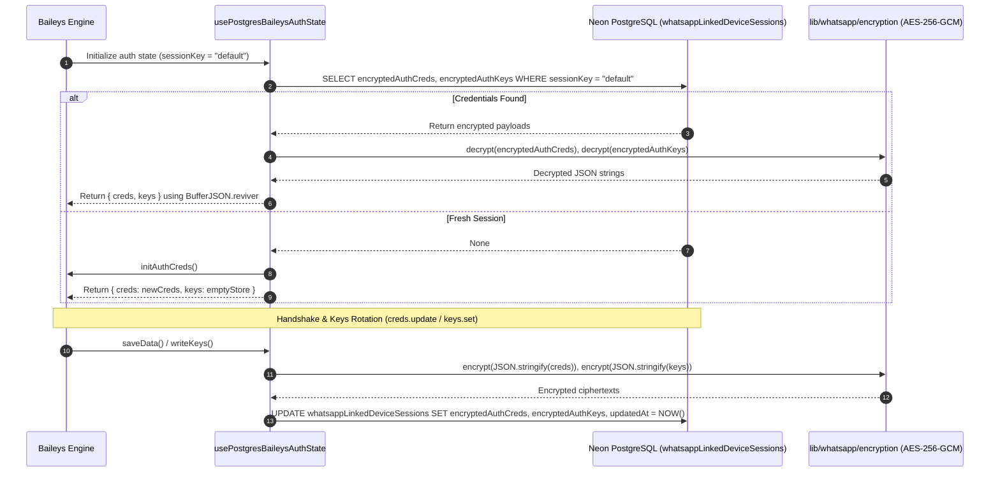
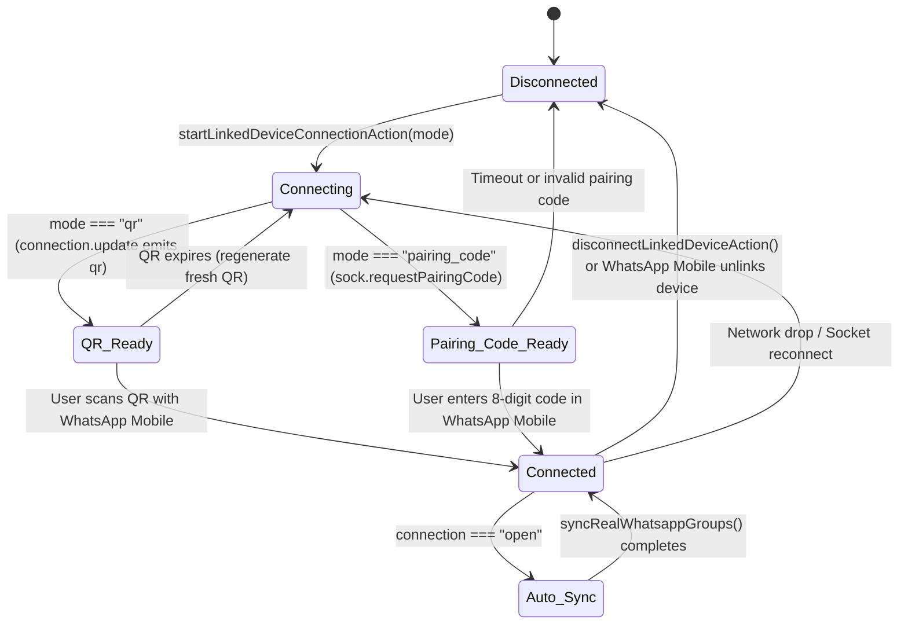
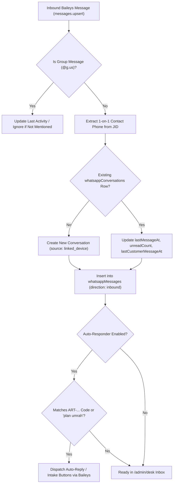
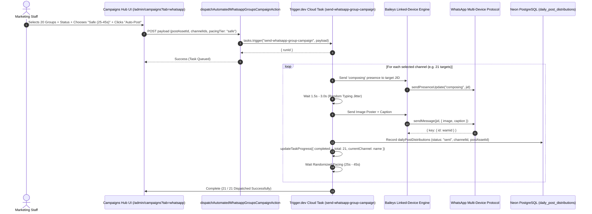

# 0021. Native WhatsApp Linked-Device Engine: QR/Pairing Code Session, Auto-Sync Real Groups & Chats, Automated Paced Group/Status Posting & Fake Seed Purge

**Date**: 2026-11-09  
**Status**: Approved

## Summary

This specification defines **Slice 40 (Feature #44)**: the **Native WhatsApp Linked-Device Engine** for Al Ramlah Travels. Operating alongside the official Meta WhatsApp Cloud API v21.0 engine (`Specs 0009, 0013, 0017, 0019`), this feature establishes a native WhatsApp Multi-Device connection powered by `@whiskeysockets/baileys` directly integrated into Next.js 16 App Router, Neon Serverless PostgreSQL (`@neondatabase/serverless`), and Trigger.dev Cloud v4 (`@trigger.dev/sdk`).

Specifically, this slice eliminates manual clipboard-based WhatsApp community posting and overcomes Meta Cloud API template constraints by delivering:

1. **Fake Seed Channel Purge & Clean Database State**: Completely removes all 36 fake placeholder `marketing_channels` rows (`Askari 10 Sector A...`, `DHA Phase 1...`, etc.) and associated test distribution records from Neon PostgreSQL, and purges the static channel generation logic from `web/db/seed.ts`.
2. **PostgreSQL-Backed Encrypted Multi-Device Session State (`whatsappLinkedDeviceSessions`)**: Creates a resilient, encrypted auth state adapter (`usePostgresBaileysAuthState`) in `web/lib/whatsapp/linked-device.ts` that persists Baileys signal keys and authentication credentials inside Neon PostgreSQL using AES-256-GCM authenticated encryption. This guarantees linked sessions survive Next.js hot module reloads, serverless worker recycling, and deployments without requiring staff to re-scan.
3. **Dual Connection Mode: Live QR Code & 8-Digit Phone Pairing Code**: Provides consultants and agency administrators with two intuitive pairing options directly within the admin dashboard:
   - **Live Dynamic QR Code** generated via `qrcode` with automatic 2.5s polling.
   - **8-Digit Phone Pairing Code** (`sock.requestPairingCode(phoneDigits)`) allowing linking without using a camera (ideal for mobile or remote team SIM cards).
4. **Auto-Discovery of Real WhatsApp Groups & WhatsApp Status**: On connection establishment (`connection === "open"`), the engine queries WhatsApp's protocol via `sock.groupFetchAllParticipating()` and automatically upserts every authentic participating group (`@g.us`, subject, member count, announcement-only status, admin privileges) and the device's personal `WhatsApp Status (status@broadcast)` directly into `marketingChannels`.
5. **Real-Time Chat Synchronization & 24-Hour Window Bypass in Desk Inbox**: Ingests inbound and outbound 1-on-1 and group messages via Baileys `messages.upsert` into `whatsappConversations` and `whatsappMessages`. When a pilgrim inquiry falls outside Meta Cloud API's strict 24-hour customer service window, consultants in `/admin/desk?tab=inbox` can send free-form text, quotation flyers, and booking documents directly through the linked physical SIM without requiring a pre-approved Meta Template.
6. **Durable Paced Group & Status Auto-Posting Task (`send-whatsapp-group-campaign.task.ts`)**: Replaces manual copy-pasting with a hands-free, background campaign task in Trigger.dev Cloud. The worker dispatches 4K flyer posters and markdown captions to selected WhatsApp Groups and Status with simulated human typing presence (`composing` state for 1.5s–3s) and configurable anti-ban randomized delays (`15s–35s` default, selectable up to `45s–90s` Ultra-Safe), logging distribution audits into `dailyPostDistributions` in real time.
7. **Unified Admin Management UI & Automated Campaign Bar**: Introduces a dedicated `WhatsappLinkedDeviceCard` integrated into `/admin/settings?tab=whatsapp` and `/admin/campaigns?tab=whatsapp`, featuring real-time connection status badges, live QR/Pairing Code modals, 1-click group sync, group multi-selection with status toggles, pacing presets, and automated campaign launch triggers.

---

## Context

In Slices 28, 32, 36, and 38 (`Specs 0009, 0013, 0017, 0019`), Al Ramlah Travels built an enterprise Meta WhatsApp Cloud API v21.0 infrastructure. Intending pilgrims can send inquiries to the official WABA number, receive automated `ART-...` flyer responses, complete guided 3-step intake flows, and converse with consultants in `/admin/desk?tab=inbox`.

However, two severe operational realities of the Pakistan Umrah travel market cannot be addressed by the Meta WhatsApp Cloud API alone:

1. **Meta Cloud API Has No Support for WhatsApp Groups or Status**:
   - In Pakistan, the overwhelming majority of high-intent Umrah inquiries originate from community WhatsApp Groups (e.g. resident groups across Askari 10, DHA Lahore, Cantt, welfare circles, doctor/engineer forums) and personal WhatsApp Status updates viewed by family, friends, and repeat pilgrims.
   - Meta's official WhatsApp Business Cloud API strictly forbids joining or posting to WhatsApp Groups (`@g.us`) and does not support posting to WhatsApp Status (`status@broadcast`).
   - Consequently, our marketing workflow in `/admin/campaigns?tab=whatsapp` was previously reduced to a manual clipboard assistant: consultants had to download the 4K poster, click "1-Tap Copy Caption", open WhatsApp Web on their personal laptops, manually paste the image and caption into 30+ groups one by one, and return to check manual audit boxes.
2. **Fake Seed Data Clutter**:
   - To prototype the UI in early phases, `web/db/seed.ts` seeded 36 hypothetical groups (e.g., `"Askari 10 Sector A Residents Forum"`, `"DHA Phase 3 Block Y & Z Community"`). These placeholder entries do not correspond to real WhatsApp JIDs (`@g.us`) and pollute the database and analytics.
3. **The 24-Hour Customer Service Window Blocker**:
   - Under Meta Cloud API rules, once 24 hours have elapsed since a pilgrim's last inbound message, businesses are prohibited from sending free-form text or media messages. To follow up on an ongoing visa or ticket inquiry, staff must send a pre-approved paid Meta Template message. Intending pilgrims frequently do not reply to structured templates, causing deals to stall.
   - The agency maintains real Android/iPhone business SIMs (e.g., `+92 327 4029701` and `+92 319 0462638`) on the Askari 10 Haramain desk. By linking these physical SIM numbers directly to Al Ramlah Travels via Baileys multi-device protocol, consultants can conduct organic, unconstrained 1-on-1 conversations and automated group broadcasts from the same dashboard.

---

## Requirements

### User Stories

- **As a marketing manager**, I want to link our primary agency WhatsApp SIM (`+92 327 4029701`) to the dashboard using either a live QR code or an 8-digit pairing code, so that Al Ramlah Travels can interact with real WhatsApp groups and status without manual browser extensions.
- **As a campaign administrator**, I want the system to automatically discover and list all real WhatsApp Groups that our phone participates in, with real member counts and admin status, so that I don't have to manually create or configure group channels.
- **As a content publisher**, I want to select 15–30 real community groups and our WhatsApp Status, select today's 4K Umrah package poster, and click a single "Auto-Post to Groups" button that safely dispatches the poster with human-like typing and randomized delays, so that our team saves 2 hours of repetitive manual copying every morning while remaining completely safe from WhatsApp spam flags.
- **As a Haramain desk consultant**, when an intending pilgrim's conversation is older than 24 hours, I want the Desk Inbox to let me send direct replies and PDF vouchers via our linked device SIM without forcing me to wait for Meta template approvals.
- **As a database administrator**, I want all fake placeholder groups from early development purged from Neon PostgreSQL and `web/db/seed.ts`, leaving only authentic synchronized groups and channels.

### Acceptance Criteria

- **AC-1 (Fake Seed Purge & Seed Script Cleanup)**:
  - All 36 fake seeded rows in `marketing_channels` (`Askari 10...`, `DHA...`, etc.) and any referencing rows in `daily_post_distributions` are purged from Neon PostgreSQL.
  - `web/db/seed.ts` is updated to remove the static placeholder `marketingChannels` seed array and its insertion block, ensuring fresh database seed operations never reintroduce mock channels.
- **AC-2 (Dependencies & Next.js 16 Server Bundling Configuration)**:
  - `@whiskeysockets/baileys` and `qrcode` (along with `@types/qrcode`) are added to `web/package.json`.
  - `web/next.config.ts` includes `serverExternalPackages: ["@whiskeysockets/baileys", "pino"]` to prevent Webpack bundling issues with native cryptographic and WebSocket modules.
- **AC-3 (PostgreSQL-Backed Linked-Device Schema Extension)**:
  - `web/db/schema/whatsapp-crm.ts` defines `whatsappLinkedDeviceSessions` table:
    - `id`: `uuid` primary key default random.
    - `sessionKey`: `varchar("session_key", { length: 64 })` unique not null default `"default"`.
    - `label`: `text("label")` not null default `"Primary Business WhatsApp"`.
    - `phoneNumber`: `varchar("phone_number", { length: 32 })`.
    - `pushName`: `text("push_name")`.
    - `status`: `pgEnum("whatsapp_linked_device_status")` with values `['disconnected', 'connecting', 'qr_ready', 'pairing_code_ready', 'connected']`.
    - `qrDataUrl`: `text("qr_data_url")`.
    - `pairingCode`: `varchar("pairing_code", { length: 16 })`.
    - `encryptedAuthCreds`: `text("encrypted_auth_creds")` (AES-256-GCM encrypted Baileys `AuthenticationCreds`).
    - `encryptedAuthKeys`: `text("encrypted_auth_keys")` (AES-256-GCM encrypted Baileys `SignalKeyStore`).
    - `groupsSyncedCount`: `integer("groups_synced_count")` not null default 0.
    - `lastError`: `text("last_error")`.
    - `lastConnectedAt`: `timestamp("last_connected_at", { withTimezone: true })`.
    - `lastSyncedAt`: `timestamp("last_synced_at", { withTimezone: true })`.
    - `createdAt` and `updatedAt` timestamps with timezone.
  - `marketing_channels` in `web/db/schema/suppliers-and-marketing.ts` supports storing group metadata:
    - `externalGroupIdOrHandle`: Stores the authentic JID (e.g. `120363024849302@g.us` or `status@broadcast`).
    - `platform`: Supports `"whatsapp_group"` and `"whatsapp_status"`.
    - `isActive`: Set to `true` if group allows messages (or user is admin); set to `false` if `announce: true` and user is not an admin.
- **AC-4 (Native Baileys Engine & PostgreSQL Auth State Adapter — `web/lib/whatsapp/linked-device.ts`)**:
  - Implements `usePostgresBaileysAuthState(sessionKey: string)`:
    - Loads encrypted credentials and keys from `whatsappLinkedDeviceSessions`, decrypts using `decrypt` from `web/lib/whatsapp/encryption.ts`, and deserializes via `BufferJSON.reviver`.
    - Persists credential updates and key transactions back to PostgreSQL with AES-256-GCM encryption on every Baileys `creds.update` and `keys.set` event.
  - Implements `initBaileysSocket(sessionKey, options)`:
    - Supports `mode: "qr"`: Emits `connection.update` with QR string, renders to data URL using `qrcode.toDataURL`, updates session status to `"qr_ready"`.
    - Supports `mode: "pairing_code"`: Accepts `phoneNumber`, strips non-digits, calls `sock.requestPairingCode(phoneDigits)`, formats as `XXXX-XXXX`, updates status to `"pairing_code_ready"`.
    - Handles `connection.update`: On `"open"`, updates status to `"connected"`, saves phone number and push name, and invokes `syncRealWhatsappGroups`. On `"close"`, distinguishes intentional logout (unlinks credentials) from network reconnects.
- **AC-5 (Real WhatsApp Groups & Status Auto-Discovery)**:
  - Implements `syncRealWhatsappGroups(sessionKey: string)`:
    - Calls `sock.groupFetchAllParticipating()` to retrieve all joined groups.
    - Upserts each group into `marketingChannels`:
      - `name`: `group.subject`
      - `platform`: `"whatsapp_group"`
      - `externalGroupIdOrHandle`: `group.id`
      - `memberCount`: `group.participants.length`
      - `areaTag`: `"Synced WhatsApp Group"`
      - `senderWhatsappNumber`: session phone number
      - `isActive`: `!group.announce || isUserAdmin(group, sessionJid)`
    - Automatically upserts a `"WhatsApp Status (status@broadcast)"` record with `platform: "whatsapp_status"` and `externalGroupIdOrHandle: "status@broadcast"`.
    - Updates `groupsSyncedCount` and `lastSyncedAt` on `whatsappLinkedDeviceSessions`.
- **AC-6 (Safe Human-Like Paced Sender & Durable Trigger.dev Task)**:
  - Implements `sendLinkedDeviceGroupOrStatusPost`:
    - Dispatches simulated typing presence: `await sock.sendPresenceUpdate("composing", jid)` for randomized `1.5s–3.0s`.
    - Sends image buffer/URL + formatted caption to group (`@g.us`), individual (`@s.whatsapp.net`), or Status (`status@broadcast`).
  - Creates `web/trigger/send-whatsapp-group-campaign.task.ts` (`id: "send-whatsapp-group-campaign"`):
    - Bound to `whatsappBroadcastQueue` (`concurrencyLimit: 1`).
    - Accepts payload: `postAssetId`, `caption`, `channelIds: string[]`, `pacingTier: "fast" | "safe" | "ultra_safe"`, `minDelaySec?: number`, `maxDelaySec?: number`.
    - Iterates selected channels, dispatches post, logs `dailyPostDistributions` with `status: "sent"`, reports live progress via `updateTaskProgress`, and waits randomized delay between dispatches:
      - `fast`: 10–20 seconds
      - `safe` (default): 25–45 seconds
      - `ultra_safe`: 45–90 seconds
- **AC-7 (Server Actions Contract & Desk Inbox Direct Reply Upgrade)**:
  - `web/app/actions/whatsapp-linked-device.ts` exports:
    - `getLinkedDeviceStatusAction(sessionKey?: string)`
    - `startLinkedDeviceConnectionAction(input: { sessionKey?: string; mode: "qr" | "pairing_code"; phoneNumber?: string })`
    - `disconnectLinkedDeviceAction(sessionKey?: string)`
    - `syncRealWhatsappGroupsAction(sessionKey?: string)`
    - `purgeFakeMarketingChannelsAction()`
    - `dispatchAutomatedWhatsappGroupsCampaignAction(input: { postAssetId: string; caption: string; channelIds: string[]; pacingTier?: "fast" | "safe" | "ultra_safe" })`
  - Upgrades `sendWhatsappConversationReplyAction` in `web/app/actions/whatsapp-crm.ts`:
    - If a conversation is outside the 24h Meta Cloud window (or user toggles "Send via Linked Device") and the linked device is connected, dispatches the free-form message/media via `sendLinkedDeviceMessage` rather than returning an error.
- **AC-8 (Admin UI & Comprehensive Test Suite)**:
  - `web/components/admin/whatsapp/whatsapp-linked-device-card.tsx` provides:
    - Connection status badge (`Connected`, `Connecting`, `QR Ready`, `Disconnected`), live phone number, and synced groups counter.
    - Modal for dynamic QR code rendering with countdown/reload.
    - 8-digit Pairing Code display with copy button.
    - 1-click **[ Sync Real WhatsApp Groups ]** and **[ Purge Mock Channels ]** buttons.
  - Integrates into:
    - `/admin/settings?tab=whatsapp` (`connections-settings-client.tsx`).
    - `/admin/campaigns?tab=whatsapp` (`campaigns-hub-client.tsx`) alongside group multi-selection, pacing picker, and **"Auto-Post to Selected WhatsApp Groups & Status"** button.
    - `/admin/desk?tab=inbox` (`desk-hub-client.tsx`) with `"Linked Device Active — Direct Reply Enabled"` indicator and seamless fallback.
  - Unit tests in `web/tests/whatsapp-linked-device-and-groups.test.ts` verify auth state serialization, pairing phone sanitizer, group permission evaluation, anti-ban jitter math, and action validation schemas.

---

## Options Considered

### Option 1: Headless Chromium Browser Automation (Puppeteer / WPPConnect / Playwright)

Spin up a headless Chromium container (or utilize our Oracle Cloud Gotenberg instance) running WhatsApp Web via Puppeteer or Playwright.

**Pros**:
- Uses official WhatsApp Web DOM directly.
- Emulates an authentic browser user-agent.

**Cons**:
- **Prohibitive Resource Footprint**: Each Chromium instance consumes 400MB–800MB RAM. On serverless hosting (Vercel) and constrained worker environments, running a headless browser crashes with Out-Of-Memory (OOM) errors.
- **Fragile DOM Selectors**: WhatsApp Web frequently pushes silent React DOM obfuscation updates that break Puppeteer element selectors every few weeks.
- **Slow Startup**: Cold-starting a browser to send a single message takes 10–20 seconds.

### Option 2: Pure Meta WhatsApp Cloud API (Graph API) Exclusively

Limit all WhatsApp functionality to official Meta Cloud API endpoints (`https://graph.facebook.com/v21.0/`).

**Pros**:
- Zero additional dependencies; already implemented in `Spec 0009`.
- Officially supported and sanctioned by Meta.

**Cons**:
- **Zero Group & Status Capability**: Meta does not allow Cloud API accounts to join WhatsApp Groups or post WhatsApp Status stories. This completely cripples community marketing across Lahore and Askari 10.
- **Rigid 24-Hour Paywall**: Meta strictly blocks free-form messages to pilgrims after 24 hours of inactivity, requiring expensive paid templates for every minor follow-up.
- **Manual Labor Overhead**: Requires staff to manually copy and paste 30+ posters every single day.

### Option 3 (Chosen): Hybrid Architecture — Official Meta Cloud API + Native Baileys Linked-Device Engine with PostgreSQL Auth State

Combine official Meta Cloud API v21.0 (for reliable inbound webhook ingestion, automated intake flows, and high-volume subscriber broadcasts) with a native `@whiskeysockets/baileys` Multi-Device Linked-Device connection for community group posting, WhatsApp Status updates, and 24h-window-bypassing direct replies.

**Pros**:
- **Lightweight & High-Performance**: Pure Node.js WebSocket protocol implementation. Uses negligible memory (~30MB–50MB), zero browser overhead, and sub-second message dispatch.
- **Full Group & Status Access**: Native support for `@g.us` group discovery, participant lists, admin detection, and `status@broadcast` story publishing.
- **Durable Persistence**: Storing encrypted credentials and signal keys in Neon PostgreSQL allows sessions to persist across Next.js restarts and serverless worker lifetimes.
- **Best of Both Worlds**: The agency gets official Meta Cloud stability for core operations and authentic device freedom for marketing and direct pilgrim care.

---

## Decision

**Chosen Option**: Option 3 — Hybrid Architecture with Native Baileys Linked-Device Engine, PostgreSQL Encrypted Auth State, and Trigger.dev Paced Dispatcher.

---

## Architecture and Technical Design

### 1. Component and Directory Structure

```text
web/
├── db/
│   ├── schema/
│   │   ├── whatsapp-crm.ts                    # AC-3: whatsappLinkedDeviceSessions table & enums
│   │   └── suppliers-and-marketing.ts         # AC-1, AC-3: marketingChannels & distributions schema updates
│   └── seed.ts                                # AC-1: Purge fake marketingChannels seed data
├── lib/
│   ├── validations/
│   │   └── whatsapp-linked-device.ts          # AC-7: Zod schemas for linking, pacing, campaigns, actions
│   └── whatsapp/
│       ├── linked-device.ts                   # AC-4, AC-5, AC-6: Baileys socket, Postgres auth state adapter, group discovery, sender
│       ├── linked-device-auth-postgres.ts     # AC-4: Custom Baileys auth state adapter for Neon PostgreSQL
│       └── encryption.ts                      # AES-256-GCM encryption/decryption utilities
├── trigger/
│   ├── send-whatsapp-group-campaign.task.ts   # AC-6: Durable paced campaign posting task
│   ├── queues.ts                              # Bound to whatsappBroadcastQueue
│   └── index.ts                               # Export task
├── app/
│   └── actions/
│       ├── whatsapp-linked-device.ts          # AC-7: Server actions for QR/pairing code, group sync, auto-poster, purge
│       └── whatsapp-crm.ts                    # AC-7: Upgrade sendWhatsappConversationReplyAction with linked device fallback
├── components/
│   └── admin/
│       ├── whatsapp/
│       │   └── whatsapp-linked-device-card.tsx# AC-8: Status badge, QR modal, pairing code, group sync, purge buttons
│       └── hubs/
│           ├── connections-settings-client.tsx# AC-8: Embed linked device card in /admin/settings?tab=whatsapp
│           ├── campaigns-hub-client.tsx       # AC-8: Synced groups selector, pacing slider & 1-click auto-post bar
│           └── desk-hub-client.tsx            # AC-8: "Linked Device Active" badge & 24h direct reply composer
├── next.config.ts                             # AC-2: serverExternalPackages for @whiskeysockets/baileys and pino
└── tests/
    └── whatsapp-linked-device-and-groups.test.ts # AC-8: Unit tests for auth state, group sync, pacing, schemas
```

---

### 2. Database Schema Extensions

#### A. Linked-Device Sessions (`web/db/schema/whatsapp-crm.ts`)

```typescript
export const whatsappLinkedDeviceStatusEnum = pgEnum(
  "whatsapp_linked_device_status",
  ["disconnected", "connecting", "qr_ready", "pairing_code_ready", "connected"]
)

export const whatsappLinkedDeviceSessions = pgTable(
  "whatsapp_linked_device_sessions",
  {
    id: uuid("id").primaryKey().defaultRandom(),
    sessionKey: varchar("session_key", { length: 64 })
      .notNull()
      .default("default")
      .unique(),
    label: text("label").notNull().default("Primary Business WhatsApp"),
    phoneNumber: varchar("phone_number", { length: 32 }),
    pushName: text("push_name"),
    status: whatsappLinkedDeviceStatusEnum("status")
      .notNull()
      .default("disconnected"),
    qrDataUrl: text("qr_data_url"),
    pairingCode: varchar("pairing_code", { length: 16 }),
    encryptedAuthCreds: text("encrypted_auth_creds"),
    encryptedAuthKeys: text("encrypted_auth_keys"),
    groupsSyncedCount: integer("groups_synced_count").notNull().default(0),
    lastError: text("last_error"),
    lastConnectedAt: timestamp("last_connected_at", { withTimezone: true }),
    lastSyncedAt: timestamp("last_synced_at", { withTimezone: true }),
    createdAt: timestamp("created_at", { withTimezone: true })
      .notNull()
      .defaultNow(),
    updatedAt: timestamp("updated_at", { withTimezone: true })
      .notNull()
      .defaultNow(),
  },
  (table) => [
    index("idx_wa_linked_session_key").on(table.sessionKey),
    index("idx_wa_linked_status").on(table.status),
  ]
)

export type WhatsappLinkedDeviceSession =
  typeof whatsappLinkedDeviceSessions.$inferSelect
export type NewWhatsappLinkedDeviceSession =
  typeof whatsappLinkedDeviceSessions.$inferInsert
```

#### B. Marketing Channels Enhancements (`web/db/schema/suppliers-and-marketing.ts`)

`marketingChannels` already contains `externalGroupIdOrHandle`, `platform`, `memberCount`, and `isActive`. When populated by Baileys:
- `platform`: `"whatsapp_group"` for `@g.us` groups, `"whatsapp_status"` for `status@broadcast`.
- `externalGroupIdOrHandle`: Stores the canonical WhatsApp JID (`<id>@g.us` or `status@broadcast`).
- `memberCount`: Stores real participant count reported by `groupFetchAllParticipating()`.
- `isActive`: Boolean flag indicating if Al Ramlah Travels can post to the group (`!group.announce || isUserAdmin`).
- `areaTag`: Defaulted to `"Synced WhatsApp Group"` or `"WhatsApp Status"`.

---

### 3. PostgreSQL Baileys Auth State Adapter (`usePostgresBaileysAuthState`)

Baileys requires an `AuthenticationState` object containing `creds` (`AuthenticationCreds`) and `keys` (`SignalKeyStoreWithTransaction`).

To allow the session to survive process terminations without relying on fragile local disk storage in serverless environments, we implement a custom storage adapter backed by Neon PostgreSQL:



#### Key Implementation Logic:

```typescript
import { BufferJSON, initAuthCreds, proto } from "@whiskeysockets/baileys"
import type { AuthenticationCreds, AuthenticationState, SignalDataSet, SignalDataTypeMap } from "@whiskeysockets/baileys"
import { eq } from "drizzle-orm"
import { db } from "@/db"
import { whatsappLinkedDeviceSessions } from "@/db/schema/whatsapp-crm"
import { decrypt, encrypt } from "@/lib/whatsapp/encryption"

export async function usePostgresBaileysAuthState(
  sessionKey = "default"
): Promise<{
  state: AuthenticationState
  saveCreds: () => Promise<void>
}> {
  // 1. Fetch existing session row
  const [session] = await db
    .select()
    .from(whatsappLinkedDeviceSessions)
    .where(eq(whatsappLinkedDeviceSessions.sessionKey, sessionKey))
    .limit(1)

  let creds: AuthenticationCreds
  const keysStore: Record<string, Record<string, any>> = {}

  if (session?.encryptedAuthCreds) {
    try {
      const decryptedCreds = decrypt(session.encryptedAuthCreds)
      creds = JSON.parse(decryptedCreds, BufferJSON.reviver)
    } catch {
      creds = initAuthCreds()
    }
  } else {
    creds = initAuthCreds()
  }

  if (session?.encryptedAuthKeys) {
    try {
      const decryptedKeys = decrypt(session.encryptedAuthKeys)
      const parsedKeys = JSON.parse(decryptedKeys, BufferJSON.reviver)
      Object.assign(keysStore, parsedKeys)
    } catch (err) {
      console.error("[usePostgresBaileysAuthState] Error parsing keys:", err)
    }
  }

  const saveToDb = async () => {
    const encCreds = encrypt(JSON.stringify(creds, BufferJSON.replacer))
    const encKeys = encrypt(JSON.stringify(keysStore, BufferJSON.replacer))

    await db
      .insert(whatsappLinkedDeviceSessions)
      .values({
        sessionKey,
        encryptedAuthCreds: encCreds,
        encryptedAuthKeys: encKeys,
        updatedAt: new Date(),
      })
      .onConflictDoUpdate({
        target: whatsappLinkedDeviceSessions.sessionKey,
        set: {
          encryptedAuthCreds: encCreds,
          encryptedAuthKeys: encKeys,
          updatedAt: new Date(),
        },
      })
  }

  return {
    state: {
      creds,
      keys: {
        get: async (type, ids) => {
          const data: Record<string, any> = {}
          for (const id of ids) {
            const val = keysStore[type]?.[id]
            if (val) {
              data[id] = type === "app-state-sync-key"
                ? proto.Message.AppStateSyncKeyData.fromObject(val)
                : val
            }
          }
          return data
        },
        set: async (data: SignalDataSet) => {
          for (const category in data) {
            keysStore[category] = keysStore[category] || {}
            for (const id in data[category as keyof SignalDataTypeMap]) {
              const value = data[category as keyof SignalDataTypeMap]![id]
              if (value) {
                keysStore[category][id] = value
              } else {
                delete keysStore[category][id]
              }
            }
          }
          await saveToDb()
        },
      },
    },
    saveCreds: saveToDb,
  }
}
```

---

### 4. QR Code & 8-Digit Pairing Code Lifecycle State Machine



#### Dual Connection Methods:

1. **Live QR Code Mode (`mode: "qr"`)**:
   - Used when an administrator has the physical phone in hand and wishes to scan a QR code on their desktop screen.
   - Baileys emits `connection.update` with a raw `qr` string.
   - The engine generates a data URL via `QRCode.toDataURL(qr, { margin: 2, scale: 6 })` and saves it to `whatsappLinkedDeviceSessions.qrDataUrl`.
   - The admin UI polls `/api/actions` every 2.5s and renders the QR code.
2. **8-Digit Phone Pairing Code Mode (`mode: "pairing_code"`)**:
   - Used when the consultant or SIM owner is remote or does not want to use a camera.
   - The user supplies the phone number (e.g. `03274029701` or `+92 327 4029701`).
   - The engine sanitizes the number to digits (`923274029701`), invokes `sock.requestPairingCode("923274029701")`, and formats the returned 8-character string with a hyphen: `XXXX-XXXX`.
   - The user opens WhatsApp on their phone: **Linked Devices** $\rightarrow$ **Link a Device** $\rightarrow$ **Link with phone number instead** $\rightarrow$ enters the 8-digit code.

---

### 5. Real WhatsApp Groups & Status Auto-Discovery

When connection state transitions to `"open"`, `syncRealWhatsappGroups` executes automatically:

```typescript
export async function syncRealWhatsappGroups(sessionKey = "default") {
  const sock = getActiveBaileysSocket(sessionKey)
  if (!sock) throw new Error("Linked device is not currently connected")

  // 1. Fetch participating groups
  const groups = await sock.groupFetchAllParticipating()
  const groupList = Object.values(groups)

  const sessionJid = sock.user?.id ? jidNormalizedUser(sock.user.id) : null
  const connectedPhone = sessionJid ? sessionJid.split("@")[0] : null

  // 2. Upsert each group into marketingChannels
  for (const group of groupList) {
    const isUserAdmin = Boolean(
      group.participants.find(
        (p) => jidNormalizedUser(p.id) === sessionJid && (p.admin === "admin" || p.admin === "superadmin")
      )
    )

    // Can post if group is not announce-only OR current user is admin
    const canPost = !group.announce || isUserAdmin

    await db
      .insert(marketingChannels)
      .values({
        name: group.subject,
        platform: "whatsapp_group",
        areaTag: "Synced WhatsApp Group",
        externalGroupIdOrHandle: group.id,
        memberCount: group.participants.length,
        senderWhatsappNumber: connectedPhone,
        isActive: canPost,
        dailyTargetPosts: 1,
      })
      .onConflictDoUpdate({
        target: marketingChannels.externalGroupIdOrHandle,
        set: {
          name: group.subject,
          memberCount: group.participants.length,
          senderWhatsappNumber: connectedPhone,
          isActive: canPost,
        },
      })
  }

  // 3. Upsert Status broadcast line
  await db
    .insert(marketingChannels)
    .values({
      name: `WhatsApp Status (${connectedPhone || "Primary Line"})`,
      platform: "whatsapp_status",
      areaTag: "WhatsApp Status",
      externalGroupIdOrHandle: "status@broadcast",
      senderWhatsappNumber: connectedPhone,
      isActive: true,
      dailyTargetPosts: 1,
    })
    .onConflictDoUpdate({
      target: marketingChannels.externalGroupIdOrHandle,
      set: {
        name: `WhatsApp Status (${connectedPhone || "Primary Line"})`,
        senderWhatsappNumber: connectedPhone,
        isActive: true,
      },
    })

  // 4. Update session metadata
  await db
    .update(whatsappLinkedDeviceSessions)
    .set({
      groupsSyncedCount: groupList.length,
      lastSyncedAt: new Date(),
    })
    .where(eq(whatsappLinkedDeviceSessions.sessionKey, sessionKey))

  return { syncedCount: groupList.length }
}
```

---

### 6. Inbound Message Sync & Direct Outbound Reply Pipeline (Bypassing 24h Meta Window)



#### Outbound Desk Reply Logic (`sendWhatsappConversationReplyAction`):

When a consultant sends a message from `/admin/desk?tab=inbox`:
1. Check if the conversation is inside Meta's 24h window:
   - If **inside 24h**: Dispatch via official Meta Cloud API v21.0 (preferred for verified enterprise sender identity).
   - If **outside 24h**:
     - Check if a linked device session is `status === "connected"`.
     - If **connected**: Dispatch the free-form text, flyer image, or PDF voucher directly through the linked SIM via `sendLinkedDeviceMessage`! Log the outbound message in `whatsappMessages` with `wamid: result.key.id`.
     - If **not connected**: Enforce the Meta approved template requirement.

---

### 7. Durable Trigger.dev Paced Group & Status Campaign Task

Posting to dozens of WhatsApp groups in rapid succession triggers WhatsApp's anti-spam heuristics and leads to temporary account blocks or permanent SIM bans.

To guarantee 100% human-safe delivery, `send-whatsapp-group-campaign.task.ts` enforces:
1. **Typing Simulation**: Sends `composing` presence to the target JID for `1.5s–3.0s` before sending the payload.
2. **Anti-Ban Randomized Delay**: Pauses between each target group with randomized jitter based on the chosen safety tier:
   - `fast`: 10 to 20 seconds.
   - `safe` (Recommended): 25 to 45 seconds.
   - `ultra_safe`: 45 to 90 seconds.
3. **Queue Isolation**: Executed on `whatsappBroadcastQueue` (`concurrencyLimit: 1`) to guarantee dispatches never run in parallel.
4. **Real-Time Audit Trail**: Upserts a record in `dailyPostDistributions` with `status: "sent"`, `postedAt: new Date()`, and `senderWhatsappLine`.



---

### 8. Server Actions API Contract

#### A. Linked-Device Actions (`web/app/actions/whatsapp-linked-device.ts`)

```typescript
"use server"

export interface LinkedDeviceStatusResult {
  success: boolean
  session?: {
    id: string
    sessionKey: string
    label: string
    phoneNumber: string | null
    pushName: string | null
    status: "disconnected" | "connecting" | "qr_ready" | "pairing_code_ready" | "connected"
    qrDataUrl: string | null
    pairingCode: string | null
    groupsSyncedCount: number
    lastConnectedAt: string | null
    lastSyncedAt: string | null
    lastError: string | null
  }
  error?: string
}

export async function getLinkedDeviceStatusAction(
  sessionKey = "default"
): Promise<LinkedDeviceStatusResult>

export async function startLinkedDeviceConnectionAction(input: {
  sessionKey?: string
  mode: "qr" | "pairing_code"
  phoneNumber?: string
}): Promise<{
  success: boolean
  status?: string
  qrDataUrl?: string
  pairingCode?: string
  error?: string
}>

export async function disconnectLinkedDeviceAction(
  sessionKey = "default"
): Promise<{ success: boolean; error?: string }>

export async function syncRealWhatsappGroupsAction(
  sessionKey = "default"
): Promise<{ success: boolean; syncedCount?: number; error?: string }>

export async function purgeFakeMarketingChannelsAction(): Promise<{
  success: boolean
  purgedCount?: number
  error?: string
}>

export async function dispatchAutomatedWhatsappGroupsCampaignAction(input: {
  postAssetId: string
  caption: string
  channelIds: string[]
  pacingTier?: "fast" | "safe" | "ultra_safe"
  minDelaySec?: number
  maxDelaySec?: number
}): Promise<{
  success: boolean
  runId?: string
  totalTargets?: number
  error?: string
}>
```

---

### 9. User Interface Design & Workflows

#### A. Linked-Device Card (`web/components/admin/whatsapp/whatsapp-linked-device-card.tsx`)

A luxury styled card with Haramain Emerald (`#0A3622`) and Gold (`#C5A059`) accents displaying:
- **Header**: WhatsApp Multi-Device Icon, title `"WhatsApp Linked Device Engine"`, and live connection status pill (`Connected` in green, `QR Ready` in cyan, `Connecting` in amber, `Disconnected` in gray).
- **Details (when Connected)**:
  - Phone Number: `+92 327 4029701` (SIM line label).
  - Push Name: `Al Ramlah Travels Desk`.
  - Synced Groups: `34 Active Communities`.
  - Last Synced: `Today at 10:15 AM`.
- **Primary Actions**:
  - **[ Sync Real WhatsApp Groups ]**: Triggers `syncRealWhatsappGroupsAction` with spinning loader.
  - **[ Purge Fake Seed Channels ]**: Outlined button with confirmation dialog to purge placeholder records.
  - **[ Disconnect ]**: Unlinks the device.
- **Connection Wizard (when Disconnected)**:
  - Tab 1: **"QR Code Scan"**: Renders the dynamic QR code inside a centered canvas frame with countdown timer and manual "Regenerate" button.
  - Tab 2: **"8-Digit Pairing Code"**: Phone number input field + "Request Code" button. Displays large monospace `XXXX-XXXX` with 1-click copy and 3-step mobile guide.

#### B. Campaigns Hub Group Posting Bar (`/admin/campaigns?tab=whatsapp`)

Upgrades the existing manual clipboard section:
- Embeds `WhatsappLinkedDeviceCard` at the top of the tab.
- Replaces the static table with a **Smart Group Dispatcher**:
  - **Select All Checkbox** + **Include WhatsApp Status Checkbox**.
  - **Safety Pacing Radio Group**:
    - `Fast (10–20s)` — suitable for 3–5 VIP groups.
    - `Safe (25–45s, Recommended)` — balanced daily schedule.
    - `Ultra-Safe (45–90s)` — recommended when posting to 30+ groups to prevent any risk of WhatsApp flagging.
  - **Auto-Post Button**: Prominent Emerald button: `"Auto-Post to 28 Selected Groups & Status"`.
  - **Live Dispatch Progress Dialog**: Shows real-time progress (`Posting to Askari 10 Community (4/28)... Pacing 31s...`).

#### C. Desk Inbox 24h Window Bypass (`/admin/desk?tab=inbox`)

In `web/components/admin/hubs/desk-hub-client.tsx`:
- When a thread is older than 24 hours:
  - Instead of disabling the composer and forcing a template, the interface displays a gold banner:  
    `"⚡ Linked Device Active: Direct reply enabled via +92 327 4029701 (Bypassing Meta 24h Window)"`.
  - The message composer remains active, allowing consultants to send custom text, quote breakdowns, or image attachments directly.

---

### 10. Fake Seed Purge Strategy

To restore database hygiene and ensure only real WhatsApp groups exist:
1. Identify all legacy seeded `marketingChannels` records:
   - Records with `areaTag IN ('Askari 10', 'DHA', 'Lahore', 'Other Cities')` and `externalGroupIdOrHandle` that does NOT end in `@g.us` or `status@broadcast`.
2. Delete referencing rows in `daily_post_distributions`.
3. Delete the matching `marketing_channels` rows.
4. Modify `web/db/seed.ts` to remove the mock channels array and associated `db.insert(schema.marketingChannels)` call entirely.

---

## Build plan

### Milestone 1: Fake Seed Purge (`marketing_channels` in Neon + `db/seed.ts`), Dependencies (`@whiskeysockets/baileys`, `qrcode`) & PostgreSQL-Backed Linked-Device Auth Schema
- Execute purge of all 36 fake seeded `marketing_channels` rows and referencing `daily_post_distributions` from Neon PostgreSQL, and remove the static seed data from `web/db/seed.ts` (**AC-1**).
- Add `@whiskeysockets/baileys`, `qrcode`, and `@types/qrcode` to `web/package.json` (**AC-2**).
- Update `web/next.config.ts` with `serverExternalPackages: ["@whiskeysockets/baileys", "pino"]` (**AC-2**).
- Extend `web/db/schema/whatsapp-crm.ts` with `whatsappLinkedDeviceStatusEnum` and `whatsappLinkedDeviceSessions` table, and update `marketingChannels` in `web/db/schema/suppliers-and-marketing.ts` (**AC-3**).

### Milestone 2: Native Baileys Linked-Device Engine (`lib/whatsapp/linked-device.ts`) & Auto-Discovery of Real WhatsApp Groups & Chats
- Create `web/lib/whatsapp/linked-device-auth-postgres.ts` implementing `usePostgresBaileysAuthState` with AES-256-GCM encryption/decryption of auth credentials and signal keys (**AC-4**).
- Create `web/lib/whatsapp/linked-device.ts`:
  - Implement socket lifecycle supporting both Live QR Code (`qrcode.toDataURL`) and 8-Digit Pairing Code (`sock.requestPairingCode`) (**AC-4**).
  - Implement `syncRealWhatsappGroups` using `sock.groupFetchAllParticipating()` to auto-discover and upsert real groups (`@g.us`) and Status (`status@broadcast`) into `marketingChannels` (**AC-5**).
  - Implement real-time inbound chat sync (`messages.upsert`) to save 1-on-1 pilgrim messages and trigger auto-responder/intake flows when applicable (**AC-5**).
  - Implement `sendLinkedDeviceMessage` and `sendLinkedDeviceGroupOrStatusPost` with typing presence simulation (`composing` for 1.5s–3s) (**AC-6**).

### Milestone 3: Durable Trigger.dev Paced Group & Status Campaign Task & Server Actions
- Create `web/trigger/send-whatsapp-group-campaign.task.ts` bound to `whatsappBroadcastQueue` with randomized human-like pacing and stage progress reporting (**AC-6**).
- Export new task in `web/trigger/index.ts` (**AC-6**).
- Create `web/app/actions/whatsapp-linked-device.ts` with server actions for status check, QR/pairing connection start, disconnect, group sync, fake purge, and automated campaign triggering (**AC-7**).
- Upgrade `sendWhatsappConversationReplyAction` in `web/app/actions/whatsapp-crm.ts` to allow direct free-form text/media replies via linked device outside Meta's 24h window (**AC-7**).

### Milestone 4: Live QR / Pairing Code UI in `/admin/settings` & `/admin/campaigns?tab=whatsapp` + Automated 1-Click Group Auto-Poster & Unit Tests
- Create `web/components/admin/whatsapp/whatsapp-linked-device-card.tsx` with dynamic QR code viewer, pairing code generator, status polling, and sync/purge controls (**AC-8**).
- Embed `WhatsappLinkedDeviceCard` in `/admin/settings?tab=whatsapp` (`connections-settings-client.tsx`) (**AC-8**).
- Upgrade `/admin/campaigns?tab=whatsapp` (`campaigns-hub-client.tsx`) with synced groups multi-selection, pacing selector, and the **"Auto-Post to Selected WhatsApp Groups & Status"** bar (**AC-8**).
- Upgrade `/admin/desk?tab=inbox` (`desk-hub-client.tsx`) to show `"Linked Device Active — Direct Reply Enabled"` badge and allow free-form replies outside 24h window (**AC-8**).
- Create comprehensive unit test suite in `web/tests/whatsapp-linked-device-and-groups.test.ts` (**AC-8**).
