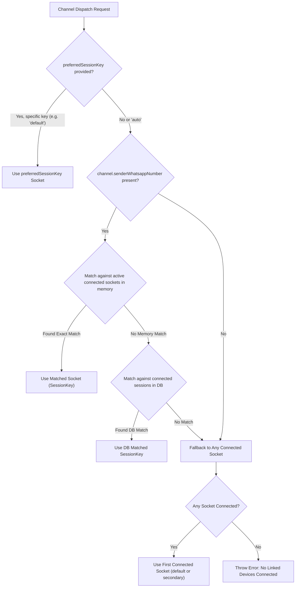
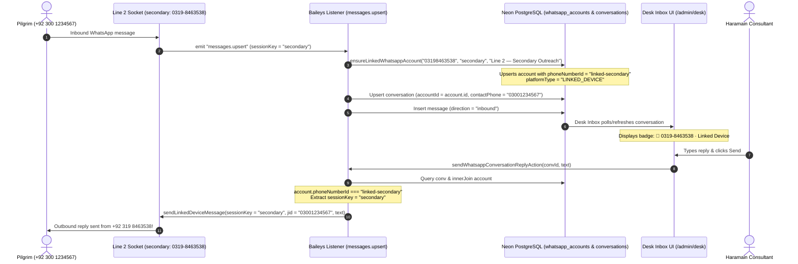

# 0022. Multi-Number WhatsApp System: Multi-Session Linked-Device Architecture, Per-Line Attribution, Hub UI Controls & Bi-Directional Routing

**Date**: 2026-11-09  
**Status**: Accepted (Implemented)

---

## Summary

This specification defines **Slice 41 (Feature #45)**: the **Multi-Number WhatsApp System** for Al Ramlah Travels. Expanding upon the single-session native Linked-Device foundation established in `Spec 0021` and the enterprise Meta WhatsApp Cloud API v21.0 infrastructure (`Specs 0009, 0013, 0017, 0019`), this feature transforms Al Ramlah Travels into an omnichannel multi-SIM telecommunications hub capable of operating multiple concurrent physical phone lines alongside official Meta Cloud API WABA numbers.

In high-volume Umrah operations across Pakistan, agencies maintain distinct physical SIMs dedicated to specialized business functions:
- **Line 1 — Primary Business (`0321-4629700`)**: The principal Haramain booking desk, handling executive customer inquiries, primary status announcements, and VIP community groups across Askari 10 and DHA Lahore.
- **Line 2 — Secondary Outreach (`0319-8463538`)**: High-cadence B2B sub-agent coordination, regional community broadcast distribution, and cold/warm pilgrim lead re-engagement.
- **Line 3+ — Specialized Consultant / Seasonal Lines**: Event-specific SIMs deployed during peak Ramadan or Hajj seasons.

To eliminate the single-device bottleneck, prevent database collisions, and give agency staff complete clarity and control over their communication channels, this slice delivers:

1. **Multi-Session Linked-Device Engine & Auto-Bootstrapping (`web/lib/whatsapp/linked-device.ts`)**:
   - Manages an in-memory registry of multiple active Baileys WebSocket singletons (`Map<string, WASocket>`) persisted in Neon PostgreSQL via `whatsappLinkedDeviceSessions`.
   - Automatically bootstraps two standard agency slots on first access:
     - `sessionKey = "default"` labeled `"Line 1 — Primary Business (0321-4629700)"`
     - `sessionKey = "secondary"` labeled `"Line 2 — Secondary Outreach (0319-8463538)"`
   - Exposes slot lifecycle operations: listing all sessions, creating custom slots (`sessionKey` + `label`), updating labels, and safely deleting non-default slots.
   - Provides a 1-click **"Sync All Connected Lines"** server action that iterates every connected session to discover and synchronize groups across all active SIMs concurrently.
2. **Per-Number WhatsApp Status & Group Attribution (`marketing_channels`)**:
   - Eliminates database unique-index collisions by isolating each phone's WhatsApp Status story handle as `externalGroupIdOrHandle = "status@broadcast:${sessionKey}"` (e.g. `status@broadcast:default`, `status@broadcast:secondary`), with `senderWhatsappNumber` tagged to that phone.
   - Transparently normalizes outgoing JIDs starting with `"status@broadcast"` back to `"status@broadcast"` when invoking Baileys `sock.sendMessage`.
   - Tags every synchronized WhatsApp Group (`@g.us`) with the discovering phone's `senderWhatsappNumber`.
   - Implements `resolveLinkedDeviceSessionForChannel(channelSenderPhone, preferredSessionKey)` to dynamically select the correct connected socket when dispatching automated campaigns.
3. **Per-Number 1-on-1 Chat Account Mapping & Bi-Directional Outbound Routing (`whatsapp_accounts`)**:
   - Upgrades `ensureLinkedWhatsappAccount` to maintain a 1:1 mapping between each Linked-Device `sessionKey` and a dedicated `whatsapp_accounts` record (`phoneNumberId = "linked-" + sessionKey`, `platformType = "LINKED_DEVICE"`).
   - Ingests incoming 1-on-1 chats directly under their owning phone's account record, guaranteeing chat history isolation.
   - Upgrades `sendWhatsappConversationReplyAction` in `web/app/actions/whatsapp-crm.ts` to inspect the conversation's account `platformType` and `phoneNumberId`, routing outbound replies and 24h-window-bypassing flyers through the exact physical SIM socket that owns the thread.
4. **Multi-Number Linked-Device Switcher Card (`web/components/admin/whatsapp/whatsapp-linked-device-card.tsx`)**:
   - Features a luxury **Phone Line Switcher Bar** displaying all available slots with real-time status indicator dots (`emerald` for connected, `amber` for QR/Pairing ready, `slate` for disconnected), phone number badges, and synced group counters.
   - Includes a **`+ Add WhatsApp Line`** modal to register new slots and a **"Sync All Connected Lines"** button.
   - Allows independent pairing via Live Dynamic QR Code or 8-Digit Pairing Code per slot.
5. **Multi-Number Campaigns Hub Controls (`/admin/campaigns?tab=whatsapp` & Tab 3 Broadcasts)**:
   - **Phone Line Filter Pills** (`All Lines`, `📱 0321-4629700`, `📱 0319-8463538`) to instantly filter the group and status queue by phone number.
   - **Phone Line Badges** rendered on every group and status card to show exactly which SIM line belongs to the group.
   - **Sender Line Routing Selector** in the Auto-Post Execution Bar: `Auto-Match Group's Phone Line (Recommended)` or override with a specific connected line.
   - **Sender Account Selector** in the Tab 3 Official Meta Broadcast Drawer (`whatsapp-broadcast-drawer.tsx`).
6. **Multi-Number Shared Team Inbox (`/admin/desk?tab=inbox`)**:
   - **Phone Line Filter Pills** in the conversation sidebar with real-time conversation count badges per number.
   - **Phone Line Attribution Badges** on every conversation item (`📱 0321-4629700 · Linked Device` vs `☁️ +92 319 0462638 · Meta Cloud API`) and in the active chat header, guaranteeing consultants know immediately which number the pilgrim contacted.
   - Automatic routing of direct replies to the correct physical SIM socket or Meta Cloud API.

---

## Context

In `Spec 0021 (Slice 40)`, Al Ramlah Travels successfully built the native Baileys Linked-Device engine, allowing the agency to pair a single WhatsApp mobile device, auto-discover participating community groups, and bypass Meta Cloud API's 24-hour customer service window for direct pilgrim replies.

However, operational deployment on the Askari 10 Haramain desk revealed four critical architectural limitations in a single-session model:

1. **The Multi-SIM Operational Reality**:
   - Al Ramlah Travels does not rely on a single mobile number. The agency maintains two primary physical SIM cards in Lahore:
     - **Line 1 (`0321-4629700`)**: The executive desk number, joined to elite housing society and welfare groups (e.g. Askari 10, DHA Phase 5, Cantt Club) where the managing director and chief consultants interact.
     - **Line 2 (`0319-8463538`)**: The marketing and B2B coordination line, joined to hundreds of sub-agent and regional travel forums across Punjab.
   - In `Spec 0021`, the database session key was hardcoded to `"default"`. Linking a second device would overwrite the first device's signal keys in PostgreSQL, instantly disconnecting Line 1.
2. **WhatsApp Status Unique-Index Collision**:
   - In `marketing_channels`, `externalGroupIdOrHandle` carries a database `UNIQUE` index constraint (`idx_channel_external_id`).
   - `Spec 0021` inserted the WhatsApp Status story record with a static handle `externalGroupIdOrHandle = "status@broadcast"`. If two devices attempted to synchronize their status lines, the second device's sync operation would crash with a PostgreSQL unique constraint violation or silently overwrite Line 1's status row.
3. **Chat Attribution Ambiguity in Shared Inbox**:
   - In `/admin/desk?tab=inbox`, all 1-on-1 inbound chats synced from Baileys were attached to a generic account created with `phoneNumberId = "linked-" + Date.now()`.
   - When multiple consultants responded to incoming inquiries, staff had no visual indicator indicating whether the pilgrim had messaged Line 1 or Line 2. Furthermore, all outbound replies were dispatched blindly through `socketMap.get("default")`, resulting in failures or messages sent from the wrong telephone number.
4. **Group Campaign Misrouting**:
   - In `/admin/campaigns?tab=whatsapp`, the automated campaign dispatcher passed a static `sessionKey = "default"`. If an admin selected 20 groups joined by Line 1 and 15 groups joined by Line 2, the runner would attempt to dispatch all 35 messages through Line 1. Because Line 1 was not a participant in Line 2's groups, the messages would fail with `403 Forbidden` or `not-authorized` errors from WhatsApp servers.

Spec 0022 resolves these challenges by introducing a unified, multi-session, multi-line routing architecture.

---

## Requirements

### User Stories

- **As an agency director**, I want to link both of our official agency SIMs (`0321-4629700` and `0319-8463538`) to the admin dashboard at the same time, so that our team can manage community groups, status broadcasts, and pilgrim conversations from both numbers without logging out.
- **As a marketing specialist**, I want to filter the WhatsApp Groups queue by phone line (`Line 1` vs `Line 2`), so that I can audit which communities each phone participates in and ensure comprehensive coverage across Lahore.
- **As a campaign dispatcher**, when launching an automated flyer campaign across selected groups belonging to different phone numbers, I want the system to automatically route each post through the specific phone line that joined that group, so that posts never fail due to non-membership.
- **As a Haramain desk consultant**, when viewing pilgrim conversations in `/admin/desk?tab=inbox`, I want to see a clear badge showing which phone line the pilgrim messaged (`Line 1 Linked Device`, `Line 2 Linked Device`, or `Meta Cloud API`), and I want my replies to automatically send from that exact line.
- **As a system administrator**, I want to create additional labeled phone slots or delete temporary slots from the UI, with 1-click synchronization across all connected lines.

### Acceptance Criteria

- **AC-1 (Multi-Session Database Bootstrapping & Lifecycle Actions)**:
  - `listLinkedDeviceSessionsAction()` checks `whatsappLinkedDeviceSessions`. If empty, it automatically bootstraps two default slots:
    - Slot 1: `sessionKey: "default"`, `label: "Line 1 — Primary Business (0321-4629700)"`, `status: "disconnected"`
    - Slot 2: `sessionKey: "secondary"`, `label: "Line 2 — Secondary Outreach (0319-8463538)"`, `status: "disconnected"`
  - Server actions exported from `web/app/actions/whatsapp-linked-device.ts`:
    - `listLinkedDeviceSessionsAction()`: Returns all session slots ordered by creation date.
    - `createLinkedDeviceSessionSlotAction({ label: string, sessionKey?: string })`: Creates a new custom session slot.
    - `updateLinkedDeviceSessionSlotAction({ sessionKey: string, label: string })`: Updates the display label of a session slot.
    - `deleteLinkedDeviceSessionSlotAction({ sessionKey: string })`: Unlinks and deletes a custom session slot; rejects deletion of `"default"` and `"secondary"` slots.
    - `syncAllConnectedLinkedDevicesAction()`: Iterates all connected sessions in parallel or sequence, executes `syncRealWhatsappGroups(sessionKey)`, and returns a combined summary.
- **AC-2 (Per-Number WhatsApp Status & Group Channel Attribution)**:
  - In `syncRealWhatsappGroups(sessionKey: string)`:
    - Upserts the WhatsApp Status line with `externalGroupIdOrHandle: "status@broadcast:${sessionKey}"` and `senderWhatsappNumber: connectedPhone`, ensuring distinct database rows in `marketing_channels` without index collision.
    - For all participating `@g.us` groups, sets `senderWhatsappNumber: connectedPhone`.
  - In `sendLinkedDeviceMessage` and `sendLinkedDeviceGroupOrStatusPost`:
    - Normalizes any JID matching `^status@broadcast(:.*)?$` to `"status@broadcast"` before calling `sock.sendMessage`.
  - Implements `resolveLinkedDeviceSessionForChannel(channelSenderPhone?: string | null, preferredSessionKey?: string)`:
    - If `preferredSessionKey` is provided and not `"auto"`, returns `preferredSessionKey`.
    - If `preferredSessionKey === "auto"` or omitted: matches `channelSenderPhone` against the `phoneNumber` of all connected sessions in memory or database; falls back to the first available connected session if no exact match is found.
- **AC-3 (Per-Number 1-on-1 Chat Account Mapping & Bi-Directional Outbound Routing)**:
  - In `web/lib/whatsapp/linked-device.ts`, updates `ensureLinkedWhatsappAccount(sessionPhone?: string | null, sessionKey = "default", sessionLabel?: string)`:
    - Upserts/finds a distinct `whatsapp_accounts` row where `phoneNumberId = "linked-" + sessionKey`.
    - Sets `platformType: "LINKED_DEVICE"`, `name: sessionLabel || "Linked Device (" + sessionPhone + ")"`, and `displayPhoneNumber: sessionPhone`.
  - In `messages.upsert` listener in `initBaileysSocket`:
    - Uses `ensureLinkedWhatsappAccount(connectedPhone, sessionKey, session.label)` so that inbound messages from that socket are attached directly to that session's account ID.
  - In `sendWhatsappConversationReplyAction` (`web/app/actions/whatsapp-crm.ts`):
    - When replying to a conversation whose `account.platformType === "LINKED_DEVICE"` or when bypassing the 24h window:
    - Extracts `targetSessionKey = account.phoneNumberId.replace(/^linked-/, "")`.
    - Dispatches the message via `sendLinkedDeviceMessage({ sessionKey: targetSessionKey, ... })`. If that socket is not connected, gracefully falls back to any active connected linked-device socket.
- **AC-4 (Multi-Line Baileys In-Memory Socket Registry)**:
  - `socketMap` (`globalThis.__baileysLinkedDeviceSockets`) stores multiple `WASocket` instances keyed by `sessionKey`.
  - `getActiveBaileysSocket(sessionKey)` and `isLinkedDeviceConnected(sessionKey)` accurately inspect the specific session socket.
  - Adding, connecting, or disconnecting one socket does not impact or restart the WebSocket connections of other sessions.
- **AC-5 (Multi-Number Linked-Device Switcher UI — `WhatsappLinkedDeviceCard`)**:
  - `web/components/admin/whatsapp/whatsapp-linked-device-card.tsx` renders a **Phone Line Switcher Bar**:
    - Horizontal slot tabs with status dots: `emerald` (connected), `amber` (pairing/qr ready), `slate` (disconnected).
    - Phone number badge (e.g. `0321-4629700`) and synced group count (`28 Groups`).
    - **`+ Add WhatsApp Line`** button that opens a dialog to define a new line label and optional key.
    - **"Sync All Connected Lines"** button that triggers `syncAllConnectedLinkedDevicesAction`.
    - Trash icon to delete non-default slots (with confirmation).
  - Selected slot tab displays its specific QR Code or 8-Digit Pairing Code interface, live connection badges, phone number, and disconnect controls.
- **AC-6 (Multi-Number Campaigns Hub — Tab 2 Groups & Status Queue)**:
  - In `web/components/admin/hubs/campaigns-hub-client.tsx` (Tab 2: WhatsApp Groups & Status Queue):
    - Adds a **Connected Phone Line Filter** pill bar above the channel grid:
      - `All Lines (X)`
      - `📱 Line 1: 0321-4629700 (Y)`
      - `📱 Line 2: 0319-8463538 (Z)`
    - Displays a prominent **Phone Line Badge** (`📱 0321-4629700` / `📱 0319-8463538`) on every group card and status card.
    - In the **Auto-Post Execution Bar**, introduces a **Sender Line Routing Selector**:
      - `Auto-Match Group's Phone Line (Recommended)` (`sessionKey: "auto"`)
      - `Force via Line 1 (0321-4629700)` (`sessionKey: "default"`)
      - `Force via Line 2 (0319-8463538)` (`sessionKey: "secondary"`)
- **AC-7 (Multi-Account Official Meta Broadcasts — Tab 3 Broadcasts & Drawer)**:
  - In `web/components/admin/campaigns/whatsapp-broadcast-drawer.tsx` and Tab 3 launch card:
    - Provides a dropdown selector for `accountId` populated with all active `whatsapp_accounts` (e.g. Official Meta Cloud WABA lines), defaulting to the active default account.
- **AC-8 (Multi-Number Shared Team Inbox — `/admin/desk?tab=inbox`)**:
  - `web/app/admin/(dashboard)/desk/page.tsx` includes `platformType` in the `whatsappConversations.account` query and passes the full list of `whatsappAccounts` to `DeskHubClient`.
  - In `web/components/admin/hubs/desk-hub-client.tsx`:
    - Adds a **Phone Line Filter Bar** at the top of the Pilgrim Conversations sidebar:
      - `All Lines`
      - `📱 0321-4629700`
      - `📱 0319-8463538`
      - `☁️ Meta Cloud API`
    - Displays a **Phone Line Badge** on each conversation item card (`📱 0321-4629700 · Linked` or `☁️ +92 319 0462638 · Cloud API`).
    - Displays a full **Phone Line Badge & Role Indicator** in the active chat header above the message thread.
    - When replying, dispatches through that conversation's specific owning account.
- **AC-9 (Durable Trigger.dev Paced Group Dispatcher Multi-Session Routing)**:
  - In `web/trigger/send-whatsapp-group-campaign.task.ts`:
    - Accepts `sessionKey: z.string().default("auto")`.
    - In the dispatch loop, evaluates `effectiveSessionKey = await resolveLinkedDeviceSessionForChannel(ch.senderWhatsappNumber, sessionKey)`.
    - Dispatches `sendLinkedDeviceGroupOrStatusPost({ sessionKey: effectiveSessionKey, jid: targetJid, ... })`.
    - Logs `senderWhatsappLine: ch.senderWhatsappNumber` into `dailyPostDistributions`.
- **AC-10 (Comprehensive Test Suite)**:
  - Tests in `web/tests/whatsapp-multi-number-system.test.ts` verify:
    - Auto-bootstrapping logic creates default and secondary slots if table is empty.
    - Slot creation, updating, and deletion guards (cannot delete `"default"` or `"secondary"`).
    - Status JID normalization: `status@broadcast:secondary` -> `status@broadcast`.
    - Dynamic session resolution (`resolveLinkedDeviceSessionForChannel` with exact match, fallback, and explicit override).
    - Inbound chat account mapping (`ensureLinkedWhatsappAccount`).
    - Zod validation schemas for all new action inputs.

---

## Options Considered

### Option 1: Multi-Tab Isolated Single-Session (Manual Hot-Swapping)

Maintain a single `whatsappLinkedDeviceSessions` record and require consultants to unlink and re-link whenever switching between Line 1 and Line 2.

- **Pros**: Zero database schema changes; no need for multi-socket memory management.
- **Cons**: Completely unusable in production. Unlinking deletes encryption keys, requiring physical SIM owners to scan QR codes multiple times a day. Group lists would be wiped or orphaned on every switch. Concurrent operations are impossible.

### Option 2: Split Tables per Channel (`whatsapp_sessions_line1`, `whatsapp_sessions_line2`)

Create separate static tables for each phone number.

- **Pros**: Explicit isolation between tables.
- **Cons**: Rigid and unmaintainable. Adding a third line requires database migrations, duplicate schema definitions, and repetitive server actions. Violates clean relational design principles.

### Option 3 (Chosen): Unified Multi-Session Registry with Dynamic Slot Management, JID Isolation & Per-Channel Auto-Routing

Maintain all sessions inside the existing `whatsappLinkedDeviceSessions` table keyed by a unique `sessionKey` (`"default"`, `"secondary"`, `"custom_N"`). Manage an in-memory `Map<string, WASocket>` in Node.js. Isolate WhatsApp Status stories using composite identifiers (`status@broadcast:${sessionKey}`) and dynamically resolve the dispatch socket based on the channel's `senderWhatsappNumber`.

- **Pros**:
  - **Infinite Extensibility**: Supports 2, 5, or 10 phone lines without database migrations.
  - **Zero Key Collisions**: Each session maintains its own AES-256-GCM encrypted Baileys credentials and signal keys in PostgreSQL.
  - **Transparent Routing**: Marketers don't have to remember which phone joined which group; the system auto-matches channels to their discovering SIM.
  - **Unified Inbox & Campaign UI**: Staff view all lines in a single pane of glass with intuitive line filters and badges.

---

## Decision

**Chosen Option**: Option 3 — Unified Multi-Session Registry with Dynamic Slot Management, JID Isolation, and Per-Channel Auto-Routing.

---

## Architecture and Technical Design

### 1. Component and Directory Structure

```text
web/
├── db/
│   └── schema/
│       ├── whatsapp-crm.ts                    # AC-1, AC-3: whatsappLinkedDeviceSessions & whatsappAccounts schemas
│       └── suppliers-and-marketing.ts         # AC-2: marketingChannels (status@broadcast:${sessionKey}) & distributions
├── lib/
│   ├── validations/
│   │   └── whatsapp-linked-device.ts          # AC-1, AC-9: Zod schemas for slot management & multi-line campaign dispatch
│   └── whatsapp/
│       ├── linked-device.ts                   # AC-1..4: Multi-session registry, bootstrap, JID normalization, routing helper
│       ├── linked-device-auth-postgres.ts     # Baileys auth state adapter for specific sessionKey
│       └── crm.ts                             # Account & conversation helpers
├── trigger/
│   └── send-whatsapp-group-campaign.task.ts   # AC-9: Multi-session dynamic channel router & paced group dispatcher
├── app/
│   ├── actions/
│   │   ├── whatsapp-linked-device.ts          # AC-1: listSessions, createSlot, updateSlot, deleteSlot, syncAll, dispatch
│   │   └── whatsapp-crm.ts                    # AC-3, AC-8: Bi-directional reply routing via sessionKey
│   └── admin/
│       └── (dashboard)/
│           └── desk/
│               └── page.tsx                   # AC-8: Include account platformType and pass whatsappAccounts to DeskHubClient
├── components/
│   └── admin/
│       ├── whatsapp/
│       │   └── whatsapp-linked-device-card.tsx# AC-5: Multi-Number Switcher Bar, slot manager dialog, sync all lines
│       ├── campaigns/
│       │   └── whatsapp-broadcast-drawer.tsx  # AC-7: Sender WABA Account selector dropdown
│       └── hubs/
│           ├── campaigns-hub-client.tsx       # AC-6: Tab 2 Line Filter pills, line badges, sender routing selector
│           └── desk-hub-client.tsx            # AC-8: Tab 1 Pilgrim Inbox Line Filter, badges, header line indicator
└── tests/
    └── whatsapp-multi-number-system.test.ts   # AC-10: Multi-session bootstrapping, JID normalization, routing resolution tests
```

---

### 2. Multi-Session Database Schema & Bootstrapping

The `whatsappLinkedDeviceSessions` table in `web/db/schema/whatsapp-crm.ts` already features a `sessionKey` unique column:

```typescript
export const whatsappLinkedDeviceSessions = pgTable(
  "whatsapp_linked_device_sessions",
  {
    id: uuid("id").primaryKey().defaultRandom(),
    sessionKey: varchar("session_key", { length: 64 })
      .notNull()
      .default("default")
      .unique(),
    label: text("label").notNull().default("Primary Business WhatsApp"),
    phoneNumber: varchar("phone_number", { length: 32 }),
    pushName: text("push_name"),
    status: whatsappLinkedDeviceStatusEnum("status")
      .notNull()
      .default("disconnected"),
    qrDataUrl: text("qr_data_url"),
    pairingCode: varchar("pairing_code", { length: 16 }),
    encryptedAuthCreds: text("encrypted_auth_creds"),
    encryptedAuthKeys: text("encrypted_auth_keys"),
    groupsSyncedCount: integer("groups_synced_count").notNull().default(0),
    lastError: text("last_error"),
    lastConnectedAt: timestamp("last_connected_at", { withTimezone: true }),
    lastSyncedAt: timestamp("last_synced_at", { withTimezone: true }),
    createdAt: timestamp("created_at", { withTimezone: true }).notNull().defaultNow(),
    updatedAt: timestamp("updated_at", { withTimezone: true }).notNull().defaultNow(),
  }
)
```

#### Automatic Default Bootstrapping Logic (`getAllLinkedDeviceSessions`)

When `getAllLinkedDeviceSessions()` or `listLinkedDeviceSessionsAction()` is called, if the query returns 0 rows, the system automatically inserts the two pre-configured agency slots:

```typescript
export const DEFAULT_LINKED_DEVICE_SLOTS = [
  {
    sessionKey: "default",
    label: "Line 1 — Primary Business (0321-4629700)",
  },
  {
    sessionKey: "secondary",
    label: "Line 2 — Secondary Outreach (0319-8463538)",
  },
] as const

export async function getAllLinkedDeviceSessions(): Promise<WhatsappLinkedDeviceSession[]> {
  let sessions = await db
    .select()
    .from(whatsappLinkedDeviceSessions)
    .orderBy(asc(whatsappLinkedDeviceSessions.createdAt))

  if (sessions.length === 0) {
    // Bootstrap standard agency slots
    for (const slot of DEFAULT_LINKED_DEVICE_SLOTS) {
      await db
        .insert(whatsappLinkedDeviceSessions)
        .values({
          sessionKey: slot.sessionKey,
          label: slot.label,
          status: "disconnected",
        })
        .onConflictDoNothing()
    }

    sessions = await db
      .select()
      .from(whatsappLinkedDeviceSessions)
      .orderBy(asc(whatsappLinkedDeviceSessions.createdAt))
  }

  return sessions
}
```

---

### 3. Per-Number Status JID Isolation & Group Attribution

#### The Unique Constraint Challenge
`marketing_channels.externalGroupIdOrHandle` carries a `UNIQUE` index in Neon PostgreSQL:
```sql
CREATE UNIQUE INDEX "idx_channel_external_id" ON "marketing_channels" ("external_group_id_or_handle");
```

In `Spec 0021`, status was inserted as `"status@broadcast"`. When two phone lines sync, they cannot both use `"status@broadcast"`.

#### The Solution: Session-Scoped Handle & In-Flight JID Normalization

1. **Upsert with Composite Handle**:
   In `syncRealWhatsappGroups(sessionKey: string)`:
   ```typescript
   const statusHandle = `status@broadcast:${sessionKey}`
   const phoneLabel = connectedPhone || sessionKey
   const statusCardName = `WhatsApp Status — ${session?.label || phoneLabel}`

   await db
     .insert(marketingChannels)
     .values({
       name: statusCardName,
       platform: "whatsapp_status",
       areaTag: "WhatsApp Status",
       externalGroupIdOrHandle: statusHandle,
       senderWhatsappNumber: connectedPhone,
       isActive: true,
       dailyTargetPosts: 1,
     })
     .onConflictDoUpdate({
       target: marketingChannels.externalGroupIdOrHandle,
       set: {
         name: statusCardName,
         senderWhatsappNumber: connectedPhone,
         isActive: true,
       },
     })
   ```

2. **JID Normalization Before Dispatch**:
   When Baileys receives a request to send a message to a JID, it expects literal `"status@broadcast"` for status broadcasts. In `sendLinkedDeviceMessage`:
   ```typescript
   let targetJid = options.jid.trim()
   if (targetJid.startsWith("status@broadcast")) {
     targetJid = "status@broadcast"
   } else if (!targetJid.includes("@")) {
     const digits = targetJid.replace(/\D/g, "")
     targetJid = `${digits}@s.whatsapp.net`
   }
   ```

3. **Group Channel Tagging**:
   Every participating `@g.us` group discovered by `sock.groupFetchAllParticipating()` records:
   - `senderWhatsappNumber = connectedPhone` (the E.164 phone number of that session).
   - This explicitly links the group to the phone line that joined it.

---

### 4. Dynamic Channel Routing Engine (`resolveLinkedDeviceSessionForChannel`)

When an automated campaign or direct message is dispatched across selected channels, the engine must determine which physical SIM socket to use:



#### Implementation Code:

```typescript
/**
 * Resolves the optimal active Baileys sessionKey to dispatch a message to a given channel.
 * If preferredSessionKey is specified and not "auto", it honors the preference.
 * Otherwise, it attempts to match the channel's sender phone number to a connected session.
 */
export async function resolveLinkedDeviceSessionForChannel(
  channelSenderPhone?: string | null,
  preferredSessionKey?: string
): Promise<string> {
  if (preferredSessionKey && preferredSessionKey !== "auto") {
    return preferredSessionKey
  }

  const cleanChannelPhone = channelSenderPhone
    ? channelSenderPhone.replace(/\D/g, "")
    : null

  // 1. Check in-memory active sockets for an exact phone match
  if (cleanChannelPhone) {
    for (const [key, sock] of socketMap.entries()) {
      const sockUserPhone = sock.user?.id ? sock.user.id.split(":")[0]?.split("@")[0] : null
      if (sockUserPhone && sockUserPhone.replace(/\D/g, "") === cleanChannelPhone) {
        return key
      }
    }
  }

  // 2. Check DB sessions for an exact phone match where status is connected
  if (cleanChannelPhone) {
    const dbSessions = await db
      .select()
      .from(whatsappLinkedDeviceSessions)
      .where(eq(whatsappLinkedDeviceSessions.status, "connected"))

    for (const s of dbSessions) {
      if (s.phoneNumber && s.phoneNumber.replace(/\D/g, "") === cleanChannelPhone) {
        return s.sessionKey
      }
    }
  }

  // 3. Fallback: Return any currently connected in-memory socket
  for (const [key, sock] of socketMap.entries()) {
    if (sock.user?.id) {
      return key
    }
  }

  // 4. Ultimate Fallback: Return "default"
  return "default"
}
```

---

### 5. Per-Number 1-on-1 Chat Account Mapping & Reply Routing

To guarantee that 1-on-1 chats in `/admin/desk?tab=inbox` retain their line identity, each Linked-Device `sessionKey` receives its own distinct `whatsapp_accounts` row:



#### Detailed Account Mapping Implementation:

```typescript
/**
 * Ensures each Linked-Device sessionKey maps to its own distinct whatsapp_accounts row
 * with phoneNumberId = "linked-" + sessionKey.
 */
export async function ensureLinkedWhatsappAccount(
  sessionPhone?: string | null,
  sessionKey = "default",
  sessionLabel?: string
) {
  const linkedPhoneNumberId = `linked-${sessionKey}`
  const cleanPhone = sessionPhone || (sessionKey === "secondary" ? "03198463538" : "03214629700")
  const accountName = sessionLabel || `Linked Device (${cleanPhone})`

  const [existing] = await db
    .select()
    .from(whatsappAccounts)
    .where(eq(whatsappAccounts.phoneNumberId, linkedPhoneNumberId))
    .limit(1)

  if (existing) {
    if (sessionPhone && existing.displayPhoneNumber !== sessionPhone) {
      await db
        .update(whatsappAccounts)
        .set({
          displayPhoneNumber: sessionPhone,
          name: accountName,
          isActive: true,
          updatedAt: new Date(),
        })
        .where(eq(whatsappAccounts.id, existing.id))
    }
    return existing
  }

  const [newAccount] = await db
    .insert(whatsappAccounts)
    .values({
      name: accountName,
      phoneNumberId: linkedPhoneNumberId,
      wabaId: `linked-waba-${sessionKey}`,
      displayPhoneNumber: cleanPhone,
      encryptedAccessToken: encrypt(`linked_device_${sessionKey}_mode`),
      webhookVerifyToken: `linked_device_${sessionKey}_token`,
      isActive: true,
      isDefault: sessionKey === "default",
      accountRole: "COEXISTENCE_FOUNDER",
      platformType: "LINKED_DEVICE",
    })
    .returning()

  return newAccount
}
```

---

### 6. Server Actions & Validation Schemas API Contract

#### A. Zod Validation Schemas (`web/lib/validations/whatsapp-linked-device.ts`)

```typescript
export const createLinkedDeviceSessionSlotSchema = z.object({
  label: z.string().min(2, "Label must be at least 2 characters").max(100),
  sessionKey: z
    .string()
    .min(2)
    .max(64)
    .regex(/^[a-z0-9_-]+$/, "Session key can only contain lowercase letters, numbers, hyphens, and underscores")
    .optional(),
})

export const updateLinkedDeviceSessionSlotSchema = z.object({
  sessionKey: z.string().min(1),
  label: z.string().min(2).max(100),
})

export const deleteLinkedDeviceSessionSlotSchema = z.object({
  sessionKey: z.string().min(1),
})

export const dispatchAutomatedWhatsappGroupsCampaignSchema = z.object({
  postAssetId: z.string().uuid("Invalid Post Asset ID"),
  caption: z.string().min(1, "Caption cannot be empty"),
  channelIds: z.array(z.string().uuid()).min(1, "Select at least 1 WhatsApp channel"),
  pacingTier: z.enum(["fast", "safe", "ultra_safe"]).default("safe"),
  minDelaySec: z.number().int().min(1).max(300).optional(),
  maxDelaySec: z.number().int().min(1).max(600).optional(),
  sessionKey: z.string().default("auto"), // "auto" or specific sessionKey
})
```

#### B. Server Actions Contract (`web/app/actions/whatsapp-linked-device.ts`)

```typescript
/**
 * Lists all registered Linked-Device slots, bootstrapping default & secondary if empty.
 */
export async function listLinkedDeviceSessionsAction(): Promise<{
  success: boolean
  sessions: SafeLinkedDeviceSession[]
  error?: string
}>

/**
 * Creates a new custom Linked-Device slot.
 */
export async function createLinkedDeviceSessionSlotAction(rawInput: unknown): Promise<{
  success: boolean
  session?: SafeLinkedDeviceSession
  error?: string
}>

/**
 * Updates the display label of a session slot.
 */
export async function updateLinkedDeviceSessionSlotAction(rawInput: unknown): Promise<{
  success: boolean
  error?: string
}>

/**
 * Disconnects and permanently deletes a custom session slot.
 * Rejects deletion of "default" and "secondary".
 */
export async function deleteLinkedDeviceSessionSlotAction(rawInput: unknown): Promise<{
  success: boolean
  error?: string
}>

/**
 * Iterates all connected sessions and executes syncRealWhatsappGroups in 1 click.
 */
export async function syncAllConnectedLinkedDevicesAction(): Promise<{
  success: boolean
  totalSyncedGroups: number
  connectedLinesCount: number
  results: Array<{ sessionKey: string; label: string; syncedCount: number; error?: string }>
  error?: string
}>
```

---

### 7. User Interface Specifications

#### A. Multi-Number Linked-Device Card (`web/components/admin/whatsapp/whatsapp-linked-device-card.tsx`)

The card is updated to manage multiple phone lines via a top slot switcher:

1. **Top Phone Line Switcher Bar**:
   - Renders a horizontal flex/grid bar showing all slots (e.g. `Line 1 — Primary Business`, `Line 2 — Secondary Outreach`).
   - Each slot item displays:
     - Live Status Indicator Dot: `emerald` (connected), `amber` (QR / pairing code ready), `slate` (disconnected).
     - Slot Label & Phone Number Badge (e.g. `0321-4629700`).
     - Synced Groups Badge (e.g. `34 Groups`).
   - Actions in Switcher Bar:
     - **`[ + Add WhatsApp Line ]`**: Opens a clean dialog to input slot label and optional custom key.
     - **`[ 🔄 Sync All Lines ]`**: Executes `syncAllConnectedLinkedDevicesAction()` with spinning loader.
2. **Active Slot Control Panel**:
   - For the selected slot, displays its current status banner, QR Code scan tab, 8-Digit Pairing Code tab, single-line group sync button, and disconnect button.
   - For custom slots (excluding `"default"` and `"secondary"`), renders a **"Delete Slot"** button with a confirmation prompt.

```text
+---------------------------------------------------------------------------------------------------+
|  [📱 Line 1 — Primary Business (0321-4629700) 🟢 34 Groups]  [📱 Line 2 — Outreach ⚪ Disconnected] | [+ Add Line] [🔄 Sync All] |
+---------------------------------------------------------------------------------------------------+
|  Active Line: Line 1 — Primary Business (0321-4629700)  [Connected]                               |
|  Logged in as: 923214629700@s.whatsapp.net (Al Ramlah Travels Desk)                              |
|  [ 🔄 Sync Line 1 Groups ]    [ 🔌 Disconnect Line 1 ]                                            |
+---------------------------------------------------------------------------------------------------+
```

#### B. Multi-Number Campaigns Hub (`/admin/campaigns?tab=whatsapp` & Tab 3 Broadcasts)

1. **Tab 2: WhatsApp Groups & Status Queue (`campaigns-hub-client.tsx`)**:
   - **Connected Phone Line Filter Pills**:
     Located above the channel matrix:
     `[ All Lines (42) ]` `[ 📱 Line 1: 0321-4629700 (28) ]` `[ 📱 Line 2: 0319-8463538 (14) ]`
     Clicking a pill filters the displayed groups and status lines to only those synchronized by that specific phone.
   - **Per-Card Phone Line Badge**:
     Each group card and status card renders an emerald/gold badge showing:
     `📱 0321-4629700` or `📱 0319-8463538`.
   - **Sender Line Routing Selector (Auto-Post Bar)**:
     In the automated group dispatcher section, a select input allows the marketer to choose:
     - `Auto-Match Group's Phone Line (Recommended)` (`sessionKey = "auto"`)
     - `Force via Line 1 (0321-4629700)` (`sessionKey = "default"`)
     - `Force via Line 2 (0319-8463538)` (`sessionKey = "secondary"`)
2. **Tab 3: Official Meta Broadcasts (`whatsapp-broadcast-drawer.tsx` & Tab 3)**:
   - Includes a **"Dispatching WABA Line"** dropdown displaying all active `whatsapp_accounts` (`CLOUD_API`), allowing the admin to select which verified Meta phone number sends the broadcast.

#### C. Multi-Number Shared Team Inbox (`/admin/desk?tab=inbox`)

1. **Server Component Enhancement (`app/admin/(dashboard)/desk/page.tsx`)**:
   - The query for `whatsappConversations.account` includes `platformType`.
   - Passes `whatsappAccounts` array into `DeskHubClient`.
2. **Client Component Enhancements (`desk-hub-client.tsx`)**:
   - **Phone Line Filter Pills** at the top of the conversation list:
     - `All Lines (Total Count)`
     - `📱 0321-4629700 (Count)`
     - `📱 0319-8463538 (Count)`
     - `☁️ Meta Cloud API (Count)`
   - **Line Badges on Conversation Cards**:
     - `📱 0321-4629700 · Linked Device` (Emerald border badge)
     - `☁️ +92 319 0462638 · Cloud API` (Blue border badge)
   - **Active Chat Header**:
     - Renders a prominent badge next to the pilgrim's name and status:
       `[ 📱 Line 1: 0321-4629700 · Linked Device SIM ]`
   - **Direct Reply Dispatch**:
     - Replies route through `sendWhatsappConversationReplyAction`, which automatically detects the conversation's account `phoneNumberId` and dispatches via that exact socket.

---

### 8. Durable Trigger.dev Paced Group Dispatcher (`send-whatsapp-group-campaign.task.ts`)

The background task is updated to handle multi-line routing per channel:

```typescript
// Inside the sequential loop in runSendWhatsappGroupCampaign:
for (let i = 0; i < targetChannels.length; i++) {
  const ch = targetChannels[i]!
  
  // Resolve the exact socket to use for this specific channel
  const channelSessionKey = await resolveLinkedDeviceSessionForChannel(
    ch.senderWhatsappNumber,
    sessionKey
  )

  const targetJid =
    ch.externalGroupIdOrHandle ||
    (ch.platform === "whatsapp_status"
      ? "status@broadcast"
      : `${ch.senderWhatsappNumber || "03214629700"}@s.whatsapp.net`)

  try {
    const sendResult = await sendLinkedDeviceGroupOrStatusPost({
      sessionKey: channelSessionKey,
      jid: targetJid,
      imageUrl: asset.imageUrl,
      caption,
      simulatePresence: true,
    })

    // Log distribution record with exact sending line
    await db.insert(dailyPostDistributions).values({
      scheduledDate: todayIso,
      channelId: ch.id,
      postAssetId: asset.id,
      stage: "standalone",
      status: "sent",
      senderWhatsappLine: ch.senderWhatsappNumber || "03214629700",
      captionUsed: caption,
      externalQueueJobId: sendResult.wamid,
      postedAt: new Date(),
    })
  } catch (err) {
    // ... error handling & logging
  }
}
```

---

## Build Plan

### Milestone 1: Multi-Session Engine, Slot Bootstrapping, Status/Group Attribution & Server Actions
- Extend `web/lib/whatsapp/linked-device.ts`:
  - Implement `getAllLinkedDeviceSessions` with auto-bootstrapping for `default` and `secondary` slots (**AC-1**).
  - Implement `resolveLinkedDeviceSessionForChannel(channelSenderPhone, preferredSessionKey)` (**AC-2**).
  - Update `syncRealWhatsappGroups` to isolate status handles (`status@broadcast:${sessionKey}`) and tag `senderWhatsappNumber` on all channels (**AC-2**).
  - Update `sendLinkedDeviceMessage` to normalize `status@broadcast(:.*)?$` back to `"status@broadcast"` (**AC-2**).
  - Update `ensureLinkedWhatsappAccount` to create distinct `whatsapp_accounts` entries per session (`phoneNumberId: "linked-" + sessionKey`, `platformType: "LINKED_DEVICE"`) (**AC-3**).
- Extend `web/lib/validations/whatsapp-linked-device.ts`:
  - Add schemas for slot creation, updating, deletion, and campaign dispatch with `sessionKey: "auto"` (**AC-1, AC-9**).
- Extend `web/app/actions/whatsapp-linked-device.ts`:
  - Export `listLinkedDeviceSessionsAction`, `createLinkedDeviceSessionSlotAction`, `updateLinkedDeviceSessionSlotAction`, `deleteLinkedDeviceSessionSlotAction`, and `syncAllConnectedLinkedDevicesAction` (**AC-1**).
- Extend `web/trigger/send-whatsapp-group-campaign.task.ts`:
  - Accept `sessionKey: "auto"`, resolve session per channel, and log dispatch line (**AC-9**).

### Milestone 2: Multi-Number Linked-Device Switcher Card UI
- Upgrade `web/components/admin/whatsapp/whatsapp-linked-device-card.tsx`:
  - Add Phone Line Switcher Bar at the top of the card with live status indicator dots, phone number badges, and group counts (**AC-5**).
  - Implement inline/modal dialog for **`+ Add WhatsApp Line`** (**AC-5**).
  - Implement **"Sync All Connected Lines"** button calling `syncAllConnectedLinkedDevicesAction` (**AC-1, AC-5**).
  - Implement slot deletion button with guard on default/secondary slots (**AC-1, AC-5**).
  - Maintain independent QR Code and 8-Digit Pairing Code state per selected slot (**AC-5**).

### Milestone 3: Multi-Number Campaigns Hub (Line Filter, Badges, Routing Selector & Broadcast Drawer Account Selector)
- Upgrade `web/components/admin/hubs/campaigns-hub-client.tsx` (Tab 2: WhatsApp Groups & Status Queue):
  - Add **Connected Phone Line Filter** pill bar (`All Lines`, `Line 1: 0321-4629700`, `Line 2: 0319-8463538`) (**AC-6**).
  - Add prominent **Phone Line Badges** on every group and status card (**AC-6**).
  - In the Auto-Post Execution Bar, add the **Sender Line Routing Selector** (`Auto-Match Group's Phone Line (Recommended)`, `Line 1`, `Line 2`) (**AC-6**).
- Upgrade `web/components/admin/campaigns/whatsapp-broadcast-drawer.tsx` and Tab 3 Launch Card:
  - Add active **WhatsApp Account (`accountId`)** selector for Meta WABA lines (**AC-7**).

### Milestone 4: Multi-Number Desk Shared Inbox (Line Filter, Badges, Per-Line Outbound Reply Routing) & Comprehensive Test Suite
- Upgrade `web/app/admin/(dashboard)/desk/page.tsx`:
  - Query `account.platformType` on conversations and pass `whatsappAccounts` into `DeskHubClient` (**AC-8**).
- Upgrade `web/components/admin/hubs/desk-hub-client.tsx`:
  - Add **Phone Line Filter Bar** in the Pilgrim Conversations sidebar with conversation counts per line (**AC-8**).
  - Add **Phone Line Badges** on conversation cards and active chat header (**AC-8**).
- Upgrade `sendWhatsappConversationReplyAction` in `web/app/actions/whatsapp-crm.ts`:
  - Inspect `account.platformType` and `account.phoneNumberId` to route outbound messages through the exact physical SIM socket or Cloud API (**AC-3, AC-8**).
- Author automated tests in `web/tests/whatsapp-multi-number-system.test.ts` covering bootstrapping, JID normalization, routing resolution, account mapping, and action validations (**AC-10**).

---

## Verification & Test Plan

### Automated Test Matrix (`web/tests/whatsapp-multi-number-system.test.ts`)

| Test Case | Target Function / Action | Expected Outcome |
| :--- | :--- | :--- |
| **TC-1**: Default Slot Bootstrapping | `getAllLinkedDeviceSessions()` | When table is empty, inserts `default` (0321-4629700) and `secondary` (0319-8463538) and returns both slots. |
| **TC-2**: Slot Creation & Validation | `createLinkedDeviceSessionSlotAction` | Validates label length, generates/validates slug `sessionKey`, rejects invalid characters. |
| **TC-3**: Slot Deletion Protection | `deleteLinkedDeviceSessionSlotAction` | Rejects deletion of `"default"` and `"secondary"` slots with an authorization error. |
| **TC-4**: Status JID Isolation | `syncRealWhatsappGroups("secondary")` | Generates `externalGroupIdOrHandle = "status@broadcast:secondary"`, avoiding collision with `status@broadcast:default`. |
| **TC-5**: Status JID Normalization | `sendLinkedDeviceMessage` | Normalizes `status@broadcast:secondary` to `status@broadcast` before passing to Baileys socket. |
| **TC-6**: Dynamic Routing Resolution | `resolveLinkedDeviceSessionForChannel` | Correctly resolves `sessionKey` based on channel phone match, honors explicit overrides, and falls back to connected socket. |
| **TC-7**: 1-on-1 Account Mapping | `ensureLinkedWhatsappAccount` | Upserts `whatsapp_accounts` with `phoneNumberId = "linked-secondary"` and `platformType = "LINKED_DEVICE"`. |
| **TC-8**: Bi-Directional Reply Routing | `sendWhatsappConversationReplyAction` | Extracts `secondary` from `linked-secondary` and dispatches via Line 2 socket. |

### Manual Verification Checklist

1. **Admin Settings (`/admin/settings?tab=whatsapp`)**:
   - Verify both `Line 1 — Primary Business` and `Line 2 — Secondary Outreach` slots appear in the Switcher Bar.
   - Click `+ Add WhatsApp Line`, enter a new label (e.g. `Line 3 — Ramadan Desk`), verify the slot tab is created.
   - Verify the delete button appears on Line 3 but is disabled/hidden for Line 1 and Line 2.
2. **Pairing & Group Sync**:
   - Link Line 1 and Line 2 independently via QR Code or Pairing Code.
   - Click **"Sync All Connected Lines"**; verify groups from both SIMs appear in the database.
   - Verify two distinct WhatsApp Status rows exist in `marketing_channels`: `status@broadcast:default` and `status@broadcast:secondary`.
3. **Campaigns Hub (`/admin/campaigns?tab=whatsapp`)**:
   - Verify the Phone Line Filter pills (`All Lines`, `📱 0321-4629700`, `📱 0319-8463538`) filter the channel list properly.
   - Verify every card displays its owning line's phone badge.
   - Select 2 groups from Line 1 and 2 groups from Line 2, set routing to `Auto-Match Group's Phone Line`, and dispatch. Verify logs confirm each post was sent via the matching phone line.
4. **Desk Shared Inbox (`/admin/desk?tab=inbox`)**:
   - Send an inbound WhatsApp message from a personal phone to Line 1, and another message to Line 2.
   - Verify both conversations appear in the sidebar with their respective line badges (`📱 0321-4629700` vs `📱 0319-8463538`).
   - Use the Phone Line Filter bar in the sidebar to view only Line 2 conversations.
   - Reply to the Line 2 conversation and verify the recipient receives the message from Line 2's phone number.
